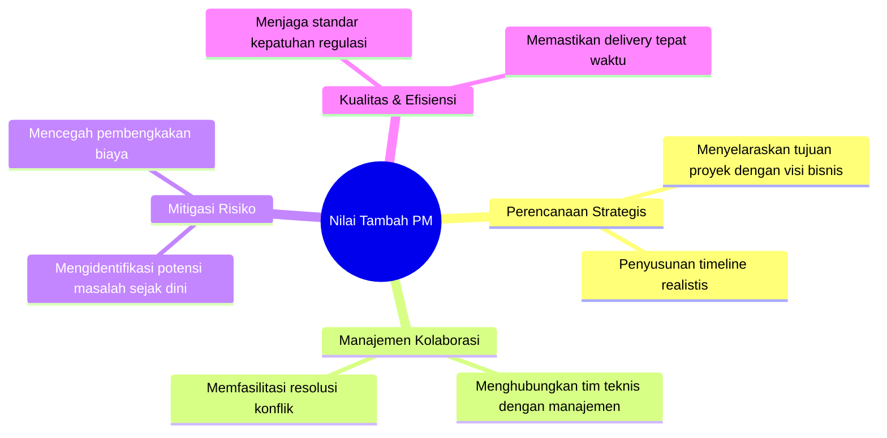
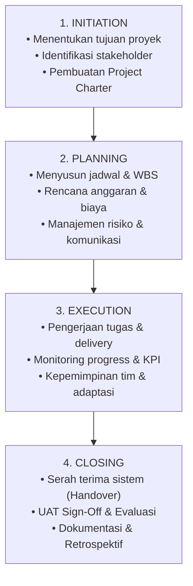

# Modul 01: Intro to Project Management
## Google Project Management Professional Certificate — Foundations of PM

> **Sumber Video**: [Intro to Project Management | Google Project Management Certificate](https://www.youtube.com/watch?v=rck3MnC7OXA&list=PLcUrHMJVaGzA&index=1)  
> **Kategori**: Course 1 — Foundations of Project Management (Module 1)  
> **Disusun oleh**: Dessy Rahmawati Chairullina, S.Kom  

---

## 📌 Executive Summary
1. **Definisi Inti**: Manajemen Proyek (*Project Management*) adalah penerapan pengetahuan (*knowledge*), keterampilan (*skills*), alat (*tools*), dan teknik pada aktivitas proyek untuk memenuhi kebutuhan serta ekspektasi pemangku kepentingan (*stakeholders*).
2. **Proyek vs Operasional**: Proyek bersifat **sementara** (*temporary*) dan menghasilkan produk/layanan yang **unik** (*unique outcome*), berbeda dengan operasional harian yang bersifat repetitif dan berkelanjutan (*ongoing*).
3. **Peran Kunci Project Manager (PM)**: PM bertindak sebagai konduktor orkestra—merencanakan, mengorganisir alur kerja, mengontrol anggaran/waktu, mengeliminasi hambatan (*impediments*), dan memfasilitasi komunikasi lintas disiplin.
4. **4 Fase Siklus Hidup Proyek**: *Initiate* ➔ *Plan* ➔ *Execute* ➔ *Close*.
5. **Keseimbangan Triple Constraint**: PM bertanggung jawab menjaga keseimbangan antara **Ruang Lingkup (Scope)**, **Waktu (Time)**, dan **Biaya (Cost)** demi mencapai **Kualitas (Quality)** yang ditargetkan.

---

## 1. Konsep Dasar: Apa Itu Proyek?

### A. Perbedaan Proyek vs Operasional Bisnis
Dalam organisasi enterprise, sering terjadi kerancuan antara kegiatan proyek dan rutinitas harian:

| Parameter | Proyek (*Project*) | Operasional (*Operations*) |
| :--- | :--- | :--- |
| **Sifat Waktu** | Memiliki awal dan akhir yang jelas (*temporary*). | Berlangsung terus-menerus tanpa batas waktu akhir (*ongoing*). |
| **Output / Hasil** | Menghasilkan produk, sistem, atau hasil yang unik. | Menjaga stabilitas produk/layanan yang sudah ada. |
| **Tujuan Utama** | Menciptakan perubahan, inovasi, atau solusi baru. | Menjalankan bisnis harian (*business-as-usual*). |
| **Contoh Riil** | Mengembangkan modul otomasi klaim BPJS baru. | Memproses berkas penagihan klaim harian di loket kasir. |

---

## 2. Peran & Nilai Tambah Project Manager (*The Value of a PM*)

Seorang Project Manager bukan sekadar pencatat jadwal atau pembuat dokumen, melainkan figur strategis yang memastikan investasi organisasi menghasilkan *Return on Investment* (ROI) yang nyata.



### Tanggung Jawab Harian Seorang PM:
1. **Planning & Organizing**: Menyusun rencana terstruktur, membagi tugas (*task breakdown*), dan mengestimasi kebutuhan sumber daya.
2. **Budgeting & Cost Control**: Mengawal alokasi dana agar tidak terjadi *cost overrun*.
3. **Managing Tasks & Timelines**: Memantau progress secara berkala dan mengambil tindakan korektif jika terjadi *delay*.
4. **Facilitating Communication**: Memastikan pesan dari manajemen dipahami oleh tim teknis, dan kendala teknis dapat dipahami oleh pihak pengambil keputusan.
5. **Removing Roadblocks**: Menghilangkan hambatan yang dihadapi tim agar produktivitas tetap optimal.

---

## 3. Siklus Hidup Proyek (*The 4 Project Phases*)

Menurut Google Project Management Framework, siklus hidup proyek terbagi ke dalam 4 tahapan berurutan:



### Rincian Setiap Fase:
1. **Fase 1: Inisiasi (*Initiate*)**
   * *Output Utama*: **Project Charter**, identifikasi *Key Stakeholders*, dan penentuan metrik keberhasilan (*Success Metrics*).
   * *Pertanyaan Kunci*: "Masalah apa yang ingin kita selesaikan? Apakah proyek ini layak secara bisnis?"
2. **Fase 2: Perencanaan (*Plan*)**
   * *Output Utama*: *Work Breakdown Structure* (WBS), *Project Schedule* (Gantt Chart), *Budget Plan*, *Risk Register*, dan *Communication Plan*.
   * *Pertanyaan Kunci*: "Bagaimana langkah detail kita mencapai tujuan tersebut? Siapa mengerjakan apa dan kapan?"
3. **Fase 3: Eksekusi (*Execute*)**
   * *Output Utama*: Deliverables perangkat lunak/sistem, laporan status mingguan, *Daily Standup*, dan manajemen perubahan (*Change Requests*).
   * *Pertanyaan Kunci*: "Apakah eksekusi berjalan sesuai rencana? Apa hambatan yang perlu diatasi hari ini?"
4. **Fase 4: Penutupan (*Close*)**
   * *Output Utama*: Penandatanganan serah terima (*UAT Sign-off*), laporan penutupan, sesi retrospektif (*Lessons Learned*), dan pelepasan sumber daya.
   * *Pertanyaan Kunci*: "Apakah seluruh target tercapai? Apa pelajaran penting untuk proyek selanjutnya?"

---

## 4. Pengenalan Metodologi Manajemen Proyek

Google PM mengenalkan beberapa pendekatan manajemen proyek utama:

```
┌────────────────────────────────────────────────────────────────────────┐
│                        PENDEKATAN PROYEK                               │
├───────────────────────────────────┬────────────────────────────────────┤
│     TRADITIONAL / WATERFALL       │          AGILE / SCRUM             │
├───────────────────────────────────┼────────────────────────────────────┤
│ • Alur sekuensial (tahap demi     │ • Alur iteratif & bertahap         │
│   tahap harus selesai berurutan). │   (siklus Sprint 1-4 minggu).      │
│ • Ruang lingkup (Scope) fixed di  │ • Ruang lingkup adaptif terhadap   │
│   awal proyek.                    │   feedback pengguna.               │
│ • Cocok untuk proyek dengan       │ • Cocok untuk pengembangan software│
│   regulasi kaku dan kepastian     │   yang dinamis dan membutuhkan     │
│   kebutuhan tinggi.               │   inovasi cepat.                   │
└───────────────────────────────────┴────────────────────────────────────┘
```

* **Lean**: Fokus pada eliminasi pemborosan (*waste reduction*) dan peningkatan nilai bagi pengguna.
* **Six Sigma**: Fokus pada pengurangan variabilitas dan pencegahan cacat (*defect prevention*) berbasis data dan statistik.

---

## 5. Skillset Esensial Project Manager

| Kategori | Keterampilan Utama | Penerapan Nyata |
| :--- | :--- | :--- |
| **Hard Skills** | • WBS & Schedule Tracking<br>• Budgeting & Financial Modeling<br>• Risk Mapping & Mitigation<br>• Tools: Jira, Trello, Asana, Sheets/Excel | Menyusun alur sprint, memetakan matriks probabilitas risiko, dan memantau realisasi anggaran proyek. |
| **Soft Skills** | • Komunikasi Lintas Divisi<br>• Kepemimpinan & Negosiasi<br>• Empati & Resolusi Konflik<br>• *Change Management* | Mengatasi resistensi perawat/dokter terhadap sistem baru, memaparkan status proyek kepada Direksi. |

---

## 6. 💼 Studi Kasus Riil: Penerapan Teori Google PM

### Latar Belakang Kasus:
* **Nama Proyek**: Implementasi Otomasi Jasa Medis & Rekonsiliasi Billing BPJS
* **Organisasi**: Rumah Sakit Swasta Tipe C
* **Tantangan Bisnis**: Sering terjadi selisih pencatatan keuangan klaim BPJS akibat proses rekonsiliasi manual dan pemotongan dokter bedah yang rumit, menyebabkan keterlambatan penagihan piutang hingga berminggu-minggu.

### Penerapan Siklus 4 Fase Google PM:

#### 1. Inisiasi (*Initiation*)
* **Problem Statement**: Penundaan rekonsiliasi klaim BPJS rata-rata 14 hari kerja per bulan dengan potensi selisih hitung mencapai jutaan rupiah.
* **Business Goal**: Membangun modul otomasi aturan perhitungan jasa medis dinamis yang terhubung langsung dengan SIMRS dan billing pasien.
* **Project Charter & Stakeholders**:
  * *Project Sponsor*: Direktur Keuangan.
  * *Primary Users*: Kasir, Akuntan, Verifikator Klaim BPJS, Komite Medis/Dokter.
  * *Project Lead*: Business System Analyst & Project Manager.

#### 2. Perencanaan (*Planning*)
* **Scope Definition**: Batasan ruang lingkup difokuskan pada 39 aturan klaim BPJS (rawat jalan, rawat inap, status klaim, dan COB).
* **WBS & Milestones**:
  * *Milestone 1*: Finalisasi matriks 39 aturan bisnis kalkulasi.
  * *Milestone 2*: Pengembangan backend kalkulator dinamis & UI Webview.
  * *Milestone 3*: Sesi pengujian UAT bersama tim keuangan.
* **Risk Register**:
  * *Risiko*: Dokter menolak formula baru pembagian jasa medis.
  * *Rencana Mitigasi*: Melibatkan perwakilan komite medis pada perumusan formula di awal fase perencanaan (*Stakeholder Buy-In*).

#### 3. Eksekusi (*Execution*)
* Menerapkan siklus *Agile Sprints* mingguan untuk mereview prototipe modul antarmuka web.
* Menjalankan *Daily Standup* singkat untuk memastikan developer tidak terhalang masalah struktur database.
* Memfasilitasi sesi UAT terstruktur dengan skenario data pasien riil.

#### 4. Penutupan (*Closing*)
* **UAT Sign-off**: Penandatanganan berita acara persetujuan modul oleh Kepala Bagian Keuangan dan Kasir.
* **Handover & Training**: Pelatihan intensif kepada staf kasir dan akuntan disertai buku petunjuk operasional.
* **Hasil Terukur (*Impact Metrics*)**:
  * Waktu rekonsiliasi klaim turun dari 14 hari kerja menjadi **1 hari kerja (real-time)**.
  * **0 selisih hitung** antara klaim INA-CBG dan jasa medis sharing dokter.

---

## 7. 🛠️ Actionable PM Checklist (Panduan Cepat Inisiasi Proyek)

Gunakan checklist ini setiap kali Anda memulai proyek baru:

- [ ] **Problem Verification**: Apakah masalah bisnis sudah didefinisikan secara spesifik dan terukur (bukan sekadar asumsi)?
- [ ] **Stakeholder Identification**: Sudahkah memetakan siapa *Sponsor*, siapa *End-User*, dan siapa yang terdampak oleh perubahan?
- [ ] **Success Metrics Definition**: Apa tolok ukur proyek ini dinyatakan berhasil (misal: penghematan waktu, nol selisih, atau sertifikasi)?
- [ ] **Constraint Check**: Berapa batas maksimal anggaran (Cost) dan tanggal absolut penyelesaian (Deadline)?
- [ ] **Methodology Selection**: Apakah proyek ini lebih cocok dikerjakan dengan Waterfall murni, Agile/Scrum, atau Hybrid?

---
*Dokumentasi Modul 01 Selesai • Lanjut ke Modul 02: Project Management Methodologies & Approaches*
