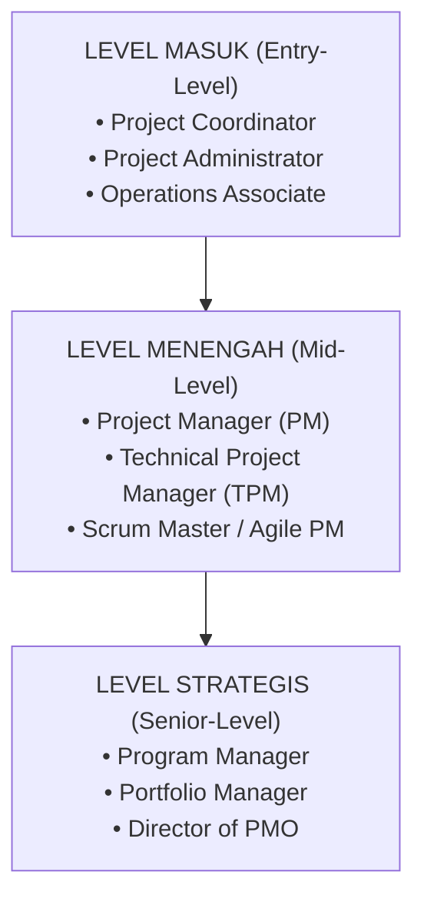
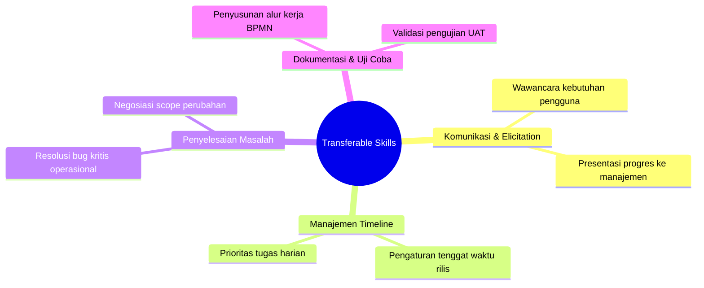

# Modul 02: Finding Project Manager Jobs
## Google Project Management Professional Certificate — Foundations of PM

> **Sumber Video**: [Finding Project Manager Jobs | Google Project Management Certificate](https://www.youtube.com/watch?v=y7LDaaFeNn4&list=PLcUrHMJVaGzA&index=2)  
> **Kategori**: Course 1 — Foundations of Project Management (Module 2)  
> **Disusun oleh**: Dessy Rahmawati Chairullina, S.Kom  

---

## 📌 Executive Summary
1. **Lanskap Permintaan Global**: Permintaan profesional manajemen proyek terus meningkat di berbagai sektor industri (Teknologi Informasi, Healthcare, Finansial, Konstruksi, dan Ritel).
2. **Spektrum Jenjang Karier**: Peran PM tidak terbatas pada titel *"Project Manager"*, melainkan mencakup *Project Coordinator*, *Operations Associate*, *Technical Project Manager (TPM)*, *Scrum Master*, hingga *Program Manager*.
3. **Kekuatan Keterampilan Alih Daya (*Transferable Skills*)**: Pengalaman masa lalu di bidang analisis sistem, pemrograman, operasional, maupun koordinasi tim dapat diposisikan sebagai bukti kompetensi kepemimpinan proyek.
4. **Formula Resumee Google XYZ**: Mengemas pencapaian karier menggunakan formula standar emas Google: *"Accomplished [X], as measured by [Y], by doing [Z]"*.
5. **Portofolio Nyata sebagai Diferensiasi Utama**: Bukti nyata berupa dokumentasi charter, WBS, matriks aturan bisnis, dan dokumen UAT jauh lebih meyakinkan rekruter dibandingkan sekadar klaim sertifikat.

---

## 1. Lanskap Industri & Spektrum Peran Project Manager

Manajemen proyek dibutuhkan di hampir seluruh sektor ekonomi modern. Memahami variasi titel dan tanggung jawab membantu pencari kerja menyasar lowongan yang paling sesuai dengan latar belakangnya.

### Pemetaan Variasi Jabatan PM:
| Judul Pekerjaan | Fokus Tanggung Jawab Utama | Sifat Kompetensi |
| :--- | :--- | :--- |
| **Project Coordinator** | Menjadwalkan rapat, mencatat notulensi teknis, memantau *action items*, dan mendukung PM utama. | Organisasi & Komunikasi |
| **Project Manager (PM)** | Mengelola *scope*, *timeline*, *budget*, alokasi sumber daya, dan mitigasi risiko proyek secara menyeluruh. | Manajemen Proyek End-to-End |
| **Technical PM (TPM)** | Memimpin proyek rekayasa perangkat lunak kompleks yang membutuhkan pemahaman mendalam tentang arsitektur kode dan database. | Hibrida Teknis & Manajemen |
| **Scrum Master / Agile PM** | Memfasilitasi upacara Scrum (*Sprint Planning*, *Daily Standup*, *Retrospective*) dan menghapus *blocker* tim pengembang. | Servant Leadership & Agile |
| **Program Manager** | Mengoordinasikan sekelompok proyek yang saling terkait (*program*) demi mencapai tujuan strategis organisasi. | Tata Kelola Strategis Multitask |

---

## 2. Mengidentifikasi & Memanfaatkan *Transferable Skills*

Banyak profesional telah menjalankan fungsi-fungsi manajemen proyek tanpa menyadari bahwa itu adalah bagian dari kompetensi PM.

### Mengonversi Pengalaman Menjadi Bahasa PM:
* **Pengalaman**: *"Saya membuat modul rekam medis di rumah sakit."*  
  ➔ **Framing PM**: *"Memimpin inisiasi dan implementasi modul rekam medis digital, mengoordinasikan kebutuhan 300+ pengguna akhir, dan memastikan kepatuhan dokumen regulasi akreditasi STARKES."*
* **Pengalaman**: *"Saya memperbaiki formula hitung jasa medis dokter yang sering salah."*  
  ➔ **Framing PM**: *"Menganalisis inefisiensi rekonsiliasi finansial, merumuskan 39 aturan bisnis kalkulasi dinamis, serta mengawal pengujian UAT hingga mencapai 0 selisih hitung."*

---

## 3. Formula Google XYZ untuk Resume & Profil LinkedIn

Google merekomendasikan formula standar untuk menuliskan setiap pencapaian dalam portofolio dan resume:

$$\text{"Berhasil mencapai [X], yang terukur sebesar [Y], dengan melakukan [Z]"}$$

### Contoh Aplikasi Formula:
1. **Contoh Bidang Healthcare IT**:
   > *"Mendorong efisiensi operasional rumah sakit hingga **90% paperless [X]**, dengan memangkas waktu tunggu layanan pasien sebesar **35% [Y]**, melalui **analisis kebutuhan alur kerja dan implementasi SIMRS terintegrasi [Z]**."*
2. **Contoh Bidang Finansial & Klaim**:
   > *"Mengeliminasi risiko selisih perhitungan klaim BPJS **[X]**, mencapai **nol temuan audit rekonsiliasi [Y]**, dengan cara **merumuskan matriks 39 aturan kalkulasi dinamis dan memfasilitasi UAT lintas divisi [Z]**."*
3. **Contoh Bidang Regulasi Eksternal**:
   > *"Mencapai kepatuhan integrasi data nasional **[X]**, dibuktikan dengan **Penghargaan Bintang 5 Direktur TI BPJS [Y]**, melalui **pemetaan gap analysis struktur data dan standardisasi payload JSON SATUSEHAT [Z]**."*

---

## 4. 💼 Studi Kasus Riil: Strategi Transisi Karier ke Project Management

### Profil Kandidat:
* **Latar Belakang**: Lulusan Sarjana Komputer dengan pengalaman 3 tahun sebagai *Business System Analyst / IT R&D* di rumah sakit swasta.
* **Tujuan Karier**: Melamar posisi **IT Project Manager / Technical Project Manager**.
* **Tantangan**: Judul jabatan sebelumnya bukan *"Project Manager"*, sehingga dikhawatirkan tidak lolos penyaringan awal ATS (*Applicant Tracking System*).

### Strategi Eksekusi Reposisi Karier:

#### 1. Audit Rekam Jejak Proyek
Kandidat menginventarisasi proyek-proyek yang pernah dipimpin secara mandiri:
* Proyek 1: Otomasi Jasa Medis & Billing (`ERP_DERA`).
* Proyek 2: EMR Asuhan Keperawatan Standar 3S (SDKI/SLKI/SIKI).
* Proyek 3: Integrasi SATUSEHAT FHIR & BPJS Smart Claim.
* Proyek 4: Platform Telekonsultasi Mandiri (`dokterpanda.com`).

#### 2. Penataan Dokumen Portofolio Publik (GitHub)
* Membuat repositori publik yang memamerkan dokumen artefak manajemen proyek: *Project Charter*, diagram alur alur proses *BPMN 2.0*, skenario pengujian *UAT Plan*, dan matriks risiko.
* Rekruter dapat melihat langsung bahwa kandidat terbiasa membuat deliverable formal standar industri.

#### 3. Hasil & Dampak:
* Profil kandidat dipandang sebagai **Technical PM yang langka** karena menguasai teknis sistem informasi sekaligus mahir mengelola manusia, biaya, dan regulasi.
* Lolos ke tahap wawancara manajerial dengan tingkat kepercayaan diri tinggi karena memiliki bukti portofolio konkret.

---

## 5. 🛠️ Actionable Job Search Checklist untuk Calon PM

Gunakan checklist ini untuk mengaudit kesiapan profil Anda:

- [ ] **Resume Framing**: Apakah setiap poin pengalaman kerja sudah menggunakan Formula Google XYZ (Action + Metric + Method)?
- [ ] **Transferable Skills Mapping**: Sudahkah mengubah kata-kata teknis koding menjadi istilah kepemimpinan proyek (*Stakeholder Management*, *Scope Definition*, *Risk Mitigation*)?
- [ ] **Public Portfolio Ready**: Apakah repositori GitHub Anda sudah menyajikan studi kasus proyek terstruktur dan dokumen artefak (BRD, WBS, UAT)?
- [ ] **Keyword Optimization**: Pastikan profil LinkedIn memuat kata kunci: *Agile, Scrum, Waterfall, SDLC, UAT, Stakeholder Engagement, Budget Tracking, Cross-Functional Leadership*.

---
*Dokumentasi Modul 02 Selesai • Lanjut ke Modul 03: How Company Culture Affects Project Management*
