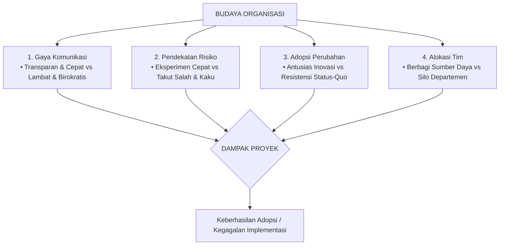
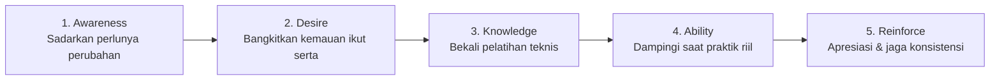

# Modul 03: How Company Culture Affects Project Management
## Google Project Management Professional Certificate — Foundations of PM

> **Sumber Video**: [How Company Culture Affects Project Management | Google Project Management Certificate](https://www.youtube.com/watch?v=f0VcIWJNDAI&list=PLcUrHMJVaGzA&index=3)  
> **Kategori**: Course 1 — Foundations of Project Management (Module 3)  
> **Disusun oleh**: Dessy Rahmawati Chairullina, S.Kom  

---

## 📌 Executive Summary
1. **Ekosistem Proyek**: Proyek tidak pernah berjalan di ruang hampa (*vacuum*). Budaya organisasi—yaitu nilai, norma, ekspektasi, dan aturan tak tertulis—adalah lingkungan yang menentukan apakah suatu proyek akan berhasil diadopsi atau ditolak mentah-mentah.
2. **4 Dimensi Budaya Penentu Proyek**:
   * *Gaya Komunikasi & Transparansi* (Terbuka vs Hierarkis/Birokratis).
   * *Toleransi Risiko & Inovasi* (Eksperimentatif vs Takut Berbuat Salah).
   * *Kesiapan terhadap Perubahan* (Dukungan Inovasi vs Resistensi *"Kami selalu begini dari dulu"*).
   * *Alokasi Sumber Daya* (Kolaborasi Lintas Divisi vs Silo Tertutup / *Turf Wars*).
3. **Struktur Organisasi**: Tingkat wewenang seorang PM sangat dipengaruhi oleh bentuk struktur perusahaan (*Functional*, *Matrix*, atau *Projectized*).
4. **Change Management sebagai Kunci Adopsi**: Keberhasilan teknis perangkat lunak tidak bernilai jika pengguna akhir menolak menggunakannya. Manajemen perubahan adalah jembatan budaya yang mengubah penolakan menjadi kepemilikan bersama (*ownership*).

---

## 1. Memahami Budaya Organisasi (*Organizational Culture*)

Budaya perusahaan adalah kepribadian bersama dari suatu organisasi. Hal ini mencakup:
* **Nilai Bersama (*Shared Values*)**: Hal apa yang paling dihargai oleh pimpinan dan staf (misal: keselamatan pasien, kecepatan pelayanan, atau kepatuhan regulasi ketat).
* **Aturan Tak Tertulis (*Unspoken Rules*)**: Norma sosial tentang cara menyampaikan kritik, cara mengambil keputusan, dan bagaimana pimpinan didekati.
* **Toleransi terhadap Kesalahan**: Apakah kegagalan eksperimen dipandang sebagai kesempatan belajar, atau sebagai ancaman pemecatan/sanksi.

---

## 2. Bagaimana Budaya Mempengaruhi Keberhasilan Proyek



### Analisis 4 Aspek Kunci Budaya:

| Dimensi Budaya | Budaya Terbuka / Adaptif | Budaya Hierarkis / Kaku | Implikasi Strategi bagi PM |
| :--- | :--- | :--- | :--- |
| **Komunikasi** | Informasi mengalir bebas lintas jenjang. *Blocker* diangkat tanpa rasa takut. | Harus melalui protokol surat resmi dan berjenjang. Jalur eskalasi lambat. | Di budaya kaku, PM wajib mengamankan dukungan resmi tertulis dari sponsor eksekutif (*top-down buy-in*). |
| **Resiko & Inovasi** | Terbiasa dengan metodologi Agile, *fail-fast*, dan iterasi berkala. | Menolak ketidakpastian. Menuntut seluruh rencana selesai dan pasti di awal. | Di budaya kaku, gunakan pendekatan Waterfall dengan dokumentasi spesifikasi yang sangat rinci (*low uncertainty*). |
| **Sikap Perubahan** | Pengguna antusias menyambut sistem baru untuk efisiensi kerja. | Pengguna menganggap sistem baru sebagai beban tambahan yang memperlambat. | Wajib menyusun strategi *Change Management* intensif, sosialisasi bertahap, dan pelatihan personal. |
| **Kolaborasi Tim** | Departemen rela berbagi talenta dan waktu staf demi keberhasilan proyek. | Antar divisi saling mempertahankan KPI dan enggan meminjamkan staf (*silo*). | PM harus menegosiasikan alokasi waktu staf bersama kepala divisi secara transparan melalui RACI Matrix. |

---

## 3. Struktur Organisasi & Derajat Otoritas PM

Tingkat kekuasaan dan fleksibilitas seorang Project Manager sangat ditentukan oleh struktur organisasi tempat proyek berjalan:

```
┌────────────────────────────────────────────────────────────────────────┐
│                   SPEKTRUM STRUKTUR ORGANISASI                         │
├──────────────────────┬──────────────────────────┬──────────────────────┤
│  FUNCTIONAL/KLASIK   │          MATRIX          │      PROJECTIZED     │
├──────────────────────┼──────────────────────────┼──────────────────────┤
│ • Kekuasaan ada pada │ • Wewenang dibagi antara │ • PM memiliki        │
│   Kepala Divisi.     │   Kepala Divisi dan PM.  │   otoritas penuh.    │
│ • PM hanya bertindak │ • Anggota tim melapor ke │ • Tim didedikasikan  │
│   sebagai koordinator│   dua pimpinan (dual     │   khusus untuk satu  │
│   atau fasilitator.  │   reporting).            │   proyek penuh.      │
│ • Anggaran dikuasai  │ • Anggaran dikelola      │ • Anggaran dikontrol │
│   manajer fungsional.│   secara negosiasi.      │   langsung oleh PM.  │
└──────────────────────┴──────────────────────────┴──────────────────────┘
```

> **Insight Google PM**: Sebagian besar perusahaan modern dan institusi kesehatan berbentuk **Matrix Organization**. Di sinilah keahlian negosiasi, persuasi, dan diplomasi interpersonal (*soft skills*) seorang PM diuji secara nyata.

---

## 4. Change Management: Menyelaraskan Sistem dengan Budaya

Banyak proyek IT gagal bukan karena kodenya bermasalah, melainkan karena pengguna menolak mengubah kebiasaan lama mereka.



### Praktik Terbaik Change Management bagi PM:
1. **Identifikasi *"Project Champions"***: Temukan staf kunci (misal: perawat senior atau staf kasir teladan) yang dihormati rekan-rekannya untuk dijadikan duta adopsi sistem baru.
2. **Komunikasi Manfaat (*What's In It For Me?*)**: Jangan hanya memaparkan keuntungan bagi manajemen, tetapi tunjukkan bagaimana sistem baru mengurangi jam lembur staf dan mempermudah pekerjaan mereka.
3. **Mendengarkan Keluhan Secara Aktif (*Feedback Loop*)**: Ciptakan kanal terbuka bagi pengguna untuk menyampaikan kendala antarmuka atau alur kerja yang dirasa janggal.

---

## 5. 💼 Studi Kasus Riil: Mengatasi Resistensi Budaya pada Transformasi EMR 90% Paperless

### Latar Belakang Masalah:
* **Organisasi**: Rumah Sakit Swasta Tipe C dengan 300+ Tenaga Kesehatan.
* **Inisiatif Proyek**: Implementasi modul rekam medis digital (EMR) dan asuhan keperawatan terstandar untuk menghapus rekam medis kertas (*paperless*).
* **Benturan Budaya**:
  * Dokter spesialis dan perawat senior menolak mengetik di komputer: *"Menulis di berkas kertas jauh lebih cepat! Komputer ini membuat pasien menunggu terlalu lama."*
  * Sebagian staf merasa sistem baru ini adalah alat pengawasan yang mengekang kebebasan kerja mereka.

### Pendekatan Solusi Manajemen Budaya oleh PM:

#### 1. Mendiagnosis Akar Budaya (*Cultural Assessment*)
PM menyadari bahwa staf bukan membenci teknologi, melainkan takut kehilangan tempo pelayanan cepat di poliklinik dan bangsal rawat inap.

#### 2. Strategi *"Co-Design"* Bukan *"Top-Down Dictation"*
* Mengundang perwakilan perawat bangsal dan dokter untuk duduk bersama mereview prototipe form EMR.
* **Optimasi Desain UX**: Tombol dan alur formulir disederhanakan (misal: fitur simpan multi-baris batch tanpa mewajibkan pengguna menekan tombol Enter berulang kali).
* Masukan staf langsung diakomodasi ke dalam iterasi pengembangan, memunculkan rasa kepemilikan bersama (*shared ownership*).

#### 3. Penunjukan Duta Perubahan (*Nurse Champions*)
* Memilih 5 perawat yang melek teknologi untuk dilatih menjadi instruktur pendamping di setiap unit.
* Saat peluncuran resmi, pendampingan dilakukan langsung di samping meja perawat selama 2 minggu penuh tanpa menghakimi kesalahan input.

#### 4. Penerbitan Buku Panduan SOP yang Manusiawi
* Menyusun buku panduan bergambar yang ringkas dan mudah dipahami tenaga non-IT (*Buku Panduan Pengisian Master Diagnosa Keperawatan*).

### Hasil Terukur (*Business & Cultural Impact*):
* **Tingkat Adopsi 100%**: Dalam 3 bulan, seluruh unit rawat jalan dan inap berhasil beralih penuh ke rekam medis digital tanpa ada penolakan operasional.
* **Efisiensi 90% Paperless Tercapai**: Pengurangan drastis biaya kertas dan ruang arsip berkas fisik.
* **Kelulusan Akreditasi STARKES**: Dokumen rekam medis dinyatakan rapi, lengkap, dan memenuhi standar audit akreditasi nasional.

---

## 6. 🛠️ Actionable Cultural Diagnostic Checklist untuk PM

Sebelum memulai proyek baru di lingkungan organisasi mana pun, jawab 5 pertanyaan diagnostik ini:

- [ ] **Authority Check**: Berapa besar wewenang formal saya sebagai PM di struktur organisasi ini (Functional, Matrix, atau Projectized)?
- [ ] **Decision Flow**: Bagaimana keputusan penting biasanya disahkan di sini (Apakah diskusi konsensus informal, atau harus persetujuan birokrasi formal tertulis)?
- [ ] **Risk Appetite**: Bagaimana sikap pimpinan terhadap kegagalan teknis awal (Apakah siap memberi toleransi iterasi perbaikan, atau menghukum kesalahan)?
- [ ] **User Pain Points**: Mengapa pengguna mungkin menolak sistem ini? Beban kerja apa yang mereka khawatirkan bertambah?
- [ ] **Change Champion Identified**: Siapa 2–3 tokoh kunci informal di tingkat staf yang pendapatnya paling didengar oleh rekan-rekannya?

---
*Dokumentasi Modul 03 Selesai • Lanjut ke Modul 04: Project Management Methodologies (Agile vs Waterfall)*
