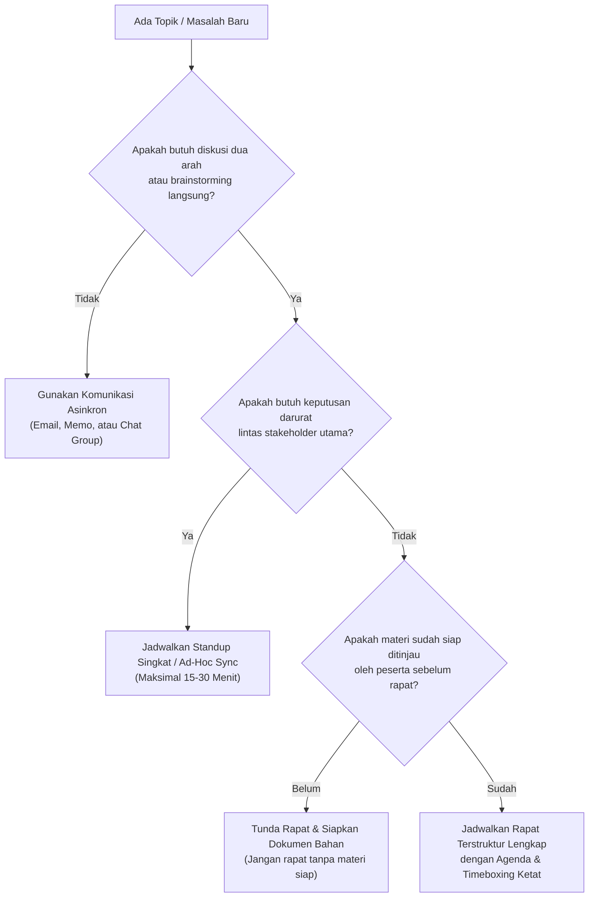

# Modul 04: Running Effective Meetings
## Google Project Management Professional Certificate

> **Sumber Materi**: [How to Run a Successful Meeting | Google Project Management Certificate](https://www.youtube.com/watch?v=_mxovBWI9m0)  
> **Kategori**: Course 1 — Foundations of Project Management (Module 4)  
> **Disusun oleh**: Dessy Rahmawati Chairullina, S.Kom  

---

## 📌 Executive Summary
1. **Biaya Rapat yang Buruk**: Rapat yang tidak terstruktur menguras jam kerja tim, memicu kelelahan kognitif (*meeting fatigue*), dan menurunkan produktivitas proyek secara dramatis.
2. **Filter Pengambilan Keputusan Rapat**: PM wajib menentukan apakah sebuah topik benar-benar membutuhkan rapat sinkron (*synchronous meeting*) atau cukup diselesaikan secara asinkron (email, pesan instan, dokumen kolaboratif).
3. **Kerangka 3 Fase Rapat Efektif**:
   * *Pra-Rapat*: Penetapan tujuan terukur, penyusunan agenda 5W1H, dan pembagian materi minimal 24 jam sebelumnya.
   * *Saat Rapat*: Manajemen waktu disiplin (*timeboxing*), penggunaan teknik *Parking Lot* untuk menampung diskusi di luar topik, dan pencatatan keputusan terbuka.
   * *Pasca-Rapat*: Distribusi ringkasan *Action Items* (Siapa, Mengerjakan Apa, Tenggat Kapan) dalam kurun waktu kurang dari 2 jam setelah rapat selesai.
4. **Kejelasan Peran Rapat**: Setiap rapat harus memiliki *Facilitator*, *Timekeeper*, dan *Note-Taker/Scribe* yang terdefinisi dengan jelas.

---

## 1. Filter: Apakah Masalah Ini Benar-Benar Membutuhkan Rapat?

Salah satu keterampilan paling kritis seorang Manajer Proyek adalah melindungi waktu tim inti dari "rapat yang sebenarnya bisa berupa email".

---

## 2. Kerangka Kerja 3 Fase Rapat (Pre, During, Post)

### Fase 1: Persiapan Matang (*Pre-Meeting*)
* **Definisikan Hasil Akhir (*Target Output*)**: Rapat tidak dimulai untuk "berbincang", melainkan untuk menghasilkan keputusan, daftar aksi, atau kesepakatan desain.
* **Pilih Peserta yang Tepat**: Batasi hanya pada pihak yang memiliki wewenang memutuskan (*decision maker*), pelaksana teknis utama (*core contributor*), atau pihak yang terdampak langsung. Gunakan aturan *two-pizza rule* (idealnya 4–8 orang).
* **Agenda 5W1H & Distribusi Dokumen**: Kirimkan agenda dan tautan dokumen kerja H-1 agar peserta datang dalam kondisi siap (*informed & prepared*), bukan baru membaca di ruangan.

### Fase 2: Pelaksanaan Terarah (*During Meeting*)
* **Tetapkan Ground Rules**:
  * Mulai dan akhiri tepat waktu tanpa menunggu yang terlambat.
  * Satu orang berbicara pada satu waktu.
  * Dilarang melakukan *multitasking* (fokus pada layar atau forum rapat).
* **Teknik *Parking Lot* (Tempat Parkir Gagasan)**:
  Jika muncul perdebatan menarik namun melenceng dari fokus agenda utama, catat topik tersebut di kolom *Parking Lot* untuk dijadwalkan dalam forum terpisah. Ini menjaga rapat tetap berada di jalurnya.
* **Tutup dengan Konfirmasi Tindakan**: 5 menit sebelum rapat berakhir, hentikan diskusi dan bacakan ulang kesepakatan yang tercapai.

### Fase 3: Tindak Lanjut (*Post-Meeting*)
* **Distribusi MoM (*Minutes of Meeting*) Kilat**: Jangan menunda pengiriman notula berhari-hari. Kirimkan ringkasan keputusan maksimal 2 jam setelah rapat selesai.
* **Format Tabel Aksi (DRI - *Directly Responsible Individual*)**:
  Format notula terbaik harus memuat matriks pertanggungjawaban konkret:
  | ID | Deskripsi Tindakan | Penanggung Jawab (DRI) | Target Waktu (Deadline) | Status |
  | :--- | :--- | :--- | :--- | :--- |
  | ACT-01 | Pembaruan mapping JSON endpoint bridging | Dera (Lead Dev) | 18 Nov, 14:00 WIB | In Progress |
  | ACT-02 | Penandatanganan BA UAT Modul Keuangan | dr. Budi (Wadir Medis) | 19 Nov, 10:00 WIB | Pending |

---

## 3. Jenis-Jenis Rapat Baku dalam Siklus Proyek

| Tipe Rapat | Frekuensi & Durasi | Tujuan Utama | Peserta Wajib |
| :--- | :--- | :--- | :--- |
| **Project Kick-Off** | Sekali di awal (60–90 mnt) | Menyamakan visi, ruang lingkup (*scope*), dan aturan main bersama. | Sponsor, PM, Core Team, Stakeholder Kunci. |
| **Daily Standup / Daily Scrum** | Harian (10–15 mnt) | Identifikasi hambatan (*blockers*) dan sinkronisasi target harian. | Seluruh Tim Pengembang / Pelaksana. |
| **Sprint Planning** | Awal iterasi (1–2 jam) | Memilih pekerjaan dari backlog dan memecahnya ke tugas teknis. | Product Owner, PM / Scrum Master, Tim Dev. |
| **Status / Steering Committee** | Mingguan / 2 Mingguan | Melaporkan progres anggaran, milestone, dan eskalasi risiko tinggi. | PM, Project Sponsor, Head of Departments. |
| **Sprint Review / Demo** | Akhir iterasi (30–60 mnt) | Mendemonstrasikan fitur produk nyata yang sudah selesai kepada pengguna. | Tim Dev, PM, End-User Representatives. |
| **Retrospective / Post-Mortem** | Akhir fase / sprint (45 mnt) | Evaluasi proses: Apa yang berjalan baik, apa yang kurang, dan rencana perbaikan. | Tim Inti Proyek (lingkup internal tertutup). |

---

## 4. Studi Kasus Nyata: Manajemen Rapat Koordinasi Krisis Bridging SIMRS

* **Konteks Proyek**: Proyek integrasi modul bridging SATUSEHAT dan BPJS mengalami keterlambatan 4 hari menjelang tenggat verifikasi akreditasi rumah sakit. Terjadi saling lempar tanggung jawab antara tim pengembang IT internal, tim rekam medis, dan vendor bridging eksternal.
* **Tindakan PM**:
  1. *Menolak Rapat Terbuka Tanpa Agenda*: PM membatalkan permintaan rapat darurat 20 orang yang diajukan secara mendadak.
  2. *Memangkas Peserta ke Inti Masalah*: PM hanya mengundang 4 orang kunci: Lead Programmer internal, Technical Lead Vendor, Kepala Instalasi Rekam Medis, dan PM sendiri sebagai fasilitator.
  3. *Agenda Berbasis Solusi 30 Menit*:
     * 00–05: Pembacaan fakta log galat HTTP 400 Bad Request payload JSON.
     * 05–20: Penentuan standarisasi format tanggal ISO-8601 UTC+07:00 dan pemetaan field mandatory `issued`.
     * 20–25: Penetapan jadwal uji tembak staging bersama sore itu juga.
     * 25–30: Pembacaan dan persetujuan action items.
* **Hasil & Metrik**:
  * Rapat selesai tepat dalam 28 menit tanpa debat kusir.
  * Galat konfigurasi payload terselesaikan dalam 3 jam pasca-rapat.
  * Uji integrasi SATUSEHAT lolos 100% pada hari yang sama.

---

## 5. 🛠️ Actionable PM Meeting Checklist

- [ ] **Necessity Check**: Apakah tujuan ini tidak bisa dicapai hanya dengan pembaruan status tertulis di dokumen/chat?
- [ ] **Objective Clarity**: Apakah undangan rapat mencantumkan kalimat: *"Rapat ini berhasil jika kita menyepakati..."*?
- [ ] **Pre-read Shared**: Sudahkah dokumen pendukung dibagikan minimal 24 jam sebelum rapat dimulai?
- [ ] **Timeboxing Enforced**: Apakah setiap sesi diskusi memiliki alokasi menit yang ketat pada agenda?
- [ ] **Parking Lot Used**: Apakah isu di luar topik langsung dialihkan ke catatan terpisah tanpa memakan waktu forum?
- [ ] **Action Items Distributed**: Sudahkah notula berisi tabel DRI (Siapa, Apa, Kapan) dikirimkan maksimal 2 jam setelah rapat berakhir?
