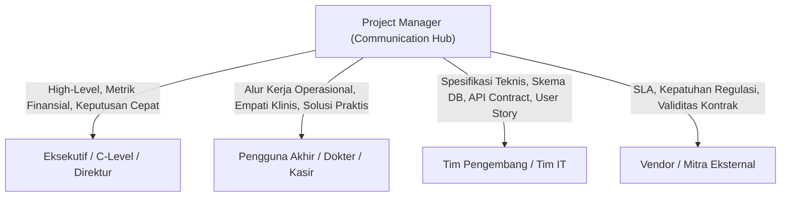

# Modul 05: Effective Communication for Project Managers
## Google Project Management Professional Certificate

> **Sumber Materi**: [Communicate Effectively as a Project Manager | Google Project Management Certificate](https://www.youtube.com/watch?v=bQ1fWZBRlLo)  
> **Kategori**: Course 1 — Foundations of Project Management (Module 5)  
> **Disusun oleh**: Dessy Rahmawati Chairullina, S.Kom  

---

## 📌 Executive Summary
1. **Peran Komunikasi Sentral**: Diperkirakan 90% waktu kerja seorang Manajer Proyek dihabiskan untuk berkomunikasi—mulai dari negosiasi ruang lingkup, klarifikasi kebutuhan, hingga pelaporan status.
2. **Komunikasi Berpusat pada Audiens (*Audience-Centric Communication*)**: Pesan yang sama harus dikemas secara berbeda tergantung siapa yang membacanya:
   * *Eksekutif / Direksi*: Ringkas, berorientasi dampak bisnis, metrik finansial, dan keputusan strategis.
   * *Tim Teknis*: Logika alur data, batasan sistem, acceptance criteria, dan spesifikasi API.
   * *Pengguna Akhir*: Dampak langsung pada rutinitas harian, kemudahan operasional, dan bahasa non-teknis.
3. **Pemilihan Kanal Komunikasi**: Menjodohkan urgensi dan sensitivitas pesan dengan media yang tepat (lisan vs tertulis, sinkron vs asinkron).
4. **Mendengarkan Aktif (*Active Listening*)**: Kemampuan menangkap kebutuhan tersirat, kekhawatiran operasional, serta membangun rasa aman psikologis (*psychological safety*) agar tim berani menyampaikan kendala sebelum menjadi krisis.

---

## 1. Menyesuaikan Komunikasi Berdasarkan Tingkat Pemangku Kepentingan

Salah satu kesalahan paling fatal bagi PM pemula adalah mengirimkan laporan teknis mentah ke meja direksi, atau sebaliknya memberikan instruksi bisnis yang terlalu abstrak kepada tim perekayasa perangkat lunak (*software engineer*).



### Matriks Segmentasi Audiens:
| Profil Audiens | Informasi yang Mereka Butuhkan | Saluran Terbaik | Pantangan Utama |
| :--- | :--- | :--- | :--- |
| **Eksekutif & Sponsor** | Status kesehatan proyek (Merah/Kuning/Hijau), deviasi anggaran, tanggal peluncuran, dan keputusan yang membutuhkan tanda tangan mereka. | Dashboard visual 1 lembar, Executive Summary mingguan via email resmi. | Membanjiri mereka dengan log galat, detail teknis bug, atau istilah koding rumit. |
| **Tim Teknis (Developer)** | Batasan fungsional, aturan bisnis validasi, diagram ERD, skenario uji, dan prioritas antrean tugas. | Papan Kanban (Jira/Trello), PRD, standup harian, dan dokumentasi API. | Memberikan arahan yang ambigu atau mengubah prioritas kerja di tengah sprint tanpa penjelasan konteks. |
| **Staf Operasional / User** | Bagaimana sistem baru mempermudah pekerjaan mereka, kapan jadwal pelatihan, dan ke mana harus melapor jika sistem macet. | Pelatihan tatap muka langsung, panduan visual ringkas (*cheat-sheet* 1 lembar), grup koordinasi operasional. | Menggunakan bahasa jargon pemrograman yang mengintimidasi dan membuat mereka merasa bodoh. |

---

## 2. Prinsip Komunikasi Efektif 7C

Google Project Management menekankan penerapan prinsip 7C dalam setiap transmisi informasi tertulis maupun lisan:

1. **Clear (Jelas)**: Tujuan pesan langsung dapat dipahami pada kalimat pertama tanpa memicu multitafsir.
2. **Concise (Ringkas)**: Memangkas kalimat pengantar yang berbunga-bunga; fokus langsung pada pokok masalah dan aksi yang diharapkan.
3. **Concrete (Konkret)**: Didukung oleh angka, tanggal spesifik, dan data faktual (bukan sekadar asumsi "kira-kira sebentar lagi").
4. **Correct (Akurat)**: Data numerik, nama orang, regulasi, dan terminologi medis/teknis terverifikasi valid.
5. **Coherent (Runtut)**: Gagasan disusun dengan logika berurutan (*Kronologis ➔ Masalah ➔ Solusi ➔ Rekomendasi*).
6. **Complete (Lengkap)**: Penerima pesan memiliki seluruh informasi yang dibutuhkan untuk mengambil keputusan tanpa harus bertanya balik berkali-kali.
7. **Courteous (Santun & Berempati)**: Menghargai beban kerja penerima pesan, menjaga nada profesional bahkan dalam kondisi krisis atau tekanan tinggi.

---

## 3. Komunikasi Eskalasi Masalah (Struktur BLUF)

Saat proyek menghadapi kendala kritis (*critical blocker*), gunakan kerangka **BLUF (Bottom Line Up Front)**: Letakkan kesimpulan, dampak, dan permintaan bantuan di paragraf paling atas pesan.

### Contoh Format Komunikasi Eskalasi BLUF:
```text
Kepada: dr. Handoko, Sp.B (Direktur Medis & Project Sponsor)
Dari: Dessy Rahmawati (Project Manager SIMRS)
Perihal: [KEPUTUSAN DIBUTUHKAN] Penyesuaian Alur Closing Klaim BPJS Per 1 Desember

RINGKASAN UTAMA (BLUF):
Kami membutuhkan persetujuan Direksi hari ini terkait penambahan 1 tahap verifikasi berkas 
oleh tim Casemix sebelum billing dikunci, guna mencegah potensi klaim pending sebesar Rp 450 juta/bulan.

LATAR BELAKANG & FAKTA:
Audit internal terhadap 120 berkas rawat inap bulan Oktober menunjukkan 18% berkas ditolak verifikator 
karena resume medis belum ditandatangani digital oleh DPJP saat pasien pulang.

OPSI SOLUSI:
• Opsi A: Mengunci tombol billing kasir jika form resume medis belum lengkap (Rekomendasi Tim).
• Opsi B: Memberikan grace period 1x24 jam dengan notifikasi peringatan otomatis ke ponsel DPJP.

DAMPAK TERHADAP PROYEK:
Implementasi Opsi A membutuhkan waktu pengembangan 2 hari kerja dan tidak menggeser jadwal go-live.

AKSI YANG DIHARAPKAN:
Mohon konfirmasi pilihan opsi dari Dokter paling lambat besok, Selasa 18 November pukul 12.00 WIB.
```

---

## 4. Studi Kasus Nyata: Mengelola Konflik Antar Departemen Melalui Komunikasi Terbuka

* **Skenario Masalah**: Pada implementasi modul *Kalkulator Jasa Medis*, staf Keuangan mengeluh dokter sering terlambat memvalidasi tindakan, sementara para dokter spesialis memprotes bahwa sistem baru terlalu lambat dan rumit untuk dibuka di sela-sela jadwal poli rawat jalan yang padat. Kedua belah pihak saling menyalahkan.
* **Tindakan Komunikasi PM**:
  1. *Menghilangkan Saluran Gosip & Asumsi*: PM menghentikan perdebatan di grup percakapan informal yang tidak produktif.
  2. *Sesi Observasi Langsung (*Shadowing*)*: PM mendampingi kasir keuangan selama 2 jam dan duduk bersama dokter di poli selama 2 jam untuk melihat langsung titik frustrasi masing-masing pihak (*active empathy*).
  3. *Komunikasi Berbasis Fakta*: PM mengumpulkan data durasi klik dan membuktikan bahwa form yang ada memang memerlukan 14 kali klik untuk satu tindakan medis.
  4. *Penyelarasan Solusi*: PM merancang penyederhanaan form menjadi sistem *1-click batch validation* untuk dokter, dan dashboard rekapitulasi instan untuk kasir.
* **Hasil**:
  * Penolakan dokter turun menjadi 0%.
  * Waktu verifikasi jasa medis terpangkas dari 15 menit per berkas menjadi kurang dari 1 menit.
  * Hubungan kerja antara staf keuangan dan dokter kembali harmonis karena kedua belah pihak merasa didengarkan secara adil.

---

## 5. 🛠️ Actionable PM Communication Checklist

- [ ] **Audience Check**: Apakah gaya bahasa dan tingkat detail pesan ini sudah sesuai dengan profil penerima (Eksekutif vs Dev vs Staf)?
- [ ] **BLUF Structure**: Apakah inti masalah dan aksi yang diminta diletakkan pada kalimat pembuka pesan?
- [ ] **Action Clarity**: Apakah penerima pesan tahu persis apa yang harus mereka lakukan, kapan batas waktunya, dan kepada siapa harus melapor?
- [ ] **Tone & Empathy**: Apakah nada pesan terdengar solutif dan kolaboratif, bebas dari nada menuduh (*blameless*)?
- [ ] **Appropriate Channel**: Apakah pesan ini sudah menggunakan media yang pas (misal: dokumen formal untuk perubahan regulasi, chat singkat untuk klarifikasi minor)?
- [ ] **Closing Confirmation**: Apakah sudah ada konfirmasi penerimaan dan pemahaman pesan dari pihak-pihak penanggung jawab?
