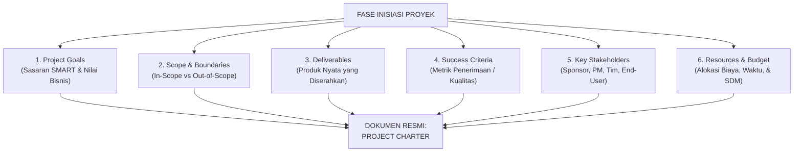

# Modul 06: Key Components of Project Initiation
## Google Project Management Professional Certificate

> **Sumber Materi**: [Bagian-Bagian Penting dari Inisiasi Proyek | Sertifikat Manajemen Proyek Google](https://www.youtube.com/watch?v=28vZa0qOHkg)  
> **Kategori**: Course 2 — Project Initiation: Starting a Successful Project (Module 1)  
> **Disusun oleh**: Dessy Rahmawati Chairullina, S.Kom  

---

## 📌 Executive Summary
1. **Fondasi Keberhasilan Proyek**: Fase inisiasi adalah tahap paling krusial untuk menentukan apakah sebuah proyek layak dijalankan (*feasible*) sebelum organisasi mengalokasikan anggaran dan tenaga kerja.
2. **6 Komponen Kunci Inisiasi**:
   * *Tujuan Proyek (Goals)*: Manfaat bisnis terukur yang ingin dicapai dan relevan dengan visi perusahaan.
   * *Ruang Lingkup (Scope)*: Batasan jelas apa yang dikerjakan (*In-Scope*) dan apa yang tegas ditolak (*Out-of-Scope*).
   * *Hasil Akhir (Deliverables)*: Artefak atau produk konkret yang diserahterimakan pada akhir proyek.
   * *Kriteria Keberhasilan (Success Criteria)*: Tolok ukur terukur kapan proyek dinyatakan sukses (*quality, time, cost, adoption*).
   * *Pemangku Kepentingan (Stakeholders)*: Identifikasi peran sponsor, tim inti, dan penerima manfaat.
   * *Estimasi Sumber Daya (Resources & Budget)*: Perkiraan awal alokasi biaya, lisensi perangkat, dan jam kerja personel.
3. **Project Charter sebagai "Kontrak Sosial"**: Dokumen formal ringkas yang memberi wewenang resmi kepada Manajer Proyek untuk menggunakan sumber daya organisasi.

---

## 1. Anatomi 6 Komponen Kunci Inisiasi Proyek

Inisiasi yang lemah adalah akar penyebab nomor satu kegagalan proyek di kemudian hari (*scope creep*, biaya bengkak, dan produk ditolak pengguna).



### Rincian Komponen:
| Komponen | Pertanyaan Kunci yang Harus Terjawab | Contoh Nyata (Implementasi SIMRS) |
| :--- | :--- | :--- |
| **Goals** | Masalah bisnis apa yang kita selesaikan dan seberapa besar dampaknya? | Meningkatkan akurasi kalkulasi bagi hasil jasa medis dokter hingga 100% dan memangkas waktu rekonsiliasi bulanan. |
| **Scope** | Di mana batas awal dan batas akhir pekerjaan tim proyek? | *In-Scope*: Modul penagihan BPJS, kalkulator tarif tindakan, dan laporan harian kasir. <br>*Out-of-Scope*: Pengadaan mesin server baru dan perombakan modul farmasi rawat jalan. |
| **Deliverables** | Apa bentuk fisik/digital yang diserahkan kepada pengguna? | Source code teruji, berkas migrasi database DDL, SOP tertulis kasir, dan video tutorial pelatihan perawat. |
| **Success Criteria** | Bagaimana auditor dan direksi tahu bahwa sistem ini sukses? | Seluruh klaim FPK BPJS selesai dicocokkan dalam $\le$ 24 jam dengan selisih nominal Rp 0 (nol rupiah). |
| **Stakeholders** | Siapa yang mendanai, memimpin, mengerjakan, dan memakai? | *Sponsor*: Direktur Keuangan. <br>*PM*: Dessy Rahmawati. <br>*Core Team*: 2 Programmer, 1 Database Admin. <br>*Users*: 12 Kasir & 40 Dokter. |
| **Resources** | Berapa anggaran, lisensi, dan kapasitas jam yang disetujui? | Anggaran implementasi Rp 50.000.000, 1 server staging virtual, dan 3 bulan masa kerja tim teknis. |

---

## 2. Mengunci Ruang Lingkup: In-Scope vs Out-of-Scope

Salah satu musuh terbesar proyek adalah ***Scope Creep*** (penambahan fitur sedikit demi sedikit secara diam-diam tanpa kompensasi waktu dan biaya tambahan).

### Teknik Mengunci Batasan Lingkup:
1. **Daftarkan Out-of-Scope Secara Eksplisit**: Jangan berasumsi bahwa pengguna tahu apa yang tidak termasuk dalam paket pekerjaan. Tuliskan dengan tegas apa saja yang tidak dikerjakan.
2. **Klausul Perubahan Resmi (*Change Control Process*)**: Setiap usulan fitur baru di luar kesepakatan charter harus diajukan melalui dokumen formulir *Change Request* yang mengevaluasi dampaknya terhadap biaya dan jadwal peluncuran.

---

## 3. Template Standar Project Charter (Format 1 Halaman)

Dokumen *Project Charter* adalah pelindung utama wewenang PM. Jika sebuah proyek belum memiliki charter yang ditandatangani oleh Sponsor, proyek tersebut secara administratif belum sah berjalan.

```text
================================================================================
                           PROJECT CHARTER RESMI
================================================================================
Nama Proyek   : Digitalisasi Asuhan Keperawatan & Pemantauan Early Warning System
Sponsor       : dr. Handoko (Direktur Pelayanan Medis)
Project Manager: Dessy Rahmawati Chairullina, S.Kom
Tanggal Mulai : 01 Desember 2026          Target Selesai : 28 Februari 2027
--------------------------------------------------------------------------------
1. LATAR BELAKANG & KELAYAKAN BISNIS (BUSINESS CASE):
   Pencatatan risiko jatuh pasien dan EWS di bangsal rawat inap saat ini masih 
   berbasis lembaran manual kertas, memicu keterlambatan deteksi dini penurunan 
   kondisi pasien serta potensi temuan ketidaklengkapan rekam medis saat akreditasi.

2. SASARAN PROYEK (PROJECT OBJECTIVES):
   • 100% digitalisasi asesmen risiko jatuh (Dewasa, Anak, Neonatus) per 1 Feb 2027.
   • Waktu input skor pemantauan tanda vital turun dari 8 menit menjadi 2 menit.
   • Integrasi otomatis ke resume riwayat medis pasien secara real-time.

3. RUANG LINGKUP PEKERJAAN:
   • IN-SCOPE: Form input EWS & Risiko Jatuh, pewarnaan otomatis baris tabel (skor merah), 
     penyimpanan database terenkripsi, dan integrasi riwayat perawatan.
   • OUT-OF-SCOPE: Pengadaan tablet perawat baru (menggunakan PC bangsal eksisting) 
     dan integrasi alat monitor bedside nirkabel (IoMT).

4. KRITERIA PENERIMAAN (ACCEPTANCE CRITERIA):
   • Lolos uji UAT oleh Kepala Ruang Bangsal dengan skor kelayakan > 90%.
   • Nol data hilang (*zero data loss*) saat diuji simulasi 500 transaksi per detik.

5. JADWAL MILESTONE UTAMA:
   • M1: Desain UI & Validasi Skema Database   : 15 Desember 2026
   • M2: Penyelesaian Koding & Integrasi        : 15 Januari 2027
   • M3: UAT & Pelatihan Perawat                : 10 Februari 2027
   • M4: Go-Live & Handover Operasional         : 28 Februari 2027

6. PERSETUJUAN & OTORISASI:
   [ Disetujui oleh Project Sponsor ]          [ Diterima oleh Project Manager ]
   
   dr. Handoko, Sp.B                           Dessy Rahmawati Chairullina, S.Kom
================================================================================
```

---

## 4. Studi Kasus Nyata: Menggagalkan Scope Creep pada Proyek Kasir Rumah Sakit

* **Situasi**: Tim PM sedang menyelesaikan modul penagihan BPJS. Di minggu ketiga pelaksanaan, Kepala Bagian Piutang meminta secara lisan agar ditambahkan modul analisis tren laba rugi farmasi dan integrasi SMS Gateway penagihan pasien umum ke dalam form yang sedang dibangun.
* **Tindakan PM**:
  1. *Merujuk pada Project Charter*: PM membuka charter yang sudah ditandatangani dan menunjukkan bahwa modul penagihan BPJS berfokus pada rekonsiliasi klaim asuransi, sedangkan analisis laba farmasi dan SMS Gateway tercantum sebagai *Out-of-Scope*.
  2. *Edukasi Dampak Triple Constraint*: PM menjelaskan bahwa menambahkan dua fitur tersebut akan menunda peluncuran modul penagihan selama minimal 4 minggu dan membutuhkan lisensi API tambahan.
  3. *Mengarahkan ke Fase 2*: PM tidak menolak ide tersebut secara kasar, melainkan mencatatnya ke dalam dokumen *Future Backlog (Fase 2)* yang akan diinisiasi setelah Fase 1 sukses beroperasi.
* **Hasil**:
  * Modul penagihan BPJS selesai tepat waktu sesuai anggaran awal.
  * Tim pengembang terlindungi dari kelelahan akibat beban kerja dadakan (*overwork*).
  * Hubungan dengan pemangku kepentingan tetap terjaga profesional dan saling menghormati.

---

## 5. 🛠️ Actionable Project Initiation Checklist

- [ ] **Problem vs Solution**: Apakah kita sudah benar-benar memahami masalah yang ingin diselesaikan, bukan hanya tergiur teknologi baru?
- [ ] **SMART Objective**: Apakah target proyek sudah Spesifik, Terukur, Dapat Dicapai, Relevan, dan Memiliki Tenggat Waktu?
- [ ] **Clear Boundary**: Apakah dokumen secara eksplisit menuliskan apa saja yang TIDAK akan dikerjakan (*Out-of-Scope*)?
- [ ] **Deliverables Inventory**: Apakah daftar serah terima barang/software sudah disepakati bersama oleh tim pengembang dan pengguna?
- [ ] **Sponsor Authorization**: Sudahkah Project Charter ditandatangani oleh pemegang anggaran resmi sebelum pengeluaran pertama dimulai?
- [ ] **Core Team Assembled**: Apakah Manajer Proyek sudah memegang komitmen alokasi waktu dari seluruh personel inti yang terlibat?
