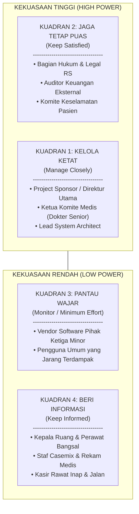

# Modul 07: Stakeholder Engagement & Communication
## Google Project Management Professional Certificate

> **Sumber Materi**: [Berkomunikasi dan Bekerja dengan Pemangku Kepentingan | Sertifikat Manajemen Proyek Google](https://www.youtube.com/watch?v=jz7tPVDwb50)  
> **Kategori**: Course 2 — Project Initiation: Starting a Successful Project (Module 2)  
> **Disusun oleh**: Dessy Rahmawati Chairullina, S.Kom  

---

## 📌 Executive Summary
1. **Definisi Pemangku Kepentingan (*Stakeholders*)**: Siapa pun yang dapat memengaruhi, atau terpengaruh secara positif maupun negatif oleh hasil dan proses pelaksanaan proyek.
2. **Matriks Pengaruh vs Minat (*Power-Interest Grid*)**: Kerangka analisis Mendelow untuk memetakan pendekatan komunikasi berdasarkan tingkat kekuasaan politik/organisasi dan tingkat keterlibatan pemangku kepentingan.
3. **Matriks Penugasan Tanggung Jawab RACI**: Standar emas untuk menghilangkan tumpang tindih peran dan memastikan hanya ada satu pengambil keputusan akhir (*Accountable*) untuk setiap aktivitas proyek.
4. **Strategi Mengelola *Difficult Stakeholders***: Menyelaraskan kepentingan yang bertentangan melalui empati aktif, penyajian data obyektif, dan pendekatan personal informal (*pre-wire alignment*).

---

## 1. Pemetaan Pemangku Kepentingan: Power vs. Interest Grid

Setiap pemangku kepentingan tidak bisa diperlakukan sama. Membanjiri pihak berkuasa tinggi yang minatnya rendah dengan detail teknis harian akan membuat mereka kesal, sementara mengabaikan pihak yang minatnya tinggi akan memicu penolakan di tingkat akar rumput.

### Matriks Kuadran Kekuasaan vs Minat (Mendelow):
| Kekuasaan \ Minat | Minat Rendah (*Low Interest*) | Minat Tinggi (*High Interest*) |
| :--- | :--- | :--- |
| **Kekuasaan Tinggi (*High Power*)** | **JAGA TETAP PUAS (*Keep Satisfied*)** • Bagian Hukum / Legal RS • Auditor Keuangan Eksternal • Komite Keselamatan Pasien | **KELOLA KETAT (*Manage Closely*)** • Project Sponsor & Direktur Utama • Ketua Komite Medis (Dokter Senior) • Lead System Architect |
| **Kekuasaan Rendah (*Low Power*)** | **PANTAU SECARA WAJAR (*Monitor*)** • Vendor software pihak ketiga minor • Pengguna umum yang jarang terdampak | **BERI INFORMASI BERKALA (*Keep Informed*)** • Kepala Ruang Rawat Inap & Perawat • Staf Rekam Medis & Casemix • Staf Kasir Pembayaran |

### Strategi Berdasarkan Kuadran:
1. **Manage Closely (Kuasa Tinggi, Minat Tinggi)**:
   * *Contoh*: Project Sponsor, Direktur Rumah Sakit, Lead Architect.
   * *Aksi PM*: Libatkan dalam pengambilan keputusan strategis, adakan rapat tatap muka rutin, dan prioritaskan masukan mereka.
2. **Keep Satisfied (Kuasa Tinggi, Minat Rendah)**:
   * *Contoh*: Bagian Hukum/Legal, Auditor Keuangan, Komite Keselamatan Pasien.
   * *Aksi PM*: Pastikan kepatuhan regulasi dan standar mereka terpenuhi tanpa membebani mereka dengan rapat teknis operasional harian.
3. **Keep Informed (Kuasa Rendah, Minat Tinggi)**:
   * *Contoh*: Perawat bangsal, staf administrasi casemix, kasir rawat jalan.
   * *Aksi PM*: Berikan buletin pembaruan rutin, libatkan dalam sesi pengujian antarmuka (UAT), dan dengarkan masukan ergonomi penggunaan sistem.
4. **Monitor (Kuasa Rendah, Minat Rendah)**:
   * *Contoh*: Penyedia lisensi software pihak ketiga, pengguna umum yang jarang terdampak.
   * *Aksi PM*: Pantau status melalui kanal laporan umum dengan konsumsi energi seminimal mungkin.

---

## 2. Matriks RACI: Kejelasan Peran Tanpa Kebingungan

Ketiadaan matriks RACI sering menyebabkan fenomena: *"Semua orang mengira orang lain yang mengerjakannya, sehingga akhirnya tidak ada yang mengerjakan"*.

### Definisi Huruf RACI:
* **R — Responsible (Pelaksana)**: Orang yang benar-benar mengerjakan tugas tersebut hingga selesai.
* **A — Accountable (Penanggung Jawab Tunggal)**: Orang yang memiliki wewenang veto, menandatangani persetujuan akhir, dan menanggung risiko jika tugas gagal. *(HANYA BOLEH ADA 1 'A' UNTUK SETIAP AKTIVITAS)*.
* **C — Consulted (Konsultan Dua Arah)**: Pakar bidang atau stakeholder kunci yang dimintai pendapat sebelum keputusan diambil.
* **I — Informed (Penerima Informasi Satu Arah)**: Pihak yang diberi tahu perkembangan hasil keputusan setelah disahkan.

### Contoh Matriks RACI pada Proyek Implementasi Modul SIMRS:
| Aktivitas Proyek | Project Manager (PM) | Lead Developer (Dev) | Dokter Penanggung Jawab (DPJP) | Direktur Keuangan (Sponsor) | Kepala Rekam Medis |
| :--- | :---: | :---: | :---: | :---: | :---: |
| Menyusun Project Charter & Anggaran | **A** | C | C | **A / Approver** | I |
| Merancang Alur Form Rekam Medis Digital | **A** | R | C | I | C |
| Menulis Kode Program & Integrasi Database | I | **A & R** | I | I | I |
| Uji Terima Pengguna (UAT Form Klinis) | A | R | **C / Tester** | I | **R / Tester** |
| Menyetujui Peluncuran Sistem (*Go-Live*) | C | C | C | **A** | C |

---

## 3. Strategi Mengelola Stakeholder yang Menentang (*Resistant Stakeholders*)

Dalam setiap transformasi digital atau proyek perubahan sistem, penolakan adalah hal yang lumrah. Penolakan biasanya berakar dari **rasa takut kehilangan kendali** atau **kekhawatiran beban kerja bertambah**.

### Protokol 4 Langkah Menghadapi Penolakan:
1. **Dengarkan Tanpa Membantah (*Empathic Inquiry*)**: Jangan langsung mempertahankan sistem dengan argumen teknologi. Dengarkan keluhan mereka sampai tuntas.
2. **Bedakan Antara Keluhan Emosional vs Masalah Riil**: Saring kata-kata emosi ("Sistem ini lambat!") untuk menemukan masalah inti faktual ("Form ini butuh 12 inputan wajib yang tidak ada datanya saat pasien gawat darurat").
3. **Teknik *Pre-Wiring***: Dekati tokoh kunci penentang secara informal (ngobrol santai sebelum rapat besar dimulai). Berikan draf perbaikan dan tanyakan masukan mereka secara tertutup. Saat rapat formal dimulai, mereka tidak lagi kaget dan merasa dihargai.
4. **Beri Panggung sebagai Kontributor**: Jadikan mereka sebagai penguji pertama (*alpha tester*). Ketika perbaikan yang mereka minta diakomodasi, penentang paling keras sering kali berubah menjadi pendukung paling setia (*fiercest champions*).

---

## 4. Studi Kasus Nyata: Menyelaraskan Kepentingan yang Bertolak Belakang

* **Konflik**: Pada proyek penyesuaian aturan pembagian Jasa Medis BPJS, Bagian Keuangan ingin transparansi penuh dengan memunculkan detail biaya operasional rumah sakit di akun setiap dokter. Sebaliknya, Komite Medis menolak keras dengan alasan angka tersebut membingungkan dan dapat memicu prasangka pemotongan sepihak. Proyek terhenti selama 3 minggu.
* **Tindakan PM**:
  1. *Analisis Posisi Stakeholder*:
     * Bagian Keuangan: Kuasa Tinggi, Minat Tinggi (Tuntutan audit internal akuntabel).
     * Dokter Spesialis: Kuasa Tinggi, Minat Tinggi (Tuntutan keadilan dan kepastian honor).
  2. *Sesi Rekonsiliasi Tertutup*: PM mempertemukan Kepala Keuangan dan Ketua Komite Medis dalam forum mediasi tertutup (bukan rapat besar).
  3. *Solusi Kompromi Dua Lapisan (Two-Tier View)*: PM merancang antarmuka sistem dengan hak akses bertingkat:
     * Tampilan Dokter: Menampilkan nominal hak jasa medis bersih secara transparan lengkap dengan rincian tindakan dan persentase yang sudah disepakati di awal tanpa membebankan komponen audit internal.
     * Tampilan Keuangan & Direksi: Dashboard komprehensif berisi seluruh struktur pembiayaan rumah sakit dan biaya BHP.
* **Hasil**:
  * Kedua belah pihak menyetujui desain antarmuka baru dalam waktu 48 jam.
  * Modul kalkulator jasa medis berhasil diluncurkan tanpa ada mogok verifikasi dari dokter.
  * Audit keuangan lulus sertifikasi transparansi.

---

## 5. 🛠️ Actionable Stakeholder Engagement Checklist

- [ ] **Stakeholder Inventory Complete**: Apakah semua pihak yang berpengaruh dan terpengaruh sudah terdaftar (termasuk yang tidak bersuara keras)?
- [ ] **Power-Interest Grid Mapped**: Sudahkah setiap pemangku kepentingan ditempatkan pada kuadran Mendelow yang tepat?
- [ ] **Single 'A' in RACI**: Apakah pada setiap baris aktivitas dalam matriks RACI hanya terdapat satu orang yang memegang peran Accountable?
- [ ] **Communication Tailoring**: Apakah jadwal dan saluran pembaruan informasi sudah disesuaikan dengan kuadran masing-masing?
- [ ] **Resistance Proactively Managed**: Sudahkah mendekati stakeholder penentang melalui pendekatan personal (*pre-wiring*) sebelum sesi voting atau rapat formal?
- [ ] **Feedback Loop Established**: Apakah tersedia kanal resmi bagi pengguna untuk menyampaikan keluhan sebelum isu membesar menjadi konflik terbuka?
