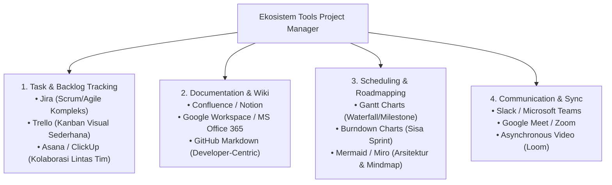

# Modul 09: Project Management Tools & Software
## Google Project Management Professional Certificate

> **Sumber Materi**: [Sumber Daya dan Alat Terbaik untuk Mengelola Proyek Anda | Sertifikat Manajemen Proyek Google](https://www.youtube.com/watch?v=ZKOwOZBvAzI)  
> **Kategori**: Course 2 — Project Initiation: Starting a Successful Project (Module 4)  
> **Disusun oleh**: Dessy Rahmawati Chairullina, S.Kom  

---

## 📌 Executive Summary
1. **Alat Adalah Fasilitator, Bukan Solusi Utama**: Perangkat lunak (*tools*) manajemen proyek terbaik sekalipun tidak dapat menyelamatkan proyek yang prosesnya rusak atau tujuannya kabur. Alat berfungsi mempercepat alur kerja, meningkatkan visibilitas, dan mendokumentasikan progres.
2. **Kategori Ekosistem Tool PM**:
   * *Work & Task Management*: Jira, Asana, Trello, ClickUp, Linear (pelacakan tugas, backlog, dan status sprint).
   * *Dokumentasi & Basis Pengetahuan*: Confluence, Notion, Google Docs (PRD, Charter, panduan teknis, dan SOP).
   * *Visualisasi Alur & Roadmap*: Gantt Charts, Kanban Boards, Swimlane Diagrams.
   * *Komunikasi Tim*: Slack, Microsoft Teams, Google Chat (koordinasi cepat dan sinkronisasi harian).
3. **Kekuatan Spreadsheet yang Tak Tergantikan**: Google Sheets / Microsoft Excel tetap menjadi alat paling serbaguna bagi PM untuk memodelkan anggaran, menghitung deviasi biaya (*variance analysis*), dan menyusun matriks alokasi sumber daya secara fleksibel.
4. **Prinsip Anti *Over-Engineering***: Memilih alat yang paling sederhana yang mampu menyelesaikan pekerjaan tanpa membebani tim dengan kerumitan administrasi pengisian form.

---

## 1. Pemetaan Ekosistem Perangkat Lunak Manajemen Proyek



### Matriks Perbandingan Karakteristik Tools Populer:
| Nama Tool | Kekuatan Utama | Skenario Penggunaan Ideal | Keterbatasan / Risiko |
| :--- | :--- | :--- | :--- |
| **Jira Software** | Pelacakan isu teknis mendalam, integrasi Git/CI-CD, metrik Agile baku (Burndown, Velocity). | Tim rekayasa perangkat lunak (*software engineers*) berskala menengah hingga enterprise. | Kurva belajar terjal; sering dianggap kaku dan lambat oleh tim non-teknis. |
| **Trello** | Sangat intuitif, antarmuka Kanban drag-and-drop ringan, ramah bagi pemula. | Tim kecil, proyek operasional non-teknis, atau pemantauan tugas ad-hoc sederhana. | Sulit mengelola dependensi tugas rumit (*blocking issues*) dan manajemen kapasitas jam kerja. |
| **Asana / ClickUp** | Tampilan fleksibel (List, Board, Timeline/Gantt), pelacakan beban kerja tim (*workload balance*). | Manajemen proyek lintas fungsi (gabungan tim IT, Pemasaran, Keuangan, dan Operasional). | Fitur terlalu banyak; berisiko membuat tim bingung jika tidak dikonfigurasi secara disiplin. |
| **Google Sheets** | Fleksibilitas tanpa batas, gratis, kolaborasi real-time, otomatisasi formula dan pivot table. | Pemodelan anggaran proyek, matriks RACI, kalkulasi variansi biaya, dan rekapitulasi data cepat. | Tidak memiliki audit log histori otomatis per tugas; berisiko terhapus jika hak akses tidak dikunci. |

---

## 2. Kapan Menggunakan Kanban Board vs Gantt Chart?

Memilih representasi visual yang salah dapat mengaburkan kondisi kesehatan proyek yang sesungguhnya.

```text
[ KANBAN BOARD ]                                      [ GANTT CHART ]
Fokus: Arus Kerja & Batasan WIP                      Fokus: Dependensi Waktu & Tanggal Absolut
Cocok untuk: Agile, Support, Iteratif                Cocok untuk: Waterfall, Konstruksi, Regulasi
+------------------------------------+               Tugas A: [=====>        ] (Minggu 1-2)
| To Do   | In Progress | Done       |                        |
| [Tsk-1] | [Tsk-3]     | [Tsk-0]    |               Tugas B: |---> [======> ] (Minggu 3-4)
| [Tsk-2] |             |            |                              |
+------------------------------------+               Milestone C:   * (15 Feb Go-Live)
```

* **Gunakan Kanban Board Jika**:
  * Proyek berorientasi *continuous flow* (misal: perbaikan bug harian, penambahan modul berkala).
  * Tim ingin membatasi *Work In Progress (WIP)* agar tidak terjadi kemacetan (*bottlenecks*).
  * Prioritas tugas sering berubah secara fleksibel dari minggu ke minggu.
* **Gunakan Gantt Chart Jika**:
  * Terdapat dependensi ketat antar tugas (*Tugas B tidak bisa dimulai sebelum Tugas A 100% selesai*).
  * Tenggat waktu peluncuran terikat tanggal kalender yang tidak bisa digeser (misal: batas waktu audit BPJS atau batas regulasi Kemenkes).
  * Pemangku kepentingan eksekutif menuntut peta jalan visual jangka panjang (3–6 bulan ke depan).

---

## 3. Spreadsheet Architecture: Menata File Pelacak Proyek Mandiri

Bagi Manajer Proyek mandiri atau di organisasi yang belum berlangganan software enterprise mahal, Google Sheets adalah senjata pamungkas.

### Struktur Standar Sheet Pelacak Proyek Profesional:
1. **Tab 1 — Executive Dashboard**: Ringkasan status KPI, persentase penyelesaian milestone, dan grafik alokasi anggaran (aktual vs rencana).
2. **Tab 2 — Master Task Tracker (WBS)**:
   * Kolom: ID Tugas, Nama Modul, PIC, Tanggal Mulai, Target Selesai, Status (Dropdown: Belum Mulai / Sedang Dikerjakan / Review / Selesai), Dependensi, Keterangan Blocker.
3. **Tab 3 — Risk Register**: Matriks dampak dan probabilitas risiko beserta rencana mitigasi aktif.
4. **Tab 4 — Budget & Resource Log**: Catatan pengeluaran riil per pos anggaran lengkap dengan bukti transaksi.

---

## 4. Studi Kasus Nyata: Mengatasi Fragmentasi Tool pada Tim Pengembang SIMRS

* **Masalah**: Tim IT Rumah Sakit mengalami kekacauan komunikasi. Programmer mencatat tugas di catatan lokal, staf rekam medis melapor error lewat WhatsApp personal, dan direksi menagih progres lewat email. Akibatnya, 23 tiket perbaikan bug kritis terlewat saat *go-live* modul IGD.
* **Tindakan PM**:
  1. *Konsolidasi ke 1 Single Source of Truth*: PM menstandarisasi pelaporan hanya melalui 1 papan Kanban digital terpusat.
  2. *Membuat Template Laporan Masalah Otomatis*: Pesan WhatsApp dialihkan ke form intake sederhana (Google Forms ➔ Sheets) yang otomatis membuat kartu tugas di papan Kanban.
  3. *Aturan Status Transparan*: Kartu hanya boleh memiliki 4 kolom: *Backlog ➔ In Development ➔ Testing/UAT ➔ Deployed*.
  4. *Dashboard 1 Halaman untuk Direksi*: Setiap Jumat sore, PM membagikan tautan dashboard ringkasan status otomatis tanpa perlu rapat bertele-tele.
* **Hasil**:
  * Tiket masalah yang terlewat turun dari 23 menjadi 0 kasus.
  * Efisiensi waktu koordinasi meningkat 40% karena seluruh tim melihat status pekerjaan yang sama secara real-time.

---

## 5. 🛠️ Actionable Tool Selection Checklist

- [ ] **Needs Assessment**: Apakah tim benar-benar membutuhkan software berbayar baru, atau cukup mengoptimalkan alat kolaborasi yang sudah ada?
- [ ] **Team Adoption**: Apakah antarmuka alat cukup mudah dipahami oleh anggota tim yang paling awam teknologi (*low barrier to entry*)?
- [ ] **Dependency Capability**: Jika proyek memiliki banyak keterkaitan antar tugas, apakah alat tersebut mendukung visualisasi jalur kritis (*Critical Path / Gantt*)?
- [ ] **Centralized Access**: Apakah seluruh pemangku kepentingan kunci memiliki akses baca (*view-only*) ke dashboard proyek tanpa kendala lisensi?
- [ ] **Notification Hygiene**: Sudahkah menyetel notifikasi alat agar tidak membanjiri kotak masuk tim dengan email spam yang tidak relevan?
