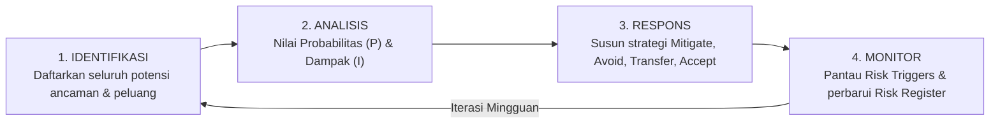
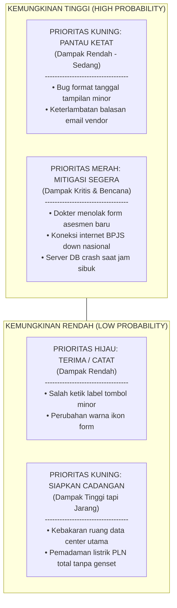

# Modul 10: Risk Management Fundamentals & Risk Register
## Google Project Management Professional Certificate

> **Sumber Materi**: [Dasar-Dasar Manajemen Risiko | Sertifikat Manajemen Proyek Google](https://www.youtube.com/watch?v=kXkVV7PFWgE)  
> **Kategori**: Course 2 — Project Initiation: Starting a Successful Project (Module 5)  
> **Disusun oleh**: Dessy Rahmawati Chairullina, S.Kom  

---

## 📌 Executive Summary
1. **Definisi Risiko Proyek**: Peristiwa atau kondisi tidak pasti yang jika terjadi akan berdampak positif (peluang/*opportunity*) atau negatif (ancaman/*threat*) terhadap sasaran proyek (*Scope, Schedule, Cost, Quality*).
2. **Proaktif vs Reaktif**: Manajemen risiko bertujuan mengantisipasi dan meredam masalah *sebelum* terjadi, bukan sekadar memadamkan kebakaran setelah krisis meledak (*firefighting*).
3. **Siklus 4 Langkah Manajemen Risiko**:
   * *Identifikasi*: Menggali potensi bahaya dari pengalaman masa lalu, masukan pakar, dan asumsi proyek.
   * *Analisis & Penilaian*: Mengukur probabilitas terjadinya dan tingkat keparahan dampak (*Risk Score = Likelihood × Impact*).
   * *Perencanaan Respons*: Menentukan strategi (Mitigasi, Hindari, Alihkan, Terima).
   * *Pemantauan Berkelanjutan*: Mengawasi pemicu risiko (*risk triggers*) dan memperbarui dokumen *Risk Register* secara berkala.
4. **Dokumen Hidup Risk Register**: Catatan resmi master risiko yang memuat pemilik risiko (*Risk Owner*), rencana mitigasi pencegahan, dan rencana darurat (*Contingency Plan*).

---

## 1. Kerangka Siklus Hidup Manajemen Risiko



---

## 2. Matriks Penilaian Risiko: Probability vs. Impact

Setiap risiko yang teridentifikasi diberi bobot nilai pada skala 1 sampai 5 untuk menentukan tingkat keparahan (*Severity Level*).

$$\text{Risk Score} = \text{Probability (Kemungkinan)} \times \text{Impact (Dampak)}$$



### Matriks Evaluasi Risiko ($P \times I$ Matrix):
| Probabilitas \ Dampak | Dampak Rendah (Skor 1–2) | Dampak Sedang (Skor 3) | Dampak Kritis (Skor 4–5) |
| :--- | :--- | :--- | :--- |
| **Tinggi (4–5)** | **Kuning (Skor 8–10)**: Pantau rutin | **Merah (Skor 12–15)**: Mitigasi aktif | **Merah (Skor 16–25)**: Darurat & Rencana Kontinjensi |
| **Sedang (3)** | **Hijau (Skor 3–6)**: Terima | **Kuning (Skor 9)**: Pantau berkala | **Merah (Skor 12–15)**: Mitigasi aktif |
| **Rendah (1–2)** | **Hijau (Skor 1–4)**: Catat | **Hijau (Skor 3–6)**: Terima | **Kuning (Skor 8–10)**: Rencana darurat |

### Klasifikasi Zona Risiko:
* **Zona Merah (Skor 15–25)**: Risiko kritis. Wajib memiliki rencana mitigasi pencegahan aktif sebelum fase pengerjaan dimulai, serta harus dilaporkan langsung ke Project Sponsor.
* **Zona Kuning (Skor 8–14)**: Risiko sedang. Butuh pemantauan berkala dan alokasi rencana cadangan (*contingency plan*).
* **Zona Hijau (Skor 1–7)**: Risiko rendah. Cukup dicatat (*accepted*) dan dievaluasi kembali jika kondisi operasional berubah.

---

## 3. Empat Strategi Baku Respons Risiko (4T)

Ketika sebuah ancaman risiko teridentifikasi, PM memiliki 4 opsi tindakan:

| Strategi Respons | Makna & Definisi | Contoh Nyata Implementasi SIMRS |
| :--- | :--- | :--- |
| **1. Mitigate (Redam)** | Mengambil tindakan pencegahan aktif untuk menurunkan probabilitas atau memperkecil dampak kerugian. | Melakukan simulasi *load testing* beban 1.000 transaksi bersamaan sebelum peluncuran sistem untuk mencegah database macet. |
| **2. Avoid (Hindari)** | Mengubah rencana atau ruang lingkup proyek secara total untuk menghilangkan sumber risiko 100%. | Membatalkan integrasi alat medis nirkabel pihak ketiga yang belum berizin resmi Kemenkes dan tetap menggunakan input manual aman. |
| **3. Transfer (Alihkan)** | Memindahkan tanggung jawab finansial atau operasional risiko kepada pihak ketiga. | Membeli asuransi siber dan mengontrak vendor infrastruktur *Cloud* dengan garansi SLA uptime 99.99% disertai penalti finansial. |
| **4. Accept (Terima)** | Mengakui adanya risiko tanpa intervensi pencegahan karena biaya mitigasi jauh lebih mahal daripada dampak kerugiannya. | Menerima risiko gangguan jaringan internet eksternal BPJS yang bersifat nasional sambil menyiapkan fitur antrean offline lokal. |

---

## 4. Struktur Master Dokumen Risk Register

Dokumen *Risk Register* bukan berkas statis yang dibuat sekali lalu disimpan di laci, melainkan dokumen operasional yang ditinjau setiap rapat status mingguan.

```text
=================================================================================================================
                                            MASTER RISK REGISTER
=================================================================================================================
ID    Deskripsi Risiko              P   I  Skor  Respons   Rencana Mitigasi Pencegahan  Rencana Darurat (Kontinjensi)  Owner
-----------------------------------------------------------------------------------------------------------------
R-01  Database down saat migrasi    2   5   10   Mitigate  Backup snapshot penuh H-2    Rollback instan ke database    Dera
      tabel transaksi besar                                jam sebelum eksekusi DDL.    lama dalam waktu < 15 menit.   (Dev)

R-02  DPJP menolak mengisi asesmen  4   4   16   Mitigate  Libatkan dokter dalam UAT;   Sediakan template input cepat  dr.Handoko
      risiko jatuh digital                                 desain form seringkas kertas. 1-klik untuk kondisi darurat.  (Sponsor)

R-03  Gangguan koneksi internet     3   4   12   Accept /  Sediakan failover koneksi    Aktivasi mode transaksi lokal Dodi
      provider utama rumah sakit                 Transfer  fiber optic sekunder (ISP-2). data di-sync saat online.     (Jaringan)
=================================================================================================================
```

---

## 5. Studi Kasus Nyata: Mengantisipasi Bencana Database Lock Saat Jam Operasional Rumah Sakit

* **Situasi Risiko**: Tim pengembang hendak melakukan alter table skema database pada tabel `rawat_inap_drpr` yang berisi 2,4 juta baris data untuk menambahkan kolom pemantauan skor risiko jatuh. Pada sistem basis data relasional, eksekusi perintah `ALTER TABLE` besar dapat mengunci (*table lock*) seluruh transaksi rumah sakit selama puluhan menit.
* **Tindakan PM Berbasis Manajemen Risiko**:
  1. *Identifikasi & Penilaian*: Risiko dinilai bernilai P=3 (Sedang), I=5 (Bencana Kritis - IGD dan Kasir lumpuh total) ➔ Skor 15 (Zona Merah).
  2. *Rencana Mitigasi Pencegahan*: PM melarang keras eksekusi alter table di jam kerja siang hari. Eksekusi dijadwalkan pada jendela pemeliharaan resmi (*maintenance window*) pukul 02.00–03.00 WIB dini hari.
  3. *Uji Coba Staging*: PM mewajibkan tim teknis menguji perintah alter table pada database kloningan staging berukuran identik terlebih dahulu untuk mengukur durasi pasti eksekusi (tercatat 3 menit 12 detik).
  4. *Rencana Kontinjensi*: Jika dalam waktu 10 menit eksekusi gagal atau database hang, DBA diwajibkan membatalkan proses (*kill process*) dan mengembalikan konfigurasi tanpa merusak integritas data.
* **Hasil**:
  * Migrasi skema database berhasil dieksekusi tepat pada pukul 02.15 WIB dalam durasi 3 menit tanpa ada kendala operasional.
  * Nol keluhan dari instalasi rawat inap, IGD, maupun kasir.
  * Tim terlindung dari kepanikan dan tuduhan malpraktik infrastruktur IT.

---

## 6. 🛠️ Actionable Risk Management Checklist

- [ ] **Comprehensive Brainstorming**: Apakah identifikasi risiko sudah melibatkan tim teknis, tim operasional, dan perwakilan pengguna (bukan hanya asumsi PM sendiri)?
- [ ] **Quantified Severity**: Apakah setiap risiko sudah dihitung skor keparahannya menggunakan matriks $P \times I$?
- [ ] **Single Risk Owner**: Apakah setiap baris risiko di dalam Risk Register sudah memiliki satu orang penanggung jawab pemantau (*Risk Owner*)?
- [ ] **Contingency Planned**: Untuk semua risiko dengan skor Zona Merah, apakah sudah ada rencana darurat jika peristiwa tersebut benar-benar terjadi?
- [ ] **Weekly Review**: Apakah dokumen Risk Register ditinjau dan diperbarui statusnya secara berkala pada setiap rapat evaluasi mingguan?
