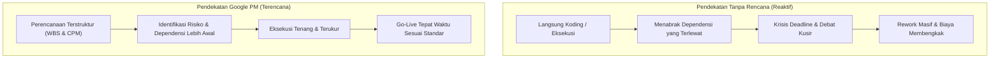
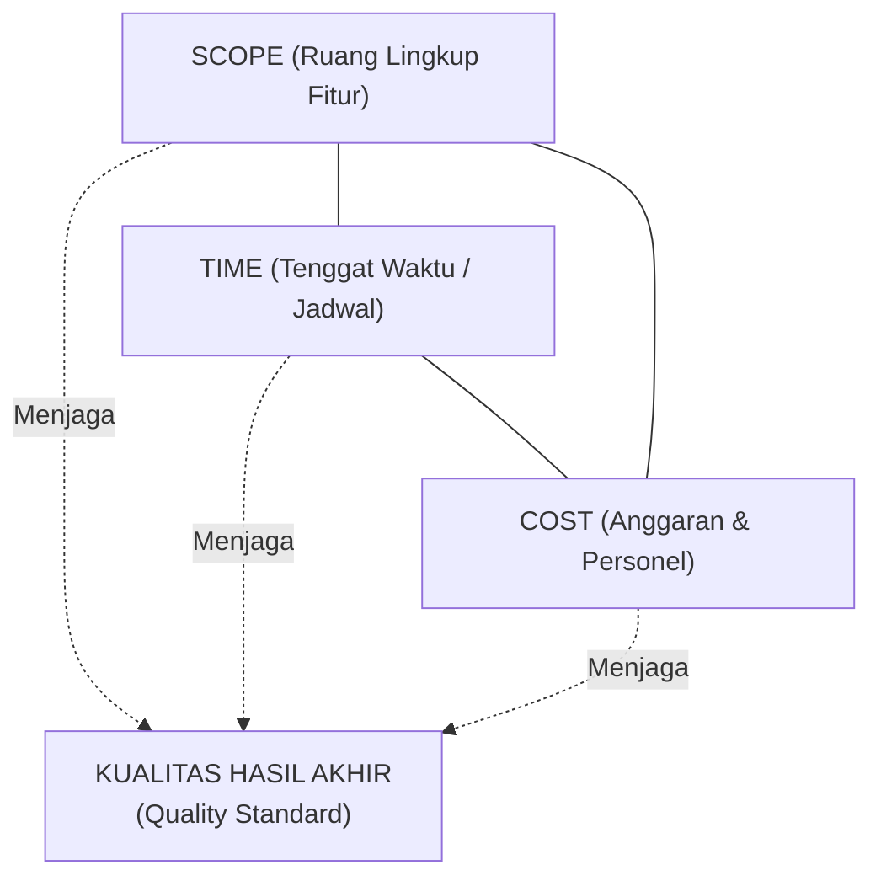

# Modul 11: The Power & Benefits of Project Planning
## Google Project Management Professional Certificate

> **Sumber Materi**: [Manfaat Perencanaan Proyek | Sertifikat Manajemen Proyek Google](https://www.youtube.com/watch?v=Yu0sUnulbo4)  
> **Kategori**: Course 3 — Project Planning: Putting It All Together (Module 1)  
> **Disusun oleh**: Dessy Rahmawati Chairullina, S.Kom  

---

## 📌 Executive Summary
1. **Transisi Kritis Menuju Eksekusi**: Jika fase Inisiasi menjawab *"Mengapa dan Apa yang ingin kita buat?"*, maka fase Perencanaan menjawab *"Bagaimana, Siapa, Kapan, dan Berapa Biaya untuk merealisasikannya?"*.
2. **Kekuatan Pencegahan Kegagalan**: Perencanaan yang matang memetakan dependensi tersembunyi, mengoptimalkan kapasitas sumber daya tim, dan menetapkan baseline jadwal dan anggaran sebagai tolok ukur pengendalian.
3. **Kerangka Triple Constraint (Segitiga Emas Manajemen Proyek)**: Keseimbangan dinamis antara *Scope* (Ruang Lingkup), *Time* (Waktu), dan *Cost* (Biaya) yang secara bersama-sama menentukan *Quality* (Kualitas Hasil Akhir).
4. **Anatomi Rencana Proyek Komprehensif**: Dokumen terpadu yang memadukan WBS (Work Breakdown Structure), jadwal jalur kritis (*Critical Path*), estimasi biaya, rencana kualitas, dan rencana manajemen perubahan.

---

## 1. Mengapa Perencanaan Adalah Investasi Waktu Terbaik?

Pepatah legendaris manajemen proyek menyatakan: *"Gagal merencanakan sama dengan merencanakan kegagalan"*. Proyek yang langsung melompat ke penulisan kode tanpa rencana matang biasanya menghabiskan 3–5 kali lipat waktu untuk perbaikan ulang (*rework*).

### Manfaat Nyata Perencanaan Terstruktur:
* **Mengungkap Dependensi Tersembunyi**: Mengetahui urutan logis pekerjaan (misal: *Alur otorisasi kasir tidak bisa dites sebelum skema database role pengguna disahkan*).
* **Membangun Konsensus Tim**: Setiap anggota tim memahami dengan jelas apa ekspektasi hasil kerja mereka dan bagaimana kontribusinya memengaruhi pekerjaan rekan lainnya.
* **Menetapkan Tolok Ukur Pengendalian (*Baselines*)**: Tanpa *Schedule Baseline* dan *Cost Baseline*, PM tidak memiliki cara objektif untuk mengetahui apakah proyek sedang terlambat atau melebihi anggaran.

---

## 2. Menguasai Kerangka Kerja Triple Constraint (Segitiga Besi)

Setiap perubahan pada salah satu sudut segitiga akan secara otomatis memaksa kompromi pada dua sudut lainnya atau mengorbankan kualitas.

### Dinamika Kompromi Proyek:
1. **Jika Scope Bertambah (Fitur Baru Ditambahkan)**:
   * ➔ *Time* harus diperpanjang (tenggat waktu mundur), **ATAU**
   * ➔ *Cost* harus dinaikkan (menambah developer/anggaran lembur), **ATAU**
   * ➔ *Quality* akan anjlok (banyak bug dan sistem tidak stabil).
2. **Jika Time Dipangkas (Peluncuran Dipercepat)**:
   * ➔ *Scope* harus dipangkas (hanya merilis MVP/fitur utama), **ATAU**
   * ➔ *Cost* harus dinaikkan (menambah sumber daya komputasi dan tim ekstra).
3. **Jika Cost Dipotong (Anggaran Dibatasi)**:
   * ➔ *Scope* harus dikurangi, **ATAU**
   * ➔ *Time* menjadi lebih panjang karena keterbatasan kapasitas tim pelaksana.

---

## 3. Komponen Inti Dokumen Rencana Proyek (Project Plan)

Dokumen Rencana Proyek yang komprehensif mengintegrasikan beberapa sub-rencana penting:

| Komponen Rencana | Fungsi & Hasil Kerja Utama |
| :--- | :--- |
| **Work Breakdown Structure (WBS)** | Dekomposisi hierarkis proyek dari paket besar menjadi unit tugas terkecil yang siap dieksekusi (*Work Packages*). |
| **Jadwal & Jalur Kritis (CPM)** | Pemetaan urutan tugas yang menentukan durasi total proyek tercepat tanpa toleransi penundaan (*zero float*). |
| **Rencana Anggaran & Biaya** | Rincian alokasi dana per milestone beserta cadangan kontinjensi (*management reserves*). |
| **Rencana Manajemen Mutu** | Standar pengujian fungsional, kepatuhan arsitektur kode, dan kriteria lolos UAT. |
| **Rencana Manajemen Sumber Daya** | Matriks alokasi beban kerja anggota tim untuk mencegah kelelahan (*burnout*). |

---

## 4. Studi Kasus Nyata: Mengubah Budaya "Langsung Koding" Menjadi Perencanaan Terstruktur

* **Latar Belakang**: Di sebuah rumah sakit, manajemen meminta tim IT segera membuat modul baru *Penyusutan Aset dan Buku Besar Akuntansi*. Karena dikejar target tutup tahun, programmer langsung menulis kode program selama 4 minggu tanpa membuat diagram alur, skema jurnal, maupun dokumen perencanaan.
* **Bencana yang Terjadi**:
  Saat diuji coba pada hari ke-28, form kasir menolak memposting transaksi karena rumus depresiasi garis lurus yang dibuat programmer ternyata tidak sesuai dengan pedoman perpajakan rumah sakit yang diatur oleh Dewan Pengawas. Seluruh kode harus dirombak total dan proyek molor 2 bulan dengan kerugian jam kerja sia-sia.
* **Penyelesaian Berbasis Perencanaan PM**:
  1. *Hentikan Eksekusi Buta*: PM baru mengambil alih dan menghentikan penulisan kode selama 1 minggu untuk fase perencanaan.
  2. *Penyusunan WBS Bersama Akuntan*: PM duduk bersama manajer keuangan menyusun rincian akun debet-kredit, rumus amortisasi, dan validasi rekonsiliasi.
  3. *Penetapan Acceptance Criteria Jelas*: Setiap fitur diberi skenario pengujian matematis yang disepakati hitam di atas putih sebelum koding dimulai kembali.
* **Hasil**:
  * Modul selesai dalam 3 minggu pengerjaan ulang yang tenang dan terarah.
  * Uji coba pertama langsung menghasilkan neraca saldo seimbang (*balance*) tanpa ada selisih satu rupiah pun.
  * Manajemen mengadopsi standar perencanaan PM sebagai SOP baku seluruh pengembangan software internal rumah sakit.

---

## 5. 🛠️ Actionable Project Planning Checklist

- [ ] **WBS Decomposed**: Apakah seluruh lingkup kerja sudah dipecah menjadi tugas-tugas kecil berdurasi realistis (maksimal 8–40 jam kerja per unit tugas)?
- [ ] **Dependencies Mapped**: Apakah urutan keterkaitan antar tugas sudah dipetakan dengan jelas (mana yang bisa paralel, mana yang harus sekuensial)?
- [ ] **Critical Path Identified**: Apakah tim tahu rangkaian tugas mana yang tidak boleh terlambat satu hari pun agar tanggal peluncuran tidak bergeser?
- [ ] **Baseline Locked**: Sudahkah Schedule Baseline dan Cost Baseline disahkan sebagai acuan evaluasi kinerja proyek?
- [ ] **Workload Balanced**: Apakah ada anggota tim yang dibebani tugas melebihi kapasitas jam kerja normal (*over-allocated*)?
