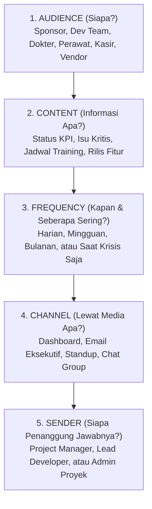

# Modul 12: Creating a Project Communication Plan
## Google Project Management Professional Certificate

> **Sumber Materi**: [Buat Rencana Komunikasi Proyek | Sertifikat Manajemen Proyek Google](https://www.youtube.com/watch?v=W_n0GYdW7DM)  
> **Kategori**: Course 3 — Project Planning: Putting It All Together (Module 2)  
> **Disusun oleh**: Dessy Rahmawati Chairullina, S.Kom  

---

## 📌 Executive Summary
1. **Peta Navigasi Informasi**: *Project Communication Plan* adalah panduan operasional tertulis yang mendefinisikan siapa yang membutuhkan informasi apa, kapan mereka membutuhkannya, melalui saluran apa informasi tersebut dikirim, dan siapa penanggung jawab pembuat laporannya.
2. **Mencegah Dua Ekstrem Berbahaya**: Rencana komunikasi yang baik melindungi proyek dari dua kegagalan fatal: *Under-communication* (pemangku kepentingan merasa ditinggalkan dan panik) dan *Over-communication* (pemangku kepentingan dibanjiri pesan spam hingga mengabaikan peringatan penting).
3. **Matriks Komunikasi Standar Google**: Format tabel terstruktur yang menjamin transparansi informasi tanpa membebani PM dengan pembuatan laporan yang tidak efektif.
4. **Mekanisme Umpan Balik (*Closed-Loop Feedback*)**: Memastikan pesan tidak hanya terkirim (*sent*), melainkan dipahami (*understood*) dan ditindaklanjuti (*acted upon*) oleh penerima.

---

## 1. Lima Pertanyaan Kunci dalam Merancang Rencana Komunikasi

Sebelum menyusun matriks komunikasi proyek, Manajer Proyek harus membedah 5 dimensi informasi:



---

## 2. Matriks Rencana Komunikasi Master Proyek

Dokumen ini dibagikan kepada seluruh pemangku kepentingan di awal fase perencanaan agar semua pihak memiliki ekspektasi yang selaras mengenai arus informasi.

```text
===========================================================================================================================
                                            MASTER PROJECT COMMUNICATION PLAN
===========================================================================================================================
Audiens             Informasi / Laporan          Frekuensi        Saluran / Format      Pengirim (Owner)   Ekspektasi Aksi
---------------------------------------------------------------------------------------------------------------------------
Project Sponsor &   Executive Status Report      Mingguan         Email Resmi & PDF     Project Manager    Tinjau status;
Direksi             (Milestone, Biaya, Eskalasi) (Jumat, 16.00)   Dashboard 1 Halaman                      eskalasi blocker.

Tim Inti Teknis     Daily Standup & Blocking     Harian           Tatap Muka / Meet     Scrum Master /     Selesaikan blocker;
(Developers & DBA)  Issues Tracking              (Pagi, 08.30)    Papan Kanban (15 mnt) PM                 sinkronisasi tugas.

Kepala Ruang &      Jadwal Pelatihan & Uji Coba  2 Mingguan       Rapat Koordinasi &    Lead Trainer /     Kirim perwakilan
Perawat Bangsal     Form Asesmen Baru            (Rabu, 13.00)    Buku Panduan Visual   PM                 staf per shift.

Staf Kasir &        Pembaruan Alur Validasi      1 Minggu Pra-    Sesi Sosialisasi &    Analis Bisnis      Simulasi transaksi
Keuangan            Billing & Rekonsiliasi BPJS  Go-Live          Cheat Sheet 1 Lembar  (BA) / PM          sebelum sistem aktif.

Seluruh Karyawan    Pengumuman Jadwal Jendela    H-3 & H-1        Broadcast Memo &      IT Operation /     Antisipasi downtime
Rumah Sakit         Pemeliharaan Server Dini Hari Sebelum Maint   WhatsApp Resmi RS     PM                 terjadwal 02.00-03.00.
===========================================================================================================================
```

---

## 3. Menjaga Kebersihan Saluran Komunikasi (*Communication Hygiene*)

Manajer Proyek wajib menetapkan aturan main komunikasi (*communication ground rules*) sejak awal untuk menjaga fokus kerja tim:

1. **Aturan Pesan Instan (WhatsApp / Slack)**:
   * Hanya digunakan untuk koordinasi cepat, klarifikasi ringkas, atau peringatan darurat (*emergency alert*).
   * Dilarang menggunakan pesan instan untuk menyetujui perubahan ruang lingkup (*scope changes*) atau perubahan anggaran tanpa konfirmasi tertulis via email resmi.
2. **Aturan Email Proyek**:
   * Gunakan subjek yang deskriptif dan mencantumkan kode status (misal: `[STATUS]`, `[DECISION NEEDED]`, atau `[URGENT]`).
   * Batasi penerima di kolom `To:` hanya pada orang yang wajib bertindak, sedangkan pihak yang sekadar perlu tahu diletakkan di kolom `Cc:`.
3. **Dokumentasi Keputusan Resmi**:
   * Setiap keputusan penting yang disepakati secara lisan di lorong atau kantin wajib diformalkan melalui memo ringkas atau notula rapat agar memiliki jejak audit yang sah (*paper trail*).

---

## 4. Studi Kasus Nyata: Mengatasi Bencana Komunikasi Saat Peluncuran Modul Rekam Medis

* **Skenario Masalah**: Pada peluncuran sistem rekam medis rawat jalan hari Senin pagi, terjadi kegagalan jaringan internet yang mengakibatkan form dokter lambat dibuka. Karena tidak ada rencana komunikasi resmi, perawat panik dan menyebarkan kabar burung bahwa sistem rusak permanen. Dokter menolak melayani pasien dan kembali menggunakan berkas kertas. Ruang tunggu poli ricuh.
* **Tindakan PM Berbasis Communication Plan**:
  1. *Aktivasi Saluran Krisis Terpusat*: PM segera mengambil alih kendali komunikasi dan merilis pesan resmi via saluran siaran rumah sakit dalam waktu 10 menit pasca-insiden:
     *"Tim IT sedang menstabilkan jalur server sekunder, estimasi normal kembali pukul 09.15 WIB. Mohon gunakan formulir darurat offline sementara waktu"*.
  2. *Status Update Berkala Tiap 15 Menit*: PM memberikan pembaruan singkat tanpa jeda panjang sehingga tidak ada celah bagi timbulnya rumor liar.
  3. *Pemberitahuan Sistem Pulih*: Pukul 09.10 WIB, jalur internet sekunder aktif dan PM mengirimkan notifikasi bahwa sistem telah aman digunakan kembali.
* **Hasil**:
  * Kepanikan mereda dalam 15 menit karena staf mendapatkan kepastian informasi dari satu sumber resmi (*Single Source of Truth*).
  * Manajemen rumah sakit mengapresiasi kecepatan mitigasi komunikasi PM yang mencegah komplain massal dari pasien rawat jalan.

---

## 5. 🛠️ Actionable Communication Plan Checklist

- [ ] **Audience Exhaustive**: Apakah semua kelompok pengguna dan pimpinan sudah tercantum dalam matriks rencana komunikasi?
- [ ] **Frequency Calibrated**: Apakah frekuensi laporan sudah seimbang (tidak terlalu jarang hingga menimbulkan kecemasan, tidak terlalu sering hingga menjadi spam)?
- [ ] **Designated Senders**: Apakah sudah ditentukan secara tegas siapa penanggung jawab tunggal pembuat laporan untuk setiap jenis audiens?
- [ ] **Emergency Protocol Defined**: Apakah ada panduan langkah-demi-langkah tentang ke mana dan bagaimana eskalasi harus dilakukan jika terjadi krisis sistem di luar jam kerja?
- [ ] **Accessibility Verified**: Apakah tautan dokumen atau dashboard yang dibagikan dapat dibuka dengan mudah oleh penerima tanpa hambatan hak akses (*permission denied*)?
