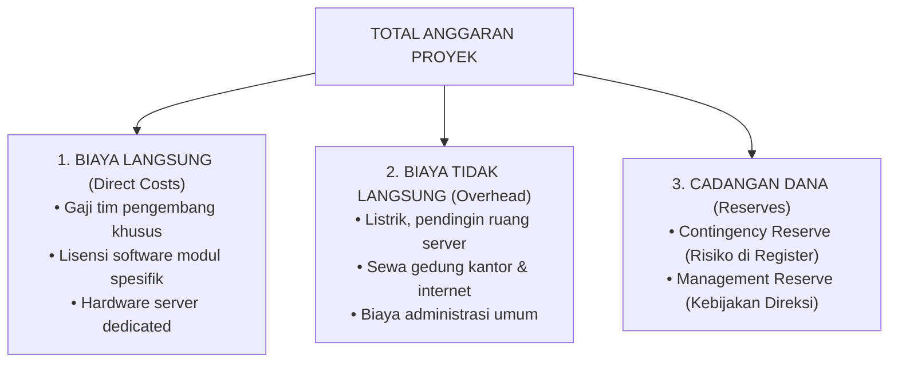
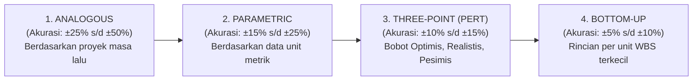

# Modul 13: Project Budgeting, Cost Estimation & Procurement
## Google Project Management Professional Certificate

> **Sumber Materi**: [Cara Membuat Anggaran Proyek | Sertifikat Manajemen Proyek Google](https://www.youtube.com/watch?v=lO51qhJWvok)  
> **Kategori**: Course 3 — Project Planning: Putting It All Together (Module 3)  
> **Disusun oleh**: Dessy Rahmawati Chairullina, S.Kom  

---

## 📌 Executive Summary
1. **Anggaran Adalah Komitmen Bisnis**: Anggaran proyek bukan sekadar daftar harga, melainkan baseline finansial yang disetujui pemegang dana (*Sponsor*) untuk membatasi pengeluaran dan mengukur efisiensi nilai hasil (*Earned Value*).
2. **Kategori Biaya Proyek**: Membedakan antara Biaya Langsung (*Direct Costs*), Biaya Tidak Langsung (*Indirect/Overhead*), Biaya Tetap (*Fixed*), dan Biaya Variabel (*Variable*), serta pemisahan belanja modal (*CapEx*) dan belanja operasional (*OpEx*).
3. **4 Teknik Estimasi Biaya Baku**: *Analogous* (Top-down historis), *Parametric* (Rumus statistik per unit), *Bottom-Up* (Kalkulasi rinci berbasis WBS), dan *Three-Point Estimating* (Formula PERT).
4. **Cadangan Finansial (*Reserves*)**: Alokasi dana darurat yang wajib disiapkan: *Contingency Reserve* (untuk risiko teridentifikasi / *known-unknowns*) dan *Management Reserve* (untuk ketidakpastian tak terduga / *unknown-unknowns*).
5. **Pengadaan & Manajemen Vendor (*Procurement*)**: Memilih jenis kontrak yang tepat (Fixed-Price vs Time & Materials) dan mengelola *Statement of Work (SOW)* secara akuntabel.

---

## 1. Klasifikasi dan Anatomi Struktur Biaya Proyek

Sebelum menjumlahkan angka, Manajer Proyek harus mengelompokkan pos pengeluaran ke dalam kategori akuntansi yang tepat.

### Matriks Karakteristik Biaya:
| Kategori Biaya | Karakteristik Utama | Contoh Kasus (Proyek SIMRS) |
| :--- | :--- | :--- |
| **CapEx (Capital Expenditure)** | Investasi aset jangka panjang yang memiliki masa manfaat lebih dari 1 tahun dan mengalami depresiasi. | Pengadaan 2 unit server fisik database dan perangkat UPS ruang data center. |
| **OpEx (Operational Expenditure)** | Biaya operasional rutin yang habis pakai untuk menjalankan aktivitas harian proyek. | Biaya langganan API gateway per bulan, honor konsultan eksternal, dan konsumsi rapat. |
| **Fixed Cost** | Biaya yang nominalnya tetap tidak peduli berapa banyak volume pekerjaan yang diproses. | Lisensi software database komersial sekali bayar (*one-time license*). |
| **Variable Cost** | Biaya yang naik atau turun sebanding dengan volume output atau jam kerja yang digunakan. | Biaya lembur staf penguji sistem saat fase UAT (dihitung per jam kerja). |

---

## 2. Empat Metode Estimasi Biaya (Cost Estimation Techniques)

Tingkat akurasi estimasi meningkat seiring berjalannya fase proyek dari konsepsi awal hingga perencanaan detail.

### Formula Three-Point Estimating (Teknik PERT):
Untuk tugas yang memiliki ketidakpastian tinggi, gunakan rata-rata tertimbang dari tiga skenario:
* $O$ = Estimasi Optimis (*kondisi terbaik*)
* $M$ = Estimasi Paling Mungkin (*Most Likely*)
* $P$ = Estimasi Pesimis (*skenario terburuk*)

$$\text{Estimasi Biaya PERT} = \frac{O + 4M + P}{6}$$

*Contoh Perhitungan*: Biaya integrasi API eksternal: $O = \text{Rp 10 jt}$, $M = \text{Rp 16 jt}$, $P = \text{Rp 34 jt}$.
$$\text{Hasil Estimasi} = \frac{10 + 4(16) + 34}{6} = \frac{108}{6} = \text{Rp 18.000.000}$$

---

## 3. Strategi Pengadaan & Memilih Jenis Kontrak Vendor

Jika proyek membutuhkan pihak ketiga (vendor pengembang atau penyedia infrastruktur cloud), PM harus memilih struktur kontrak yang melindungi kepentingan organisasi:

1. **Fixed-Price Contract (Harga Pasti)**:
   * *Mekanisme*: Nilai kontrak terkunci di awal untuk ruang lingkup pekerjaan yang didefinisikan secara sangat ketat (*well-defined scope*).
   * *Risiko*: Berada di pihak vendor. Sangat cocok jika kebutuhan sistem sudah 100% matang dan tidak akan berubah.
2. **Time and Materials / T&M (Waktu & Bahan)**:
   * *Mekanisme*: Pembayaran dihitung berdasarkan tarif jam kerja tenaga ahli ditambah biaya material aktual yang terpakai.
   * *Risiko*: Berada di pihak pembeli/rumah sakit. Cocok untuk proyek eksploratif atau pengembangan perangkat lunak Agile yang ruang lingkupnya terus berkembang.

---

## 4. Studi Kasus Nyata: Mencegah Pembengkakan Biaya 40% pada Pengadaan Server SIMRS

* **Masalah**: Pada proyek upgrade infrastruktur rekam medis elektronik, vendor mengajukan penawaran pengadaan server bare-metal baru senilai Rp 320.000.000 dengan alasan server lama tidak akan mampu menangani lonjakan transaksi form EWS rawat inap. Sponsor menolak karena melebihi pagu anggaran awal sebesar Rp 200.000.000.
* **Tindakan PM Berbasis Bottom-Up Costing**:
  1. *Audit Beban Aktual Server*: PM bersama DBA melakukan profiling utilisasi CPU dan RAM pada server eksisting saat jam sibuk poli (09.00–12.00 WIB).
  2. *Temuan Data Faktual*: Beban puncak CPU ternyata hanya 38%, dan masalah kelambatan murni disebabkan oleh *unindexed database queries* dan query join yang tidak efisien, bukan keterbatasan fisik prosesor.
  3. *Rekayasa Solusi Efisiensi Biaya*:
     * Alih-alih membeli server fisik baru Rp 320 juta, PM mengalokasikan:
       * Optimalisasi indeks dan struktur tabel database: Rp 0 (dikerjakan tim internal).
       * Upgrade modul RAM dan penyimpanan SSD Enterprise NVMe pada server eksisting: Rp 45.000.000.
       * Alokasi Contingency Reserve (15%): Rp 6.750.000.
* **Hasil**:
  * Total belanja proyek hanya Rp 51.750.000 (menghemat Rp 268.250.000 atau 83% dari penawaran awal vendor).
  * Kecepatan respons query SIMRS meningkat 4 kali lipat lebih cepat.
  * PM mendapatkan apresiasi tinggi dari Direktur Keuangan karena berhasil mencapai target performa jauh di bawah pagu anggaran.

---

## 5. 🛠️ Actionable Budgeting & Procurement Checklist

- [ ] **WBS Bottom-Up Alignment**: Apakah setiap pos biaya di dalam anggaran dapat ditelusuri langsung ke unit tugas pada dokumen WBS?
- [ ] **CapEx vs OpEx Segregated**: Apakah pengeluaran investasi aset sudah dipisahkan dengan jelas dari biaya operasional rutin?
- [ ] **Contingency Buffer Added**: Sudahkah menyisihkan dana cadangan kontinjensi (standar 10–20%) berdasarkan skor risiko di *Risk Register*?
- [ ] **Contract Type Justified**: Jika menggunakan vendor luar, apakah jenis kontrak (Fixed-Price vs T&M) sudah sesuai dengan tingkat kematangan ruang lingkup pekerjaan?
- [ ] **Formal SOW Signed**: Apakah dokumen *Statement of Work* (SOW) memuat batasan deliverable, kriteria penerimaan, dan jadwal pembayaran termin yang disetujui bagian hukum (*Legal*)?
