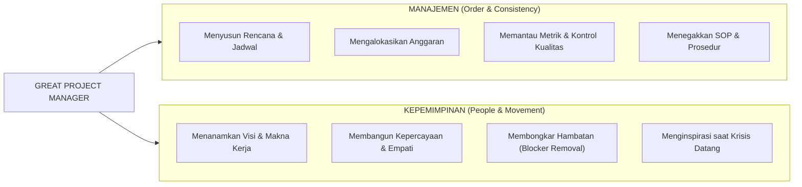

# Modul 14: Leadership vs. Management in High-Performing Teams
## Google Project Management Professional Certificate

> **Sumber Materi**: [Kepemimpinan vs Manajemen dalam Tim yang Sukses | Sertifikat Manajemen Proyek Google](https://www.youtube.com/watch?v=ypLw8he1Xh0)  
> **Kategori**: Course 4 — Project Execution: Running the Project (Module 1)  
> **Disusun oleh**: Dessy Rahmawati Chairullina, S.Kom  

---

## 📌 Executive Summary
1. **Dua Sisi Mata Uang yang Berbeda**: *Manajemen* berfokus pada ketertiban, struktur, dan konsistensi (jadwal, anggaran, prosedur, dan metrik). *Kepemimpinan* berfokus pada orang, visi, motivasi, pemberdayaan, dan navigasi perubahan.
2. **Kekuatan Kepemimpinan Tanpa Wewenang Formal (*Influencing Without Authority*)**: PM jarang sekali menjadi atasan langsung anggota tim dalam bagan organisasi. Oleh karena itu, kemampuan memengaruhi melalui kepercayaan (*trust*), empati, dan kompetensi jauh lebih efektif daripada mengandalkan kekuasaan jabatan.
3. **Model Kepemimpinan Situasional (*Situational Leadership*)**: Menyesuaikan gaya bimbingan (Directing, Coaching, Supporting, Delegating) berdasarkan tingkat kompetensi dan komitmen anggota tim.
4. **Keamanan Psikologis (*Psychological Safety*)**: Pondasi nomor satu tim berkinerja tinggi versi Google (*Project Aristotle*); lingkungan di mana anggota tim merasa aman untuk mengakui kesalahan, bertanya, dan mengajukan gagasan baru tanpa takut dipermalukan atau dihukum.

---

## 1. Perbedaan Mendasar: Manajer vs. Pemimpin Proyek

Seorang PM yang hanya bertindak sebagai "Manajer" akan menjadi administrator kaku yang dibenci tim. Sebaliknya, PM yang hanya menjadi "Pemimpin" tanpa keterampilan manajemen akan menghasilkan visi indah tanpa ada produk yang selesai tepat waktu.



### Matriks Perbandingan Perilaku:
| Situasi Proyek | Respon Murni Manajer | Respon Pemimpin Proyek (Leader) |
| :--- | :--- | :--- |
| **Terjadi Keterlambatan Tugas** | Menegur programmer, menuntut penjelasan mengapa jadwal mundur, dan menambah jam lembur paksa. | Menggali akar masalah bersama: *"Hambatan teknis apa yang sedang mengganjalmu, dan bantuan apa yang bisa saya sediakan agar tugas ini lancar?"* |
| **Terjadi Bug Kritis di Lapangan** | Mencari siapa yang menulis baris kode tersebut untuk diberikan sanksi atau surat peringatan. | Melindungi tim dari tekanan luar, fokus bersama memulihkan sistem, lalu mengadakan sesi *Blameless Post-Mortem*. |
| **Membagikan Tugas Proyek** | Membagikan tiket pekerjaan seperti membagikan beban kerja tanpa penjelasan latar belakang. | Menjelaskan *mengapa* modul ini penting: *"Fitur ini akan menyelamatkan puluhan pasien IGD dari salah dosis obat"*. |

---

## 2. Model Kepemimpinan Situasional (Hersey-Blanchard)

Gaya kepemimpinan yang seragam untuk semua orang adalah resep kegagalan. Sesuaikan pendekatan Anda dengan tingkat kesiapan personel:

```text
Tinggi ^
       |     [ COACHING / S2 ]              [ SUPPORTING / S3 ]
D      |     Tinggi Arahan, Tinggi Support  Rendah Arahan, Tinggi Support
U      |     (Karyawan bingung/stuck)       (Karyawan ragu-ragu/minder)
K      |---------------------------------------------------------------
U      |     [ DIRECTING / S1 ]             [ DELEGATING / S4 ]
N      |     Tinggi Arahan, Rendah Support  Rendah Arahan, Rendah Support
G      |     (Junior antusias, butuh SOP)   (Senior mandiri, expert)
A      +------------------------------------------------------------->
N      Rendah                       ARAHAN                       Tinggi
```

1. **Directing (S1)**: Berikan instruksi langkah demi langkah yang spesifik untuk programmer junior atau anggota tim baru yang bersemangat tetapi belum tahu prosedur rumah sakit.
2. **Coaching (S2)**: Bimbing secara intensif staf yang mulai frustrasi menghadapi kendala teknis pertama mereka; dengarkan keluhan mereka sambil menunjukkan alternatif solusi.
3. **Supporting (S3)**: Berikan dorongan moral dan otonomi kepada staf berpengalaman yang kompeten namun kurang percaya diri mengambil keputusan arsitektur.
4. **Delegating (S4)**: Berikan kepercayaan penuh, tetapkan hasil akhir yang diharapkan (*acceptance criteria*), lalu biarkan spesialis senior mengeksekusi dengan cara terbaik mereka.

---

## 3. Membangun Keamanan Psikologis (*Psychological Safety*)

Studi Google bertajuk **Project Aristotle** terhadap ratusan tim membuktikan bahwa penentu utama tim berkinerja tinggi bukanlah IQ rata-rata anggota tim, melainkan **Keamanan Psikologis**.

### Protokol Membangun Budaya Tanpa Menyalahkan (*Blameless Culture*):
* **Fokus pada Sistem, Bukan Individu**: Saat sistem macet, tanyakan *"Prosedur verifikasi apa yang kurang pada alur rilis kita?"*, bukan *"Siapa yang bodoh memasukkan baris kode ini?"*.
* **Normalisasi Pengakuan Ketidaktahuan**: Pemimpin yang berani berkata *"Saya belum tahu jawabannya, mari kita cari tahu bersama"* membuka ruang kejujuran bagi seluruh tim.
* **Apresiasi Pelaporan Dini Masalah**: Berikan pujian kepada anggota tim yang berani melaporkan potensi keterlambatan atau celah bug sejak hari pertama sebelum krisis meledak ke meja direksi.

---

## 4. Studi Kasus Nyata: Menangani Krisis Bug Transaksi dengan Servant Leadership

* **Krisis**: Pada hari pertama peluncuran modul *Billing Kasir Baru*, terjadi selisih pencatatan total sebesar Rp 18.000.000 akibat seorang programmer junior salah menaruh operator pembulatan pecahan desimal. Manajer Keuangan mengamuk dan menuntut programmer tersebut dipecat hari itu juga.
* **Tindakan PM sebagai Servant Leader**:
  1. *Menjadi Tameng Pelindung Tim*: PM berdiri di depan dan meredam amarah Manajer Keuangan secara tenang: *"Saya selaku Project Manager bertanggung jawab penuh atas rilis ini. Beri waktu tim saya 45 menit untuk memperbaiki logika dan merekonsiliasi selisih data"*.
  2. *Menenangkan Programmer Junior*: PM mendatangi meja programmer yang sedang gemetar ketakutan, membawakan air minum, dan berkata: *"Tenang, kita selesaikan ini bersama. Saya ada di sampingmu. Tunjukkan pada saya bagian kodenya"*.
  3. *Perbaikan Cepat & Verifikasi Bersama*: Bersama lead developer, bug diperbaiki dalam 20 menit dan data selisih jurnal berhasil direkonsiliasi sempurna.
  4. *Blameless Post-Mortem*: Keesokan harinya, PM memimpin evaluasi sistemik. Hasilnya, tim menyepakati pembuatan skrip *automated unit testing* untuk seluruh formula kalkulasi keuangan sebelum kode boleh di-merge ke branch master.
* **Hasil**:
  * Tidak ada pemecatan; programmer junior tersebut belajar pelajaran paling berharga dalam kariernya dan berkembang menjadi salah satu developer paling teliti di perusahaan.
  * Loyalitas dan dedikasi tim terhadap proyek meningkat drastis karena mereka tahu PM akan selalu melindungi dan mendukung mereka di saat krisis.

---

## 5. 🛠️ Actionable Team Leadership Checklist

- [ ] **Influence Mapping**: Apakah saya memimpin tim ini menggunakan pengaruh kepercayaan dan rasa hormat, bukan sekadar ancaman atau kekuasaan formal?
- [ ] **Situational Adaptation**: Apakah saya sudah menyesuaikan gaya komunikasi saya (Directing vs Delegating) dengan tingkat kematangan masing-masing anggota tim?
- [ ] **Psychological Safety Check**: Apakah anggota tim merasa nyaman menyuarakan kekhawatiran dan melaporkan bug tanpa takut disalahkan?
- [ ] **Active Blocker Removal**: Apakah pertanyaan utama saya di setiap standup harian adalah *"Apa yang menghambatmu hari ini dan bagaimana saya bisa membantumu?"*?
- [ ] **Recognition & Celebration**: Apakah pencapaian kerja keras tim diakui dan diapresiasi secara terbuka di hadapan pemangku kepentingan eksekutif?
