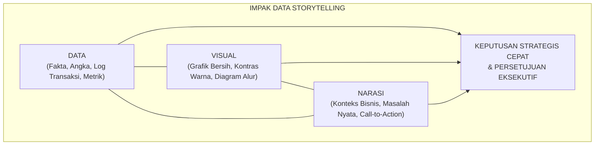

# Modul 15: Data Storytelling for Decision Making
## Google Project Management Professional Certificate

> **Sumber Materi**: [Bercerita dengan Data untuk Mengambil Keputusan | Sertifikat Manajemen Proyek Google](https://www.youtube.com/watch?v=4VDRNQ_f4IE)  
> **Kategori**: Course 4 — Project Execution: Running the Project (Module 2)  
> **Disusun oleh**: Dessy Rahmawati Chairullina, S.Kom  

---

## 📌 Executive Summary
1. **Data Mentah Tidak Pernah Mengambil Keputusan**: Data numerik hanyalah fakta dingin. Tanpa narasi dan konteks, tumpukan tabel angka tidak akan mampu meyakinkan pemangku kepentingan eksekutif untuk menyetujui anggaran atau mengubah kebijakan.
2. **Trinitas Data Storytelling**: Perpaduan harmonis antara *Data* (fakta obyektif terverifikasi), *Visual* (grafik bersih yang memandu mata pembaca), dan *Narasi* (cerita kontekstual yang memicu aksi nyata).
3. **Struktur Alur Cerita Bisnis (*The Business Narrative Arc*)**: Mengemas presentasi dengan format klasik: *Latar Belakang (Baseline) ➔ Konflik / Hambatan (Data Temuan Masalah) ➔ Solusi & Resolusi (Rekomendasi Tindakan PM)*.
4. **Prinsip Kebersihan Visual (*Visual Decluttering*)**: Menghilangkan dekorasi grafik yang mengganggu (*chartjunk*, efek 3D berlebihan, warna-warni acak) dan menggunakan kontras warna strategis untuk menonjolkan pesan kunci secara instan.

---

## 1. Trinitas Data Storytelling

Google Project Management menekankan bahwa seorang PM harus mampu menerjemahkan data teknis yang rumit menjadi cerita bisnis yang memikat.



### Apa yang Terjadi Jika Salah Satu Unsur Hilang?
* **Data + Visual (Tanpa Narasi)**: Menghasilkan grafik yang indah tetapi penonton bingung: *"Lalu apa artinya angka ini bagi bisnis kita?"*.
* **Data + Narasi (Tanpa Visual)**: Menghasilkan paparan teknis yang membosankan dan melelahkan otak pendengar (*cognitive overload*).
* **Visual + Narasi (Tanpa Data Valid)**: Menjadi propaganda atau opini kosong yang mudah dipatahkan saat diaudit.

---

## 2. Struktur Narasi 3 Babak (The Business Narrative Arc)

Jangan memulai presentasi langsung dengan slide tabel angka 100 baris. Gunakan struktur 3 babak yang alami bagi cara berpikir manusia:

```text
       [ KLIMAKS: MASALAH TERBONGKAR ]
       "Penolakan klaim BPJS melonjak ke 18.4% (Rp 450 jt)
        akibat resume medis DPJP tidak lengkap"
                  /\
                 /  \
                /    \
               /      \  [ RESOLUSI: SOLUSI & ROI ]
              /        \ "Implementasi validasi bridging otomatis
             /           memangkas penolakan hingga < 1% dalam 30 hari"
 [ BABAK 1: STATUS QUO ]
 "Rumah sakit melayani 8.000 pasien/bulan
  dengan pendapatan klaim Rp 4.2 Miliar"
```

1. **Babak 1 — Membangun Konteks (*Setting the Stage*)**:
   * Jelaskan situasi normal saat ini dan baseline kinerja organisasi agar audiens memiliki titik acuan yang sama.
2. **Babak 2 — Menyingkap Konflik (*The Tension / Friction*)**:
   * Tampilkan data anomali atau titik kemacetan (*bottleneck*) yang sedang mengancam target bisnis. Gunakan grafik yang menonjolkan lonjakan masalah secara visual.
3. **Babak 3 — Menghadirkan Solusi (*The Resolution & Call to Action*)**:
   * Tunjukkan bagaimana inisiatif proyek yang Anda pimpin akan menyelesaikan konflik tersebut, berapa biaya investasinya, dan proyeksi keuntungan (*ROI*) yang dihasilkan.

---

## 3. Panduan Memilih Grafik yang Tepat

Salah memilih jenis grafik akan mengaburkan pemahaman audiens:

| Jenis Data yang Ingin Ditampilkan | Grafik Terbaik | Pantangan Utama |
| :--- | :--- | :--- |
| **Perbandingan Antar Kategori** (Misal: Jumlah komplain per poli) | Bar Chart Horizontal atau Kolom Vertikal | Menggunakan Pie Chart dengan lebih dari 4 irisan. |
| **Tren Berkelanjutan Sepanjang Waktu** (Misal: Utilisasi server harian) | Line Chart (Grafik Garis) | Menggunakan Bar Chart yang padat sehingga sumbu horizontal berhimpitan. |
| **Proporsi Bagian terhadap Total** (Misal: Persentase jenis pasien BPJS vs Umum) | Donut Chart Sederhana (Maksimal 2–3 segmen) | Menggunakan diagram 3D yang mendistorsi sudut perspektif. |
| **Korelasi Dua Variabel** (Misal: Waktu tunggu vs Skor kepuasan pasien) | Scatter Plot (Diagram Sebar) | Memaksakan garis tren jika data tersebar acak tanpa signifikansi statistik. |

---

## 4. Studi Kasus Nyata: Meyakinkan Dewan Direksi Menyetujui Modul Jasa Medis

* **Tantangan**: PM membutuhkan persetujuan anggaran Rp 50.000.000 untuk pengembangan modul *Otomatisasi Jasa Medis dan Bridging Kasir*. Dewan Pengawas awalnya menolak karena menganggap sistem manual lama yang menggunakan Excel masih "cukup baik".
* **Strategi Presentasi Data Storytelling oleh PM**:
  1. *Slide 1 — Konteks*: Menampilkan grafik garis pendapatan rumah sakit stabil di angka Rp 5,2 Miliar/bulan.
  2. *Slide 2 — Konflik (Beban Biaya Tersembunyi)*:
     * PM menampilkan grafik batang horizontal yang menyoroti durasi kerja kasir: 140 jam kerja per bulan dihabiskan hanya untuk mencocokkan formula Excel manual.
     * PM memperlihatkan metrik selisih bayar (*uncollected revenue*) sebesar Rp 87.000.000 dalam semester terakhir akibat keterlambatan klaim kadaluwarsa.
  3. *Slide 3 — Kontras Visual*:
     * Warna abu-abu redup untuk proses manual lama (18 hari kerja, risiko selisih Rp 87 juta).
     * Warna biru tebal untuk proyeksi sistem baru (1 hari kerja, selisih Rp 0).
  4. *Slide 4 — Call to Action*:
     *"Investasi Rp 50 juta ini akan kembali modal (Break-Even Point) hanya dalam waktu 3,5 bulan dari penyelamatan potensi kebocoran pendapatan klaim"*.
* **Hasil**:
  * Dewan Direksi menyetujui anggaran secara bulat dalam rapat 20 menit tanpa perdebatan panjang.
  * Modul selesai dibangun dan berhasil menyelamatkan potensi pendapatan Rp 92 juta di kuartal pertama operasional.

---

## 5. 🛠️ Actionable Data Storytelling Checklist

- [ ] **Audience Takeaway Defined**: Apakah saya tahu satu kalimat utama yang harus diingat oleh audiens setelah presentasi selesai?
- [ ] **Chartjunk Removed**: Sudahkah menghapus bayangan 3D, border tebal, warna background gelap, dan garis kisi-kisi (*gridlines*) yang tidak perlu?
- [ ] **Strategic Color Contrast**: Apakah warna mencolok hanya digunakan untuk menyoroti data kunci yang ingin diperhatikan audiens (aturan 80/20 warna)?
- [ ] **Clear Baseline & Scale**: Apakah sumbu grafik dimulai dari angka nol (0) untuk mencegah kesan manipulasi visual (*honesty in charting*)?
- [ ] **Action-Oriented Title**: Apakah judul slide berupa kesimpulan aktif (contoh: *"Waktu Rekonsiliasi Turun 80%"*), bukan judul pasif (contoh: *"Grafik Waktu Rekonsiliasi"*）?
