# Modul 16: Quality Management & Continuous Improvement
## Google Project Management Professional Certificate

> **Sumber Materi**: [Manajemen Mutu dan Peningkatan Berkelanjutan | Sertifikat Manajemen Proyek Google](https://www.youtube.com/watch?v=QOy2gYuWxSc)  
> **Kategori**: Course 4 — Project Execution: Running the Project (Module 3)  
> **Disusun oleh**: Dessy Rahmawati Chairullina, S.Kom  

---

## 📌 Executive Summary
1. **Definisi Mutu Proyek**: Mutu bukan berarti produk harus mewah atau berfitur paling canggih, melainkan *Kesesuaian terhadap Kebutuhan (Conformance to Requirements)* dan *Kelayakan Penggunaan (Fitness for Use)* tanpa cacat fatal.
2. **Perbedaan QA vs. QC**:
   * *Quality Assurance (QA)*: Berorientasi pada **proses** pencegahan kesalahan (*proactive*) melalui standarisasi alur kerja, panduan koding, dan arsitektur pengujian.
   * *Quality Control (QC)*: Berorientasi pada **produk** akhir pendeteksian cacat (*reactive*) melalui inspeksi, pengujian regresi, dan *User Acceptance Testing (UAT)*.
3. **Biaya Kualitas (*Cost of Quality - CoQ*)**: Memperbaiki cacat sistem di tahap produksi (*External Failure*) berbiaya hingga 100 kali lipat lebih mahal daripada mencegahnya di tahap perancangan (*Prevention Cost*).
4. **Peningkatan Berkelanjutan (*Continuous Improvement*)**: Penerapan siklus **PDCA (Plan-Do-Check-Act)** dan analisis akar masalah menggunakan metode **5 Whys** dan Diagram Tulang Ikan (*Ishikawa/Fishbone*).

---

## 1. Membedah Dua Sayap Mutu: Quality Assurance vs. Quality Control

```mermaid
flowchart LR
    subgraph QA ["QUALITY ASSURANCE (QA) - FOKUS PROSES"]
    QA1["Penyusunan Standar Koding & SOP"]
    QA2["Automated Unit Testing Framework"]
    QA3["Peer Code Review Sebelum Merge"]
    QA4["Audit Kepatuhan Arsitektur"]
    end
    
    subgraph QC ["QUALITY CONTROL (QC) - FOKUS PRODUK"]
    QC1["Pengujian Fungsional (Manual Testing)"]
    QC2["Uji Beban & Stres (Load Testing)"]
    QC3["User Acceptance Testing (UAT)"]
    QC4["Pemeriksaan Format Output & Laporan"]
    end
    
    QA -->|Mencegah Cacat Masuk| Dev["Proses Pengembangan"]
    Dev -->|Menghasilkan Deliverable| QC
    QC -->|Lolos Uji Tanpa Cacat| Release["Rilis ke Produksi"]
```



### Tabel Perbandingan QA vs. QC:
| Dimensi | Quality Assurance (QA) | Quality Control (QC) |
| :--- | :--- | :--- |
| **Fokus Utama** | Mencegah timbulnya bug atau cacat pada proses. | Menemukan bug yang sudah terlanjur ada pada produk. |
| **Karakter Pendekatan** | Proaktif (*Proactive*). | Reaktif (*Reactive*). |
| **Kapan Dilakukan?** | Sepanjang siklus hidup pengembangan sistem. | Di akhir sprint, sebelum fase rilis atau serah terima. |
| **Pelaksana** | Seluruh tim proyek (PM, Lead Dev, Architect). | Tim Penguji (*Quality Tester / QA Engineer*), End-Users. |
| **Contoh Aksi Nyata** | Menetapkan aturan validasi PreparedStatement anti SQL-Injection. | Menjalankan skenario uji klik tombol "Simpan" dengan 10 variasi data uji. |

---

## 2. Model Biaya Kualitas (Cost of Quality - CoQ)

Biaya kualitas terbagi menjadi dua kubu besar: Biaya Keselarasan (*Cost of Conformance*) dan Biaya Ketidakselarasan (*Cost of Non-Conformance*).

```text
====================================================================================
                        COST OF QUALITY (CoQ) PYRAMID
====================================================================================
[ Biaya Tertinggi: External Failure ] -> Crash di ruang operasi, data pasien hilang,
                                         sanksi hukum, denda malpraktik, reputasi hancur.
[ Biaya Sedang: Internal Failure ]   -> Bug ditemukan saat testing internal, butuh
                                         rework koding dan penundaan jadwal rilis.
[ Biaya Rendah: Appraisal Costs ]    -> Biaya sesi testing, gaji tester, audit kode.
[ Biaya Paling Efisien: Prevention ] -> Pelatihan tim, standardisasi SOP, arsitektur rapi.
====================================================================================
```

* **Aturan 1-10-100**:
  * Biaya mencegah bug saat perancangan = **\$1** (Rp 15.000).
  * Biaya memperbaiki bug saat testing internal = **\$10** (Rp 150.000).
  * Biaya memperbaiki bug setelah sistem dipakai di rumah sakit = **\$100+** (Rp 1.500.000+).

---

## 3. Analisis Akar Masalah: Metode 5 Whys (5 Mengapa)

Saat terjadi kegagalan mutu, PM tidak boleh berhenti pada gejala permukaan. Gunakan teknik 5 Whys Sakichi Toyoda untuk menemukan akar sistemik:

```text
[ KASUS: FORM REKAM MEDIS GAGAL MENYIMPAN TRANSAKSI RAWAT INAP ]
1. Mengapa form gagal menyimpan data?
   -> Karena database melempar pesan error: "Data truncation: Data too long for column 'kesadaran'".
2. Mengapa kolom 'kesadaran' terlalu panjang?
   -> Karena perawat memilih opsi teks "Compos Mentis (Sadar Penuh)", sedangkan panjang kolom hanya VARCHAR(10).
3. Mengapa kolom tersebut hanya VARCHAR(10)?
   -> Karena saat membuat tabel, developer berasumsi opsi kesadaran hanya berisi kode singkatan (misal: "CM").
4. Mengapa developer berasumsi demikian?
   -> Karena tidak ada kamus data (Data Dictionary) resmi yang dibagikan saat kickoff proyek.
5. Mengapa tidak ada kamus data resmi? (AKAR MASALAH UTAMA)
   -> Karena proyek melompati fase validasi spesifikasi klinis bersama komite keperawatan.

SOLUSI SISTEMIK PM:
Bukan sekadar meng-alter tabel menjadi VARCHAR(50), melainkan mewajibkan penandatanganan 
dokumen Data Dictionary oleh perwakilan klinis sebelum koding modul baru dimulai.
```

---

## 4. Pelaksanaan User Acceptance Testing (UAT) yang Terstruktur

UAT adalah benteng terakhir sebelum software diizinkan beroperasi di lingkungan produksi. UAT bukan sekadar "mempersilakan user mencoba-coba sesuka hati", melainkan pengujian berbasis skenario uji (*Test Cases*).

### Format Lembar Uji UAT Standar:
| ID Kasus Uji | Skenario Pengujian | Hasil yang Diharapkan | Status (Lolos/Gagal) | Tingkat Keparahan Bug |
| :--- | :--- | :--- | :---: | :---: |
| UAT-01 | Input tanda vital dengan tekanan darah 190/110 mmHg. | Baris tabel otomatis berubah merah (Peringatan MEOWS Kritis). | **LOLOS** | - |
| UAT-02 | Menyimpan form tanpa mengisi identitas perawat penilai. | Sistem memunculkan dialog peringatan: *"Petugas wajib dipilih"*. | **LOLOS** | - |
| UAT-03 | Pasien rawat inap dipindahkan kamar saat form sedang terbuka. | Data riwayat otomatis menyesuaikan lokasi bangsal baru. | **GAGAL** | **Major** (Data anomali) |

---

## 5. Studi Kasus Nyata: Mengeliminasi Anomali Data pada Modul Risiko Jatuh Pasien

* **Masalah**: Pada audit akreditasi rumah sakit, ditemukan 12% rekam medis pasien geriatri tidak memiliki skor risiko jatuh yang valid. Investigasi menunjukkan form software yang ada memungkinkan tombol "Simpan" ditekan meskipun perawat belum memilih kriteria skala Morse.
* **Tindakan PM Berbasis Manajemen Mutu**:
  1. *Perbaikan QA (Pencegahan di Kode)*: PM menambahkan validasi ganda (*front-end & back-end check*). Tombol "Simpan" dinonaktifkan secara visual (*disabled state*) hingga seluruh 6 parameter risiko jatuh terisi lengkap.
  2. *Automated Unit Testing*: Tim membuat skrip uji yang otomatis menguji 50 kombinasi skor acak untuk memastikan algoritma penjumlahan total skor tidak pernah menghasilkan angka negatif atau nilai di luar batas 0–125.
  3. *Uji Terima UAT Ulang*: Sesi UAT digelar melibatkan 8 kepala ruang bangsal untuk memverifikasi kejelasan teks dan pewarnaan indikator risiko (Hijau = Rendah, Kuning = Sedang, Merah = Tinggi).
* **Hasil**:
  * Angka anomali data turun menjadi 0% (*zero defect*).
  * Rumah sakit lulus verifikasi mutu rekam medis elektronik dengan skor kepatuhan 100%.

---

## 6. 🛠️ Actionable Quality Management Checklist

- [ ] **Acceptance Criteria Defined**: Apakah setiap kartu tugas di backlog sudah memiliki kriteria penerimaan yang jelas sebelum mulai dikerjakan?
- [ ] **Peer Review Enforced**: Apakah ada aturan baku bahwa tidak ada baris kode yang boleh masuk ke branch utama tanpa ditinjau oleh minimal 1 rekan tim (*peer review*)?
- [ ] **Structured UAT Run**: Apakah pengujian pengguna akhir menggunakan naskah skenario uji formal dengan hasil tercatat hitam di atas putih?
- [ ] **Bug Severity Classified**: Apakah setiap temuan bug sudah diklasifikasikan dengan jelas (Critical, Major, Minor, Cosmetic) agar tim tahu urutan prioritas perbaikan?
- [ ] **Root Cause Analyzed**: Apakah setiap insiden sistem fatal dianalisis menggunakan metode 5 Whys untuk memperbaiki proses, bukan untuk mencari kambing hitam?
