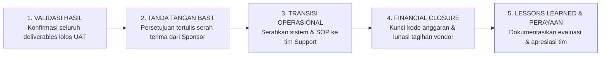

# Modul 17: How & When to Close a Project
## Google Project Management Professional Certificate

> **Sumber Materi**: [Cara dan Waktu yang Tepat untuk Menutup Proyek | Sertifikat Manajemen Proyek Google](https://www.youtube.com/watch?v=wJ5f7TxcPR0)  
> **Kategori**: Course 4 — Project Execution: Running the Project (Module 4)  
> **Disusun oleh**: Dessy Rahmawati Chairullina, S.Kom  

---

## 📌 Executive Summary
1. **Bahaya Proyek Zombie (*The Zombie Project Trap*)**: Proyek yang tidak pernah ditutup secara resmi akan terus menguras waktu, perhatian, dan anggaran tim secara terselubung, serta menimbulkan kebingungan batas tanggung jawab antara tim pengembang proyek dan tim pemeliharaan operasional (*maintenance*).
2. **Kapan Proyek Siap Ditutup?**: Ketika seluruh kriteria penerimaan (*acceptance criteria*) dalam charter telah terpenuhi, hasil kerja telah diuji dan diserahterimakan, atau ketika diputuskan dihentikan lebih awal (*early termination*) karena alasan strategis.
3. **Lima Pilar Penutupan Proyek Baku**:
   * *Serah Terima Formal & Penandatanganan BAST*: Persetujuan resmi bahwa deliverable diterima oleh Sponsor.
   * *Transisi Operasional*: Penyerahan hak kelola dan SOP kepada tim *IT Support / Maintenance*.
   * *Penyelesaian Finansial & Administrasi*: Pelunasan tagihan vendor, penutupan kode anggaran, dan pelepasan sumber daya.
   * *Dokumentasi Pembelajaran (Lessons Learned)*: Evaluasi jujur terhadap keberhasilan dan kegagalan proses.
   * *Pengarsipan & Perayaan Keberhasilan*: Mengarsipkan seluruh dokumen proyek ke repositori terpusat dan mengapresiasi kontribusi seluruh tim.

---

## 1. Alur 5 Langkah Penutupan Proyek Resmi



---

## 2. Format Resmi Berita Acara Serah Terima (BAST)

BAST adalah dokumen hukum dan manajerial paling vital yang menandai selesainya tanggung jawab tim proyek dan beralihnya sistem ke fase operasional rutin (*Business as Usual - BAU*).

```text
================================================================================
                    BERITA ACARA SERAH TERIMA SISTEM (BAST)
                          Nomor: BAST/SIMRS/2027/02/014
================================================================================
Pada hari ini, Jumat tanggal Dua Puluh Tujuh bulan Februari tahun Dua Ribu Dua Puluh Tujuh,
telah dilaksanakan serah terima hasil pekerjaan proyek sistem informasi antara:

1. NAMA    : Dessy Rahmawati Chairullina, S.Kom
   JABATAN : Project Manager SIMRS (PIHAK PERTAMA / YANG MENYERAHKAN)

2. NAMA    : dr. Handoko, Sp.B
   JABATAN : Direktur Pelayanan Medis / Project Sponsor (PIHAK KEDUA / PENERIMA)

DENGAN KETENTUAN SEBAGAI BERIKUT:
Pasal 1: PIHAK PERTAMA telah menyelesaikan 100% ruang lingkup pekerjaan pengembangan 
         "Modul Digitalisasi Pemantauan Risiko Jatuh & EWS Terintegrasi".
Pasal 2: Hasil pengujian UAT tertanggal 20 Februari 2027 menyatakan sistem LOLOS UJI 
         dengan nilai kepuasan pengguna 94.2% dan zero critical bugs.
Pasal 3: Mulai tanggal 1 Maret 2027, pemeliharaan teknis harian resmi dialihkan 
         ke Unit IT Support Operasional Rumah Sakit.

PIHAK PERTAMA (Yang Menyerahkan)             PIHAK KEDUA (Yang Menerima / Sponsor)


Dessy Rahmawati Chairullina, S.Kom           dr. Handoko, Sp.B
================================================================================
```

---

## 3. Dokumentasi Pembelajaran Proyek (Lessons Learned Document)

Tujuan utama *Lessons Learned* bukanlah mencari siapa yang bersalah atas masalah yang terjadi, melainkan memperkaya aset pengetahuan organisasi (*Organizational Process Assets*) agar proyek di masa depan berjalan lebih mulus.

### Struktur Standar Dokumen Lessons Learned:
| Aspek Evaluasi | Apa yang Berjalan dengan Sangat Baik? (*What Went Well*) | Apa yang Kurang Berjalan Baik? (*What Could Be Improved*) | Rekomendasi Konkret untuk Proyek Berikutnya |
| :--- | :--- | :--- | :--- |
| **Manajemen Ruang Lingkup** | Mengunci dokumen Project Charter sejak awal berhasil menolak 6 permintaan fitur susulan yang tidak beranggaran. | Analisis form rekam medis manual di awal kurang mendalam sehingga ada 2 parameter klinis yang sempat terlewat. | Wajibkan *clinical observation / shadowing* minimal 1 hari kerja sebelum memfinalkan skema database. |
| **Manajemen Waktu & Jadwal** | Daily Standup 15 menit terbukti memangkas waktu penyelesaian hambatan teknis secara dramatis. | Pengujian UAT di bangsal mundur 4 hari karena jadwal shift jaga dokter dan perawat sangat padat. | Jadwalkan sesi UAT pada awal minggu dan sediakan staf pengganti (*reliever*) selama sesi pelatihan berlangsung. |
| **Manajemen Teknis & Integrasi** | Struktur modular Java Swing dan helper `fungsi.*` mempercepat pembuatan form baru tanpa duplikasi kode. | Eksekusi alter table di lingkungan produksi sempat memicu kecemasan kueri lambat. | Terapkan aturan baku bahwa seluruh modifikasi skema DDL hanya boleh dijalankan di jendela pemeliharaan pukul 02.00 WIB. |

---

## 4. Studi Kasus Nyata: Menutup Proyek Modul Keuangan SIMRS Tanpa Menyisakan Masalah

* **Latar Belakang**: Proyek modul *Kalkulator Jasa Medis dan Penagihan BPJS* telah selesai dikoding dan sudah berjalan lancar selama 2 minggu masa uji coba. Namun, staf akuntansi masih terus menelepon programmer proyek setiap hari untuk meminta perbaikan-perbaikan kecil yang tidak terdaftar di kontrak.
* **Tindakan PM untuk Mengakhiri Status Menggantung**:
  1. *Menyelenggarakan Sesi Tinjauan Akhir (Formal Review)*: PM memaparkan data metrik bahwa seluruh sasaran SMART proyek telah tercapai 100% (nol selisih klaim, waktu rekonsiliasi < 24 jam).
  2. *Penandatanganan BAST Resmi*: PM mengundang Direktur Keuangan dan Kepala Bagian Akuntansi untuk menandatangani dokumen BAST resmi penutupan proyek.
  3. *Penetapan Batas Akhir Garansi & Transisi Support*: PM mengumumkan masa transisi garansi proyek selama 14 hari kerja. Setelah masa itu berakhir, seluruh permintaan penambahan fitur baru wajib diajukan melalui mekanisme tiket *Service Desk* resmi sebagai inisiatif proyek baru.
  4. *Sesi Apresiasi & Makan Bersama*: PM mengumpulkan seluruh tim pengembang, kasir, dan analis akuntansi untuk merayakan keberhasilan peluncuran dan memberikan plakat apresiasi kepada tim teknis.
* **Hasil**:
  * Proyek ditutup secara paripurna dengan legalitas lengkap.
  * Programmer proyek dapat beralih ke proyek strategis berikutnya tanpa diganggu interupsi harian yang tidak berujung.
  * Tim operasional keuangan memiliki rasa kepemilikan penuh (*ownership*) terhadap sistem yang baru.

---

## 5. 🛠️ Actionable Project Closing Checklist

- [ ] **Deliverables Verified**: Apakah seluruh produk yang dijanjikan pada Project Charter sudah diserahkan dan lolos verifikasi akhir?
- [ ] **BAST Signed**: Sudahkah lembar Berita Acara Serah Terima ditandatangani oleh Project Sponsor dan pemangku kepentingan kunci?
- [ ] **Operational Handover Done**: Apakah tim IT Support operasional sudah menerima dokumentasi teknis, kredensial konfigurasi, dan SOP penggunaan?
- [ ] **Financials Closed**: Apakah seluruh tagihan vendor pihak ketiga sudah lunas dan kode mata anggaran proyek sudah dinonaktifkan di sistem keuangan?
- [ ] **Lessons Learned Published**: Sudahkah rapat evaluasi akhir digelar dan dokumen pembelajaran diarsipkan di repositori pengetahuan organisasi?
- [ ] **Team Celebration Held**: Sudahkah Anda memberikan apresiasi dan pengakuan tulus kepada seluruh anggota tim atas dedikasi dan kerja keras mereka?
