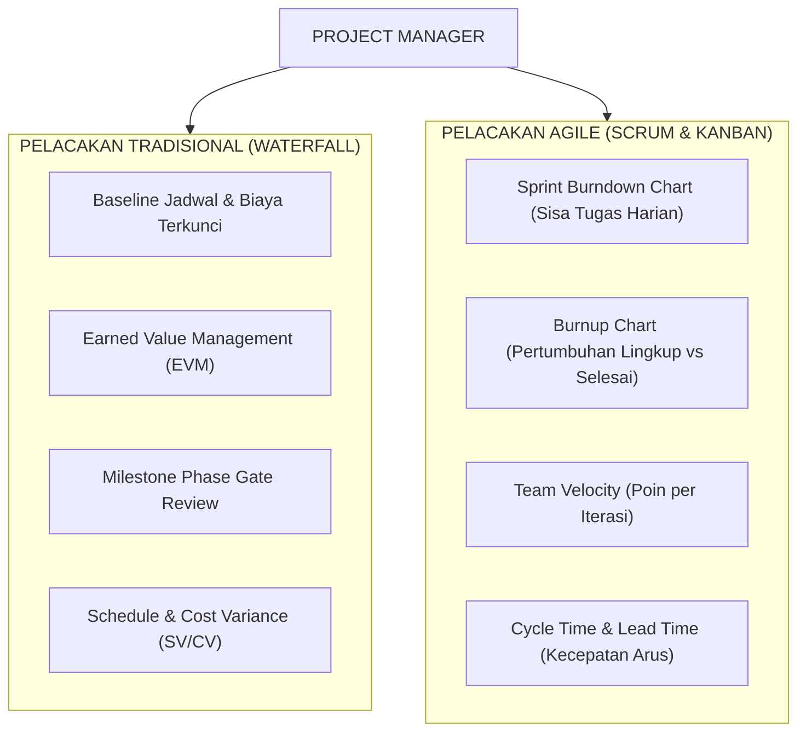

# Modul 18: Project Tracking Methods & Performance Metrics
## Google Project Management Professional Certificate

> **Sumber Materi**: [Metode dan Contoh Pelacakan Proyek | Sertifikat Manajemen Proyek Google](https://www.youtube.com/watch?v=oLh8akA7F3I)  
> **Kategori**: Course 5 — Agile Project Management (Module 1)  
> **Disusun oleh**: Dessy Rahmawati Chairullina, S.Kom  

---

## 📌 Executive Summary
1. **Fungsi Esensial Pelacakan Proyek**: Pelacakan bukan bentuk *micromanagement*, melainkan sistem peringatan dini (*early warning system*) yang mendeteksi deviasi jadwal dan biaya sebelum menjadi krisis yang tidak dapat dipulihkan.
2. **Dua Paradigma Pelacakan**:
   * *Pendekatan Tradisional (Waterfall)*: Berfokus pada perbandingan terhadap baseline awal menggunakan metode *Earned Value Management (EVM)*, deviasi jadwal (*Schedule Variance*), dan indikator status RAG (Red, Amber, Green).
   * *Pendekatan Tangkas (Agile)*: Berfokus pada arus penyelesaian nilai kerja nyata menggunakan *Burndown Charts*, *Burnup Charts*, kecepatan tim (*Team Velocity*), serta *Cycle Time* dan *Lead Time*.
3. **Visibilitas Status Transparan (RAG Status)**: Mengomunikasikan kesehatan proyek secara instan kepada pemangku kepentingan eksekutif tanpa membingungkan mereka dengan terminologi teknis.
4. **Metrik Kecepatan Tim (*Team Velocity*)**: Kapasitas rata-rata unit kerja (*Story Points*) yang dapat diselesaikan secara tuntas oleh tim dalam satu siklus iterasi (Sprint).

---

## 1. Perbandingan Paradigma Pelacakan: Waterfall vs. Agile



### Matriks Rumus & Definisi Metrik Kinerja Kunci:
| Metrik Kinerja | Rumus / Cara Menghitung | Interpretasi Nilai |
| :--- | :--- | :--- |
| **CPI (Cost Performance Index)** | $\text{CPI} = \frac{\text{EV (Earned Value)}}{\text{AC (Actual Cost)}}$ | $\text{CPI} > 1.0$: Hemat anggaran. <br>$\text{CPI} < 1.0$: Melebihi anggaran (*Over-budget*). |
| **SPI (Schedule Performance Index)**| $\text{SPI} = \frac{\text{EV (Earned Value)}}{\text{PV (Planned Value)}}$ | $\text{SPI} > 1.0$: Lebih cepat dari jadwal. <br>$\text{SPI} < 1.0$: Terlambat (*Behind schedule*). |
| **Team Velocity** | $\text{Velocity} = \sum \text{Story Points (Done)}$ | Rata-rata poin tugas yang tuntas 100% (*Definition of Done*) per sprint. |
| **Lead Time vs Cycle Time** | *Lead*: Waktu dari tiket dibuat s/d rilis. <br>*Cycle*: Waktu dari tiket mulai dikerjakan s/d rilis. | Mengukur efisiensi arus kerja dan mendeteksi antrean tugas yang mengendap. |

---

## 2. Membaca Grafik Pelacakan Agile: Burndown vs. Burnup Chart

Grafik pelacakan visual adalah jantung dari ruang kerja tim Agile.

```text
[ BURNDOWN CHART ]                                    [ BURNUP CHART ]
Fokus: Berapa banyak sisa pekerjaan yang belum?       Fokus: Berapa total pekerjaan & kemajuan riil?
Poin ^                                                Poin ^
 40  |* (Awal Sprint: 40 Poin)                         50  |              /--- [Total Scope: 50 Poin]
 30  |  \                                              40  |             /
 20  |    \--- Garis Aktual                            30  |      /-----/ [Pekerjaan Selesai]
 10  |        \                                        20  |  /--/
  0  +---------\----------> Hari                       10  |/
     H-1  H-3  H-5  H-10                                0  +-------------------------> Sprint
                                                           S-1  S-2  S-3  S-4  S-5
```

* **Sprint Burndown Chart**:
  * Garis ideal diagonal menurun dari kiri atas ke kanan bawah (nol poin di akhir hari ke-10).
  * Jika garis aktual berada **di atas** garis ideal: Tim mengalami keterlambatan atau menemukan kerumitan teknis tak terduga.
  * Jika garis aktual berada **di bawah** garis ideal: Tim menyelesaikan tugas lebih cepat dari perkiraan awal.
* **Burnup Chart**:
  * Menampilkan dua garis: Total Ruang Lingkup (*Total Scope*) dan Pekerjaan yang Selesai (*Completed Work*).
  * Sangat ampuh mendeteksi adanya penambahan fitur diam-diam (*Scope Creep*) jika garis total tiba-tiba melonjak naik di tengah proyek.

---

## 3. Standarisasi Laporan Status RAG (Red, Amber, Green)

Untuk laporan mingguan ke jajaran eksekutif, gunakan sistem lampu lalu lintas (*Traffic Light System*):

```text
====================================================================================================
                             STATUS KESEHATAN PROYEK MINGGUAN (RAG)
====================================================================================================
Kategori   Status   Deskripsi Kondisi & Pemicu                          Tindakan PM & Eskalasi
----------------------------------------------------------------------------------------------------
JADWAL     [ GREEN ] Seluruh milestone M1 s/d M3 selesai tepat waktu.   Pertahankan ritme sprint;
                     Deviasi jadwal saat ini: +0.5 hari.                tidak ada eskalasi.

ANGGARAN   [ AMBER ] Biaya komputasi server cloud naik 12% akibat       Optimasi kueri database;
                     pengujian load testing yang diperpanjang.          pantau kuota mingguan.

RISIKO &   [  RED  ] Vendor bridging belum merilis dokumentasi API      ESKALASI SPONSOR: Butuh
INTEGRASI            terbaru; mengancam jadwal rilis 1 Desember.        telepon Direktur ke Vendor.
====================================================================================================
```

---

## 4. Studi Kasus Nyata: Menggunakan Burndown Chart untuk Menyelamatkan Sprint Modul Bridging

* **Situasi**: Tim pengembang SIMRS berkomitmen menyelesaikan 45 Story Points modul *Bridging Verifikasi FPK BPJS* dalam sprint 2 minggu (10 hari kerja).
* **Anomali Hari ke-5**:
  * Pada grafik Burndown hari ke-5, sisa pekerjaan masih menumpuk di angka 40 Story Points (garis mendatar, tidak turun sama sekali).
  * Programmer tampak sibuk, namun tidak ada satu pun kartu tugas yang bergeser ke kolom "Done".
* **Investigasi & Tindakan PM**:
  1. *Identifikasi Kemacetan*: PM menemukan bahwa 2 programmer terjebak selama 4 hari mencoba memecahkan enkripsi signature HMAC-SHA256 tanpa meminta bantuan.
  2. *Swarming / Mob Programming*: PM segera menghentikan tugas non-kritis dan mengarahkan Lead Architect untuk mendampingi programmer tersebut selama 3 jam untuk memecahkan algoritma enkripsi bersama.
  3. *Dekomposisi Ulang Tugas*: PM memecah kartu tugas besar (13 poin) menjadi 3 kartu kecil (3, 5, dan 5 poin) agar kemajuan kerja dapat diverifikasi secara bertahap.
* **Hasil**:
  * Pada hari ke-7, grafik Burndown kembali menukik tajam ke arah garis ideal.
  * Di hari ke-10, seluruh 45 Story Points berhasil diselesaikan 100% dan lolos uji tembak integrasi server BPJS tepat waktu.

---

## 5. 🛠️ Actionable Project Tracking Checklist

- [ ] **Daily Standup Sync**: Apakah tim memantau Burndown Chart harian untuk mendeteksi tugas yang tidak bergerak (*stuck tasks*)?
- [ ] **Definition of Done Enforced**: Apakah tugas baru boleh dianggap "Done" jika dan hanya jika sudah lulus uji QA dan code review (bukan sekadar selesai koding)?
- [ ] **Velocity Stability**: Apakah kecepatan tim (*velocity*) dihitung berdasarkan rata-rata historis 3 sprint terakhir (bukan target angan-angan)?
- [ ] **Objective RAG Status**: Apakah status RAG ditetapkan berdasarkan data deviasi riil (bukan perasaan sungkan kepada pimpinan)?
- [ ] **Scope Creep Monitored**: Jika menggunakan Burnup Chart, apakah garis total lingkup kerja tetap stabil tanpa lonjakan tak berizin?
