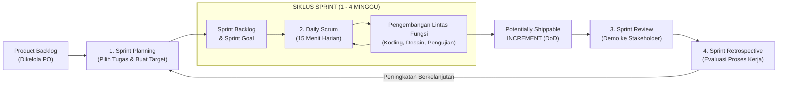

# Modul 19: What is Scrum? Roles, Events, & Artifacts
## Google Project Management Professional Certificate

> **Sumber Materi**: [Apa itu Scrum? | Sertifikat Manajemen Proyek Google](https://www.youtube.com/watch?v=SG_iHptXcKQ)  
> **Kategori**: Course 5 — Agile Project Management (Module 2)  
> **Disusun oleh**: Dessy Rahmawati Chairullina, S.Kom  

---

## 📌 Executive Summary
1. **Definisi Framework Scrum**: Kerangka kerja tangkas (*Agile framework*) yang ringan dan adaptif untuk menghasilkan produk bernilai tinggi secara berulang (*iterative*) dan bertahap (*incremental*) dalam siklus waktu tetap yang disebut **Sprint** (1–4 minggu).
2. **Tiga Pilar Empirisme Scrum**: *Transparansi (Transparency)*, *Inspeksi (Inspection)*, dan *Adaptasi (Adaptation)* yang berlandaskan 5 Nilai Scrum: Komitmen, Keberanian, Fokus, Keterbukaan, dan Rasa Hormat.
3. **Tiga Peran Kunci Tim Scrum (The Scrum Team)**: *Product Owner* (memaksimalkan nilai produk & pemilik backlog), *Scrum Master* (pemimpin pelayan & penghancur hambatan), dan *Developers* (tim lintas fungsi pelaksana teknis).
4. **Lima Acara Resmi Scrum (Scrum Events)**: *The Sprint* (wadah utama), *Sprint Planning*, *Daily Scrum*, *Sprint Review*, dan *Sprint Retrospective*.
5. **Tiga Artefak & Komitmen Terikat**: *Product Backlog* (terikat *Product Goal*), *Sprint Backlog* (terikat *Sprint Goal*), dan *Increment* (terikat *Definition of Done - DoD*).

---

## 1. Arsitektur Komprehensif Siklus Kerja Scrum



---

## 2. Tiga Peran Mandiri Tanpa Hierarki Tradisional

Dalam tim Scrum, tidak ada istilah "Bos" atau hierarki manajerial vertikal. Tim Scrum bersifat mandiri (*self-managing*) dan lintas fungsi (*cross-functional*):

| Peran Scrum | Pertanyaan Utama yang Dimiliki | Tanggung Jawab Sentral |
| :--- | :--- | :--- |
| **Product Owner (PO)** | *"APA yang harus kita buat dan MENGAPA?"* | Mendefinisikan visi produk, menulis user stories, memprioritaskan antrean Product Backlog, dan memutuskan kapan produk siap dirilis ke pasar. |
| **Scrum Master (SM)** | *"BAGAIMANA kita bekerja lebih lancar tanpa hambatan?"* | Memfasilitasi acara Scrum, membimbing tim menerapkan prinsip Agile, menghapus hambatan operasional (*impediment removal*), dan melindungi tim dari interupsi luar. |
| **Developers (Tim Pengembang)** | *"BAGAIMANA cara teknis terbaik membuatnya?"* | Bertanggung jawab penuh atas kualitas teknis, merancang arsitektur kode, menguji, dan mengubah item backlog menjadi Increment yang siap pakai (*DoD*). |

---

## 3. Lima Acara Resmi Scrum (Timeboxed Events)

Seluruh acara Scrum memiliki batasan waktu yang ketat (*timeboxed*) untuk mencegah pemborosan jam kerja tim:

1. **The Sprint (1–4 Minggu)**: Jantung detak ritme proyek. Durasi sprint harus konsisten dan tidak boleh diubah-ubah di tengah jalan.
2. **Sprint Planning (Maksimal 8 Jam untuk Sprint 4 Minggu / 2 Jam untuk Sprint 1 Minggu)**:
   * Menjawab 3 hal: Mengapa sprint ini bernilai? Apa yang bisa diselesaikan? Bagaimana pekerjaan akan dirampungkan?
3. **Daily Scrum / Standup (Maksimal 15 Menit Setiap Pagi)**:
   * Sinkronisasi harian tim pengembang di depan papan kerja untuk merencanakan pekerjaan 24 jam ke depan dan mengidentifikasi *blocker*.
4. **Sprint Review (Maksimal 4 Jam / 1 Jam)**:
   * Bukan sekadar presentasi PowerPoint, melainkan **demonstrasi langsung perangkat lunak nyata yang berfungsi** kepada pengguna dan pemangku kepentingan untuk mengumpulkan umpan balik.
5. **Sprint Retrospective (Maksimal 3 Jam / 45 Menit)**:
   * Refleksi internal tim pengembang dan SM mengenai orang, hubungan, proses, dan alat kerja guna merumuskan 1–2 perbaikan konkret pada sprint berikutnya.

---

## 4. Dua Gerbang Kualitas: Definition of Ready (DoR) vs. Definition of Done (DoD)

Kebingungan antara DoR dan DoD adalah penyebab utama pekerjaan tertunda di tengah sprint.

```text
+------------------------------+        +------------------------------+
| DEFINITION OF READY (DoR)    |        | DEFINITION OF DONE (DoD)     |
| Pintu Masuk ke Sprint        |        | Pintu Keluar Menuju Rilis    |
+------------------------------+        +------------------------------+
• User Story memiliki format:  |        • Kode lolos Peer Review (PR)  |
  Sebagai [X], saya ingin [Y], |        • Lolos Automated Unit Test    |
  sehingga [Z].                |        • Dokumentasi teknis terupdate |
• Acceptance Criteria jelas.   |        • Lolos pengujian fungsi QA    |
• Estimasi Story Points ada.   |        • Tidak ada galat kritis / bug |
• Dependensi eksternal klir.   |        • Siap dideploy ke produksi    |
+------------------------------+        +------------------------------+
```

---

## 5. Studi Kasus Nyata: Mengatasi Kegagalan Rilis Proyek EMR dengan Mengadopsi Scrum

* **Masalah**: Proyek modul *Rekam Medis Elektronik (RME) Bangsal* awalnya dikerjakan secara Waterfall selama 6 bulan. Ketika software pertama kali diserahkan ke perawat di akhir bulan ke-6, seluruh perawat menolak memakainya karena alur form digital tidak sesuai dengan alur penerimaan pasien gawat darurat. Ratusan jam koding terbuang sia-sia.
* **Transformasi ke Framework Scrum**:
  1. *Sprint 2 Mingguan*: PM mengubah siklus rilis menjadi sprint 2 mingguan.
  2. *Kepala Ruang Bangsal sebagai Product Owner*: PM menunjuk salah satu Kepala Ruang Perawat senior sebagai *Product Owner* yang memegang hak penuh menentukan prioritas fitur form.
  3. *Sprint Review Nyata*: Di akhir setiap sprint 2 minggu, tim mendemokan fitur kecil yang sudah selesai (misal: *Sprint 1: Input TTV & MEOWS otomatis*) langsung kepada perawat jaga.
  4. *Umpan Balik Instan*: Masukan perawat mengenai ukuran tombol atau letak shortcut keyboard langsung dimasukkan ke backlog sprint berikutnya.
* **Hasil**:
  * Modul RME diadopsi dengan antusiasme tinggi karena pengguna merasa sistem tersebut dirancang bersama mereka.
  * Tingkat penolakan sistem turun menjadi 0% sejak hari pertama go-live.

---

## 6. 🛠️ Actionable Scrum Framework Checklist

- [ ] **Single Product Owner**: Apakah hanya ada satu orang PO yang memiliki wewenang final menentukan urutan prioritas Product Backlog?
- [ ] **Dedicated Scrum Master**: Apakah ada Scrum Master yang fokus mengawal proses dan menghapus kendala tim (bukan merangkap sebagai bos penilai kinerja)?
- [ ] **Timeboxing Respected**: Apakah Daily Standup disiplin diakhiri tepat dalam 15 menit tanpa berlarut-larut menjadi sesi teknis panjang?
- [ ] **Working Increment Demonstrated**: Apakah sesi Sprint Review benar-benar mendemonstrasikan software nyata yang berfungsi (bukan slide presentasi)?
- [ ] **Actionable Retrospective Output**: Apakah sesi Retrospective menghasilkan minimal 1 item perbaikan proses yang langsung diterapkan pada sprint berikutnya?
