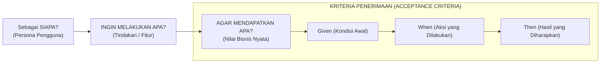

# Modul 20: Agile & Scrum in the Real World: User Stories & Estimation
## Google Project Management Professional Certificate

> **Sumber Materi**: [Agile dan Scrum di Dunia Nyata | Sertifikat Manajemen Proyek Google](https://www.youtube.com/watch?v=1evfn3qTYGM)  
> **Kategori**: Course 5 — Agile Project Management (Module 3)  
> **Disusun oleh**: Dessy Rahmawati Chairullina, S.Kom  

---

## 📌 Executive Summary
1. **Pergeseran Paradigma dari Dokumen Kaku ke User Stories**: Alih-alih menulis dokumen spesifikasi ratusan halaman yang tidak dibaca siapa pun, tim Agile mendokumentasikan kebutuhan pengguna melalui narasi ringkas berorientasi nilai bisnis yang disebut **User Story**.
2. **Standar Kualitas INVEST**: Enam kriteria baku penyusunan user story berkualitas: *Independent* (Mandiri), *Negotiable* (Dapat dinegosiasikan), *Valuable* (Bernilai bagi pengguna), *Estimable* (Dapat diestimasi), *Small* (Cukup kecil untuk 1 sprint), dan *Testable* (Dapat diuji).
3. **Konsep 3C dalam User Story**: *Card* (kartu fisik/digital sebagai pengingat), *Conversation* (diskusi mendalam antara Product Owner dan tim pengembang), dan *Confirmation* (kriteria penerimaan / *Acceptance Criteria*).
4. **Estimasi Relatif Menggunakan Story Points**: Mengapa mengestimasi software dalam ukuran jam (*hours*) selalu meleset, dan bagaimana deret angka Fibonacci (1, 2, 3, 5, 8, 13, 21) dalam sesi *Planning Poker* menghasilkan estimasi yang jauh lebih akurat dan objektif.

---

## 1. Anatomi dan Struktur Standar User Story

User Story adalah instrumen utama seorang Business Analyst dan Product Owner untuk menjembatani bahasa klinis/bisnis dengan bahasa teknis tim rekayasa perangkat lunak.



### Format Baku User Story:
$$\text{"Sebagai [Tipe Pengguna], saya ingin [Tindakan/Kebutuhan], agar [Manfaat Bisnis]."}$$

### Contoh Perbandingan Story Lemah vs Story Kuat:
| Komponen | Rumusan Lemah | Rumusan Standar Agile Profesional |
| :--- | :--- | :--- |
| **User Persona** | "Sebagai kasir..." (Terlalu umum). | "Sebagai **Kasir Rawat Inap Rumah Sakit**..." |
| **Kebutuhan** | "...saya ingin sistem yang cepat saat input pembayaran." | "...saya ingin **sistem otomatis mengunci billing saat pasien BPJS belum memiliki nomor SEP valid**..." |
| **Manfaat Nilai** | "...agar pekerjaan saya mudah." | "...agar **mencegah piutang tidak tertagih (unclaimed revenue) yang rata-rata mencapai Rp 45 juta/bulan**." |

---

## 2. Kriteria Kualitas Cerita: Framework INVEST

Sebelum sebuah kartu cerita dimasukkan ke dalam *Sprint Backlog*, kartu tersebut harus lolos uji filter INVEST:

* **I — Independent (Mandiri)**: Cerita tidak boleh saling mengunci secara erat dengan cerita lain, sehingga dapat diprioritaskan dan dikerjakan secara acak tanpa memicu ketergantungan kusut.
* **N — Negotiable (Dapat Dinegosiasikan)**: Bukan kontrak harga mati; detail implementasi teknis didiskusikan secara fleksibel antara developer dan PO.
* **V — Valuable (Bernilai Nyata)**: Memberikan nilai konkret bagi pengguna akhir atau pembeli (bukan sekadar tugas teknis internal seperti *"bikin tabel database"*).
* **E — Estimable (Dapat Diestimasi)**: Tim memiliki pemahaman yang cukup tentang ruang lingkup tugas sehingga mampu menentukan bobot kerumitannya.
* **S — Small (Berukuran Tepat)**: Berukuran cukup kecil untuk diselesaikan tuntas dalam satu siklus sprint (maksimal 2–3 hari kerja tim). Cerita besar wajib dipecah (*decomposed*).
* **T — Testable (Dapat Diuji)**: Memiliki kriteria penerimaan objektif dengan hasil lolos/gagal yang jelas.

---

## 3. Estimasi Relatif vs Estimasi Mutlak (Story Points & Planning Poker)

Salah satu penemuan terbesar dalam rekayasa perangkat lunak adalah: **Manusia sangat buruk dalam memperkirakan waktu mutlak (jam/hari), tetapi sangat hebat dalam memperkirakan ukuran relatif (lebih besar vs lebih kecil)**.

```text
====================================================================================================
                        SKALA FIBONACCI DALAM PLANNING POKER
====================================================================================================
Point  1  : Tugas sangat sepele; ganti label warna, perbaiki salah ketik teks (1-2 jam).
Point  2  : Tugas sederhana dengan pola yang sudah jelas (tambah 1 kolom di tabel).
Point  3  : Tugas standar; ada sedikit logika validasi (buat form input sederhana).
Point  5  : Tugas dengan kerumitan sedang; butuh integrasi 2 tabel database dan validasi ganda.
Point  8  : Tugas kompleks; ada dependensi API eksternal atau algoritma perhitungan rumit.
Point 13  : Tugas sangat kompleks; risiko tinggi. (Sebaiknya dipecah menjadi 2-3 cerita kecil).
Point 21+ : EPIC / Terlalu Besar. DILARANG masuk sprint sebelum dipecah menjadi User Stories kecil.
====================================================================================================
```

### Mengapa Menggunakan Deret Fibonacci?
Jarak antar angka semakin besar seiring membesarnya angka (1, 2, 3, 5, 8, 13, 21). Hal ini sengaja dirancang untuk mencerminkan **ketidakpastian yang berlipat ganda pada tugas berukuran besar**, serta menghentikan debat kusir yang tidak ada gunanya antara 11 jam vs 12 jam.

---

## 4. Studi Kasus Nyata: Sesi Planning Poker Modul Jasa Medis Dokter

* **Situasi**: Tim pengembang sedang merencanakan sprint untuk modul *Kalkulator Jasa Medis*. Product Owner mengajukan satu kartu cerita: *"Sistem otomatis menghitung pembagian jasa medis dokter spesialis bedah"*.
* **Jalannya Sesi Planning Poker**:
  1. *Voting Putaran 1*: Developer A melempar kartu 3 poin, sementara Developer B (Senior) melempar kartu 13 poin. Terjadi perbedaan pandangan ekstrem.
  2. *Eksplorasi Asumsi Tersembunyi*:
     * Scrum Master meminta Developer A dan B menjelaskan alasan masing-masing.
     * Developer A mengira rumusnya hanyalah persentase tetap 60% : 40%.
     * Developer B menjelaskan fakta regulasi medis bahwa jika operasi melibatkan 2 operator dokter spesialis bedah dan 1 dokter anestesi, tarif jasa medis dibagi berjenjang dengan potongan biaya BHP dan sewa kamar operasi (*Cito vs Elektif*).
  3. *Tindakan PM/Scrum Master*:
     * Kartu tersebut dinyatakan terlalu besar (*Epic*) dan belum memenuhi kriteria *Small* (INVEST).
     * Cerita dipecah menjadi 3 cerita kecil:
       * Story 1: Kalkulasi tindakan operasi tunggal operator (5 poin).
       * Story 2: Kalkulasi tindakan operasi tim dokter gabungan (8 poin).
       * Story 3: Penerapan penyesuaian tarif darurat malam hari / Cito (3 poin).
* **Hasil**:
  * Seluruh tim sepakat dengan pembagian tugas yang realistis.
  * Modul selesai dalam sprint tanpa ada lembur mendadak karena seluruh kerumitan tersembunyi telah diungkap sejak awal sesi perencanaan.

---

## 5. 🛠️ Actionable User Story & Estimation Checklist

- [ ] **Standard Story Format**: Apakah setiap kartu cerita menggunakan struktur *"Sebagai [Persona], Saya ingin [Fitur], Agar [Manfaat]"*?
- [ ] **INVEST Criteria Checked**: Apakah cerita sudah mandiri, bernilai bagi user, dan cukup kecil untuk diselesaikan dalam satu sprint?
- [ ] **Gherkin Acceptance Criteria**: Apakah kriteria penerimaan ditulis dengan format *Given-When-Then* yang siap diuji oleh tim QA?
- [ ] **No Absolute Hours**: Apakah estimasi tugas murni menggunakan Story Points relatif (bukan menanyakan "butuh berapa jam")?
- [ ] **Epic Decomposed**: Apakah seluruh kartu tugas bernilai 13 atau 21 poin sudah dipecah menjadi cerita-cerita kecil sebelum sprint planning ditutup?
