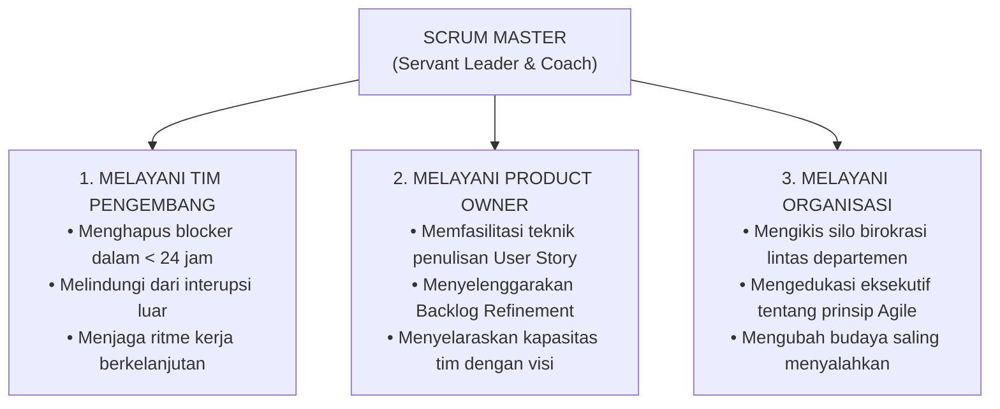
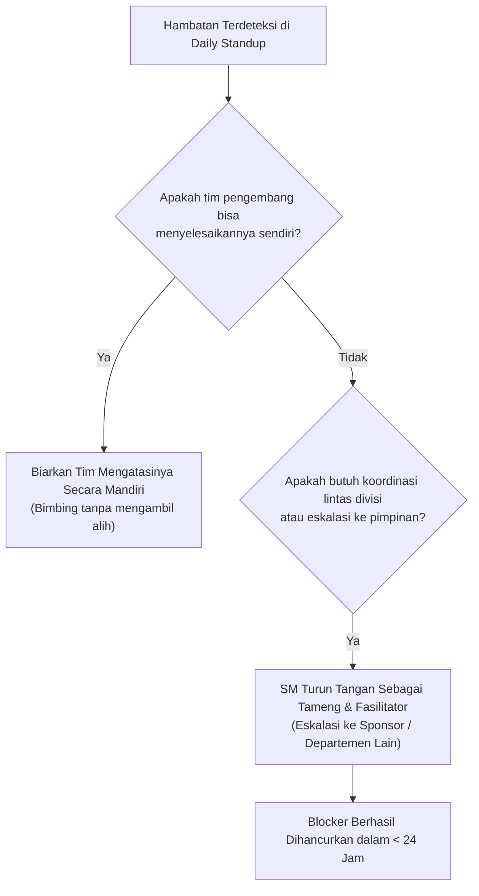

# Modul 21: The Scrum Master Playbook: Facilitation & Blocker Removal
## Google Project Management Professional Certificate

> **Sumber Materi**: [Tutorial Scrum Master | Sertifikat Manajemen Proyek Google](https://www.youtube.com/watch?v=eYLf0z3Xhok)  
> **Kategori**: Course 5 — Agile Project Management (Module 4)  
> **Disusun oleh**: Dessy Rahmawati Chairullina, S.Kom  

---

## 📌 Executive Summary
1. **Hakikat Peran Scrum Master (SM)**: Scrum Master bukanlah "mandor proyek" atau manajer tradisional dengan hak memberi perintah (*command-and-control*), melainkan seorang **Pemimpin Pelayan (*Servant Leader*)** dan fasilitator yang bertugas membebaskan tim dari segala rintangan kerja agar tim dapat mencapai kinerja puncak secara mandiri.
2. **Tiga Dimensi Layanan Scrum Master**:
   * *Melayani Tim Pengembang*: Menghancurkan hambatan teknis/organisasi (*impediment removal*) dan membimbing tim menuju kemandirian (*self-organization*).
   * *Melayani Product Owner*: Membantu teknik penataan backlog yang efektif dan memastikan tujuan sprint dipahami bersama.
   * *Melayani Organisasi*: Mengedukasi pimpinan dan pemangku kepentingan eksternal mengenai cara berinteraksi dengan tim Agile tanpa merusak fokus sprint.
3. **Perisai Pelindung Tim (*Shielding the Team*)**: Melindungi para pengembang dari gangguan tugas dadakan (*ad-hoc requests*) yang sering diselundupkan oleh manajer fungsional di tengah sprint.
4. **Mendeteksi & Mengatasi Anti-Pola Scrum (*Scrum Anti-Patterns*)**: Mengenali penyimpangan seperti *Dark Scrum* (Daily Standup berubah menjadi sesi interogasi laporan status ke bos) dan *Zombie Scrum* (menjalankan ritual rapat tanpa pernah merilis produk yang berfungsi).

---

## 1. Tiga Pilar Layanan Scrum Master

Seorang Scrum Master bekerja di persimpangan antara manusia, proses kerja, dan budaya organisasi.

---

## 2. Seni Fasilitasi: Teknik Memandu Acara Scrum

Fasilitasi yang buruk akan membuat rapat Scrum terasa seperti beban yang membuang-buang waktu. Fasilitator hebat menggunakan teknik-teknik teruji:

### Teknik Fasilitasi Kunci:
1. **Pertanyaan Netral & Terbuka (*Inquiry-Based Facilitation*)**:
   * Jangan mendikte solusi: *"Kalian harus pakai indexing tabel di sini!"*.
   * Ajukan pertanyaan pemantik: *"Opsi arsitektur apa yang kita miliki untuk mencegah beban query ini melambat saat jam sibuk?"*.
2. **Brainstorming Sunyi & *Dot Voting***:
   * Dalam sesi evaluasi, berikan waktu 5 menit bagi seluruh anggota tim untuk menuliskan gagasan di sticky notes secara hening sebelum berdiskusi.
   * Setiap anggota tim diberi 3 stiker (*dots*) untuk memilih ide terbaik. Ini memastikan suara anggota tim yang pendiam (*introverts*) memiliki bobot yang sama dengan anggota yang bersuara paling lantang.
3. **Manajemen Papan Kerja (*Parking Lot & Timeboxing*)**:
   * Alihkan perdebatan teknis yang melenceng dari agenda ke kolom catatan terpisah (*Parking Lot*) untuk diselesaikan oleh 2 orang terkait di luar forum utama.

---

## 3. Protokol Penghancuran Hambatan (Impediment Removal Protocol)

Hambatan (*blocker*) adalah apa pun yang memperlambat laju tim pengembang menyelesaikan pekerjaan.

### Klasifikasi Hambatan & Tindakan SM:
| Tipe Hambatan | Gejala di Lapangan | Intervensi Langsung Scrum Master |
| :--- | :--- | :--- |
| **Hambatan Lingkungan Teknis** | Server staging crash, kredensial database belum diberikan oleh DBA pusat. | SM mendatangi tim infrastruktur hari itu juga dan mengawal tiket hingga akses dibuka. |
| **Interupsi Tugas Dadakan** | Kepala bagian meminta developer membuatkan laporan ad-hoc Excel di tengah sprint. | SM menjadi penangkal: *"Semua permintaan baru harus masuk melalui Product Owner di sprint berikutnya"*. |
| **Konflik Antar Anggota Tim** | Dua developer senior berdebat kusir mengenai pola arsitektur kode selama 3 hari. | SM memfasilitasi sesi *Timeboxed Spiking* (menguji kedua opsi selama 4 jam dan mengukur metriknya secara objektif). |

---

## 4. Studi Kasus Nyata: Menyelamatkan Tim Pengembang dari Interupsi "Tugas Siluman" Direksi

* **Masalah**: Tim pengembang SIMRS memiliki performa buruk di mana setiap sprint 2 minggu hanya 40% kartu tugas yang selesai. Developer mengeluh kelelahan dan sering lembur hingga larut malam.
* **Investigasi Scrum Master**:
  * SM mengamati standup harian dan menemukan bahwa setiap hari para manajer fungsional dan wakil direktur sering langsung menelpon atau mendatangi meja programmer untuk meminta perbaikan fitur darurat secara personal ("tugas siluman").
  * Akibat rasa sungkan menolak atasan, programmer mengerjakan tugas dadakan tersebut dan menelantarkan kartu tugas resmi sprint.
* **Tindakan Pemimpin Pelayan (Scrum Master)**:
  1. *Edukasi Batasan Sprint ke Pimpinan*: SM menghadap para direktur dan menjelaskan konsep kapasitas tim: *"Ketika Bapak menyuruh developer mengerjakan tugas dadakan 2 jam, Bapak baru saja menunda peluncuran modul bridging yang ditargetkan regulasi pemerintah"*.
  2. *Protokol Single Gatekeeper*: SM menetapkan aturan tegas: Seluruh permintaan darurat wajib diserahkan kepada Product Owner. Jika tugas tersebut benar-benar kritis (*P0 Emergency*), PO berhak membatalkan sprint resmi atau menukar tugas lain yang berbobot sama keluar dari sprint.
  3. *Perlindungan Fisik Tim*: SM memindahkan area meja tim pengembang ke ruang kerja khusus yang tenang tanpa gangguan lalu-lalang staf operasional (*focus room*).
* **Hasil**:
  * Interupsi liar turun 95% dalam 1 bulan.
  * Penyelesaian sprint (*Sprint Completion Rate*) melonjak dari 40% menjadi 92%.
  * Tingkat stres developer menurun drastis dan moral kerja tim kembali solid.

---

## 5. 🛠️ Actionable Scrum Master Playbook Checklist

- [ ] **Daily Blocker Audit**: Apakah saya mencatat seluruh blocker yang disebutkan di standup dan mengambil tindakan nyata dalam 2 jam setelah rapat selesai?
- [ ] **External Shield Active**: Apakah saya sudah melindungi tim dari permintaan tugas dadakan yang tidak terdaftar di Sprint Backlog?
- [ ] **Facilitation, Not Dictation**: Apakah saya memfasilitasi diskusi dengan pertanyaan terbuka, bukan dengan memerintahkan solusi teknis versi saya sendiri?
- [ ] **Equal Voice Guaranteed**: Apakah sesi retrospektif memberikan ruang bicara yang aman bagi seluruh anggota tim (termasuk yang paling pendiam)?
- [ ] **Anti-Pattern Guard**: Apakah Daily Standup tetap fokus pada kolaborasi harian, dan tidak bergeser menjadi ajang interogasi laporan kerja?
