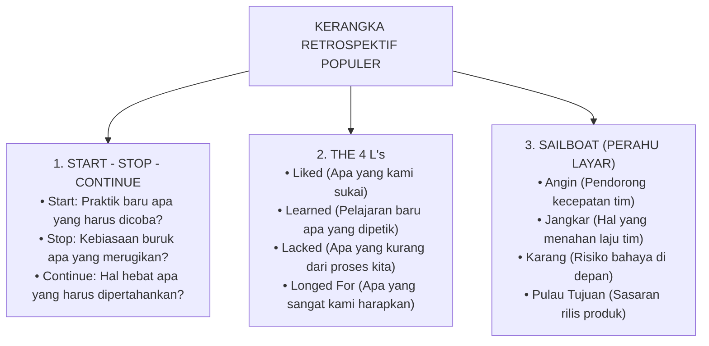

# Modul 22: Agile Management & High-Impact Retrospectives
## Google Project Management Professional Certificate

> **Sumber Materi**: [Manajemen Agile | Sertifikat Manajemen Proyek Google](https://www.youtube.com/watch?v=km7n3DI5IWk)  
> **Kategori**: Course 5 — Agile Project Management (Module 5)  
> **Disusun oleh**: Dessy Rahmawati Chairullina, S.Kom  

---

## 📌 Executive Summary
1. **Inti dari Manajemen Agile**: Mengelola proyek bukan dengan memaksakan kepatuhan buta pada rencana awal, melainkan dengan mengoptimalkan kecepatan penyampaian nilai bisnis (*Business Value Delivery*) dan kapasitas beradaptasi terhadap perubahan realitas lapangan.
2. **Sprint Retrospective sebagai Mesin Perbaikan**: Acara Scrum paling sakral untuk evolusi tim. Retrospektif bukan sesi mengeluh atau ajang mencari kesalahan rekan kerja, melainkan lokakarya terstruktur untuk menganalisis proses dan menghasilkan perbaikan konkret.
3. **Prinsip Utama Retrospektif (Prime Directive)**: Keyakinan fundamental bahwa setiap orang telah bekerja sebaik mungkin berdasarkan pengetahuan, keterampilan, dan sumber daya yang mereka miliki saat peristiwa itu terjadi.
4. **Variasi Kerangka Retrospektif Efektif**: *Start-Stop-Continue*, *The 4 L's (Liked, Learned, Lacked, Longed For)*, dan *Sailboat Retrospective (Perahu Layar)*.
5. **Pendekatan Hybrid Agile di Industri Terikat Regulasi**: Menggabungkan tata kelola kepatuhan regulasi (*Waterfall Governance*) pada level audit dengan eksekusi bertahap (*Scrum/Agile Sprints*) pada level tim teknis.

---

## 1. Empat Format Populer Sesi Sprint Retrospective

Memakai format tanya-jawab yang sama setiap minggu akan membuat tim bosan dan pasif. Gunakan variasi kerangka kerja visual:



---

## 2. Struktur Visual Sailboat Retrospective (Metode Perahu Layar)

Metode Perahu Layar adalah salah satu teknik paling intuitif untuk memetakan dinamika tim teknis:

```text
                        ~  PULAU TUJUAN (Goal)  ~
                         "Go-Live Modul Kasir 100% Lolos Audit"
                                  [###]
                                  / | \
                                 /  |  \
           ANGIN PENDORONG      /   |   \
           "Code Review cepat,     [====] (PERAHU TIM)
            Daily Standup 15 mnt"    ||
                                     ||
              KARANG BAHAYA          ||  JANGKAR PENGHAMBAT
              "Regulasi BPJS         ||  "Dokumentasi API vendor minim,
               berubah mendadak"     \/   Server staging sering crash"
                                    (===)
```

### Langkah Menjalankan Sesi:
1. **Setting the Stage (5 Menit)**: Bacakan *Prime Directive* untuk menegakkan suasana aman dan bebas dari saling menyalahkan.
2. **Pengumpulan Data Sunyi (10 Menit)**: Seluruh anggota tim menuliskan sticky notes pada 4 kategori perahu layar tanpa berbicara.
3. **Pengelompokan & Diskusi (20 Menit)**: Kelompokkan catatan yang memiliki tema serupa (*Affinity Mapping*) dan bahas akar penyebabnya.
4. **Voting & Pemilihan 1–2 Tindakan SMART (10 Menit)**: Pilih maksimal 1–2 komitmen perbaikan paling berdampak untuk dimasukkan ke sprint berikutnya. Jangan menumpuk 10 rencana perbaikan yang tidak realistis.

---

## 3. Penerapan Hybrid Agile di Lingkungan Terikat Regulasi (Healthcare & Enterprise)

Banyak organisasi rumah sakit atau perbankan tidak dapat menerapkan Agile murni secara bebas karena terikat regulasi kementerian yang ketat dan jadwal audit tahunan yang mutlak.

```text
[ HYBRID AGILE / WATER-SCRUM-FALL ARCHITECTURE ]
+-------------------+------------------------------------+-------------------+
| FASE AWAL         | FASE PENGEMBANGAN TEKNIS           | FASE SERAH TERIMA |
| (WATERFALL)       | (SCRUM / SPRINT 2 MINGGUAN)        | (WATERFALL)       |
+-------------------+------------------------------------+-------------------+
| • Project Charter | • Sprint 1: Form TTV & MEOWS       | • Audit Legal RS  |
| • Compliance Check| • Sprint 2: Asesmen Risiko Jatuh   | • Penandatanganan |
| • Persetujuan Pagu| • Sprint 3: Integrasi Data Rekam   |   BAST Resmi      |
|   Anggaran Direksi| • Sprint 4: Validasi & Uji Tembal  | • Handover Support|
+-------------------+------------------------------------+-------------------+
```

* **Di Mana Waterfall Digunakan?**: Pada penetapan visi bisnis, batas anggaran tahunan, dan audit kepatuhan regulasi hukum.
* **Di Mana Scrum Digunakan?**: Pada perancangan fitur antarmuka, penulisan kode program, kolaborasi harian, pengujian regresi, dan demonstrasi modul berkala ke pengguna akhir.

---

## 4. Studi Kasus Nyata: Mengubah Sesi Mengeluh Menjadi Otomatisasi Build Pipeline

* **Situasi**: Pada sprint retrospektif ke-4, tim pengembang SIMRS dipenuhi ketegangan. Tim QA mengeluh bahwa kode yang diserahkan developer sering merusak modul lama, sementara developer membela diri bahwa mereka tidak punya waktu untuk mengetes seluruh fitur secara manual.
* **Fasilitasi Retrospektif oleh SM**:
  1. *Menegakkan Prime Directive*: SM meredam ketegangan personal dan memfokuskan pembicaraan pada proses kerja: *"Kita semua sepakat ingin sistem yang stabil. Mari kita cari sistem kerja apa yang bisa kita perbaiki bersama"*.
  2. *Menggunakan Kerangka 4 L's*:
     * *Lacked*: Tim sepakat bahwa yang hilang adalah mekanisme pengujian otomatis sebelum kode di-merge ke branch utama (*absence of CI/CD pipeline*).
  3. *Rumusan Tindakan Perbaikan SMART Tunggal*:
     Alih-alih membuat 5 aturan baru yang membebani, tim menyepakati satu aksi konkret: *"Developer Senior akan mendedikasikan 1 hari di awal sprint untuk mengonfigurasi skrip automated build dan regression testing di git repository"*.
* **Hasil**:
  * Mulai sprint ke-5, setiap kali programmer melakukan push kode, skrip otomatis menguji 120 skenario transaksi secara otomatis dalam waktu 90 detik.
  * Laporan bug regresi turun drastis hingga 85%.
  * Hubungan antara tim developer dan tim QA kembali harmonis karena proses pengujian dijamin oleh sistem yang adil dan transparan.

---

## 5. 🛠️ Actionable Agile Management & Retro Checklist

- [ ] **Prime Directive Read**: Apakah sesi retrospektif selalu diawali dengan penegasan komitmen bahwa seluruh tim telah berbuat yang terbaik?
- [ ] **Psychological Safety Maintained**: Apakah sesi retro bebas dari aksi saling tuduh individu (*focus on the system, not the person*)?
- [ ] **Format Rotated**: Apakah format retrospektif diganti secara berkala (Start-Stop-Continue, Sailboat, 4 L's) untuk menjaga kesegaran diskusi?
- [ ] **Rule of 1-2 Actions**: Apakah hasil retrospektif dibatasi hanya pada maksimal 1 atau 2 komitmen tindakan nyata (bukan daftar panjang angan-angan)?
- [ ] **Retrospective Action Tracked**: Apakah komitmen dari retro sprint lalu ditinjau status penerapannya sebelum memulai sesi retro baru?
