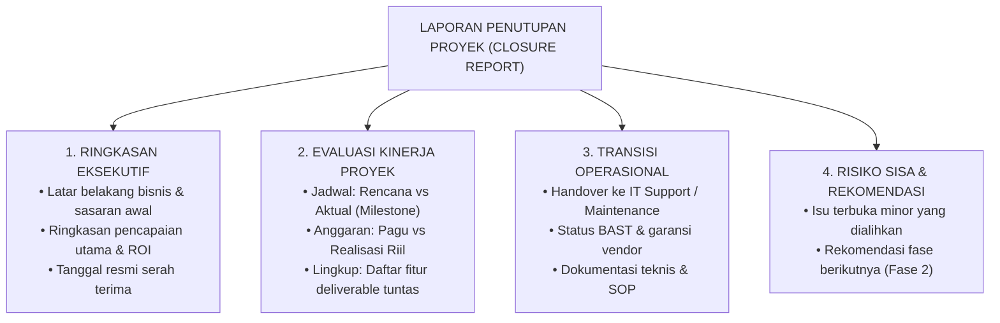

# Modul 23: Writing Executive Project Closure Reports
## Google Project Management Professional Certificate

> **Sumber Materi**: [Cara Menulis Laporan Penutupan Proyek | Sertifikat Manajemen Proyek Google](https://www.youtube.com/watch?v=WfHpPsOa5Nw)  
> **Kategori**: Course 6 — Capstone: Applying PM in the Real World (Module 1)  
> **Disusun oleh**: Dessy Rahmawati Chairullina, S.Kom  

---

## 📌 Executive Summary
1. **Puncak Akuntabilitas Proyek**: *Project Closure Report* (Laporan Penutupan Proyek) adalah dokumen formal komprehensif yang merangkum seluruh riwayat pelaksanaan proyek, membandingkan target rencana awal terhadap hasil aktual, dan mempertanggungjawabkan alokasi anggaran kepada pemegang dana (*Sponsor*).
2. **Struktur Komparasi Rencana vs. Aktual**: Menganalisis deviasi pada 4 pilar utama: Ruang Lingkup (*Scope Completion*), Jadwal (*Schedule Variance*), Biaya (*Budget Variance*), dan Kualitas (*Defect Rate & User Acceptance*).
3. **Dokumentasi Isu Terbuka & Risiko Sisa (*Residual Risks*)**: Mengidentifikasi pekerjaan minor yang belum selesai atau potensi risiko jangka panjang yang dialihkan pengawasannya kepada unit operasional.
4. **Ringkasan Eksekutif 1 Halaman**: Menyajikan dampak bisnis nyata (*Business Impact*) dan rasio laba atas investasi (*ROI*) dalam bahasa yang padat bagi dewan direksi.

---

## 1. Anatomi Laporan Penutupan Proyek Eksekutif



---

## 2. Tabel Evaluasi Kinerja: Baseline vs. Aktual

Bagian paling penting dalam laporan penutupan adalah transparansi evaluasi kuantitatif terhadap kesepakatan charter:

| Dimensi Kinerja | Target Baseline Awal (Charter) | Realisasi Aktual Proyek | Deviasi / Varian | Analisis Keterangan |
| :--- | :--- | :--- | :---: | :--- |
| **Jadwal (Waktu)** | 01 Des 2026 s/d 20 Feb 2027 (82 Hari Kalender) | 01 Des 2026 s/d 25 Feb 2027 (87 Hari Kalender) | +5 Hari (+6%) | Keterlambatan terjadi akibat penyesuaian jadwal dinas perawat saat sesi UAT di bangsal rawat inap. |
| **Anggaran (Biaya)**| Pagu Anggaran Rp 60.000.000 | Realisasi Pengeluaran Rp 53.400.000 | -Rp 6.600.000 (-11%) | Penghematan dicapai karena optimalisasi server internal tanpa membeli lisensi library pihak ketiga. |
| **Ruang Lingkup** | 4 Modul Terintegrasi (Risiko Jatuh, EWS, Skala Nyeri, Riwayat) | 4 Modul Selesai 100% | 0 (Nol Deviasi) | Seluruh 4 modul fungsional diserahterimakan dan lulus uji kelayakan. |
| **Kualitas (Mutu)** | Angka kepuasan user > 85%, Zero Critical Bugs | Kepuasan 94.2%, Zero Critical Bugs, 2 Minor Cosmetic | Melampaui Target | Dua bug minor berupa penyesuaian margin font diselesaikan dalam masa garansi 14 hari. |

---

## 3. Template Dokumen Laporan Penutupan Proyek

```text
====================================================================================================
                        LAPORAN PENUTUPAN PROYEK RESMI (PROJECT CLOSURE REPORT)
====================================================================================================
Nama Proyek   : Digitalisasi Rekam Medis Pemantauan Risiko Jatuh & EWS Terintegrasi
Kode Proyek   : PRJ-SIMRS-2027-004
Project Manager: Dessy Rahmawati Chairullina, S.Kom
Project Sponsor: dr. Handoko, Sp.B (Direktur Pelayanan Medis)
Tanggal Rilis : 27 Februari 2027
----------------------------------------------------------------------------------------------------
1. RINGKASAN EKSEKUTIF:
   Proyek digitalisasi pemantauan klinis bangsal rawat inap telah resmi diselesaikan. Sistem ini 
   berhasil mendigitalisasi 100% asesmen risiko jatuh (Dewasa, Anak, Neonatus) dan pemantauan skor EWS, 
   menggantikan sistem lembaran kertas manual di seluruh instalasi rawat inap rumah sakit.

2. PENCAPAIAN NILAI BISNIS & KLINIS:
   • Waktu pengisian skor risiko jatuh terpangkas 75% (dari 8 menit menjadi 2 menit per pasien).
   • Deteksi dini perburukan kondisi pasien (Early Warning Score) meningkat dari 62% menjadi 98%.
   • Penghematan biaya operasional cetak kertas rekam medis sebesar Rp 14.200.000/tahun.

3. STATUS ISU TERBUKA & RISIKO SISA (RESIDUAL RISKS):
   • Isu Terbuka: Kebutuhan integrasi dengan perangkat monitor pasien nirkabel (IoMT) dialihkan 
     ke rencana kerja strategis IT Tahun Anggaran 2028 (Fase 2).
   • Penanggung Jawab Operasional: Seluruh tiket kendala teknis harian resmi ditangani oleh 
     Unit IT Support (Ext: 204) di bawah supervisi Kepala Instalasi Rekam Medis.

4. PERSETUJUAN PENUTUPAN:
   Laporan ini menandai dibubarkannya tim proyek dan dialihkannya sistem ke fase operasional rutin.

   Diserahkan oleh:                              Disetujui oleh:
   Project Manager                               Project Sponsor


   Dessy Rahmawati Chairullina, S.Kom            dr. Handoko, Sp.B
====================================================================================================
```

---

## 4. Studi Kasus Nyata: Laporan Penutupan Proyek Rekonsiliasi Klaim BPJS

* **Konteks**: Proyek modul *Rekonsiliasi Piutang & Penagihan BPJS* telah selesai dan siap ditutup. PM menyusun Laporan Penutupan Proyek untuk dipresentasikan di hadapan Direktur Keuangan dan Komite Medik.
* **Isi Laporan**:
  * PM tidak hanya melaporkan bahwa kode software telah selesai, tetapi menyajikan data audit 30 hari pasca-uji coba:
    * Angka piutang tertagih meningkat dari 82% menjadi 99,4%.
    * Waktu rekonsiliasi data FPK terpangkas dari 7 hari kerja menjadi 6 jam.
    * Potensi denda administrasi klaim sebesar Rp 120.000.000 berhasil dicegah.
* **Hasil**:
  * Laporan penutupan disetujui tanpa catatan koreksi oleh Dewan Direksi.
  * Dokumen tersebut dijadikan acuan standar (*benchmark*) tata kelola penutupan proyek IT di lingkungan grup rumah sakit.

---

## 5. 🛠️ Actionable Project Closure Report Checklist

- [ ] **Baseline vs Actual Audited**: Apakah laporan menyajikan perbandingan angka riil terhadap baseline awal (Jadwal, Biaya, Ruang Lingkup)?
- [ ] **Residual Risks Documented**: Apakah risiko sisa dan pekerjaan minor yang belum selesai sudah dicatat dan dialihkan ke tim pemeliharaan?
- [ ] **BAST Number Referenced**: Apakah nomor dokumen Berita Acara Serah Terima dicantumkan sebagai bukti legalitas serah terima?
- [ ] **Business Impact Highlighted**: Apakah laporan memuat metrik dampak bisnis nyata (efisiensi waktu, penghematan biaya, ROI), bukan sekadar daftar teknis koding?
- [ ] **Sponsor Signature Attached**: Sudahkah dokumen penutupan ditandatangani oleh Project Sponsor sebagai tanda persetujuan mutlak?
