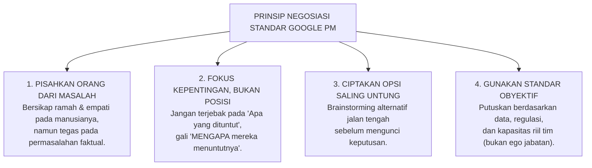

# Modul 24: Advanced Planning & Stakeholder Negotiation
## Google Project Management Professional Certificate

> **Sumber Materi**: [Rencanakan Proyek Anda dan Bernegosiasi dengan Pemangku Kepentingan | Sertifikat Manajemen Proyek Google](https://www.youtube.com/watch?v=eYaVc2puvlY)  
> **Kategori**: Course 6 — Capstone: Applying PM in the Real World (Module 2)  
> **Disusun oleh**: Dessy Rahmawati Chairullina, S.Kom  

---

## 📌 Executive Summary
1. **Negosiasi Sebagai Keterampilan Bertahan Hidup PM**: Manajer Proyek menghabiskan sebagian besar waktunya menegosiasikan sumber daya, tenggat waktu, dan ruang lingkup dengan pihak-pihak yang sering kali memiliki wewenang lebih tinggi darinya.
2. **Prinsip Negosiasi Berbasis Prinsip (*Principled Negotiation*)**: Pendekatan ilmiah Harvard Negotiation Project yang menolak tawar-menawar posisi (*positional bargaining*) dan berfokus pada 4 pilar: Pisahkan orang dari masalah, fokus pada kepentingan (*interests*) bukan posisi (*positions*), ciptakan alternatif keuntungan bersama (*mutual gain*), dan gunakan standar obyektif.
3. **Konsep BATNA & ZOPA**: Memahami alternatif terbaik jika negosiasi buntu (*Best Alternative to a Negotiated Agreement*) dan memetakan zona kemungkinan tercapainya kesepakatan (*Zone of Possible Agreement*).
4. **Menegosiasikan Segitiga Emas (*Triple Constraint Trade-offs*)**: Teknik diplomatis menolak permintaan penambahan fitur dadakan tanpa merusak hubungan kerja: *"Kita bisa menambahkan fitur ini, dengan konsekuensi memundurkan rilis 2 minggu atau menambah 1 orang developer"*.

---

## 1. Empat Pilar Negosiasi Berbasis Prinsip (Harvard Project)



### Posisi vs. Kepentingan (*Positions vs. Interests*):
* **Posisi (Tuntutan Luar yang Kaku)**: *"Sistem ini harus go-live tanggal 1 Januari dan tidak boleh terlambat satu hari pun!"*.
* **Kepentingan (Motif Kebutuhan Riil di Balik Posisi)**: Pimpinan memiliki kewajiban pelaporan ke Dinas Kesehatan per tanggal 5 Januari dan takut mendapatkan sanksi administratif jika data belum siap.
* **Solusi Negosiasi PM**: Merilis **Minimum Viable Product (MVP)** yang hanya berisi fitur pelaporan Dinas Kesehatan per 1 Januari, sementara modul analitik sekunder diluncurkan pada rilis berkala 15 Januari.

---

## 2. Memetakan BATNA & ZOPA

Sebelum memasuki ruang rapat negosiasi, seorang PM yang cerdas selalu menyiapkan analisis BATNA dan ZOPA:

```text
====================================================================================
                        ZONA KESEPAKATAN (ZOPA)
====================================================================================
Ekspektasi Sponsor:      Rilis 4 Minggu  <====== ZOPA ======> Rilis 6 Minggu (Batas Toleransi)
Kapasitas Tim IT:        Rilis 5 Minggu  <====== ZOPA ======> Rilis 8 Minggu (Estimasi Aman)

-> ZOPA Ada di rentang:  5 Minggu s/d 6 Minggu (Titik temu negosiasi realistis).
-> BATNA Tim IT:         Jika sponsor memaksakan 4 minggu tanpa kompromi, alternatif 
                         terbaik PM adalah memangkas 30% fitur non-kritis (Phased Release).
====================================================================================
```

* **BATNA (Best Alternative to a Negotiated Agreement)**: Rencana cadangan terkuat Anda jika negosiasi gagal mencapai kesepakatan. Semakin kuat BATNA Anda, semakin besar daya tawar diplomatis Anda.
* **ZOPA (Zone of Possible Agreement)**: Area tumpang tindih antara batas minimal yang dapat diterima oleh pihak pertama dan batas maksimal yang sanggup diberikan oleh pihak kedua.

---

## 3. Matriks Diplomasi Negosiasi Triple Constraint

Ketika pemangku kepentingan menuntut *"Saya mau fitur ditambah, tapi deadline tetap dan anggaran tidak boleh naik!"*, gunakan tabel respons diplomatis berikut:

| Tuntutan Pemangku Kepentingan | Respon Lemah / Merusak | Respon Negosiasi Profesional PM |
| :--- | :--- | :--- |
| **"Tambahkan modul farmasi ini ke rilis bulan depan!"** | "Tidak bisa, Pak! Tim kami sudah capek dan tidak ada waktu lagi!" (Konfrontatif & defensif). | "Tentu bisa, Dok. Karena kapasitas sprint tim sudah penuh, fitur mana dari modul rawat inap yang ingin kita tunda ke sprint berikutnya untuk memberi ruang pada modul farmasi ini?" |
| **"Pangkas jadwal pengerjaan jadi 2 minggu!"** | "Baik, Pak, kami usahakan sebisanya..." (Menyerah lalu tim burnout & sistem crash). | "Bisa kita selesaikan dalam 2 minggu jika kita membatasi ruang lingkup hanya pada fitur utama verifikasi (MVP), dan meluncurkan fitur cetak laporan di fase kedua." |
| **"Anggaran dipotong 20% tapi fitur harus lengkap!"** | "Itu tidak masuk akal, anggaran segitu mana cukup!" | "Dengan pemotongan anggaran 20%, kami merekomendasikan penggunaan open-source library internal yang stabil, namun tim butuh waktu 1 minggu ekstra untuk kustomisasi." |

---

## 4. Studi Kasus Nyata: Negosiasi Batasan Modul Farmasi antara Komite Medis dan IT

* **Konflik**: Komite Farmasi menuntut sistem memiliki 40 aturan peringatan interaksi obat (*Drug-Drug Interaction*) sebelum boleh diluncurkan. Tim IT menghitung bahwa mengintegrasikan 40 aturan tersebut butuh waktu 8 minggu, sementara batas akhir akreditasi tersisa 4 minggu lagi. Ketua Komite Farmasi mengancam tidak akan menandatangani persetujuan sistem.
* **Strategi Negosiasi PM**:
  1. *Eksplorasi Kepentingan (Interests)*: PM mendekati Ketua Farmasi dan menggali motifnya: Kekhawatiran terbesarnya adalah risiko fatal salah resep obat antibiotik dosis tinggi.
  2. *Mengajukan Standar Obyektif*: PM menyajikan data historis bahwa 80% insiden interaksi obat di rumah sakit selama 3 tahun terakhir hanya berpusat pada 8 golongan obat berisiko tinggi (*High Alert Medications*).
  3. *Menciptakan Solusi Win-Win*:
     * Fase 1 (Selesai dalam 3 minggu): Mengimplementasikan aturan otomatis untuk 8 obat *High Alert* tersebut agar keselamatan pasien terjamin dan syarat akreditasi terpenuhi.
     * Fase 2 (Pasca-Akreditasi): Menyelesaikan sisa 32 aturan interaksi obat secara berkala dalam 2 sprint berikutnya.
* **Hasil**:
  * Ketua Komite Farmasi menerima kompromi tersebut dengan lega karena kekhawatiran keselamatan pasiennya telah terlindungi.
  * Akreditasi rumah sakit berjalan sukses dengan apresiasi tim surveyor terhadap sistem pencegahan resep digital.

---

## 5. 🛠️ Actionable Stakeholder Negotiation Checklist

- [ ] **BATNA Defined**: Apakah saya sudah menentukan langkah alternatif terbaik saya sebelum melangkah ke meja negosiasi?
- [ ] **Interests Uncovered**: Apakah saya sudah mengetahui kekhawatiran riil atau motif utama di balik tuntutan keras stakeholder?
- [ ] **Objective Data Prepared**: Apakah argumen negosiasi saya didukung oleh angka kapasitas riil tim (Velocity / Jam kerja), bukan asumsi emosional?
- [ ] **Multiple Options Ready**: Sudahkah saya menyiapkan minimal 2 alternatif solusi kompromi (*trade-offs*) untuk ditawarkan?
- [ ] **Mutual Respect Preserved**: Apakah nada komunikasi tetap santun dan menjaga integritas hubungan kerja jangka panjang?
