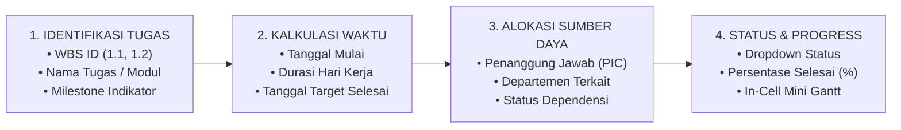

# Modul 25: Master Project Planning with Google Sheets
## Google Project Management Professional Certificate

> **Sumber Materi**: [Menyusun Rencana Proyek dengan Google Sheets | Sertifikat Manajemen Proyek Google](https://www.youtube.com/watch?v=GJyiNGP9jyk)  
> **Kategori**: Course 6 — Capstone: Applying PM in the Real World (Module 3)  
> **Disusun oleh**: Dessy Rahmawati Chairullina, S.Kom  

---

## 📌 Executive Summary
1. **Bahasa Universal Manajemen Proyek**: Meskipun industri memiliki software berbayar mahal seperti Jira atau Asana, spreadsheet (*Google Sheets & Excel*) tetap menjadi alat paling universal dan fleksibel untuk memodelkan rencana kerja, alokasi jam kerja, dan anggaran secara real-time.
2. **Arsitektur Rencana Kerja Terpadu (WBS Sheet)**: Struktur hierarkis yang memadukan dekomposisi tugas, identifikasi penanggung jawab tunggal (*Owner*), tanggal mulai dan selesai berbasis hari kerja efektif, serta pelacakan persentase kemajuan (*% Complete*).
3. **Formula Penting yang Wajib Dikuasai PM**: Pemanfaatan formula tanggal otomatis (`NETWORKDAYS`, `WORKDAY`), formula agregasi status (`COUNTIFS`), pencarian sumber daya (`XLOOKUP`), serta visualisasi *In-Cell Gantt Chart* menggunakan formula `SPARKLINE`.
4. **Tata Kelola Kolaborasi & Keamanan Berkas**: Mengunci hak akses (*Protect Sheets & Ranges*) untuk mencegah formula rusak terhapus oleh anggota tim lain tanpa sengaja.

---

## 1. Arsitektur Master Project Plan Spreadsheet

Sebuah spreadsheet pelacak proyek profesional dibangun dengan struktur kolom logis yang saling terintegrasi secara matematis:



---

## 2. Formula Kunci yang Wajib Dikuasai Setiap Project Manager

Hindari menghitung hari kerja secara manual di kalender meja. Manfaatkan formula cerdas spreadsheet:

### 1. Menghitung Jumlah Hari Kerja Bersih (Mengecualikan Akhir Pekan & Libur Nasional):
```excel
=NETWORKDAYS(C4; D4; 'Daftar Libur'!$A$2:$A$20)
```
* *Fungsi*: Menghitung durasi hari kerja riil antara tanggal mulai di sel `C4` dan tanggal selesai di `D4`, secara otomatis memotong hari Sabtu-Minggu dan daftar hari libur nasional di lembar referensi.

### 2. Menghitung Tanggal Selesai Otomatis Berdasarkan Durasi Hari Kerja:
```excel
=WORKDAY(C4; E4; 'Daftar Libur'!$A$2:$A$20)
```
* *Fungsi*: Jika proyek mulai tanggal `C4` dan membutuhkan durasi `E4` hari kerja, formula ini akan mengeluarkan tanggal kalender selesai yang akurat.

### 3. Visualisasi Mini Progress Bar di Dalam Sel Menggunakan SPARKLINE:
```excel
=SPARKLINE(F4; {"charttype"\"bar"; "max"\100; "color1"\"#2E7D32"})
```
* *Fungsi*: Menampilkan batang grafik progres visual horizontal di dalam sel berdasarkan nilai persentase di `F4` (0–100%).

### 4. Ringkasan Status Proyek Menggunakan COUNTIF:
```excel
=COUNTIF(G4:G50; "Selesai") / COUNTA(G4:G50)
```
* *Fungsi*: Menghitung persentase penyelesaian keseluruhan proyek secara dinamis setiap kali ada status tugas yang diubah menjadi "Selesai".

---

## 3. Template Struktur Master Tracker Proyek

```text
=================================================================================================================
                                      MASTER PROJECT TRACKER SPREADSHEET
=================================================================================================================
WBS   Nama Tugas / Deliverable      PIC       Mulai      Durasi   Target Selesai   Status         Progres  Visual
-----------------------------------------------------------------------------------------------------------------
1.0   MODUL REKAM MEDIS RAWAT INAP
1.1   Desain Form Risiko Jatuh      Dera      01/12/26   5 Hari   05/12/26         Selesai        100%     [====]
1.2   Pewarnaan Tabel MEOWS Kritis  Dera      08/12/26   4 Hari   11/12/26         Selesai        100%     [====]
1.3   Integrasi Database Pasien     Budi      12/12/26   7 Hari   19/12/26         In Progress     60%     [==> ]
1.4   Uji Coba UAT Bangsal Flamboyan Handoko   20/12/26   5 Hari   25/12/26         Belum Mulai      0%     [    ]

2.0   MODUL KEUANGAN & BPJS
2.1   Kalkulator Jasa Medis Dokter  Dera      15/12/26   8 Hari   23/12/26         In Progress     40%     [=>  ]
2.2   Rekonsiliasi Piutang FPK BPJS Siti      24/12/26   6 Hari   30/12/26         Belum Mulai      0%     [    ]
=================================================================================================================
```

---

## 4. Studi Kasus Nyata: Mengelola 14 Modul SIMRS dengan Spreadsheet Otomatis

* **Tantangan**: Manajemen rumah sakit menugaskan PM untuk mengoordinasikan pengembangan 14 modul SIMRS baru yang dikerjakan oleh 6 programmer. Rumah sakit tidak memiliki lisensi software project management berbayar.
* **Solusi Spreadsheet PM**:
  1. *Tab 1 — Executive Dashboard*: Menampilkan KPI utama, total jam kerja terpakai, dan grafik batang persentase penyelesaian per departemen (Medis, Keuangan, Farmasi).
  2. *Tab 2 — Master Task Sheet*: 140 baris tugas yang dikelompokkan per modul menggunakan fitur *Group / Collapsible Rows*. Setiap tugas memiliki dropdown status warna (Hijau = Selesai, Biru = In Progress, Kuning = Review, Merah = Blocked).
  3. *Tab 3 — Workload Capacity Tracker*: Menggunakan formula `SUMIFS` untuk menghitung total jam kerja yang dibebankan kepada masing-masing programmer, sehingga terdeteksi jika ada developer yang kelebihan beban (*over-allocated* > 40 jam/minggu).
  4. *Cell Locking & Permission*: PM mengunci seluruh kolom formula agar hanya bisa diedit oleh PM, sementara programmer hanya diizinkan mengubah kolom persentase progres dan status.
* **Hasil**:
  * Seluruh 14 modul berhasil dilacak dengan transparansi tinggi tanpa biaya software tambahan (menghemat biaya lisensi software ~Rp 25 juta/tahun).
  * Direksi dapat membuka dashboard kapan saja dari smartphone mereka melalui Google Drive.

---

## 5. 🛠️ Actionable Spreadsheet Planning Checklist

- [ ] **Data Validation Enforced**: Apakah kolom Status menggunakan dropdown validasi data untuk mencegah salah ketik teks status?
- [ ] **Networkdays Utilized**: Apakah perhitungan durasi jadwal menggunakan formula `NETWORKDAYS` untuk memotong akhir pekan dan libur nasional?
- [ ] **Formulas Protected**: Apakah sel-sel yang memuat formula kalkulasi matematis sudah dikunci (*Protected Ranges*) dari akses edit umum?
- [ ] **Conditional Formatting Applied**: Apakah status tugas memiliki pewarnaan otomatis (Merah untuk *Blocked*, Hijau untuk *Done*) guna memudahkan pemantauan visual cepat?
- [ ] **Executive Dashboard Available**: Apakah lembar pertama menyajikan ringkasan visual tingkat tinggi (*High-Level Summary*) yang ramah dibaca oleh pimpinan?
