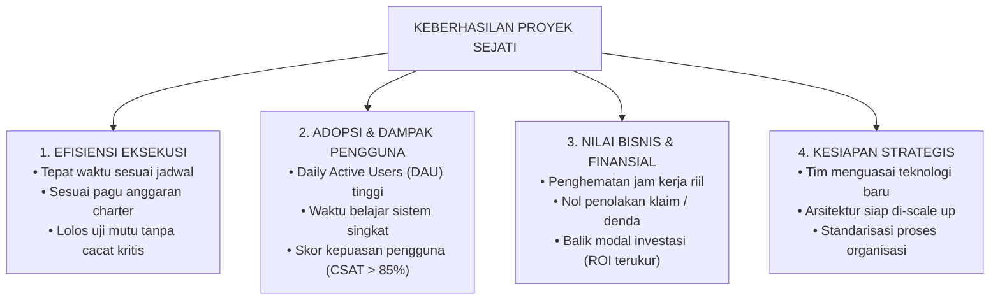

# Modul 26: Defining & Measuring True Project Success
## Google Project Management Professional Certificate

> **Sumber Materi**: [Menentukan Keberhasilan Proyek Anda | Sertifikat Manajemen Proyek Google](https://www.youtube.com/watch?v=NhCZvKxsi_Q)  
> **Kategori**: Course 6 — Capstone: Applying PM in the Real World (Module 4)  
> **Disusun oleh**: Dessy Rahmawati Chairullina, S.Kom  

---

## 📌 Executive Summary
1. **Melampaui Mitos Segitiga Besi (*Beyond the Iron Triangle*)**: Menyelesaikan proyek tepat waktu dan sesuai anggaran hanyalah indikator efisiensi teknis. Keberhasilan proyek sejati diukur dari apakah sistem tersebut **benar-benar digunakan oleh pengguna akhir**, memecahkan masalah bisnis nyata, dan memberikan nilai investasi (*Return on Investment - ROI*).
2. **Empat Dimensi Keberhasilan Proyek**:
   * *Efisiensi Proyek*: Kinerja jadwal dan deviasi anggaran saat fase pengerjaan.
   * *Dampak pada Pengguna*: Tingkat adopsi, kemudahan penggunaan (*usability*), dan kepuasan pengguna (*CSAT/NPS*).
   * *Manfaat Bisnis Langsung*: Penghematan biaya operasional, pencegahan kebocoran pendapatan, dan kepatuhan audit.
   * *Kesiapan Masa Depan*: Membangun fondasi arsitektur dan kapabilitas tim untuk inovasi jangka panjang.
3. **Audit Pasca-Peluncuran (*Post-Implementation Review - PIR*)**: Evaluasi formal yang digelar 30–90 hari pasca *go-live* untuk mengukur metrik adopsi riil di lapangan setelah masa euforia peluncuran mereda.
4. **Metrik Adopsi vs Metrik Kesombongan (*Vanity Metrics*)**: Membedakan antara data semu (berapa banyak akun yang dibuat) dengan data keterlibatan riil (berapa transaksi yang diproses tuntas setiap hari).

---

## 1. Empat Dimensi Keberhasilan Proyek Komprehensif



### Perbedaan Proyek "Berhasil Secara Teknis" vs "Gagal Secara Bisnis":
| Skenario Kasus | Indikator Tradisional (Triple Constraint) | Realitas Nilai Bisnis (Business Outcome) | Status Akhir |
| :--- | :--- | :--- | :---: |
| **Kasus A: Form Rawat Inap** | Selesai tepat waktu 3 bulan, hemat biaya Rp 10 juta, seluruh fitur terkoding rapi. | Dokter dan perawat menolak mengisi form karena terlalu banyak klik; data tetap dicatat di kertas manual. | **GAGAL TOTAL** |
| **Kasus B: Modul Jasa Medis** | Terlambat 1 minggu dari jadwal dan menghabiskan 100% anggaran pagu. | Dipakai 100% oleh kasir dan dokter; menyelesaikan sengketa pembagian honor dan memangkas waktu kerja dari 18 hari ke 1 hari. | **SUKSES BESAR** |

---

## 2. Struktur Audit Pasca-Peluncuran (Post-Implementation Review - PIR)

Audit PIR dilakukan 30–90 hari setelah sistem berjalan di lingkungan produksi untuk mengukur kestabilan dan dampak jangka panjang.

```text
====================================================================================================
                        POST-IMPLEMENTATION REVIEW (PIR) DASHBOARD
====================================================================================================
Proyek: Digitalisasi Pemantauan Risiko Jatuh & EWS Rawat Inap (Audit Hari ke-60)
----------------------------------------------------------------------------------------------------
Metrik Evaluasi               Sebelum Proyek (Baseline)   Hasil Hari ke-60 (Aktual)   Status Target
----------------------------------------------------------------------------------------------------
Tingkat Adopsi Harian         0% (Manual Kertas)          98.4% Transaksi Digital     TERCAPAI
Waktu Input Asesmen           8 Menit / Pasien            2 Menit 15 Detik / Pasien   TERCAPAI (Hemat 72%)
Kelengkapan Berkas Akreditasi 62% Lengkap                 99.1% Lengkap               TERCAPAI
Insiden Pasien Jatuh Bangsal  14 Kasus / Bulan            4 Kasus / Bulan             MELAMPAUI (Turun 71%)
Tiket Kendala Sistem (Bug)    -                           1 Tiket Minor / Minggu      STABIL
Skor Kepuasan Perawat (CSAT)  -                           91.5% Puas / Sangat Puas    TERCAPAI
====================================================================================================
```

---

## 3. Metrik Adopsi Nyata vs Vanity Metrics

Seorang Business Analyst dan PM harus waspada terhadap jebakan *Vanity Metrics* (angka yang tampak bagus di slide presentasi tetapi tidak mencerminkan nilai bisnis nyata):

| Kategori Metrik | Vanity Metric (Data Semu) | Actionable Metric (Data Bernilai Nyata) |
| :--- | :--- | :--- |
| **Penggunaan Software** | Jumlah akun perawat yang terdaftar di database (150 akun). | Persentase perawat jaga yang aktif menyelesaikan asesmen pasien setiap shift (**Daily Active Users / Shift Completion Rate**). |
| **Keuangan Proyek** | Total baris kode yang ditulis programmer (25.000 baris kode). | Total nominal kebocoran klaim piutang yang berhasil diselamatkan sistem per bulan (**Recovered Revenue**). |
| **Performa Sistem** | Server menyala terus 99.9% tanpa restart. | Waktu respons buka form pasien di jam sibuk pagi hari (< 500 ms tanpa lag). |

---

## 4. Studi Kasus Nyata: Mengukur Keberhasilan Klinis Modul Risiko Jatuh Pasien

* **Latar Belakang**: Rumah sakit menginvestasikan dana untuk digitalisasi formulir risiko jatuh (Skala Morse & Humpty Dumpty) dengan peringatan warna otomatis.
* **Hasil Pengukuran Hari ke-90 Pasca-Peluncuran**:
  1. *Metrik Adopsi*: 100% perawat bangsal telah beralih penuh menggunakan sistem digital tanpa ada lagi formulir kertas yang beredar di nurse station.
  2. *Dampak Klinis Nyata (Clinical Outcome)*:
     * Karena sistem langsung memberi tanda warna merah terang pada baris tabel pasien berisiko tinggi saat pergantian shift jaga, perawat segera memasang gelang kuning penanda risiko jatuh dan menaikkan pengaman tempat tidur (*bedrail*).
     * Angka insiden pasien jatuh di bangsal rawat inap anjlok dari rata-rata **14 kasus per bulan menjadi hanya 4 kasus per bulan** (penurunan sebesar 71%).
  3. *Dampak Finansial & Hukum*: Mencegah potensi tuntutan hukum keluarga pasien dan menghemat biaya perawatan cedera sekunder senilai ratusan juta rupiah.
* **Kesimpulan Direksi**: Proyek ini dinyatakan sebagai **Keberhasilan Paripurna (*Exceptional Success*)** karena dampak positifnya dirasakan langsung oleh keselamatan pasien (*patient safety*).

---

## 5. 🛠️ Actionable Project Success Measurement Checklist

- [ ] **Outcome-Based Success Defined**: Apakah tolok ukur sukses proyek sudah berfokus pada hasil bisnis dan adopsi pengguna (bukan sekadar tanggal rilis)?
- [ ] **PIR Scheduled**: Apakah tanggal audit pasca-peluncuran (*PIR*) sudah dijadwalkan pada hari ke-30 atau ke-60 pasca go-live?
- [ ] **No Vanity Metrics**: Apakah laporan kinerja bebas dari metrik semu dan murni memuat data transaksi riil yang tuntas?
- [ ] **User Feedback Surveyed**: Sudahkah menyebarkan kuesioner kepuasan pengguna (CSAT) kepada staf operasional yang menggunakan sistem setiap hari?
- [ ] **Tangible ROI Calculated**: Apakah penghematan biaya atau peningkatan efisiensi jam kerja sudah dihitung dan dilaporkan secara transparan ke pemegang anggaran?
