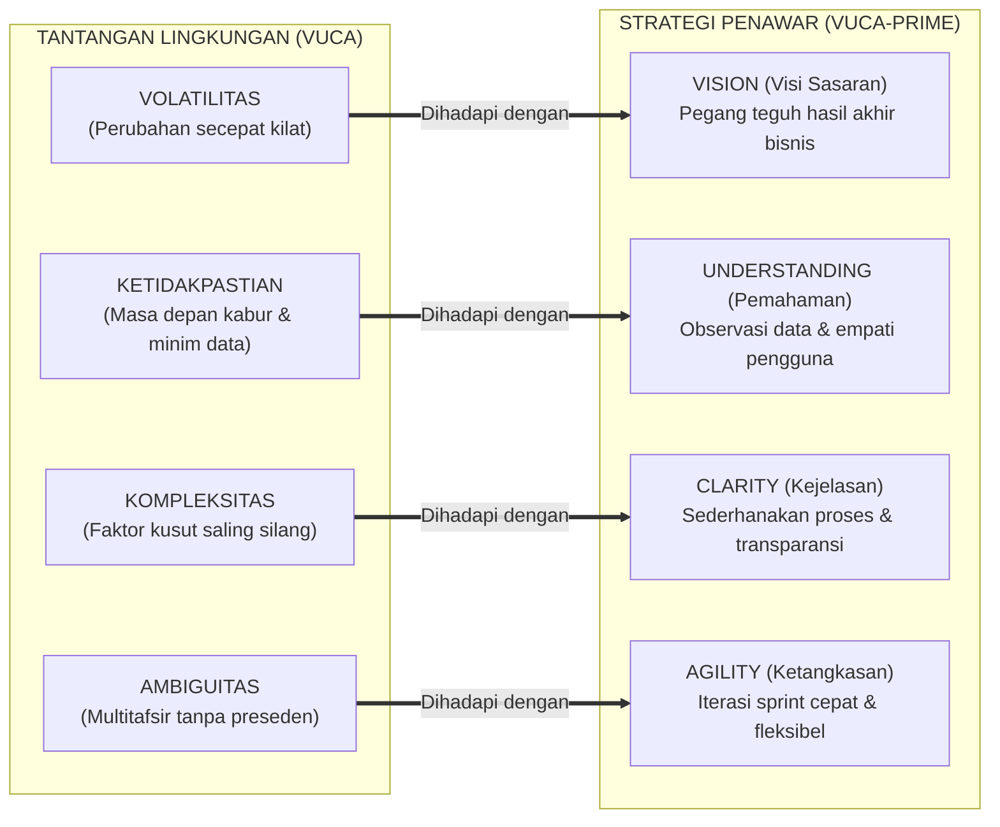

# Modul 27: Navigating VUCA in Modern Project Management
## Google Project Management Professional Certificate

> **Sumber Materi**: [Apa itu VUCA dan Bagaimana Manfaatnya bagi Manajer Proyek? | Sertifikat Manajemen Proyek Google](https://www.youtube.com/watch?v=XC55lgkilp0)  
> **Kategori**: Course 6 — Capstone: Applying PM in the Real World (Module 5)  
> **Disusun oleh**: Dessy Rahmawati Chairullina, S.Kom  

---

## 📌 Executive Summary
1. **Dunia Proyek yang Bergejolak (The VUCA Reality)**: Proyek modern tidak lagi berjalan di lingkungan yang stabil dan dapat diprediksi secara linier. Manajer Proyek beroperasi di tengah ekosistem **VUCA**: *Volatility* (Volatilitas), *Uncertainty* (Ketidakpastian), *Complexity* (Kompleksitas), dan *Ambiguity* (Ambiguitas).
2. **Framework Penawar VUCA-Prime**: Kerangka strategi kepemimpinan Bob Johansen untuk menaklukkan dinamika VUCA:
   * Lawan *Volatility* dengan **Vision** (Visi sasaran yang kokoh dan tak tergoyahkan).
   * Lawan *Uncertainty* dengan **Understanding** (Pemahaman mendalam & empati lapangan).
   * Lawan *Complexity* dengan **Clarity** (Kejelasan komunikasi & penyederhanaan alur kerja).
   * Lawan *Ambiguity* dengan **Agility** (Ketangkasan iterasi bertahap & eksperimen cepat).
3. **Penyelarasan Metodologi**: Mengapa proyek di lingkungan VUCA tinggi harus menggunakan pendekatan **Agile/Iteratif**, bukan memaksakan rencana kaku Waterfall jangka panjang yang mudah patah saat terjadi disrupsi.
4. **Resiliensi Psikologis Tim Proyek**: Membangun ketahanan mental tim agar tidak panik saat regulasi pemerintah atau prioritas bisnis berubah secara mendadak di tengah jalan.

---

## 1. Membedah Empat Dimensi VUCA & Penawarnya (VUCA-Prime)



### Matriks Karakteristik & Strategi Aksi PM:
| Dimensi VUCA | Definisi & Skenario Lapangan | Tindakan Penawar PM (VUCA-Prime) |
| :--- | :--- | :--- |
| **Volatility (Volatilitas)** | Perubahan terjadi dalam hitungan hari (misal: Surat Edaran Kemenkes mendadak mewajibkan integrasi field baru SATUSEHAT minggu depan). | **Vision**: Jangan ubah tujuan inti proyek; sesuaikan strategi teknisnya dengan menjaga fokus tim pada keselamatan pasien dan kepatuhan hukum. |
| **Uncertainty (Ketidakpastian)** | Tidak ada data historis apakah dokter akan menerima sistem baru atau bagaimana beban server saat lonjakan pasien. | **Understanding**: Turun langsung ke lapangan (*gemba walk*), lakukan uji coba bertahap (*pilot project*) di 1 bangsal sebelum rilis massal. |
| **Complexity (Kompleksitas)** | Sistem melibatkan 12 modul berbeda, 4 vendor pihak ketiga, dan 3 komite medis dengan regulasi yang tumpang tindih. | **Clarity**: Dekomposisi masalah besar menjadi unit WBS kecil; visualisasikan alur integrasi dengan diagram arsitektur yang sederhana. |
| **Ambiguity (Ambiguitas)** | Petunjuk teknis dari kementerian belum memiliki contoh koding yang jelas (*no precedent*). | **Agility**: Bangun *Proof of Concept (PoC)* cepat dalam 3 hari, lakukan uji tembak API, dan lakukan iterasi berdasarkan respons server riil. |

---

## 2. Navigasi Perubahan Regulasi Mendadak: Protokol Manajemen Perubahan Tangkas

Saat disrupsi eksternal menghantam proyek yang sedang berjalan, PM dilarang bersikap reaktif panik. Gunakan protokol 4 langkah:

```text
[ PROTOKOL NAVIGASI DISRUPSI VUCA ]
1. PAUSE & ASSESS (Hentikan Kepanikan)
   -> Identifikasi secara objektif: Apa yang sebenarnya berubah? Berapa banyak modul 
      yang terdampak langsung? Jangan membuat asumsi liar tanpa membaca dokumen regulasi resmi.

2. EVALUASI TRIPLE CONSTRAINT (Dampak Waktu & Biaya)
   -> Hitung dampak penyesuaian: Berapa Story Points tambahan yang dibutuhkan?
      Apakah tanggal peluncuran harus mundur, atau ada fitur sekunder yang bisa ditukar keluar?

3. KOMUNIKASI TRANSPARAN KE SPONSOR (Opsi Solusi, Bukan Sekadar Masalah)
   -> Hadapi pimpinan dengan 2 alternatif jalan keluar yang konkret beserta konsekuensi risikonya.

4. RE-ESTIMATE & ITERATE (Adaptasi di Sprint Berikutnya)
   -> Masukkan penyesuaian baru ke Product Backlog teratas dan jalankan dengan sprint pendek.
```

---

## 3. Studi Kasus Nyata: Menghadapi Perubahan Format API Bridging Kemenkes di Tengah Rilis

* **Situasi Disrupsi Ekstrem**:
  Dua minggu sebelum jadwal peluncuran modul bridging SIMRS, Kemenkes merilis pembaruan pedoman teknis yang mewajibkan penambahan parameter koordinat lokasi geospasial dan enkripsi payload baru pada endpoint SATUSEHAT. Seluruh kode yang telah dibangun programmer selama 1 bulan berisiko tidak valid.
* **Tindakan PM Menavigasi VUCA**:
  1. *Menghadapi Volatilitas dengan Visi (Vision)*: PM mengumpulkan tim dan menegaskan: *"Tujuan kita tetap sama: Rumah sakit harus lulus akreditasi digital. Perubahan format ini dialami oleh seluruh rumah sakit di Indonesia, bukan hanya kita"*.
  2. *Menghadapi Ketidakpastian dengan Pemahaman (Understanding)*: PM segera menghubungi tim teknis helpdesk DTO Kemenkes dan mengikuti forum pengembang resmi untuk memverifikasi contoh payload JSON yang valid.
  3. *Menghadapi Kompleksitas dengan Kejelasan (Clarity)*: PM merancang modul helper enkripsi terpusat yang berdiri sendiri (*modular decoupled architecture*), sehingga perubahan format payload tidak merusak logika form klinis perawat.
  4. *Menghadapi Ambiguitas dengan Ketangkasan (Agility)*: Tim membuat skrip uji simulasi (*sandbox test*) dan melakukan iterasi harian hingga seluruh endpoint dinyatakan lolos verifikasi staging Kemenkes dalam 5 hari kerja.
* **Hasil**:
  * Modul bridging berhasil mengadopsi standar baru sebelum batas waktu regulasi berakhir.
  * Rumah sakit menjadi salah satu fasilitas kesehatan pertama di wilayahnya yang berhasil melakukan sinkronisasi data rekam medis tanpa kendala.

---

## 4. 🛠️ Actionable VUCA Navigation Checklist

- [ ] **Vision Anchored**: Apakah visi dan tujuan utama proyek dipahami dengan jelas oleh seluruh anggota tim sehingga tidak mudah goyah oleh kabar angin?
- [ ] **Early Warning Sensing**: Apakah PM aktif memantau perubahan regulasi pemerintah, pembaruan API vendor, dan tren industri secara berkala?
- [ ] **Modular Architecture**: Apakah sistem dirancang secara modular sehingga jika satu komponen eksternal berubah, modul lainnya tidak ikut lumpuh total?
- [ ] **Empathetic Understanding**: Saat ketidakpastian tinggi, apakah tim melakukan observasi langsung ke pengguna (*gemba walk*) daripada menebak-nebak di ruang rapat?
- [ ] **Agile Experimentation**: Apakah tim memiliki ruang aman untuk melakukan uji coba prototipe cepat (*Spike / PoC*) dalam 1–2 hari kerja untuk memecahkan ambiguitas teknis?
