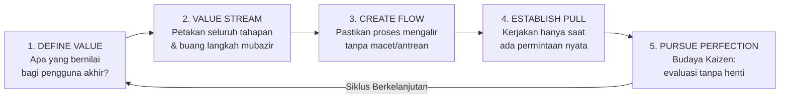

# Modul 28: 5 Principles of Lean Methodology & Waste Elimination
## Google Project Management Professional Certificate

> **Sumber Materi**: [Apa Saja 5 Prinsip Metodologi Lean? | Sertifikat Manajemen Proyek Google](https://www.youtube.com/watch?v=RL6jtiKzSzI)  
> **Kategori**: Specialization — Advanced PM Practices & Lean Methodologies (Module 1)  
> **Disusun oleh**: Dessy Rahmawati Chairullina, S.Kom  

---

## 📌 Executive Summary
1. **Filosofi Inti Lean**: Memaksimalkan nilai bagi pelanggan (*Customer Value*) dengan meminimalkan atau melenyapkan segala bentuk pemborosan (*Waste Elimination*) tanpa mengorbankan kualitas.
2. **Lima Prinsip Baku Metodologi Lean**:
   * *1. Tentukan Nilai (Define Value)*: Nilai hanya ditentukan dari sudut pandang pengguna akhir (apa yang mereka bayar dan butuhkan).
   * *2. Petakan Arus Nilai (Map the Value Stream)*: Memvisualisasikan seluruh langkah proses untuk memisahkan aktivitas bernilai tambah (*Value-Added*) dari aktivitas pemborosan (*Non-Value-Added*).
   * *3. Ciptakan Arus Lancar (Create Continuous Flow)*: Menghilangkan hambatan antrean agar pekerjaan bergerak tanpa henti.
   * *4. Terapkan Sistem Tarik (Establish Pull)*: Pekerjaan baru hanya ditarik saat ada permintaan nyata dari hilir, bukan didorong secara membabi buta (*Push System*).
   * *5. Kejar Kesempurnaan (Pursue Perfection / Kaizen)*: Siklus perbaikan bertahap tanpa henti menuju nol cacat.
3. **Delapan Pemborosan Lean (*8 Wastes of Lean / DOWNTIME*)**: *Defects, Overproduction, Waiting, Non-utilized talent, Transportation, Inventory, Motion, Extra-processing*.
4. **Alat Analisis Value Stream Mapping (VSM)**: Memetakan waktu tunggu (*Wait Time*) vs waktu kerja riil (*Cycle Time*) untuk melipatgandakan efisiensi operasional.

---

## 1. Lima Prinsip Dasar Metodologi Lean



---

## 2. Mengenal Delapan Pemborosan (The 8 Wastes / DOWNTIME)

Dalam konteks manajemen proyek sistem informasi dan operasional rumah sakit, 8 pemborosan Lean memanifestasikan diri dalam bentuk:

| Kode | Jenis Pemborosan | Manifestasi Nyata di Proyek IT / SIMRS | Solusi Eliminasi Lean |
| :--- | :--- | :--- | :--- |
| **D** | **Defects (Cacat / Bug)** | Form salah kalkulasi tarif, data pasien tertukar, sistem crash saat jam sibuk. | Standarisasi automated unit testing dan checklist validasi sebelum merge kode. |
| **O** | **Overproduction** | Membangun 20 fitur rumit yang tidak pernah disentuh pengguna di lapangan. | Hanya membangun Minimum Viable Product (MVP) berbasis kebutuhan terverifikasi. |
| **W** | **Waiting (Menunggu)** | Developer menunggu approval skema database; pasien menunggu antrean validasi billing 40 menit. | Pangkas hierarki persetujuan; terapkan sistem validasi 1-klik otomatis. |
| **N** | **Non-utilized Talent** | Programmer senior mengerjakan data entry manual; perawat membuang waktu mengurus fotokopi berkas. | Otomatisasi bridging data; delegasikan tugas sesuai matriks kompetensi keahlian. |
| **T** | **Transportation** | File dokumen berpindah tangan bolak-balik antara 4 departemen untuk tanda tangan fisik. | Digitalisasi alur persetujuan terpusat menggunakan Tanda Tangan Elektronik (TTE). |
| **I** | **Inventory (Penumpukan)** | Tumpukan 50 kartu tugas di kolom "In Progress" yang macet tidak ada yang selesai. | Terapkan batas ketat *Work In Progress (WIP Limits)* pada papan Kanban. |
| **M** | **Motion (Gerakan Sia-sia)** | Dokter harus melakukan 18 kali klik mouse pada 4 form berbeda hanya untuk meresepkan 1 obat. | Restrukturisasi ergonomi UI menjadi *1-Screen Clinical View*. |
| **E** | **Extra-Processing** | Mencatat data tanda vital di kertas manual, lalu mengetiknya ulang ke SIMRS, lalu mencetaknya lagi. | *Single-Entry Data*: Input sekali langsung tersinkronisasi ke seluruh modul terintegrasi. |

---

## 3. Value Stream Mapping (VSM): Membedah Waktu Tunggu vs Waktu Kerja

Alat paling ampuh seorang Lean Project Manager adalah menghitung rasio efisiensi proses kerja (*Process Cycle Efficiency*):

$$\text{Process Efficiency} = \frac{\text{Total Value-Added Time (Waktu Kerja Riil)}}{\text{Total Lead Time (Total Waktu Proses Lengkap)}} \times 100\%$$

```text
[ ALUR PELAYANAN RESEP FARMASI RAWAT JALAN SEBELUM LEAN ]
Dokter input resep -> (TUNGGU 15 MNT) -> Farmasi telaah resep (2 MNT) -> (TUNGGU 20 MNT)
-> Peracikan obat (5 MNT) -> (TUNGGU 10 MNT) -> Penyerahan obat (3 MNT).

Total Lead Time (Waktu Pasien Menunggu) = 55 Menit
Total Value-Added Time (Waktu Kerja Nyata) = 2 + 5 + 3 = 10 Menit
Efisiensi Alur Sebelum Lean = (10 / 55) x 100% = 18.1% (81.9% WAKTU DIBUANG UNTUK MENUNGGU!)
```

---

## 4. Studi Kasus Nyata: Penerapan Lean VSM pada Alur Farmasi SIMRS

* **Masalah**: Ruang tunggu farmasi rumah sakit selalu penuh sesak dengan komplain waktu tunggu obat rata-rata mencapai 55 menit per pasien. Pasien lansia kelelahan dan staf farmasi stres menghadapi kemarahan keluarga pasien.
* **Tindakan PM Menerapkan 5 Prinsip Lean**:
  1. *Define Value*: Nilai bagi pasien adalah menerima obat yang akurat dan aman dalam waktu secepat mungkin.
  2. *Map the Value Stream*: PM memetakan alur fisik dan digital, lalu menemukan 2 titik tunggu terbesar (*Waiting Waste*):
     * Waktu tunggu telaah resep (15 menit) karena apoteker harus menelepon dokter untuk mengonfirmasi tulisan resep yang tidak terbaca.
     * Waktu tunggu validasi kasir (20 menit) karena kasir menunggu berkas fisik diantar kurir.
  3. *Create Continuous Flow*:
     * PM mengganti alur dengan sistem *Digital e-Prescribing*: Dokter memilih obat langsung dari formularium digital (nol tulisan tangan kabur).
     * Modul farmasi diintegrasikan langsung dengan modul kasir: Begitu dokter menekan tombol "Resepkan", tagihan otomatis terhitung di kasir tanpa kurir fisik.
  4. *Establish Pull*: Staf peracik obat hanya memproses antrean obat yang sudah berstatus "Verifikasi Berhasil" di layar monitor TV farmasi.
* **Hasil**:
  * Total Lead Time anjlok dari 55 menit menjadi **hanya 12 menit per pasien** (penurunan waktu tunggu sebesar 78%).
  * Efisiensi proses kerja melonjak menjadi 83%.
  * Antrean ruang tunggu farmasi menjadi tertib, tenang, dan tingkat kepuasan pasien (*CSAT*) melesat ke angka 96%.

---

## 5. 🛠️ Actionable Lean PM Checklist

- [ ] **Customer Value Defined**: Apakah setiap fitur dalam lingkup proyek benar-benar memberikan nilai langsung kepada pengguna akhir?
- [ ] **Wastes Audited (DOWNTIME)**: Sudahkah mengidentifikasi minimal 3 dari 8 pemborosan dalam alur kerja sistem saat ini?
- [ ] **WIP Limits Enforced**: Apakah tim membatasi jumlah pekerjaan yang berjalan bersamaan di papan Kanban untuk mencegah kemacetan antrean?
- [ ] **Extra-Processing Eliminated**: Apakah ada proses penginputan data berulang yang bisa diotomatisasi dengan integrasi basis data?
- [ ] **Continuous Improvement (Kaizen)**: Apakah tim secara berkala mengukur *Lead Time vs Cycle Time* untuk mencari celah penyederhanaan alur kerja?
