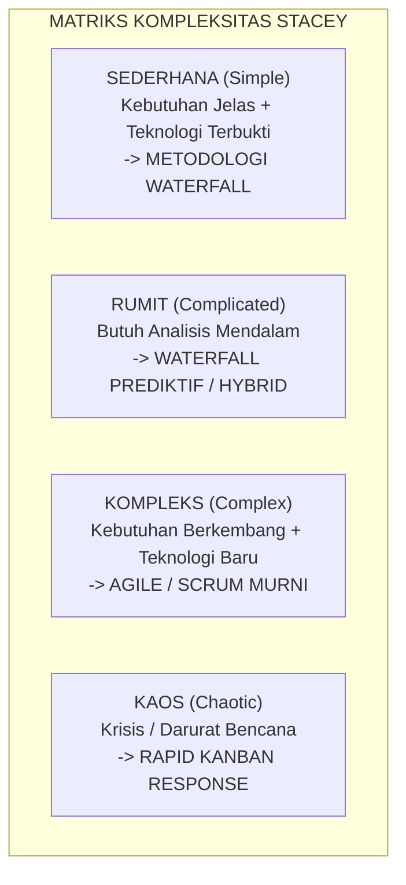

# Modul 29: Hybrid Project Management: Blending Agile & Waterfall
## Google Project Management Professional Certificate

> **Sumber Materi**: [Apa itu Metode Penggabungan dalam Manajemen Proyek? | Sertifikat Manajemen Proyek Google](https://www.youtube.com/watch?v=ffjIRy2qa-0)  
> **Kategori**: Specialization — Advanced PM Practices & Lean Methodologies (Module 2)  
> **Disusun oleh**: Dessy Rahmawati Chairullina, S.Kom  

---

## 📌 Executive Summary
1. **Melampaui Dogmatisme Metodologi**: Di dunia industri nyata, perdebatan kaku antara "harus 100% Waterfall" vs "harus 100% Agile" adalah perangkap semu. Organisasi enterprise dan rumah sakit modern hampir selalu menerapkan **Pendekatan Hibrida (*Hybrid Project Management*)**.
2. **Matriks Kompleksitas Stacey (*Stacey Complexity Matrix*)**: Alat diagnostik untuk memilih metodologi terbaik berdasarkan dua sumbu: Tingkat Kepastian Kebutuhan (*Requirements Certainty*) dan Tingkat Kepastian Teknologi (*Technology Certainty*).
3. **Model Arsitektur Water-Scrum-Fall**: Menggabungkan tata kelola kepatuhan regulasi dan pagu anggaran awal (*Waterfall Initiation & Governance*), eksekusi perancangan perangkat lunak secara tangkas (*Scrum Sprints*), dan audit rilis resmi (*Waterfall Closing & Compliance*).
4. **Kapan Menggunakan Hibrida?**: Sangat ideal untuk proyek yang terikat tenggat waktu regulasi kementerian yang mutlak, namun fitur antarmuka penggunanya membutuhkan iterasi dan adaptasi klinis harian.

---

## 1. Menentukan Metodologi: Matriks Kompleksitas Stacey



### Panduan Memilih Pendekatan yang Tepat:
| Karakteristik Proyek | Rekomendasi Metodologi | Alasan Pendekatan |
| :--- | :---: | :--- |
| **Pembangunan Gedung Rawat Inap Baru** | **Waterfall Murni** | Fondasi dan beton tidak bisa diubah-ubah di tengah jalan; biaya perbaikan fisik sangat mahal. |
| **Aplikasi Pasien Mobile Rumah Sakit** | **Agile Murni (Scrum)** | Preferensi pengguna berubah cepat; butuh rilis fitur baru dan uji coba UI setiap 2 minggu. |
| **Integrasi SIMRS Terikat Regulasi Kemenkes** | **Hybrid (Water-Scrum-Fall)** | Pagu anggaran, audit hukum, dan tenggat waktu terkunci pasti, namun logika form dan alur kerja dokter butuh iterasi sprint fleksibel. |

---

## 2. Anatomi Model Hibrida: Water-Scrum-Fall

Model ini adalah standar *de facto* dalam rekayasa perangkat lunak enterprise dan sistem kesehatan (*Healthcare IT*):

```text
====================================================================================================
                        ARSITEKTUR HYBRID WATER-SCRUM-FALL
====================================================================================================
[ FASE 1: WATER (Inisiasi & Governance) ]
• Penyusunan Business Case & Analisis Kelayakan Finansial
• Penandatanganan Project Charter oleh Direksi & Sponsor
• Penguncian Pagu Anggaran Maksimal & Tenggat Akreditasi Mutlak
• Kepatuhan Regulasi Hukum (KARS, UU PDP, Standar Kemenkes)
                  |
                  v
[ FASE 2: SCRUM (Pengembangan Teknis & Desain UI) ]
• Sprint 1 (2 Minggu) : Riset Persona & Desain Antarmuka Form Klinis
• Sprint 2 (2 Minggu) : Integrasi Database & Automated Unit Testing
• Sprint 3 (2 Minggu) : Demo Perangkat Lunak Nyata & UAT Bersama Dokter
• Sprint 4 (2 Minggu) : Iterasi Feedback & Penguncian Modul
                  |
                  v
[ FASE 3: FALL (Peluncuran, Audit & Penutupan) ]
• Audit Keamanan Siber & Penetrasi Sistem (Pentest)
• Pelatihan Massal Staf Rumah Sakit & Penyerahan SOP
• Penandatanganan Berita Acara Serah Terima (BAST) Resmi
• Handover ke IT Support Operasional (BAU)
====================================================================================================
```

---

## 3. Menjaga Keseimbangan Tata Kelola dan Ketangkasan

Tantangan terbesar Manajer Proyek dalam lingkungan Hibrida adalah **menjadi penerjemah dua arah**:

* **Ke Arah Pimpinan Eksekutif**:
  * Sajikan laporan dalam bahasa Waterfall: *Gantt Chart tingkat tinggi, persentase penyelesaian milestone, dan variansi biaya*.
  * Jangan membebani direksi dengan istilah Velocity, Story Points, atau Burndown.
* **Ke Arah Tim Pengembang**:
  * Lindungi tim dengan bahasa Agile: *User Stories, papan Kanban visual, pembatasan WIP, dan perlindungan dari interupsi tugas dadakan*.
  * Jangan membebani developer dengan format pelaporan birokrasi harian yang melelahkan.

---

## 4. Studi Kasus Nyata: Implementasi Hybrid PM pada Sistem Rawat Inap Rumah Sakit

* **Tantangan Proyek**:
  * Manajemen rumah sakit menetapkan batas waktu mutlak: *Sistem Rekam Medis Rawat Inap harus lulus verifikasi akreditasi pada tanggal 15 Mei dengan anggaran maksimal Rp 80.000.000*.
  * Namun, para dokter spesialis bedah dan penyakit dalam menolak spesifikasi teknis awal karena dianggap terlalu rumit.
* **Strategi Hibrida PM**:
  1. *Fase Awal (Waterfall)*: PM mengunci pagu anggaran Rp 80 juta dan menetapkan milestone tanggal 15 Mei sebagai tanggal harga mati (*Schedule Baseline*).
  2. *Fase Eksekusi (Scrum)*:
     * Alih-alih membuat form kaku sekali jadi, PM memecah pengembangan menjadi 4 sprint berdurasi 2 minggu.
     * Di akhir setiap sprint, tim pengembang mendemokan form langsung di hadapan dokter untuk mendapatkan masukan ergonomi alur klik.
  3. *Fase Penutupan (Waterfall)*: Dua minggu sebelum tanggal 15 Mei, proses koding dibekukan (*code freeze*) untuk pelaksanaan audit kepatuhan rekam medis dan penandatanganan dokumen BAST resmi bersama dewan pengawas.
* **Hasil**:
  * Proyek selesai tepat waktu pada tanggal 10 Mei (5 hari sebelum batas akreditasi) dengan realisasi anggaran Rp 74.500.000 (hemat 7%).
  * Rumah sakit meraih predikat kelulusan Paripurna akreditasi.
  * Para dokter merasa bangga karena sistem yang mereka gunakan merupakan hasil rancangan bersama (*co-creation*).

---

## 5. 🛠️ Actionable Hybrid PM Checklist

- [ ] **Complexity Diagnosed**: Sudahkah menggunakan Matriks Stacey untuk membedakan bagian proyek mana yang butuh kepastian Waterfall dan bagian mana yang butuh kelenturan Agile?
- [ ] **Dual Governance Aligned**: Apakah jadwal milestone eksekutif (Waterfall) sudah diselaraskan dengan ritme sprint tim pengembang (Scrum)?
- [ ] **Clear Code Freeze Date**: Apakah ada tanggal pembekuan kode yang tegas sebelum fase audit dan serah terima dimulai?
- [ ] **Bilingual PM Communication**: Apakah PM mampu menyajikan laporan status Waterfall untuk direksi dan memfasilitasi sprint Agile untuk tim teknis?
- [ ] **Compliance Guardrails Active**: Apakah standar regulasi industri (keamanan data, audit medis) tetap ditegakkan sepanjang siklus iterasi sprint?
