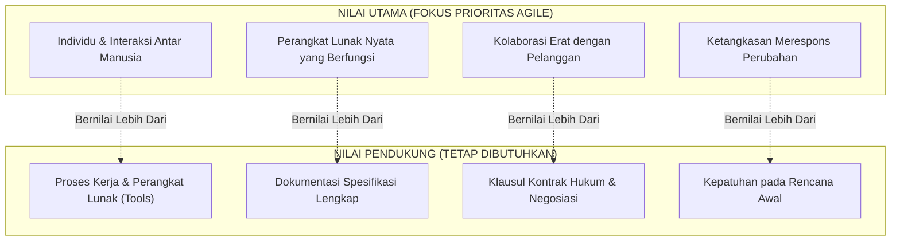

# Modul 30: The Agile Manifesto & The 12 Guiding Principles
## Google Project Management Professional Certificate

> **Sumber Materi**: [Apa itu Agile Manifesto? | Sertifikat Manajemen Proyek Google](https://www.youtube.com/watch?v=YmMadDTvoqY)  
> **Kategori**: Specialization — Advanced PM Practices & Lean Methodologies (Module 3)  
> **Disusun oleh**: Dessy Rahmawati Chairullina, S.Kom  

---

## 📌 Executive Summary
1. **Titik Balik Sejarah Rekayasa Perangkat Lunak**: Pada Februari 2001 di Snowbird, Utah, 17 tokoh pelopor perangkat lunak merumuskan **Agile Manifesto** sebagai bentuk perlawanan terhadap metodologi birokrasi kaku (*heavyweight processes*) yang menghasilkan tumpukan dokumen tebal tetapi gagal melahirkan software yang bermanfaat.
2. **Empat Nilai Fundamental Agile**:
   * *Individu dan interaksi* LEBIH BERNILAI daripada proses dan alat.
   * *Perangkat lunak yang berfungsi* LEBIH BERNILAI daripada dokumentasi yang komprehensif.
   * *Kolaborasi dengan pelanggan* LEBIH BERNILAI daripada negosiasi kontrak.
   * *Merespons perubahan* LEBIH BERNILAI daripada mengikuti rencana kaku.
3. **Klarifikasi Penting Klausul Penutup**: Agile tidak mengatakan bahwa proses, dokumentasi, kontrak, atau rencana tidak penting. Yang ditegaskan adalah bahwa **hal-hal di sebelah kiri memiliki bobot nilai yang jauh lebih tinggi bagi keberhasilan proyek**.
4. **Pola Pikir Tangkas (*Being Agile vs Doing Agile*)**: Menjalankan ritual harian Scrum tanpa meresapi nilai-nilainya hanyalah kepura-puraan mekanis (*Cargo Cult Agile*). Menjadi Agile sejati berakar pada kepercayaan, keterbukaan, dan kesederhanaan.

---

## 1. Empat Nilai Inti Agile Manifesto

---

## 2. Bedah 12 Prinsip Penuntun Agile dalam Praktik Enterprise

Dua belas prinsip penuntun Agile diterjemahkan ke dalam tata kelola proyek modern:

1. **Kepuasan Pelanggan Adalah Prioritas Utama**: Melalui rilis perangkat lunak bernilai secara dini dan berkelanjutan (*early & continuous delivery*).
2. **Sambut Perubahan Kebutuhan**: Bahkan di fase akhir pengerjaan sekalipun. Perubahan adalah keunggulan kompetitif bagi pelanggan.
3. **Rilis Sering dalam Hitungan Minggu**: Kirimkan software yang berfungsi dalam rentang waktu beberapa minggu, bukan menunggu beberapa bulan/tahun.
4. **Kolaborasi Harian Bisnis & Pengembang**: Tim bisnis (analis/klinisi) dan developer wajib berkomunikasi setiap hari sepanjang proyek.
5. **Bangun Proyek di Sekitar Orang-Orang Termotivasi**: Beri mereka lingkungan kerja yang suportif dan percayai mereka untuk menyelesaikan tugas secara mandiri (*trust your team*).
6. **Percakapan Tatap Muka Adalah Saluran Terbaik**: Metode paling efisien dan efektif untuk menyampaikan informasi adalah dialog langsung (fisik atau video call).
7. **Software Berfungsi Adalah Ukuran Utama Kemajuan**: Bukan persentase dokumen yang selesai, melainkan berapa banyak fitur yang sudah bisa dipakai di dunia nyata.
8. **Pertahankan Ritme Kerja Berkelanjutan (*Sustainable Pace*)**: Sponsor, pengembang, dan pengguna harus mampu mempertahankan kecepatan kerja konstan tanpa lembur kronis (*anti-burnout*).
9. **Perhatian Tanpa Henti pada Keunggulan Teknis**: Kualitas desain arsitektur yang bersih memperkuat ketangkasan jangka panjang (*Clean Code = High Agility*).
10. **Kesederhanaan Adalah Hal yang Mutlak**: Seni memaksimalkan jumlah pekerjaan yang **TIDAK PERLU DIKERJAKAN** (*maximizing work not done*).
11. **Arsitektur Terbaik Lahir dari Tim yang Mengorganisasi Diri (*Self-Organizing*)**: Tim yang diberi otonomi menghasilkan solusi teknis paling brilian.
12. **Refleksi & Penyesuaian Diri Berkala**: Secara teratur tim mengevaluasi cara kerja mereka untuk menjadi lebih efektif, lalu menyesuaikan perilakunya (esensi *Sprint Retrospective*).

---

## 3. "Being Agile" (Pola Pikir) vs. "Doing Agile" (Ritual Mekanis)

Banyak organisasi mengklaim telah menjadi "Agile" hanya karena telah membeli lisensi software Jira dan mewajibkan rapat berdiri setiap pagi.

| Karakteristik | Doing Agile (Mekanisme Semu) | Being Agile (Pola Pikir Sejati) |
| :--- | :--- | :--- |
| **Sikap terhadap Kesalahan** | Mencari siapa yang salah dan memberikan sanksi administratif. | Menganalisis kelemahan sistem melalui sesi *Blameless Post-Mortem*. |
| **Sikap terhadap Perubahan** | Menolak perubahan dengan alasan *"Di dokumen kontrak tidak ada!"*. | Mengevaluasi nilai perubahan dan menyesuaikan prioritas backlog bersama PO. |
| **Tujuan Daily Standup** | Melapor kepada atasan proyek bahwa saya tidak malas bekerja. | Berkoordinasi dengan rekan setim untuk menghancurkan hambatan (*blockers*). |
| **Ukuran Keberhasilan** | Seluruh rencana jadwal 6 bulan terlaksana tanpa meleset satu hari pun. | Pengguna mencintai produk dan masalah bisnis riil terpecahkan secara nyata. |

---

## 4. Studi Kasus Nyata: Menyelamatkan Proyek SIMRS dari "Document Paralysis"

* **Bencana Awal**: Sebuah tim pengembang SIMRS menghabiskan waktu 4 bulan dan dana Rp 120.000.000 hanya untuk menyusun dokumen spesifikasi kebutuhan setebal 240 halaman. Ketika dokumen selesai, para dokter menolak menandatanganinya karena bahasanya terlalu teknis dan bertele-tele. Proyek lumpuh total (*Analysis Paralysis*).
* **Intervensi Agile Manifesto**:
  1. *Penerapan Nilai 2: Working Software over Comprehensive Documentation*: PM menghentikan penulisan dokumen tebal. PM meminta programmer membuat prototipe antarmuka form rekam medis sederhana dalam waktu 3 hari.
  2. *Penerapan Nilai 3: Customer Collaboration over Contract Negotiation*: PM membawa laptop berisi prototipe tersebut ke ruang dokter dan mempersilakan dokter mencoba mengklik langsung di sela-sela jam istirahat.
  3. *Penerapan Nilai 1: Individuals and Interactions*: Alih-alih mengirim memo birokrasi, PM duduk berdialog langsung mendengarkan keluhan dokter.
* **Hasil**:
  * Dalam waktu 2 minggu, form rekam medis berhasil disempurnakan dan disetujui para dokter.
  * Tim menghemat 3 bulan waktu birokrasi yang sebelumnya terbuang untuk merevisi dokumen teks 240 halaman.

---

## 5. 🛠️ Actionable Agile Manifesto Checklist

- [ ] **Working Software Prioritized**: Apakah kemajuan proyek diukur dari fitur nyata yang berfungsi di layar, bukan dari tebalnya dokumen laporan?
- [ ] **Direct Collaboration Active**: Apakah pengembang dan perwakilan pengguna berkomunikasi langsung secara rutin (bukan hanya lewat perantara dokumen)?
- [ ] **Simplicity Practiced**: Apakah tim berani memangkas fitur-fitur rumit yang sebenarnya tidak dibutuhkan pengguna (*maximizing work not done*)?
- [ ] **Sustainable Pace Kept**: Apakah tim bekerja dengan ritme jam kerja normal tanpa lembur ekstrem yang merusak fokus dan moral kerja?
- [ ] **Mindset Over Mechanics**: Apakah tim memahami *alasan filosofis* di balik setiap acara Scrum, bukan sekadar mengikuti ritual rapat formalitas?
