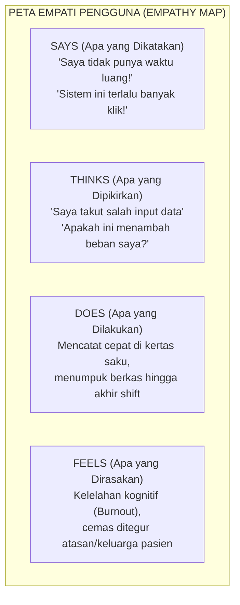
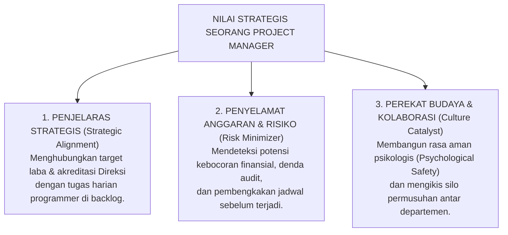

# Modul 31: Customer Centricity & The Strategic Value of a PM
## Google Project Management Professional Certificate

> **Sumber Materi**: [Bagaimana Manajer Proyek Membangun Kepuasan Pelanggan & Nilai Seorang PM | Sertifikat Manajemen Proyek Google](https://www.youtube.com/watch?v=hwZ6MgKTKyU)  
> **Kategori**: Specialization — Advanced PM Practices & Lean Methodologies (Module 4)  
> **Disusun oleh**: Dessy Rahmawati Chairullina, S.Kom  

---

## 📌 Executive Summary
1. **Pergeseran Paradigma Berpusat pada Pelanggan (*Customer-Centricity*)**: Manajer Proyek modern tidak lagi memandang tugasnya sekadar "menyelesaikan proyek", melainkan **"memecahkan masalah pengguna dan menghadirkan kepuasan nyata"**. Proyek yang selesai tepat waktu tetapi dibenci penggunanya adalah proyek yang gagal.
2. **Peta Empati Pengguna (*Empathy Mapping*)**: Alat eksplorasi mendalam untuk membedah apa yang *Dikatakan (Says)*, *Dipikirkan (Thinks)*, *Dilakukan (Does)*, dan *Dirasakan (Feels)* oleh pengguna dalam rutinitas kerjanya.
3. **Nilai Strategis PM sebagai Pengganda Nilai (*Value Multiplier*)**: PM bukan biaya beban administratif (*overhead cost*), melainkan jembatan strategis yang menyelaraskan visi bisnis eksekutif dengan realitas teknis tim pengembang, memitigasi risiko finansial, dan mengikis ego sektoral antar departemen.
4. **Metrik Pengukuran Pengalaman Pengguna**: Tiga instrumen baku evaluasi kepuasan: **CSAT** (*Customer Satisfaction*), **NPS** (*Net Promoter Score*), dan **CES** (*Customer Effort Score* — mengukur seberapa mudah sistem digunakan).

---

## 1. Peta Empati Pengguna (Empathy Mapping Framework)

Sebelum merancang sistem atau menulis satu baris kode pun, PM wajib memetakan kondisi psikologis pengguna di lapangan:

### Manfaat Penerapan Empathy Mapping:
* **Menyingkap Kebutuhan Tersembunyi**: Pengguna sering kali tidak mampu mengungkapkan kebutuhan teknisnya secara langsung. Mereka hanya mengekspresikan rasa frustrasi. Peta empati membantu PM menemukan solusi ergonomis yang sesungguhnya.
* **Meredam Ego Tim Pengembang**: Mencegah programmer berasumsi bahwa *"Semua orang pasti paham cara kerja tombol ini"*, dengan menunjukkan fakta bahwa perawat di IGD bekerja dalam kondisi stres tinggi dan sarung tangan medis tebal.

---

## 2. Mengukur Kepuasan Pengguna dengan Tiga Metrik Emas

Seorang PM berbasis data (*data-driven PM*) mengukur kepuasan pengguna menggunakan metrik terstandarisasi:

| Metrik Evaluasi | Pertanyaan Kunci yang Diajukan | Skala Pengukuran | Standar Keunggulan |
| :--- | :--- | :---: | :---: |
| **CSAT (Customer Satisfaction)** | *"Seberapa puas Anda dengan kemudahan pengisian form rekam medis ini?"* | 1 s/d 5 Bintang | Target $\ge$ 85% respon puas (skor 4 atau 5). |
| **NPS (Net Promoter Score)** | *"Seberapa besar kemungkinan Anda merekomendasikan sistem ini kepada rekan kerja di rumah sakit lain?"* | 0 s/d 10 Poin | Skor $\text{NPS} = \% \text{Promoters} - \% \text{Detractors}$. Target $> +50$. |
| **CES (Customer Effort Score)** | *"Seberapa mudah alur validasi tagihan ini diselesaikan?"* | 1 (Sangat Sulit) s/d 7 (Sangat Mudah) | Target rata-rata $\ge$ 5.8 dari skala 7. |

---

## 3. Tiga Pilar Nilai Strategis Manajer Proyek bagi Organisasi

Mengapa perusahaan bersedia menggaji mahal seorang Project Manager yang hebat? Karena PM memberikan 3 nilai strategis yang tidak bisa digantikan oleh peran lain:

---

## 4. Studi Kasus Nyata: Mengubah Sikap Perawat dari Penolak Menjadi Pendukung Setia

* **Masalah**: Peluncuran awal form *Asuhan Keperawatan Digital* gagal total. Para perawat bangsal melancarkan protes tertulis kepada Direktur Keperawatan karena form tersebut membutuhkan waktu 15 menit per pasien dan mewajibkan 28 pilihan dropdown. Skor CES anjlok ke angka 2.1 (Sangat Melelahkan).
* **Pendekatan Customer-Centricity oleh PM**:
  1. *Sesi Observasi Lapangan (Shadowing)*: PM mengenakan seragam dinas lapangan dan mendampingi perawat jaga malam selama 8 jam penuh untuk melihat langsung bagaimana perawat mencatat data sambil menangani infus pasien.
  2. *Temuan Kunci Peta Empati*: Perawat tidak membutuhkan 28 dropdown. Mereka hanya butuh **template keluhan standar 1-klik** yang otomatis memuat diagnosa SDKI/SLKI/SIKI yang paling sering muncul (90% kasus rawat inap polanya sama).
  3. *Redesain UI Radikal*: PM bersama tim pengembang merancang ulang antarmuka menjadi sistem *Quick Template Buttons* dan mengaktifkan navigasi perpindahan kursor cepat via tombol Enter (`KeyEvent.VK_ENTER`).
* **Hasil**:
  * Waktu pengisian asuhan keperawatan terpangkas drastis dari 15 menit menjadi **hanya 2 menit per pasien** (hemat 86% waktu kerja).
  * Pada survei 30 hari pasca-redesain, skor kepuasan CSAT melonjak ke **94%**, dan skor Net Promoter Score (NPS) mencapai angka spektakuler **+74**.
  * Perawat yang awalnya menjadi penentang paling vokal kini menjadi pembicara utama yang melatih rumah sakit lain dalam implementasi rekam medis digital.

---

## 5. 🛠️ Actionable Customer Centricity Checklist

- [ ] **End-User Shadowed**: Apakah PM dan desainer sistem sudah turun langsung mengamati pengguna bekerja di lingkungan operasional aslinya?
- [ ] **Empathy Map Created**: Apakah tim sudah memetakan rasa cemas, beban kerja, dan titik frustrasi pengguna (*Pains & Gains*)?
- [ ] **Customer Effort Minimized**: Apakah alur sistem dirancang untuk meminimalkan jumlah klik dan waktu input pengguna (*Low Effort Score*)?
- [ ] **Satisfaction Survey Automated**: Apakah ada mekanisme pengumpulan skor CSAT/NPS berkala pasca-implementasi sistem?
- [ ] **Value Communication**: Apakah PM mampu menjelaskan kepada dewan direksi bagaimana proyek ini meningkatkan kepuasan dan loyalitas pengguna akhir?
