# Modul 32: AI in Project Management & The Modern PM Toolkit
## Google Project Management Professional Certificate

> **Sumber Materi**: [Pengantar Penggunaan AI dalam Manajemen Proyek | Sertifikat Manajemen Proyek Google](https://www.youtube.com/watch?v=NodcUIt5Qnw)  
> **Kategori**: Specialization — Advanced PM Practices & Lean Methodologies (Module 5)  
> **Disusun oleh**: Dessy Rahmawati Chairullina, S.Kom  

---

## 📌 Executive Summary
1. **Revolusi AI dalam Manajemen Proyek**: Kecerdasan Buatan (*Artificial Intelligence*) bukan ancaman yang akan menggantikan peran Manajer Proyek, melainkan instrumen pengganda produktivitas (*superpower tool*). **PM yang memanfaatkan AI akan menggantikan PM yang menolak menggunakannya**.
2. **Otomatisasi Pekerjaan Administratif**: AI membebaskan PM dari beban kerja rutin yang menyita 50% waktu harian (pembuatan draf dokumen charter, transkripsi notula rapat otomatis, penyusunan User Stories, dan perumusan matriks risiko awal).
3. **Analitik Prediktif & Deteksi Dini**: Kemampuan AI mendeteksi anomali pada kecepatan tim (*Velocity*), memprediksi deviasi anggaran (*Cost Variance*), dan mengidentifikasi potensi bahaya jadwal (*Schedule Slippage*) sebelum kasat mata oleh manusia.
4. **Benteng Kemanusiaan yang Tak Tergantikan**: AI unggul dalam kalkulasi data dan sintesis teks, namun **tidak akan pernah bisa menggantikan empati kepemimpinan, negosiasi politis dengan direksi, resolusi konflik antar manusia, dan penilaian etis**.
5. **Protokol Keamanan & Privasi Data**: Batasan ketat kerahasiaan (*data governance*) untuk tidak memasukkan data medis pasien (PHI), kredensial sistem, atau rahasia finansial organisasi ke dalam model AI publik.

---

## 1. Pemanfaatan AI Sepanjang Siklus Hidup Proyek

```mermaid
flowchart LR
    subgraph INITIATION ["1. INISIASI"]
        I1["Draf Business Case Awal"]
        I2["Sintesis Riset Pasar"]
        I3["Draf Project Charter"]
    end
    
    subgraph PLANNING ["2. PERENCANAAN"]
        P1["Dekomposisi WBS Otomatis"]
        P2["Penulisan User Stories (INVEST)"]
        P3["Draf Master Risk Register"]
    end
    
    subgraph EXECUTION ["3. EKSEKUSI & MONITOR"]
        E1["Transkrip Notula Rapat (MoM)"]
        E2["Analisis Sentimen Stakeholder"]
        E3["Prediksi Deviasi Burndown"]
    end
    
    subgraph CLOSING ["4. PENUTUPAN"]
        C1["Kompilasi Lessons Learned"]
        C2["Draf Executive Closure Report"]
    end
    
    INITIATION --> PLANNING --> EXECUTION --> CLOSING
```



---

## 2. Batasan Kapabilitas: Apa yang Bisa vs. Tidak Bisa Dilakukan AI

Memahami batasan AI adalah kunci menjaga integritas profesional seorang Manajer Proyek:

| Kapabilitas AI (Sangat Diunggulkan) | Batasan Mutlak AI (Wajib Kendali Penuh Manusia) |
| :--- | :--- |
| **Sintesis Dokumen Panjang**: Meringkas transkrip rapat 1 jam menjadi 5 poin *Action Items* dalam 5 detik. | **Empati & Kepekaan Rasa**: Merasakan ketika seorang programmer sedang stres berat atau mengalami kelelahan mental (*burnout*). |
| **Generasi Alternatif Solusi**: Menyarankan 10 skenario mitigasi risiko teknis berdasarkan praktik industri global. | **Negosiasi Kompromi Politis**: Membujuk dokter spesialis senior yang keras kepala agar mau mengalah pada kebijakan rumah sakit. |
| **Validasi Sintaks & Format**: Memeriksa kelengkapan kriteria penerimaan User Story (*Given-When-Then*). | **Akuntabilitas & Tanggung Jawab Moral**: Mengambil keputusan darurat saat pasien di meja operasi terancam oleh kegagalan sistem. |
| **Pemodelan Data Numerik**: Menghitung kalkulasi variansi anggaran dan estimasi probabilitas statistik PERT. | **Membangun Kepercayaan (Trust)**: Menjalin hubungan persahabatan dan kolaborasi erat antar pemangku kepentingan. |

---

## 3. Kerangka Kerja Prompting Standar PM (The R-C-C-D Framework)

Untuk menghasilkan keluaran AI yang akurat, berbobot, dan siap pakai, gunakan kerangka **R-C-C-D**:

1. **Role (Peran)**: Tentukan identitas AI (*"Bertindaklah sebagai Senior Technical Project Manager berpengalaman di industri Healthcare IT"*).
2. **Context (Konteks)**: Jelaskan latar belakang dan masalah bisnis (*"Kami sedang membangun modul otomatisasi rekonsiliasi piutang BPJS di rumah sakit tipe B"*).
3. **Constraint (Batasan & Kriteria)**: Berikan pagar pembatas (*"Gunakan standar penulisan INVEST, hindari bahasa yang terlalu abstrak, dan batasi hanya pada 3 skenario uji utama"*).
4. **Deliverable (Bentuk Output yang Diharapkan)**: Tentukan format hasil akhir (*"Sajikan dalam bentuk tabel Markdown dengan kolom: User Story, Acceptance Criteria Gherkin, dan Estimasi Story Points Fibonacci"*).

---

## 4. Protokol Keamanan & Anti-Halusinasi (The Zero-Hallucination Protocol)

Seorang PM dilarang keras menelan mentah-mentah hasil keluaran AI tanpa proses verifikasi:

```text
====================================================================================================
                        PROTOKOL VERIFIKASI KEAMANAN PENGGUNAAN AI
====================================================================================================
[ ATURAN 1: SANITASI DATA KETAT (DATA SANITIZATION) ]
Dilarang memasukkan: Nama pasien, NIK, rekam medis (PHI), password database, token API, 
atau laporan laba-rugi riil ke platform AI cloud publik. Gunakan data anonim tiruan (dummy data).

[ ATURAN 2: VERIFIKASI FAKTA GANDA (FACT-CHECKING) ]
AI sering mengalami "halusinasi" (mengarang pasal regulasi atau angka statistik palsu yang meyakinkan).
Setiap kutipan undang-undang, kode BPJS, atau batas teknis WAJIB diverifikasi ke dokumen aslinya.

[ ATURAN 3: HUMAN IN THE LOOP (AKUNTABILITAS TUNGGAL) ]
Jika ada dokumen proyek yang salah atau menyesatkan, PM tidak boleh menyalahkan AI. 
Penanggung jawab mutlak atas setiap kata yang keluar ke meja direksi adalah diri Anda sendiri.
====================================================================================================
```

---

## 5. Studi Kasus Nyata: Menghemat 9 Hari Kerja Perumusan Dokumen Bisnis dengan AI

* **Tantangan**: PM ditugaskan menyusun dokumen *Business Requirements Document (BRD)* dan 40 *User Stories* untuk sistem integrasi farmasi baru dalam waktu 3 hari sebelum rapat dewan direksi, padahal proses normal manual biasanya membutuhkan waktu 10–14 hari kerja.
* **Strategi Pemanfaatan AI oleh PM**:
  1. *Transkripsi Suara Wawancara*: PM merekam wawancara 45 menit bersama Kepala Instalasi Farmasi, lalu menggunakan alat AI transkripsi lokal untuk mengekstrak poin keluhan utama dalam 3 menit.
  2. *Draf Cerita INVEST dengan Prompt Terstruktur*: PM memasukkan ringkasan keluhan farmasi ke model AI menggunakan kerangka R-C-C-D. Dalam 30 detik, AI menghasilkan 40 draf *User Story* lengkap dengan format *Given-When-Then*.
  3. *Proses Kurasi & Penyempurnaan Manusia (Human Curation)*: PM bersama Lead Developer meninjau 40 draf tersebut selama 2 jam, merevisi 6 cerita yang tidak realistis secara teknis, dan menyempurnakan batasan regulasi obat keras.
* **Hasil**:
  * Dokumen BRD setebal 25 halaman selesai dalam waktu **1 hari kerja** (menghemat 9 hari kerja).
  * Kualitas dokumen sangat dipuji oleh Dewan Direksi karena mencakup skenario pengujian yang sangat detail dan rapi.
  * Tim pengembang dapat memulai sprint koding 1 minggu lebih cepat dari jadwal semula.

---

## 6. 🛠️ Actionable AI-Powered PM Checklist

- [ ] **Data Sanitized**: Apakah seluruh data sensitif (nama pasien, kredensial server, finansial riil) sudah disamarkan sebelum diproses oleh AI?
- [ ] **Prompt Engineered (R-C-C-D)**: Apakah instruksi prompt sudah mencakup Peran, Konteks, Batasan, dan Format Luaran yang jelas?
- [ ] **Human Verification Run**: Apakah setiap angka kalkulasi dan acuan regulasi hukum dari AI sudah diverifikasi ke dokumen sumber aslinya?
- [ ] **Administrative Tasks Automated**: Sudahkah memanfaatkan AI untuk mempercepat pembuatan notula rapat, draf email eskalasi, dan dekomposisi WBS?
- [ ] **Human Core Preserved**: Apakah PM tetap memegang kendali penuh atas empati komunikasi tim, negosiasi langsung, dan pengambilan keputusan etis?
