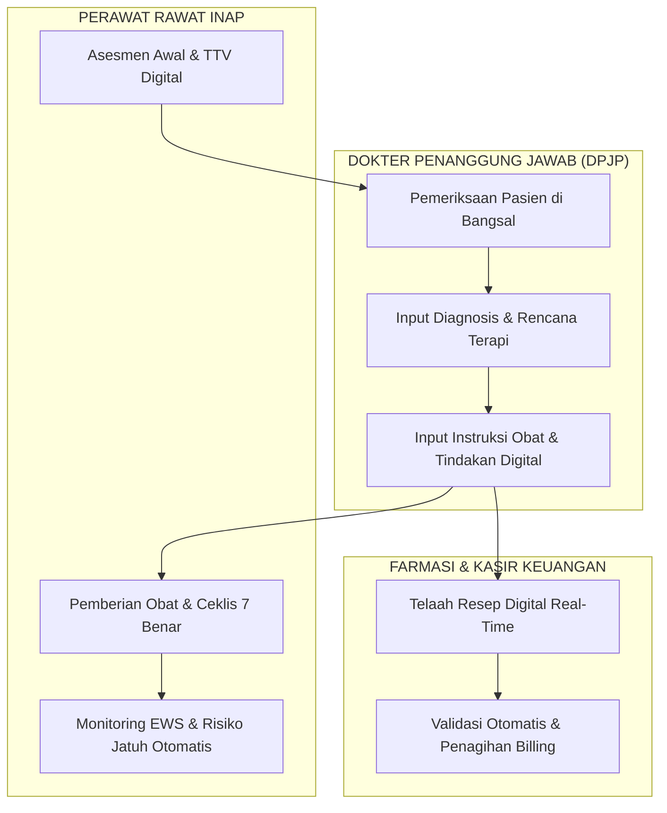
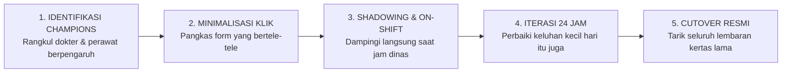

# Modul 33: Clinical Workflow Mapping & EMR Adoption
## Google Project Management Professional Certificate

> **Kategori**: Industry Track — Healthcare & Enterprise Systems Deep-Dive (Module 1)  
> **Disusun oleh**: Dessy Rahmawati Chairullina, S.Kom  

---

## 📌 Executive Summary
1. **Keunikan Lingkungan Proyek Klinis**: Rumah sakit adalah ekosistem kerja dengan tekanan ekstrem (*high-stakes environment*). Kesalahan sistem bukan sekadar kerugian finansial, melainkan menyangkut keselamatan nyawa pasien (*patient safety*). Manajer Proyek wajib memiliki empati mendalam terhadap beban kognitif dokter dan perawat.
2. **Pemetaan Alur Kerja Klinis (As-Is vs. To-Be)**: Menggunakan notasi pemodelan alur kerja standar (BPMN / Swimlane) untuk mengidentifikasi titik kemacetan (*bottlenecks*), duplikasi pencatatan, dan celah keselamatan pasien sebelum merancang antarmuka sistem baru.
3. **Mengurangi Beban Kognitif (*Cognitive Load Reduction*)**: Desain formulir rekam medis elektronik (RME) wajib mengutamakan kecepatan input: *Keyboard-First Navigation*, *1-Click Templates*, pewarnaan indikator risiko otomatis, dan minimasi jumlah klik mouse.
4. **Strategi Adopsi Perubahan Klinis 5 Tahap**: Membangun *Clinical Change Champions*, observasi lapangan langsung (*shadowing*), pelatihan bertahap berbasis peran, kanal umpan balik instan, dan penutupan berkas kertas secara tegas (*decommissioning*).

---

## 1. Pemetaan Alur Kerja Klinis: Swimlane As-Is vs. To-Be

Menganalisis alur perpindahan informasi antar profesi pemberi asuhan (PPA) di rumah sakit:

### Prinsip Transformasi Alur Kerja:
* **Single Entry, Multiple Reuse**: Data identitas dan tanda vital pasien diinput sekali oleh perawat di IGD, dan otomatis mengalir ke form dokter poli, catatan rawat inap, dan klaim kasir tanpa input ulang.
* **Closed-Loop Verification**: Setiap instruksi terapi dokter harus memiliki konfirmasi penerimaan dan pelaksanaan dari perawat untuk mencegah insiden malpraktik pemberian obat.

---

## 2. Standar Ergonomi UI Rekam Medis Rumah Sakit

Untuk memastikan dokter dan perawat mengadopsi sistem tanpa stres, terapkan 4 aturan emas antarmuka klinis:

1. **Keyboard-First Navigation (`KeyEvent.VK_ENTER`)**:
   * Dokter dan perawat mengetik dengan cepat. Setiap kali tombol `Enter` ditekan, kursor wajib otomatis berpindah ke field isian berikutnya tanpa memaksa tangan meraih mouse.
2. **Pewarnaan Peringatan Otomatis (*Visual Triage*)**:
   * Angka kritis tanda vital (misal: tekanan darah sistolik > 180 atau SpO2 < 90%) otomatis mengubah latar belakang baris tabel menjadi merah menyala (*MEOWS/PEWS alert*).
3. **Template Keluhan Standar 1-Klik**:
   * Menyediakan paket template keluhan dan diagnosa SDKI/SLKI/SIKI yang paling sering muncul, sehingga 80% kasus rutin dapat diselesaikan dalam waktu kurang dari 60 detik.
4. **Pencegahan Data Hilang (*Zero Data Loss on Crash*)**:
   * Fitur auto-save draf setiap 30 detik untuk mengantisipasi pemadaman listrik tiba-tiba di bangsal rawat inap.

---

## 3. Lima Tahap Mengatasi Resistensi Adopsi Tenaga Medis

* **Tahap 1 — Membentuk *Clinical Champions***: Gandeng 2 dokter spesialis senior dan 3 kepala ruang perawat yang dihormati. Libatkan mereka sejak hari pertama perancangan agar mereka memiliki rasa kepemilikan (*co-ownership*).
* **Tahap 2 — Reduksi Beban Klik**: Setiap form yang membutuhkan lebih dari 5 kali klik dievaluasi ulang untuk disederhanakan.
* **Tahap 3 — Pendampingan di Jam Jaga (*On-Shift Shadowing*)**: Tim IT duduk mendampingi perawat di nurse station saat jam sibuk malam hari untuk menyelesaikan kendala langsung di tempat (*real-time troubleshooting*).
* **Tahap 4 — Perbaikan Kilat 24 Jam**: Keluhan kecil (misal: ukuran font terlalu kecil untuk dokter senior) langsung diperbaiki dalam 24 jam. Ini membangun kepercayaan luar biasa bahwa tim PM benar-benar mendengarkan mereka.
* **Tahap 5 — Penutupan Kertas (*Official Cutover*)**: Setelah sistem stabil selama 2 minggu, manajemen menerbitkan SK Direksi yang menarik seluruh map rekam medis kertas secara permanen.

---

## 4. Studi Kasus Nyata: Mengubah Penolakan Form Rawat Inap Menjadi Adopsi 100%

* **Masalah**: Peluncuran awal form *Pemantauan Pasien Terintegrasi (CPPT)* ditolak mentah-mentah oleh 30 dokter spesialis. Para dokter menolak mengisi form digital dengan alasan mengganggu waktu visit pasien rawat inap.
* **Intervensi PM Berbasis Clinical Workflow Mapping**:
  1. *Audit Waktu*: PM mengukur durasi visit dokter: Rata-rata dokter hanya memiliki waktu 3 menit per pasien di samping tempat tidur. Form digital lama membutuhkan waktu 6 menit hanya untuk login dan memilih diagnosis.
  2. *Rekayasa Ulang Form (To-Be)*:
     * PM merancang tampilan *One-Page Clinical Summary*: Seluruh riwayat lab, radiologi, dan tanda vital terakhir muncul dalam 1 layar tanpa navigasi tab berbelit-belit.
     * Mengaktifkan fitur pencarian diagnosa ICD-10 instan berbasis autocomplete kata kunci.
  3. *Uji Coba Bersama Tokoh Kunci (Champion Model)*: PM mendemokan tampilan baru ini kepada Ketua Komite Medis dan mendampinginya saat visit pagi. Dokter tersebut kagum karena form baru hanya membutuhkan waktu 90 detik.
* **Hasil**:
  * Ketua Komite Medis mengeluarkan himbauan resmi kepada seluruh dokter spesialis untuk beralih penuh ke sistem digital.
  * Tingkat kepatuhan pengisian CPPT digital melonjak dari 15% menjadi 98.6% dalam waktu 3 minggu.
  * Rumah sakit berhasil meraih akreditasi digital rekam medis tingkat nasional.

---

## 5. 🛠️ Actionable Clinical Workflow PM Checklist

- [ ] **Clinical Shadowing Completed**: Apakah tim PM dan analis sudah mendampingi tenaga medis di bangsal minimal 1 shift penuh sebelum membuat form?
- [ ] **Keyboard-First Verified**: Apakah perpindahan field input pada form klinis dapat dioperasikan 100% menggunakan tombol Enter dan tabulasi keyboard?
- [ ] **Critical Alert Thresholds Set**: Apakah nilai batas bahaya tanda vital (MEOWS/PEWS) sudah diverifikasi dan disahkan oleh Komite Keperawatan?
- [ ] **Clinical Champions Appointed**: Apakah ada perwakilan dokter dan perawat yang bertindak sebagai juru bicara resmi proyek di lapangan?
- [ ] **Paper Decommissioning Planned**: Apakah ada tanggal pasti yang ditetapkan oleh Direksi untuk menghentikan peredaran formulir kertas manual?
