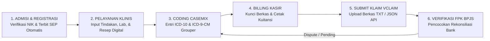

# Modul 34: Healthcare Financial Reconciliation & Claims Management
## Google Project Management Professional Certificate

> **Kategori**: Industry Track — Healthcare & Enterprise Systems Deep-Dive (Module 2)  
> **Disusun oleh**: Dessy Rahmawati Chairullina, S.Kom  

---

## 📌 Executive Summary
1. **Arteri Finansial Rumah Sakit (*Revenue Cycle Management - RCM*)**: Lebih dari 75% pendapatan rumah sakit di Indonesia bersumber dari klaim asuransi kesehatan (BPJS Kesehatan & Asuransi Swasta). Kegagalan tata kelola sistem penagihan akan langsung melumpuhkan arus kas (*cash flow*) dan operasional pelayanan.
2. **Siklus Hidup Klaim Berkas (*End-to-End Claims Lifecycle*)**: Mulai dari verifikasi Surat Eligibilitas Peserta (SEP), *Charge Capture* tindakan dokter dan obat, koding INA-CBGs (ICD-10 & ICD-9-CM), pengelompokan (*grouping*), penagihan kasir, hingga verifikasi berita acara formulir FPK.
3. **Rekonsiliasi Formulir Pengajuan Klaim (FPK)**: Proses pencocokan otomatis antara data tagihan kasir internal rumah sakit terhadap data hasil verifikasi BPJS (Disetujui, Pending, Dispute, atau Ditolak) guna memastikan **selisih nominal nol rupiah (*zero variance balance*)**.
4. **Pencegahan Piutang Kadaluwarsa (*Claim Expiry Prevention*)**: Aturan ketat BPJS bahwa berkas klaim yang terlambat diajukan lebih dari 6 bulan akan hangus permanen (*uncollectible debt*), menuntut PM merancang sistem peringatan dini otomatis.

---

## 1. Arsitektur Revenue Cycle Management (RCM) Rumah Sakit



---

## 2. Anatomi Masalah Rekonsiliasi FPK BPJS

Setiap bulan, BPJS Kesehatan menerbitkan Formulir Pengajuan Klaim (FPK) yang merinci status pembayaran ratusan hingga ribuan berkas pasien:

| Status Berkas FPK | Makna Finansial | Akar Penyebab Masalah | Tindakan Sistem SIMRS |
| :--- | :--- | :--- | :--- |
| **Disetujui (Layak)** | Dana cair ke rekening rumah sakit sesuai tarif paket INA-CBGs. | Berkas lengkap, koding tepat, SEP valid. | Posting otomatis ke Buku Besar Akuntansi (*Auto-Journaling*). |
| **Pending (Ditunda)** | Pembayaran ditahan sementara menunggu kelengkapan berkas fisik/digital. | Resume medis belum ditandatangani digital oleh DPJP; hasil lab belum terlampir. | Munculkan notifikasi merah di dashboard casemix untuk segera dilengkapi DPJP. |
| **Dispute (Sengketa)** | Terjadi perbedaan persepsi koding diagnosa antara verifikator BPJS dan koder RS. | Ketidaksesuaian kriteria diagnosa sekunder (misal: Sepsis vs SIRS). | Masukkan ke modul *Dispute Management* untuk sidang mediasi komite medis. |
| **Ditolak (Klaim Gugur)**| Klaim ditolak mutlak dan tidak dibayar oleh BPJS. | Berkas ganda, tanggal SEP kadaluwarsa (> 3x24 jam), atau kartu peserta tidak aktif. | Masukkan ke akun kerugian piutang (*bad debt write-off*) dengan persetujuan Direksi. |

---

## 3. Logika Algoritma Pencocokan Otomatis (*Auto-Match Engine*)

Manajer Proyek wajib merancang logika pencocokan data FPK yang tahan terhadap kesalahan manusia (*foolproof algorithm*):

```text
====================================================================================================
                        LOGIKA ENJIN REKONSILIASI OTOMATIS FPK BPJS
====================================================================================================
Langkah 1: PARSING BERKAS FPK (Format Excel / JSON dari BPJS)
   -> Ekstrak: Nomor SEP, Nomor Rekam Medis (No RM), Nama Pasien, Tarif Pengajuan, Tarif Disetujui.

Langkah 2: PENCARIAN RECORD INTERNAL DATABASE (Primary Key Matching)
   -> Cari record transaksi kasir berdasarkan Kunci Utama: 'Nomor SEP'.
   -> Fallback 1: Jika Nomor SEP kosong, cari berdasarkan 'Nomor Rawat + Tanggal Pulang'.
   -> Fallback 2: Jika tetap tidak cocok, tandai sebagai "Berkas Tidak Ditemukan (Unmatched)".

Langkah 3: VALIDASI SELISIH MATEMATIS (Variance Calculation)
   -> Selisih = Tarif Pengajuan Rumah Sakit - Tarif Disetujui BPJS.
   -> Jika Selisih == Rp 0 : Status otomatis "Lunas Sempurna (Match 100%)".
   -> Jika Selisih != Rp 0 : Hitung potongan iuran / biaya obat di luar paket,
                             arahkan ke akun penyesuaian tarif INA-CBGs.

Langkah 4: LOCKING TRANSAKSI & PREVENT MULTIPLE CLAIMING
   -> Kunci record piutang pasien agar tidak bisa diajukan dua kali (Anti-Double Claiming).
====================================================================================================
```

---

## 4. Studi Kasus Nyata: Mengotomatisasi Rekonsiliasi Klaim BPJS Senilai Rp 4,2 Miliar

* **Masalah Awal**:
  * Rumah sakit mengajukan rata-rata 3.200 berkas rawat jalan dan inap per bulan senilai Rp 4,2 Miliar.
  * Proses pencocokan lembar FPK dilakukan secara manual oleh 4 staf keuangan menggunakan formula Excel `VLOOKUP`.
  * Proses manual memakan waktu **7 hingga 10 hari kerja setiap bulan**. Akibatnya, berkas dispute terlambat diperbaiki hingga melewati batas waktu penagihan kadaluwarsa, memicu kerugian piutang rata-rata Rp 180.000.000 per kuartal.
* **Tindakan PM Berbasis Otomatisasi Sistem**:
  1. *Perancangan Modul Cocokkan FPK Terintegrasi*: PM merancang form Java Swing `DlgCocokkanFPKBPJS` yang mampu mengimpor berkas FPK Excel secara instan (1 klik memproses 3.200 baris data dalam 8 detik).
  2. *Validasi Ganda Pra-Pengajuan (Pre-Submission Gatekeeper)*:
     * Sistem otomatis menolak penguncian billing kasir jika nomor SEP belum terisi atau resume medis belum ditandatangani digital oleh dokter.
  3. *Early Warning Caducity*: Sistem menampilkan hitung mundur (*countdown timer*) hari kadaluwarsa berkas pending: warna kuning jika tersisa 60 hari, dan warna merah berkedip jika tersisa $\le$ 30 hari.
* **Hasil**:
  * Waktu rekonsiliasi terpangkas 92% (dari 10 hari kerja menjadi **hanya 4 jam**).
  * Potensi piutang kadaluwarsa turun menjadi **Rp 0 (Nol Rupiah)** karena seluruh berkas pending terdeteksi dan diperbaiki dalam minggu yang sama.
  * Staf keuangan dapat dialihkan ke analisis efisiensi biaya operasional rumah sakit.

---

## 5. 🛠️ Actionable Healthcare Financial PM Checklist

- [ ] **Pre-Lock Billing Validation**: Apakah sistem otomatis mencegah penutupan billing kasir jika parameter wajib klaim (SEP, TTE Dokter, Koding) belum lengkap?
- [ ] **Auto-Match Engine Verified**: Apakah algoritma pencocokan FPK mengunci data berdasarkan Nomor SEP unik untuk mencegah klaim ganda?
- [ ] **Dispute Workflow Established**: Apakah ada alur kerja dan batas waktu yang jelas bagi koder dan dokter untuk memperbaiki berkas dispute/pending?
- [ ] **Caducity Countdown Active**: Apakah ada dashboard pemantau berkas yang mendekati masa kadaluwarsa 6 bulan BPJS?
- [ ] **Zero-Variance Audit**: Apakah setiap selisih antara tarif pengajuan RS dan tarif paket INA-CBGs tercatat otomatis di akun penyesuaian buku besar?
