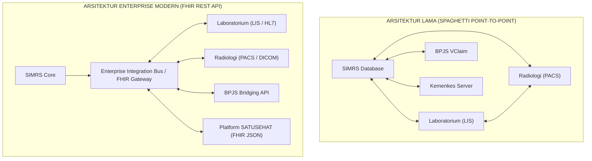
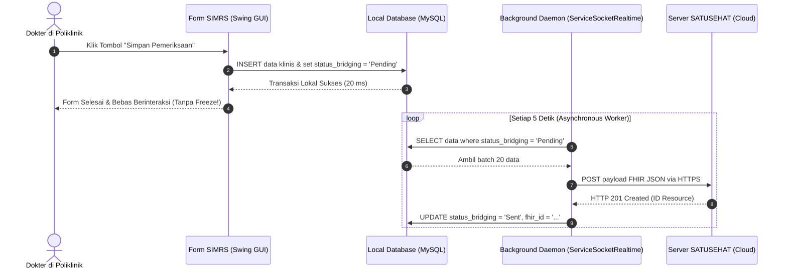

# Modul 35: Enterprise System Architecture & FHIR Interoperability
## Google Project Management Professional Certificate

> **Kategori**: Industry Track — Healthcare & Enterprise Systems Deep-Dive (Module 3)  
> **Disusun oleh**: Dessy Rahmawati Chairullina, S.Kom  

---

## 📌 Executive Summary
1. **Kutukan Silo Informasi (*The Data Silo Curse*)**: Di rumah sakit dan enterprise berskala besar, data sering terisolasi di pulau-pulau sistem yang terpisah: SIMRS (Klinis & Billing), LIS (Laboratorium), PACS (Radiologi), dan Sistem Farmasi. Menghubungkan sistem ini melalui koneksi langsung antar basis data (*point-to-point database coupling*) adalah resep bencana arsitektur spaghetti.
2. **Standar Global Interoperabilitas FHIR (Fast Healthcare Interoperability Resources)**: Standar generasi baru HL7 yang mengadopsi protokol web modern: **RESTful API**, payload berformat **JSON**, dan pemodelan data berbasis sumber daya modular (*Resources*) seperti `Patient`, `Encounter`, `Condition`, dan `Observation`.
3. **Ekosistem Nasional SATUSEHAT Kemenkes RI**: Mandat regulasi pemerintah Indonesia yang mewajibkan seluruh fasilitas kesehatan terhubung dan mengirimkan data rekam medis terstandarisasi FHIR secara real-time.
4. **Pola Desain Arsitektur Asinkron (*Decoupled Architecture*)**: Memisahkan antarmuka pengguna (Swing GUI) dari proses transmisi jaringan bridging menggunakan layanan latar belakang (*Background Daemon Service*) guna menjamin sistem kasir dan form dokter tidak pernah mengalami freeze (*EDT Non-Blocking*).

---

## 1. Evolusi Interoperabilitas: Dari Arsitektur Spaghetti ke FHIR API



---

## 2. Struktur Sumber Daya Baku FHIR (FHIR Resources Anatomy)

Dalam ekosistem SATUSEHAT Kemenkes, data perjalanan pasien dipecah menjadi objek modular terstandarisasi:

| Resource FHIR | Fungsi & Data yang Dimuat | Standarisasi Terminologi Wajib |
| :--- | :--- | :--- |
| **Patient** | Identitas demografis pasien, NIK, nama lengkap, tanggal lahir, jenis kelamin. | NIK terverifikasi Dukcapil & ID IHS Patient. |
| **Encounter** | Riwayat episode kunjungan rawat jalan, IGD, atau bangsal rawat inap, dokter pemeriksa, status selesai. | Kode Kelas Pelayanan Kemenkes (`AMB` / `IMP` / `EMER`). |
| **Condition** | Diagnosis penyakit utama dan penyakit penyerta yang ditegakkan dokter. | ICD-10 resmi Kemenkes & Terminologi SNOMED CT. |
| **Observation** | Hasil pengukuran klinis terukur: Tanda Vital (Tekanan Darah, Nadi, Suhu, Pernapasan, SpO2). | Kode LOINC Standar Laboratorium & Observasi. |
| **MedicationRequest** | Instruksi peresepan obat dari dokter ke instalasi farmasi. | Kamus Farmasi Kemenkes (KFA) & Nomor Registrasi BPOM. |

### Contoh Struktur Payload Observasi Tanda Vital (FHIR JSON):
```json
{
  "resourceType": "Observation",
  "status": "final",
  "category": [{
    "coding": [{
      "system": "http://terminology.hl7.org/CodeSystem/observation-category",
      "code": "vital-signs",
      "display": "Vital Signs"
    }]
  }],
  "code": {
    "coding": [{
      "system": "http://loinc.org",
      "code": "8867-4",
      "display": "Heart rate"
    }]
  },
  "subject": { "reference": "Patient/100000030015" },
  "encounter": { "reference": "Encounter/f9821-ab90-41" },
  "effectiveDateTime": "2027-02-15T09:30:00+07:00",
  "issued": "2027-02-15T09:30:00+07:00",
  "valueQuantity": {
    "value": 78,
    "unit": "beats/minute",
    "system": "http://unitsofmeasure.org",
    "code": "/min"
  }
}
```

---

## 3. Desain Background Daemon: Mencegah GUI Freeze

Kesalahan arsitektur paling sering terjadi adalah saat programmer memanggil request HTTP API eksternal langsung di dalam event tombol GUI (`ActionEvent` pada Event Dispatch Thread - EDT). Jika server Kemenkes atau BPJS mengalami kelambatan, seluruh form rumah sakit akan macet total (*Not Responding*).



---

## 4. Studi Kasus Nyata: Desain Bridging SATUSEHAT untuk 1.500 Pasien per Hari

* **Tantangan**: Rumah sakit tipe B melayani rata-rata 1.500 kunjungan pasien per hari. Kementerian Kesehatan mewajibkan seluruh rekam medis terkirim ke SATUSEHAT secara real-time. Pada uji coba pertama, programmer memanggil API SATUSEHAT langsung dari form perawat. Saat jaringan internet pemerintah melambat, form pendaftaran kasir dan poli macet hingga 40 detik per pasien, memicu antrean mengular di lobi rumah sakit.
* **Solusi Arsitektur PM**:
  1. *Decoupled Background Queue*: PM menginstruksikan pemisahan mutlak: Form SIMRS lokal hanya bertugas menyimpan data ke database lokal dalam waktu < 50 milidetik.
  2. *Implementasi Layanan Realtime Mandiri (`ServiceSocketRealtime`)*: Dibangun subproject daemon background yang berjalan terpisah di server rumah sakit untuk mengambil antrean data (*message worker*) dan mengirimkannya ke cloud Kemenkes.
  3. *Exponential Backoff & Idempotency*: Jika server pemerintah melempar status HTTP 429 (Rate Limit) atau HTTP 503 (Service Unavailable), daemon otomatis menunda pengiriman secara eksponensial (2 detik ➔ 4 detik ➔ 8 detik) tanpa membuang data transaksi.
* **Hasil**:
  * Form SIMRS di poli dan kasir berjalan sangat cepat (waktu simpan < 0.1 detik tanpa lag).
  * 100% data transaksi (1.500 pasien/hari) terkirim sukses ke SATUSEHAT setiap malam tanpa membebani jam operasional siang hari.
  * Rumah sakit dinobatkan sebagai percontohan fasilitas kesehatan dengan integrasi digital terstabil di provinsinya.

---

## 5. 🛠️ Actionable Interoperability PM Checklist

- [ ] **EDT Non-Blocking Verified**: Apakah seluruh pemanggilan request HTTP bridging berjalan di background thread/daemon terpisah (bebas dari UI freeze)?
- [ ] **Standard Terminology Enforced**: Apakah data diagnosis menggunakan kode ICD-10 resmi dan tanda vital menggunakan kode LOINC terdaftar?
- [ ] **ISO-8601 Timestamp with Offset**: Apakah seluruh field waktu (`effectiveDateTime`, `issued`) memuat zona waktu lokal yang valid (contoh: `+07:00` untuk WIB)?
- [ ] **Idempotent Retries Designed**: Apakah mekanisme pengiriman ulang memiliki pencegahan duplikasi data jika server eksternal sempat timeout?
- [ ] **Single Data Entry**: Apakah data yang sudah diinput di satu sistem (misal Lab/LIS) otomatis tersinkronisasi ke modul rekam medis tanpa perlu diketik ulang?
