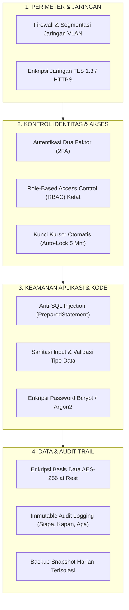

# Modul 36: Data Governance, Patient Privacy & Security Audits
## Google Project Management Professional Certificate

> **Kategori**: Industry Track — Healthcare & Enterprise Systems Deep-Dive (Module 4)  
> **Disusun oleh**: Dessy Rahmawati Chairullina, S.Kom  

---

## 📌 Executive Summary
1. **Data Pasien Adalah Data Pribadi Sensitif**: Data rekam medis, diagnosis penyakit, dan riwayat tindakan merupakan kategori data pribadi spesifik menurut **UU No. 27 Tahun 2022 tentang Perlindungan Data Pribadi (UU PDP)** dan **Permenkes No. 24 Tahun 2022**. Kelalaian tata kelola dapat berujung pada sanksi pidana dan denda hingga miliaran rupiah bagi institusi.
2. **Prinsip Hak Akses Terkecil (*Principle of Least Privilege*)**: Menegakkan kontrol akses berbasis peran (**Role-Based Access Control - RBAC**) di mana setiap pengguna (dokter, perawat, kasir, auditor) hanya diizinkan melihat data yang secara mutlak dibutuhkan untuk fungsi pekerjaannya.
3. **Audit Trail yang Tak Dapat Dimanipulasi (*Immutable Logging*)**: Merekam setiap interaksi terhadap data sensitif: *Siapa yang membaca (View/Print), Mengubah (Edit), atau Menghapus (Delete)* lengkap dengan stempel waktu detik (*timestamp*) dan alamat IP perangkat.
4. **Keamanan Bertingkat (*Defense in Depth*)**: Mengombinasikan enkripsi saat transit (*TLS 1.3*), enkripsi saat penyimpanan (*AES-256 at Rest*), pencegahan injeksi SQL via *PreparedStatement*, serta pengujian kerentanan berkala (*Penetration Testing*).

---

## 1. Kerangka Perlindungan Data Berlapis (Defense in Depth)



---

## 2. Matriks Hak Akses Berbasis Peran (RBAC Matrix)

Pemisahan tugas (*Segregation of Duties*) mencegah penyalahgunaan data medis oleh pihak yang tidak berhak:

| Modul / Data Sensitif | Dokter Penanggung Jawab | Perawat Bangsal | Kasir Keuangan | Staf Pendaftaran | Auditor Internal |
| :--- | :---: | :---: | :---: | :---: | :---: |
| **Catatan Rekam Medis (CPPT/Diagnosis)** | **Baca & Tulis** | Baca & Tulis | *Ditolak (No Access)*| *Ditolak* | Baca (Read-Only) |
| **Pemberian Obat & Tanda Vital (EWS)** | Baca & Tulis | **Baca & Tulis** | *Ditolak* | *Ditolak* | Baca (Read-Only) |
| **Tarif Jasa Medis & Pembagian Honor** | Baca (Milik Sendiri) | *Ditolak* | **Baca & Tulis** | *Ditolak* | Baca (Read-Only) |
| **Identitas Demografis Pasien (NIK/No RM)**| Baca | Baca | Baca | **Baca & Tulis** | Baca |
| **Riwayat Penyakit Menular / VIP** | **Akses Khusus DPJP**| Akses Khusus | *Ditolak* | *Ditolak* | Izin Komite Etik |

---

## 3. Desain Audit Trail yang Memenuhi Standar Hukum

Dalam investigasi hukum atau sengketa medikolegal, pengadilan akan meminta rekaman audit trail. Audit trail yang sah wajib memuat 6 atribut informasi tanpa cela:

```text
====================================================================================================
                        REKAMAN AUDIT LOG AKSES REKAM MEDIS (IMMUTABLE LOG)
====================================================================================================
Timestamp (WIB)      User ID      Nama Pengguna      Role      IP Address     Aksi      Keterangan Data
----------------------------------------------------------------------------------------------------
2027-02-15 08:14:22  dr_handoko   dr. Handoko, Sp.B  Dokter    192.168.10.45  [VIEW]    Buka CPPT Pasien No RM 048210
2027-02-15 08:19:04  dr_handoko   dr. Handoko, Sp.B  Dokter    192.168.10.45  [UPDATE]  Tambah Diagnosa Utama: K35.8
2027-02-15 09:30:12  prw_siti     Siti Rahayu, S.Kep Perawat   192.168.20.12  [INSERT]  Input Skor EWS = 2 (Stabil)
2027-02-15 11:45:00  ksr_dewi     Dewi Lestari       Kasir     192.168.30.08  [PRINT]   Cetak Rincian Billing Pulang
2027-02-15 14:10:33  admin_it     Budi Prasetyo      IT Admin  192.168.10.99  [DENIED]  Akses Ditolak: Intip RM VIP
====================================================================================================
```

* **Anti-Tampering Rule**: Tabel audit log wajib dikonfigurasi hak akses hanya `INSERT` (tanpa wewenang `UPDATE` atau `DELETE`), bahkan bagi akun Superadmin IT sekalipun.

---

## 4. Keamanan Kode: Standarisasi Anti SQL-Injection

Setiap query ke basis data yang memproses input dari pengguna wajib menggunakan `PreparedStatement` dengan parameter binding (`?`):

```java
// CONTOH SALAH (RENTAN SERANGAN SQL-INJECTION):
// String sql = "SELECT * FROM pasien WHERE no_rkm_medis = '" + txtNoRM.getText() + "'";

// CONTOH BENAR & AMAN SESUAI STANDAR ARSITEKTUR KODE KHANZA:
String sql = "SELECT no_rkm_medis, nm_pasien, no_ktp, tgl_lahir FROM pasien WHERE no_rkm_medis = ?";
try (PreparedStatement ps = koneksi.prepareStatement(sql)) {
    ps.setString(1, txtNoRM.getText().trim());
    try (ResultSet rs = ps.executeQuery()) {
        if (rs.next()) {
            txtNama.setText(rs.getString("nm_pasien"));
        }
    }
} catch (SQLException e) {
    Log.error("Kegagalan query pencarian pasien: " + e.getMessage());
}
```

---

## 5. Studi Kasus Nyata: Mencegah Kebocoran Rekam Medis Pejabat Publik (VIP)

* **Skenario Insiden**: Seorang pejabat daerah dirawat di ruang VIP rumah sakit. Karena penasaran, beberapa staf administrasi dan staf farmasi mencoba membuka catatan rekam medis pejabat tersebut dari komputer di ruangan mereka.
* **Tindakan PM Menerapkan Sistem VIP Shielding**:
  1. *Klasifikasi Rekam Medis Khusus (VIP Flagging)*: PM menambahkan atribut penandaan khusus `status_vip = '1'` pada database pasien.
  2. *Pemberlakuan Break-Glass Procedure*:
     * Pengguna biasa yang mencoba membuka berkas tersebut langsung dihadang dialog peringatan: *"Pasien ini berstatus perlindungan privasi khusus. Seluruh aktivitas akses akan dilaporkan langsung ke Direktur Utama"*.
     * Jika tenaga medis benar-benar bertugas merawat pasien tersebut, mereka harus memasukkan alasan klinis darurat (*Break-Glass Access*) yang otomatis mengirimkan notifikasi instan ke Komite Etik dan Hukum.
  3. *Audit Investigasi Log*: Dari rekaman audit log, PM menemukan 3 staf non-medis yang mencoba mengakses berkas tersebut tanpa alasan dinas yang sah.
* **Hasil**:
  * Tidak ada data medis pejabat yang bocor ke media atau pihak luar.
  * Rumah sakit lulus audit kepatuhan Undang-Undang Perlindungan Data Pribadi (UU PDP) dengan nilai kepatuhan keamanan data 100%.

---

## 6. 🛠️ Actionable Data Governance & Security Checklist

- [ ] **RBAC Strictly Enforced**: Apakah hak akses form dikunci berdasarkan profil peran pengguna (kasir tidak bisa intip rekam medis klinis)?
- [ ] **PreparedStatements Mandatory**: Apakah seluruh kueri database menggunakan parameter binding (`?`) untuk menangkal SQL Injection?
- [ ] **Immutable Audit Log Active**: Apakah setiap tindakan membuka, mencetak, atau mengedit data pasien tercatat otomatis dengan User ID dan IP address?
- [ ] **Auto-Lock Screen Configured**: Apakah aplikasi otomatis terkunci (*lock screen*) jika tidak ada aktivitas mouse/keyboard selama 5 menit di bangsal?
- [ ] **Data Breach Protocol Ready**: Apakah ada rencana tanggap darurat insiden kebocoran data resmi yang siap dieksekusi dalam waktu 3x24 jam sesuai amanat UU PDP?
