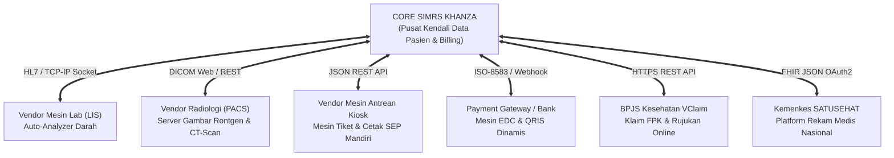
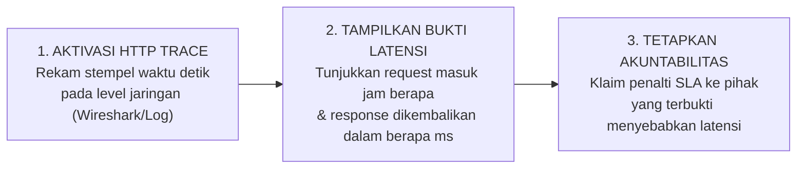

# Modul 37: Multi-Vendor Integration & Third-Party SLA Governance
## Google Project Management Professional Certificate

> **Kategori**: Industry Track — Healthcare & Enterprise Systems Deep-Dive (Module 5)  
> **Disusun oleh**: Dessy Rahmawati Chairullina, S.Kom  

---

## 📌 Executive Summary
1. **Realitas Multi-Vendor di Sistem Enterprise**: Tidak ada satu pun software yang berdiri sendiri di rumah sakit modern. Ekosistem IT terdiri dari kolase vendor: Inti SIMRS, Vendor Mesin Laboratorium (LIS), Vendor Alat Radiologi (PACS), Vendor Mesin Antrean Kiosk, Payment Gateway Perbankan, dan API Pemerintah (BPJS & Kemenkes).
2. **Fenomena Saling Lempar Tanggung Jawab (*The Vendor Blame Game*)**: Saat terjadi kegagalan integrasi, vendor software sering menyalahkan jaringan rumah sakit, dan vendor perangkat keras menyalahkan software SIMRS. Tugas PM adalah memotong debat kusir menggunakan **telemetri data dan bukti log obyektif**.
3. **Perjanjian Tingkat Layanan (*Service Level Agreement - SLA*)**: Kontrak berkekuatan hukum yang menetapkan batas toleransi waktu gangguan (*Uptime/Downtime*), waktu respons pertama (*Mean Time to Acknowledge - MTTA*), dan waktu perbaikan tuntas (*Mean Time to Resolve - MTTR*) disertai klausul penalti finansial.
4. **Protokol Tata Kelola Integrasi Vendor**: Mewajibkan masa uji coba di lingkungan terisolasi (*Sandbox Staging Environment*), standarisasi versi API (*API Versioning*), dan peninjauan kinerja berkala (*Quarterly Business Reviews - QBR*).

---

## 1. Peta Ekosistem Multi-Vendor Rumah Sakit



---

## 2. Struktur SLA: Menetapkan Tolok Ukur Kinerja Vendor

Perjanjian SLA yang lemah adalah celah di mana vendor dapat menelantarkan keluhan rumah sakit selama berhari-hari tanpa konsekuensi.

```text
====================================================================================================
                        MATRIKS TINGKAT KEPARAHAN INSIDEN & SLA VENDOR
====================================================================================================
Tingkat Insiden      Deskripsi Dampak Bisnis               Waktu Respon (MTTA)   Target Solusi (MTTR)
----------------------------------------------------------------------------------------------------
TIER 1 (CRITICAL)    Seluruh layanan IGD / Kasir lumpuh;    Maksimal 15 Menit    Maksimal 2 Jam
                     data transaksi tidak bisa disimpan.

TIER 2 (MAJOR)       Satu poliklinik terganggu; integrasi   Maksimal 30 Menit    Maksimal 4 Jam
                     mesin lab lambat namun ada manual.

TIER 3 (MINOR)       Fungsi minor terganggu; antrean tiket  Maksimal 2 Jam       Maksimal 24 Jam
                     nomor tidak muncul di layar TV.

TIER 4 (COSMETIC)    Permintaan ubah warna label form atau  Maksimal 1 Hari      Sprint Rilis Berikutnya
                     penyesuaian tata letak font cetak.
====================================================================================================
```

### Memahami Angka Uptime:
* **Uptime 99.0%**: Mentoleransi downtime hingga **7,2 jam per bulan** (Sangat berbahaya untuk IGD rumah sakit!).
* **Uptime 99.9% (Three Nines)**: Mentoleransi downtime maksimal **43,8 menit per bulan** (Standar minimum enterprise).
* **Uptime 99.99% (Four Nines)**: Mentoleransi downtime maksimal **4,38 menit per bulan** (Standar ruang ICU/Operasi).

---

## 3. Protokol Memotong "Saling Lempar Tanggung Jawab" Antar Vendor

Ketika mesin antrean kiosk gagal mencetak tiket pendaftaran dan vendor kiosk berkata: *"Ini server SIMRS yang lambat merespons!"*, sementara tim SIMRS berkata: *"Bukan, mesin kiosk yang rusak!"*, PM mengambil kendali melalui 3 langkah pembuktian log:



### Contoh Catatan Bukti Telemetri Log Jaringan:
```text
[HTTP REQUEST LOG - ENDPOINT /api/v1/antrean/ambil-nomor]
Timestamp Masuk  : 2027-02-15 08:30:12.104 WIB -> Diterima server SIMRS dari IP Kiosk 192.168.1.50
Timestamp Proses : 2027-02-15 08:30:12.148 WIB -> Query database selesai dalam 44 milidetik
Timestamp Keluar : 2027-02-15 08:30:12.152 WIB -> Response HTTP 200 JSON dikirim kembali ke Kiosk
Total Waktu SIMRS: 48 MILIDETIK (SANGAT CEPAT!)

KESIMPULAN AUDIT PM:
Keterlambatan 8 detik pencetakan tiket murni disebabkan oleh driver printer termal mesin kiosk 
yang mengalami spooling error, BUKAN akibat kelambatan server SIMRS rumah sakit.
```

---

## 4. Studi Kasus Nyata: Mengatasi Sengketa Integrasi Mesin Laboratorium (LIS)

* **Masalah**: Integrasi antara mesin hematologi darah otomatis (LIS) dan modul rekam medis SIMRS sering macet setiap pukul 10.00 pagi. Dokter IGD mengeluh hasil lab pasien kritis tidak kunjung muncul di layar komputer. Vendor mesin LIS bersikukuh bahwa koneksi socket SIMRS yang terputus sepihak.
* **Tindakan PM Berbasis Vendor Governance**:
  1. *Audit Bersama di Lapangan (Joint War-Room)*: PM mengundang Technical Lead vendor LIS dan Lead Developer SIMRS untuk duduk bersama di laboratorium pada pukul 09.30 WIB.
  2. *Pemasangan Logging Trace Terpusat*: PM memasang logging paket TCP/IP pada socket port 5000.
  3. *Temuan Akar Masalah Faktual*:
     * Tepat pukul 10.00 WIB, terbukti bahwa mesin LIS mengirimkan paket data format HL7 dengan karakter carriage return (`\r\n`) yang terpotong akibat buffer memori internal mesin LIS penuh (*buffer overflow*).
     * Server SIMRS menolak paket tersebut karena struktur string JSON rusak (*malformed payload*).
  4. *Solusi Tegas & Berkeadilan*:
     * Vendor LIS memperbarui firmware mesin hematologi mereka untuk memperbesar ukuran alokasi buffer.
     * Tim SIMRS menambahkan fungsi sanitasi string (*graceful error handling*) agar jika ada karakter terpotong, sistem otomatis meminta pengiriman ulang (*re-request*) tanpa memutus koneksi socket.
* **Hasil**:
  * Sengketa antar vendor terselesaikan secara elegan dalam waktu 3 jam berbasis data fakta log.
  * Transmisi hasil laboratorium ke rekam medis dokter kembali lancar dengan latensi < 1 detik.
  * Manajemen rumah sakit mengadopsi protokol audit war-room PM sebagai standar penanganan komplain pihak ketiga.

---

## 5. 🛠️ Actionable Multi-Vendor Governance Checklist

- [ ] **Contractual SLA Enforced**: Apakah kontrak vendor memuat angka batas waktu respons (MTTA) dan penyelesaian (MTTR) disertai klausul denda penalti?
- [ ] **Sandbox Environment Required**: Apakah seluruh pihak ketiga wajib menguji integrasi API mereka di server staging sebelum diberi akses ke server produksi?
- [ ] **Detailed Logging Enabled**: Apakah seluruh pertukaran data API eksternal mencatat stempel waktu milidetik, alamat IP, dan kode respons HTTP?
- [ ] **Deprecation Notice Period**: Apakah ada klausul kontrak bahwa vendor wajib memberitahukan perubahan format API minimal 60–90 hari sebelum diterapkan?
- [ ] **Quarterly Vendor Review (QBR)**: Apakah kinerja seluruh vendor dievaluasi secara berkala setiap 3 bulan bersama jajaran direktur dan bagian pengadaan (*Procurement*)?
