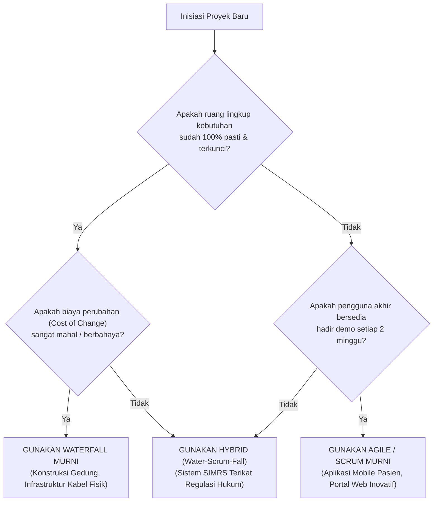

# Modul 38: When to Use Agile and When to Avoid It
## Google Project Management Professional Certificate

> **Sumber Materi**: [Kapan Agile Paling Tepat Digunakan? | Sertifikat Manajemen Proyek Google](https://www.youtube.com/watch?v=ExVAweCZUy0)  
> **Kategori**: Capstone Mastery — Advanced PM Strategy & Career Mastery (Module 1)  
> **Disusun oleh**: Dessy Rahmawati Chairullina, S.Kom  

---

## 📌 Executive Summary
1. **Mitos "Agile Adalah Obat Segala Penyakit"**: Agile bukanlah peluru perak (*silver bullet*) yang cocok untuk semua jenis proyek. Memaksakan framework Agile pada proyek yang salah akan memicu kekacauan anggaran dan ketidakpastian ruang lingkup.
2. **Kriteria Proyek yang Sangat Cocok untuk Agile**:
   * Tingkat ketidakpastian kebutuhan tinggi (*high uncertainty*).
   * Pengguna akhir siap berkolaborasi dan memberikan umpan balik setiap minggu.
   * Biaya perubahan (*Cost of Change*) relatif rendah (seperti pada pengembangan perangkat lunak).
   * Produk dapat dirilis secara bertahap dan menghasilkan nilai parsial (*incremental value*).
3. **Kriteria Proyek di Mana Agile Harus Dihindari (Pilih Waterfall)**:
   * Proyek konstruksi fisik atau pengadaan infrastruktur keras (*Hardware / Civil Engineering*).
   * Proyek dengan regulasi hukum kaku di mana seluruh spesifikasi harus disetujui di awal sebelum pengerjaan boleh dimulai.
   * Kontrak pengadaan pihak ketiga bertipe *Fixed-Price, Fixed-Scope* yang tidak mentoleransi perubahan.
4. **Faktor Kegagalan Kritis Adopsi Agile**: Ketiadaan *Product Owner* yang berdedikasi penuh, budaya organisasi yang masih menganut *command-and-control*, dan tim yang terpecah karena menangani terlalu banyak proyek sekaligus (*multitasking trap*).

---

## 1. Filter Diagnostik Pemilihan Metodologi

Sebelum memulai proyek, Manajer Proyek wajib menjalankan filter diagnostik untuk menentukan apakah proyek harus menggunakan Agile, Waterfall, atau Hibrida:

---

## 2. Matriks Perbandingan: Kapan Agile Menang vs Kapan Waterfall Menang

| Dimensi Evaluasi | Skenario Unggul Agile (Scrum/Kanban) | Skenario Unggul Waterfall (Prediktif) |
| :--- | :--- | :--- |
| **Kejelasan Kebutuhan** | Kebutuhan kabur dan baru akan dipahami setelah pengguna melihat prototipe nyata. | Kebutuhan sudah terstandarisasi jelas oleh pedoman teknis kementerian. |
| **Keterlibatan Pengguna** | Pengguna (dokter/perawat) dapat hadir secara aktif di sesi Sprint Review 2 mingguan. | Pengguna hanya memiliki waktu di awal untuk wawancara dan di akhir saat pengujian serah terima. |
| **Arsitektur Produk** | Berbasis software modular yang mudah diperbarui (*Continuous Deployment*). | Melibatkan perangkat keras fisik, instalasi server bare-metal, atau renovasi ruangan. |
| **Toleransi terhadap Perubahan** | Perubahan disambut sebagai keunggulan kompetitif untuk menyempurnakan produk. | Perubahan di tengah jalan dicegah karena memicu pembengkakan biaya pembongkaran. |

---

## 3. Tiga Jebakan Kegagalan Implementasi Agile di Dunia Nyata

Banyak organisasi gagal dalam transformasi Agile karena terjebak pada 3 kesalahan fatal:

1. **The "Part-Time Product Owner" Trap**:
   * Menunjuk manajer senior yang sibuk menjadi Product Owner, sehingga tim pengembang terkatung-katung menunggu persetujuan User Story selama berminggu-minggu.
2. **The "Agile Means No Documentation" Myth**:
   * Mengabaikan dokumentasi arsitektur dan kamus data dengan alasan *"Kan kita Agile"*, sehingga saat developer kunci mengundurkan diri, tidak ada yang tahu cara memelihara sistem (*technical debt*).
3. **The "Deadline Tetap, Lingkup Fleksibel" Paradox**:
   * Pimpinan menuntut seluruh 100 fitur selesai pada tanggal 1 Januari, namun tim pengembang mengklaim bekerja dengan Agile. Ini bukan Agile, melainkan *Waterfall yang dipaksakan dengan rapat berdiri*.

---

## 4. Studi Kasus Nyata: Evaluasi Pemilihan Metodologi di Rumah Sakit

* **Situasi**: Rumah sakit memiliki 2 proyek paralel:
  * Proyek A: Pembangunan Ruang Server Data Center Baru (Instalasi genset, pendingin precision, pemadam api FM-200, dan rak server).
  * Proyek B: Pengembangan Aplikasi Pendaftaran Pasien Mandiri (Kiosk & Mobile App).
* **Keputusan Metodologi oleh PM**:
  1. *Proyek A (Ruang Server)*: PM menetapkan metodologi **Waterfall Murni**.
     * *Alasan*: Pemasangan pipa gas pemadam dan jalur kabel listrik genset membutuhkan perhitungan teknik sipil yang mutlak presisi di awal. Membongkar dinding beton di tengah jalan karena "ingin iterasi" akan melipatgandakan biaya proyek.
  2. *Proyek B (Aplikasi Pendaftaran Pasien)*: PM menetapkan metodologi **Agile / Scrum**.
     * *Alasan*: Preferensi kenyamanan pasien saat menyentuh layar sentuh kiosk baru diketahui setelah diuji coba di lobi. Tim merilis versi dasar (MVP) dalam 2 minggu, lalu mengiterasi ukuran tombol dan tata letak menu berdasarkan observasi pasien lansia.
* **Hasil**:
  * Proyek A selesai tanpa insiden keselamatan kerja dan lulus sertifikasi kelayakan ruang server.
  * Proyek B sukses besar dengan tingkat adopsi pasien mencapai 88% di bulan pertama peluncuran.

---

## 5. 🛠️ Actionable Methodology Selection Checklist

- [ ] **Uncertainty Level Assessed**: Apakah tingkat ketidakpastian kebutuhan sudah diukur sebelum menentukan framework proyek?
- [ ] **PO Availability Guaranteed**: Jika memilih Scrum, apakah ada Product Owner yang berkomitmen meluangkan waktu minimal 5–10 jam per minggu untuk tim?
- [ ] **Cost of Change Factored**: Apakah biaya pembongkaran produk murah dan aman jika terjadi perubahan arah desain di tengah jalan?
- [ ] **Working Increment Possible**: Apakah produk dapat dipecah menjadi rilis bagian-bagian kecil yang sudah memberikan manfaat bagi pengguna?
- [ ] **Executive Buy-In Secured**: Apakah jajaran direksi memahami bahwa dalam Agile murni, ruang lingkup bersifat fleksibel sementara waktu dan mutu terkunci?
