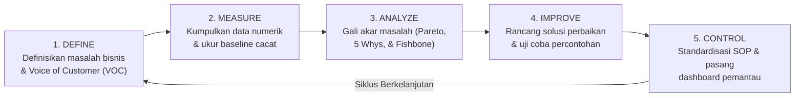

# Modul 39: Lean Six Sigma Principles & DMAIC Process Improvement
## Google Project Management Professional Certificate

> **Kategori**: Capstone Mastery — Advanced PM Strategy & Career Mastery (Module 2)  
> **Disusun oleh**: Dessy Rahmawati Chairullina, S.Kom  

---

## 📌 Executive Summary
1. **Perkawinan Dua Disiplin Keunggulan Operasional**: *Lean* berfokus pada **kecepatan dan eliminasi pemborosan** (*eliminating waste*), sedangkan *Six Sigma* berfokus pada **mutu dan eliminasi variasi cacat** (*reducing defect variation*). Menggabungkan keduanya menghasilkan proses proyek yang cepat, ramping, dan nyaris tanpa cacat.
2. **Target Ambisius Six Sigma**: Mencapai standar kualitas industri tingkat tinggi di mana toleransi cacat maksimal hanya **3,4 kesalahan per satu juta peluang (3.4 DPMO)**.
3. **Framework 5 Tahap DMAIC**: Metodologi terstruktur berbasis data untuk memecahkan masalah proses yang kronis: *Define* (Definisikan), *Measure* (Ukur Baseline), *Analyze* (Analisis Akar Masalah), *Improve* (Perbaiki & Uji Coba), dan *Control* (Kendalikan & Standardisasi).
4. **Prinsip Pareto 80/20**: Menemukan 20% penyebab utama (*the vital few*) yang bertanggung jawab atas 80% masalah cacat sistem atau keluhan pengguna di lapangan.

---

## 1. Alur Lima Tahap Siklus DMAIC



---

## 2. Bedah Tahapan DMAIC dalam Proyek Sistem Informasi

| Fase DMAIC | Pertanyaan Kunci yang Harus Dijawab | Alat Bantu (*Tools*) Utama |
| :--- | :--- | :--- |
| **1. Define** | Masalah apa yang sedang terjadi dan mengapa proyek ini penting bagi kepuasan pelanggan? | Project Charter, SIPOC (Suppliers, Inputs, Process, Outputs, Customers), Voice of Customer (VOC). |
| **2. Measure** | Berapa tingkat cacat atau kelambatan yang terjadi saat ini (*current baseline*)? | Data Collection Plan, Process Mapping, Check Sheets, Run Charts. |
| **3. Analyze** | Faktor apa yang secara statistik menjadi penyebab utama munculnya cacat? | Diagram Tulang Ikan (Ishikawa), Analisis 5 Whys, Analisis Pareto 80/20. |
| **4. Improve** | Solusi apa yang paling efektif dan hemat biaya untuk melenyapkan akar masalah tersebut? | Brainstorming Solusi, Uji Coba Percontohan (Pilot Project), FMEA (Failure Mode and Effects Analysis). |
| **5. Control** | Bagaimana cara menjaga agar masalah ini tidak terulang kembali di masa depan? | Pembuatan SOP Baku, Pelatihan Staf, Checklist Pokayoke (Anti-Salah), Dashboard SPC. |

---

## 3. Analisis Pareto 80/20: Menyerang 20% Penyebab Kunci

Sering kali tim PM kehabisan energi mencoba menyelesaikan 50 masalah kecil sekaligus. Diagram Pareto membantu memfokuskan energi pada titik paling berdampak:

```text
====================================================================================================
                        ANALISIS PARETO KELUHAN RESEP OBAT SALAH (N = 500 KASUS)
====================================================================================================
No   Jenis Masalah Koding / Transaksi      Jumlah Kasus    Persentase    Kumulatif   Kategori
----------------------------------------------------------------------------------------------------
1    Salah baca tulisan tangan dokter          280 Kasus       56.0%        56.0%     [ VITAL FEW ]
2    Salah pilih dosis obat (dropdown)         120 Kasus       24.0%        80.0%     [ VITAL FEW ]
----------------------------------------------------------------------------------------------------
3    Keterlambatan input perawat ke SIMRS       45 Kasus        9.0%        89.0%     (Useful Many)
4    Koneksi printer etiket macet               35 Kasus        7.0%        96.0%     (Useful Many)
5    Stok fisik obat di rak kosong              20 Kasus        4.0%       100.0%     (Useful Many)
====================================================================================================
KESIMPULAN PARETO:
Hanya dengan menyelesaikan 2 masalah pertama (Tulisan dokter & Dosis obat), tim proyek 
berhasil MELENYAPKAN 80% SELURUH KASUS KELUHAN di instalasi farmasi!
```

---

## 4. Studi Kasus Nyata: Menurunkan Angka Salah Resep Obat dari 4.8% ke 0.05%

* **Masalah Kritis**: Di sebuah rumah sakit rujukan, angka kesalahan peracikan obat di depo farmasi rawat jalan mencapai 4,8% (dari 10.000 resep/bulan, terjadi 480 insiden potensi salah obat). Komite Keselamatan Pasien menetapkan ini sebagai kondisi darurat.
* **Penerapan DMAIC oleh PM**:
  1. *Define*: Menetapkan sasaran proyek: *"Menurunkan angka kesalahan obat dari 4,8% menjadi < 0,1% dalam 60 hari"*.
  2. *Measure*: PM mengumpulkan data audit 3 bulan dan memetakan setiap titik serah terima berkas resep.
  3. *Analyze*: Melalui analisis Pareto, ditemukan bahwa 80% insiden disebabkan oleh kemiripan nama obat (*Look-Alike Sound-Alike - LASA*) dan salah pembacaan satuan miligram (mg) vs mikrogram (mcg).
  4. *Improve*:
     * *Poka-Yoke (Desain Anti-Salah)*: PM merancang sistem peringatan otomatis pada SIMRS: Jika dokter memilih obat LASA, teks nama obat otomatis diformat menggunakan huruf kapital bercampur (*Tall Man Lettering*, contoh: `predniSONE` vs `prednisoLONE`).
     * *Barcode Scanning*: Apoteker wajib memindai barcode fisik pada botol obat sebelum etiket pasien tercetak. Jika barcode tidak cocok, sistem mengeluarkan alarm suara keras.
  5. *Control*: PM memasang dashboard pemantau harian di ruang farmasi dan mewajibkan audit barcode mingguan.
* **Hasil**:
  * Angka kesalahan obat anjlok spektakuler dari 4,8% menjadi **hanya 0,05%** (5 kasus per 10.000 resep).
  * Nyawa ribuan pasien terlindungi dari risiko keracunan atau salah terapi obat.
  * Rumah sakit memenangkan penghargaan inovasi mutu layanan kesehatan tingkat nasional.

---

## 5. 🛠️ Actionable Lean Six Sigma PM Checklist

- [ ] **Problem Quantified**: Apakah masalah bisnis didefinisikan dengan angka baseline terukur (bukan sekadar asumsi subjektif)?
- [ ] **Data Sample Validated**: Apakah pengumpulan data pada fase Measure mencakup sampel waktu dan volume transaksi yang representatif?
- [ ] **Pareto 80/20 Applied**: Sudahkah tim mengidentifikasi 20% penyebab utama yang memicu 80% kerugian proses sebelum merancang solusi?
- [ ] **Poka-Yoke Implemented**: Apakah solusi perbaikan menggunakan mekanisme pencegahan salah otomatis (*mistake-proofing*) di dalam kode sistem?
- [ ] **Control Plan Active**: Apakah ada dokumen SOP baku dan indikator kontrol visual untuk memastikan perbaikan bertahan permanen dalam jangka panjang?
