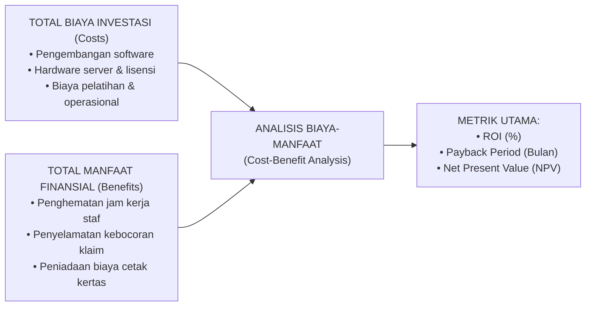

# Modul 40: Calculating Project Business Value & ROI
## Google Project Management Professional Certificate

> **Kategori**: Capstone Mastery — Advanced PM Strategy & Career Mastery (Module 3)  
> **Disusun oleh**: Dessy Rahmawati Chairullina, S.Kom  

---

## 📌 Executive Summary
1. **Bahasa Finansial Eksekutif**: Manajer Proyek dan Business Analyst yang hebat tidak hanya berbicara tentang User Story atau Sprint Burndown. Mereka mampu berbicara dalam bahasa Direktur Keuangan (*CFO*): **Nilai Bisnis (*Business Value*), Pengembalian Investasi (*ROI*), Periode Balik Modal (*Payback Period*), dan Analisis Biaya-Manfaat (*Cost-Benefit Analysis*)**.
2. **Kalkulasi Return on Investment (ROI)**: Rasio keuntungan bersih yang dihasilkan proyek dibandingkan dengan total biaya investasi yang dikeluarkan.
3. **Manfaat Berwujud (*Tangible*) vs. Tidak Berwujud (*Intangible*)**: Membedakan antara penghematan uang kas riil dan efisiensi jam kerja dengan manfaat strategis seperti kepatuhan regulasi hukum, keselamatan pasien, dan reputasi merek institusi.
4. **Jebakan Biaya Hangus (*The Sunk Cost Fallacy*)**: Kesalahan psikologis berbahaya di mana manajemen terus membuang-buang uang pada proyek yang sudah jelas gagal hanya karena merasa *"sudah terlanjur mengeluarkan banyak biaya di awal"*.

---

## 1. Rumus Kunci Metrik Keuangan Proyek

Sebelum mengajukan proposal proyek sistem informasi baru, PM wajib melampirkan kalkulasi finansial objektif:



### 1. Return on Investment (ROI):
$$\text{ROI} = \frac{\text{Total Manfaat Finansial Bersih} - \text{Total Biaya Investasi}}{\text{Total Biaya Investasi}} \times 100\%$$

### 2. Payback Period (Periode Balik Modal):
$$\text{Payback Period} = \frac{\text{Total Biaya Investasi Awal}}{\text{Penghematan Kas Bersih per Bulan}}$$

---

## 2. Matriks Manfaat Berwujud vs. Manfaat Tidak Berwujud

Dalam sektor kesehatan dan sistem enterprise, keberhasilan proyek memiliki dua lapisan nilai:

| Kategori Manfaat | Karakteristik Pengukuran | Contoh Nyata Proyek SIMRS |
| :--- | :--- | :--- |
| **Tangible Benefits** (Berwujud & Terukur Kas) | Dapat dihitung dalam satuan nominal rupiah (*hard cash savings*) atau jam kerja yang dapat dialihkan. | • Penghematan kertas & tinta rekam medis: Rp 18.000.000/tahun.<br>• Penyelamatan denda kadaluwarsa klaim: Rp 120.000.000/tahun.<br>• Pemangkasan 160 jam lembur kasir per bulan. |
| **Intangible Benefits** (Strategis & Tak Berwujud) | Sangat berharga bagi kelangsungan hidup organisasi, namun sulit dinyatakan dalam satuan rupiah langsung. | • Kelulusan akreditasi rumah sakit tingkat Paripurna.<br>• Penurunan angka komplain dokter spesialis.<br>• Reputasi rumah sakit sebagai pelopor faskes digital terdepan. |

---

## 3. Menghindari Jebakan Biaya Hangus (The Sunk Cost Fallacy)

Salah satu keputusan paling berani dari seorang Senior Project Manager adalah **merekomendasikan pembatalan proyek yang sudah tidak layak**, meskipun proyek tersebut sudah menghabiskan ratusan juta rupiah.

```text
[ ILUSTRASI PERANGKAP BIAYA HANGUS (SUNK COST TRAP) ]
Kondisi Proyek:
Proyek integrasi sistem modul X sudah berjalan 8 bulan dan menghabiskan biaya Rp 200 Juta.
Namun di tengah jalan, regulasi pemerintah berubah total dan modul tersebut tidak akan 
bisa dipakai sama sekali saat rilis.

Respon Salah (Sunk Cost Fallacy):
"Kita harus teruskan sampai selesai dan tambah anggaran Rp 100 Juta lagi, 
karena sayang kita sudah menghabiskan Rp 200 Juta di awal!" 
-> HASIL: Rugi Total Rp 300 Juta untuk sistem sampah yang tidak terpakai.

Respon Benar (Rational PM Decision):
"Uang Rp 200 Juta tersebut sudah HANGUS (Sunk Cost) dan tidak akan pernah kembali. 
Keputusan terbaik hari ini adalah MENGHENTIKAN PROYEK sekarang juga untuk 
MENYELAMATKAN sisa anggaran Rp 100 Juta agar bisa dialokasikan ke inisiatif lain."
```

---

## 4. Studi Kasus Nyata: Analisis Kelayakan Finansial Modul Rekonsiliasi Otomatis BPJS

* **Proposal Proyek**: PM mengajukan proyek *Otomatisasi Rekonsiliasi Klaim BPJS dan Integrasi Casemix* dengan rincian biaya investasi:
  * Biaya pengembangan software (internal dev sprint 4 minggu): Rp 35.000.000.
  * Upgrade memori server dan backup storage: Rp 15.000.000.
  * Pelatihan staf keuangan dan casemix: Rp 5.000.000.
  * **Total Biaya Investasi Awal** = **Rp 55.000.000**.
* **Kalkulasi Proyeksi Manfaat Finansial Tahunan**:
  1. *Penyelamatan Kebocoran Klaim Kadaluwarsa*: Berdasarkan data audit tahun lalu, rata-rata terjadi klaim hangus Rp 15.000.000 per bulan $\rightarrow$ Penghematan = Rp 180.000.000/tahun.
  2. *Efisiensi Jam Kerja Staf Kasir*: Menghemat 120 jam kerja lembur staf per bulan senilai Rp 4.500.000/bulan $\rightarrow$ Penghematan = Rp 54.000.000/tahun.
  3. **Total Penghematan Kas Riil per Tahun** = **Rp 234.000.000** (atau Rp 19.500.000 per bulan).
* **Hasil Perhitungan Metrik Finansial**:
  * **Payback Period**: $\frac{\text{Rp 55.000.000}}{\text{Rp 19.500.000/bulan}} = \mathbf{2,82\text{ Bulan}}$ (Balik modal dalam kurun waktu kurang dari 3 bulan!).
  * **ROI Tahun Pertama**: $\frac{\text{Rp 234.000.000} - \text{Rp 55.000.000}}{\text{Rp 55.000.000}} \times 100\% = \mathbf{+325\%}$.
* **Dampak**: Dewan Direksi langsung menyetujui anggaran dalam satu kali rapat presentasi karena justifikasi bisnis dan rasio pengembalian modalnya tak terbantahkan.

---

## 5. 🛠️ Actionable Project Financial Checklist

- [ ] **All Direct & Indirect Costs Counted**: Apakah kalkulasi biaya investasi sudah mencakup biaya software, lisensi, pelatihan staf, dan cadangan risiko?
- [ ] **Tangible Benefits Validated**: Apakah angka penghematan uang kas didasarkan pada data historis audit akuntansi nyata (bukan angka khayalan)?
- [ ] **Payback Period Calculated**: Apakah periode balik modal (*Payback Period*) telah dihitung untuk menunjukkan kecepatan pengembalian dana organisasi?
- [ ] **ROI Formulated**: Apakah proposal memuat rasio ROI tahunan yang jelas untuk meyakinkan Direktur Keuangan?
- [ ] **Sunk Cost Disregarded**: Saat mengevaluasi kelanjutan proyek bermasalah, apakah tim murni menilai prospek masa depan tanpa terbebani biaya masa lalu yang sudah hangus?
