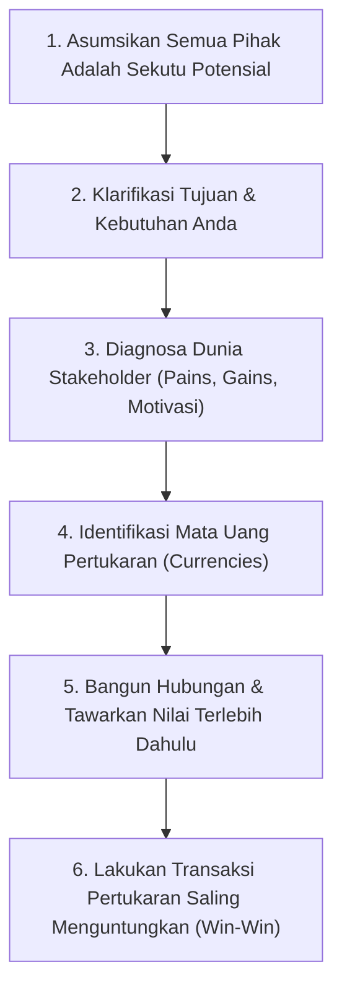
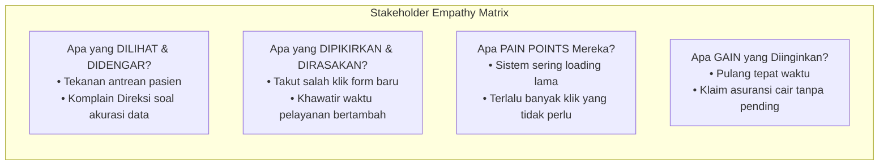
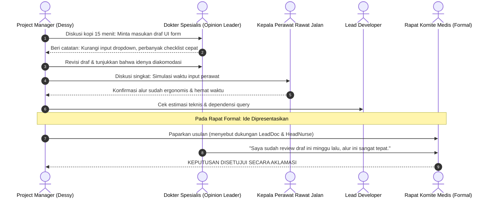
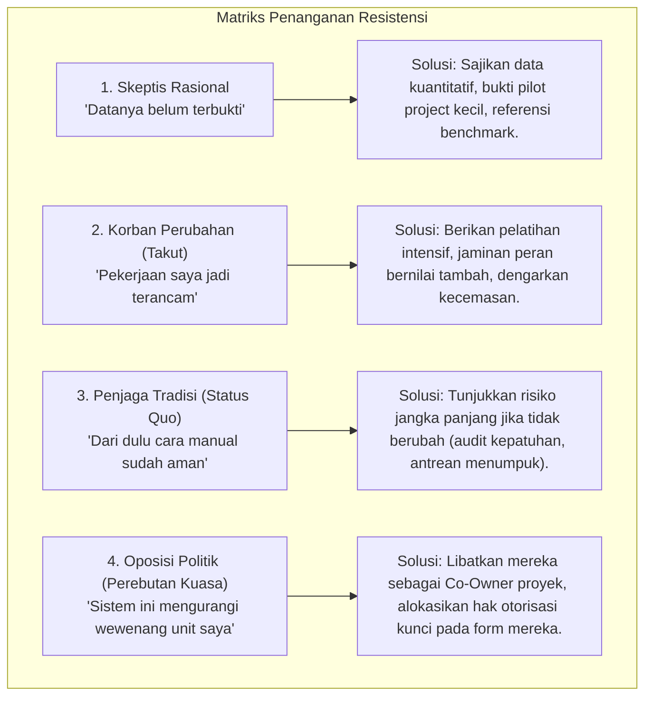
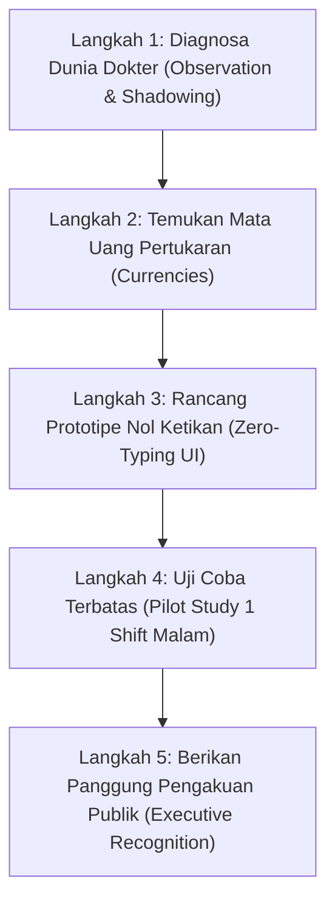

# Modul 41: Influencing Stakeholders Without Authority (Seni Mempengaruhi Tanpa Otoritas Struktural)

Sebagai Project Manager (PM) atau Business Analyst (BA), Anda hampir tidak pernah memiliki otoritas lini (*line authority*) atas orang-orang yang Anda butuhkan untuk menyelesaikan proyek. Pengembang perangkat lunak melapor ke Engineering Manager, dokter spesialis melapor ke Komite Medis/Direktur Pelayanan, akuntan melapor ke Manajer Keuangan, dan vendor melapor ke pimpinan perusahaan mereka sendiri.

Kendati demikian, Anda memikul **100% akuntabilitas** atas keberhasilan proyek. Jika Anda hanya mengandalkan instruksi kaku atau eskalasi ke atasan setiap kali menemui hambatan, tim akan mengalami resistensi pasif (*passive resistance*), hilangnya respek, dan kelambatan birokrasi. 

Kemampuan **mempengaruhi tanpa otoritas struktural (*influencing without authority*)** adalah *superpower* sejati yang membedakan PM biasa dari PM kelas dunia.

---

## 1. Fondasi Psikologis: Model Pengaruh Cohen-Bradford

Model Cohen-Bradford didasarkan pada **Hukum Timbal Balik (*The Law of Reciprocity*)**: hampir semua manusia memiliki dorongan bawah sadar untuk membalas budi dan memperlakukan orang lain sebagaimana mereka diperlakukan. Pengaruh dibangun melalui pertukaran nilai (*value exchange*), bukan pemaksaan hierarki.



### 5 Mata Uang Pengaruh (*Currencies of Influence*)

Orang tidak hanya termotivasi oleh uang atau promosi jabatan. Dalam dinamika organisasi, terdapat 5 "mata uang" non-finansial yang dapat Anda perdagangkan:

| Kategori Mata Uang | Bentuk Nilai Nyata | Contoh Penerapan Praktis PM / BA |
| :--- | :--- | :--- |
| **Inspiration / Vision** | Makna, etika, kebanggaan profesi, berkontribusi pada misi besar | *"Form skrining triase digital ini akan mencegah kematian pasien anak di IGD karena keterlambatan penanganan."* |
| **Task-Related** | Bantuan teknis, sumber daya, informasi penting, pengurangan beban kerja | Membantu staf rekam medis merapikan format data impor Excel sebelum migrasi agar mereka tidak lembur manual. |
| **Position / Career** | Pengakuan (*visibility*), pujian di depan pimpinan, reputasi profesional | Mempresentasikan modul baru di hadapan Direksi dengan menyebut nama dokter spesialis yang merancang formulirnya. |
| **Relationship** | Penerimaan personal, persahabatan, empati emosional, mendengarkan keluhan | Mengajak *lead developer* minum kopi santai dan mendengarkan keluh kesahnya mengenai beban *technical debt*. |
| **Personal** | Otonomi, kenyamanan psikologis, kepemilikan ide (*ownership*) | Memberikan kebebasan penuh kepada tim arsitek database untuk memilih strategi partisi tabel tanpa diintervensi detailnya. |

---

## 2. Peta Empati Pemangku Kepentingan (*Stakeholder Empathy Map*)

Sebelum Anda meminta komitmen waktu atau perubahan alur kerja dari *stakeholder* yang resisten, lakukan analisis menggunakan Peta Empati:



### Pertanyaan Kunci Diagnostik:
1. **Apa KPI utama yang menentukan bonus atau performa mereka tahun ini?**  
   *Jika proyek Anda membantu mereka mencapai KPI mereka, mereka akan menjadi sekutu terkuat Anda.*
2. **Apa ketakutan terbesar mereka terkait perubahan ini?**  
   *Ketakutan kehilangan kendali, ketakutan terlihat tidak kompeten, atau ketakutan beban kerja membengkak.*
3. **Siapa figur panutan yang paling mereka dengarkan?**  
   *Jika Anda tidak bisa meyakinkan mereka secara langsung, yakinkan figur yang mereka hormati (*opinion leader*).*

---

## 3. Strategi "Pre-Wiring" (Lobi Informal Sebelum Pertemuan Formal)

Kesalahan paling fatal yang dilakukan PM amatir adalah menyajikan ide perubahan besar secara mendadak di ruang rapat pleno (*town hall* atau komite formal). Ketika seseorang terkejut di depan publik, respon insting mereka adalah defensif dan menolak (*status quo bias*).

**Pre-wiring** (dalam budaya korporat Jepang dikenal sebagai *Nemawashi*) adalah proses menabur benih dan menyelaraskan pandangan melalui obrolan 1-on-1 informal sebelum rapat penentuan keputusan resmi.



### Taktik Pre-Wiring yang Efektif:
- Datangi meja mereka dengan draf yang baru 70% selesai: *"Dokter, modul ini baru setengah jalan dan kami sengaja belum menyelesaikan sisanya karena kami sangat membutuhkan perspektif klinis Anda."* (Membangkitkan rasa kepemilikan / *IKEA Effect*).
- Jangan meminta persetujuan total di awal; minta **umpan balik perbaikan**.
- Ketika draf diperbaiki, tunjukkan perubahan tersebut kepada mereka sebelum rapat pleno dimulai.

---

## 4. Seni "Managing Up" (Mempengaruhi Pimpinan & Eksekutif)

Mempengaruhi atasan, Direktur, atau sponsor proyek memerlukan pendekatan komunikasi yang sama sekali berbeda dengan tim operasional:

### Prinsip 1: Jangan Bawa Masalah Tanpa Minimal 2 Opsi Solusi
Hindari datang ke meja Direksi hanya dengan keluhan: *"Bu, server integrasi kita down karena vendor telat kirim API."*  
Gunakan kerangka kerja **Problem - Options - Recommendation (POR)**:
> *"Pak Direktur, integrasi vendor tertunda 5 hari karena spesifikasi payload mereka belum final. Kami telah menyiapkan 2 opsi: Opsi A, menggunakan mock server internal sehingga testing form klinis tetap jalan sesuai timeline; Opsi B, menunda deployment modul 1 minggu dengan menerbitkan surat peringatan SLA ke vendor. Rekomendasi kami adalah Opsi A agar jadwal go-live tidak tergeser, dengan catatan surat penalti vendor tetap kita layangkan."*

### Prinsip 2: Berbicara dalam Bahasa Keuangan dan Risiko
Direksi tidak peduli dengan kerumitan arsitektur microservices atau CSS margin. Mereka peduli pada:
1. **Revenue & Cash Flow**: Apakah ini mempercepat perputaran piutang klaim?
2. **Cost Optimization**: Berapa jam lembur staf yang bisa dihemat?
3. **Risk & Compliance**: Apakah kita terancam sanksi Kementerian Kesehatan atau BPJS jika ini tidak dipatuhi?

---

## 5. Mengatasi 4 Tipe Resistensi Stakeholder



---

## 6. Studi Kasus Riil: Menggolkan Form Triase Terintegrasi Tanpa Wewenang Struktural

### Konteks Kasus
- **Peran**: Business Analyst / Project Manager SIMRS (Dessy Rahmawati Chairullina).
- **Inisiatif Proyek**: Digitalisasi Formulir Triase IGD Gawat Darurat yang terhubung otomatis ke Antrean Farmasi dan Notifikasi Warning Dokter Spesialis.
- **Tantangan Utama**:
  - Kepala Instalasi Gawat Darurat (Dokter Senior Spesialis Emergensi) menolak keras: *"Dokter IGD tidak punya waktu untuk mengetik komputer di depan pasien yang sedang sekarat! Form kertas 3 baris jauh lebih cepat."*
  - PM tidak memiliki wewenang untuk memerintah dokter senior tersebut.

### Langkah Eksekusi Pengaruh (Step-by-Step):



1. **Diagnosa Dunia Dokter (Shadowing 4 Jam di IGD)**:
   - PM berdiri di IGD pada jam sibuk (pukul 19.00 - 23.00 WIB) mengamati alur fisik triase tanpa menginterupsi.
   - Ditemukan fakta riil: Dokter tidak membenci komputer, mereka membenci **kehilangan kontak mata dengan keluarga pasien** dan frustrasi ketika mouse harus diklik belasan kali.
2. **Identifikasi Mata Uang Pertukaran**:
   - Mata uang dokter tersebut adalah **Reputasi Klinis Bebas Malpraktik** dan **Waktu Istirahat Shift**.
   - Rasa sakit terbesar dokter: Sering disalahkan ketika terjadi keterlambatan pemberian terapi definitif di bangsal karena lembar kertas triase terselip.
3. **Mendesain Solusi Ergonomis Berbasis 'Zero-Typing'**:
   - Mengubah form input teks bebas menjadi **sistem tomboh warna triase (Merah, Kuning, Hijau, Hitam)** dengan *single keyboard shortcut* (`F1` - `F4`).
   - Tekanan darah dan saturasi oksigen ditarik otomatis dari bedside monitor via bridging serial port.
4. **Pre-Wiring & Uji Coba Terbatas**:
   - PM menemui dokter saat santai pagi: *"Dok, kami merancang tombol cepat berdasarkan pengamatan shift Anda kemarin. Bisakah dokter mencoba 3 menit saja di laptop saya? Jika dokter merasa ini menambah waktu lebih dari 10 detik, saya pribadi yang akan membatalkan proyek ini di depan Direksi."*
   - Dokter mencoba dan terkesan karena input hanya memakan waktu 4 detik—lebih cepat dari menulis tangan.
5. **Konversi Sekutu & Hasil**:
   - Dokter tersebut secara sukarela menjadi advokat utama dalam rapat Komite Medis bulanan.
   - Adopsi modul triase mencapai 100% dalam waktu 7 hari pasca peluncuran tanpa ada satu pun instruksi sanksi dari Direktur.

---

## 7. Rangkuman Intisari & Toolkit PM

```
+-----------------------------------------------------------------------------------+
|                        THE INFLUENCE WITHOUT AUTHORITY CHEAT SHEET                |
+-----------------------------------------------------------------------------------+
| 1. The Law of Reciprocity : Berikan nilai (bantuan, data, apresiasi) sebelum       |
|                             meminta bantuan atau komitmen kerja.                  |
| 2. Diagnose Before Action : Jangan asumsikan resistensi terjadi karena niat buruk. |
|                             Cari tahu apa KPI, ketakutan, dan rasa sakit mereka.  |
| 3. Never Surprise in Public: Lakukan pre-wiring 1-on-1 sebelum rapat formal.       |
| 4. Co-Creation = Ownership: Libatkan pihak resisten dalam merancang solusi agar    |
|                             mereka memiliki rasa bangga memiliki (*IKEA effect*). |
| 5. Frame in Their Language: Eksekutif butuh ROI & kepatuhan; Pengembang butuh      |
|                             kejelasan arsitektur; Pengguna klinis butuh ergonomi. |
+-----------------------------------------------------------------------------------+
```
