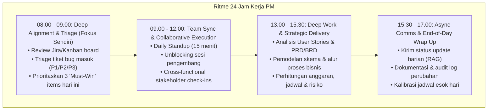
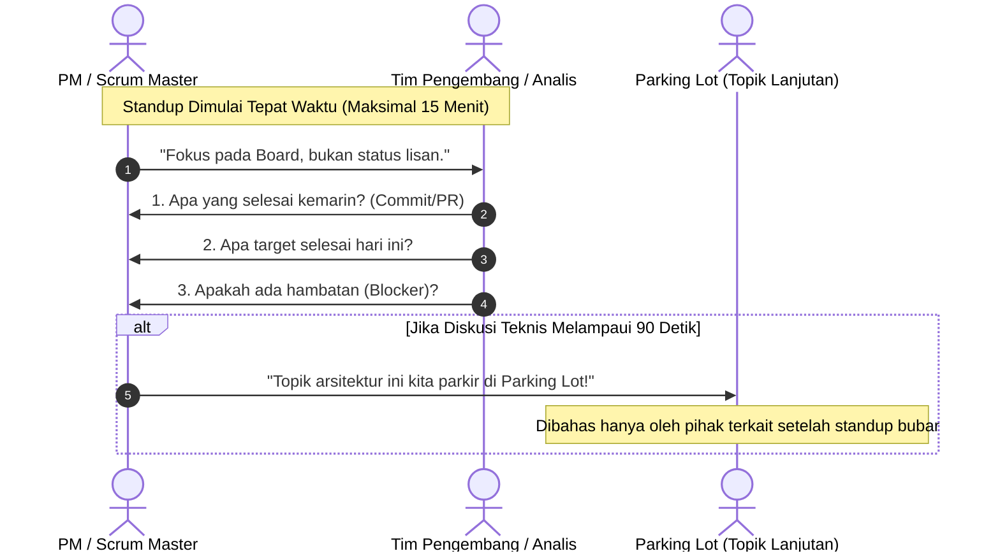
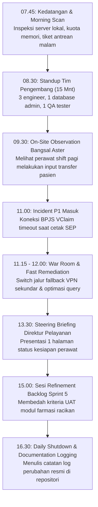

# Modul 42: A Day in the Life of a Project Manager (Ritme Kerja & Disiplin Harian PM)

Banyak profesional pemula membayangkan pekerjaan Project Manager (PM) sebagai profesi yang "hanya duduk di rapat sepanjang hari" atau "sekadar memindahkan kartu di Jira". Pada kenyataannya, PM adalah **konduktor orkestra**: individu yang bertanggung jawab menjaga tempo kerja seluruh divisi, menyingkirkan friksi sebelum menjadi krisis, dan menyaring kebisingan operasional agar tim pengembang dapat fokus berkarya.

Tanpa disiplin manajemen waktu dan batasan yang ketat, seorang PM akan dengan mudah terseret ke dalam perangkap reaktif (*firefighting mode*), di mana seluruh jam kerja habis hanya untuk memadamkan kebakaran dadakan tanpa pernah sempat memikirkan strategi ke depan.

---

## 1. Arsitektur Jadwal Harian: Blok Waktu (*Time-Blocking Framework*)

Seorang PM profesional membagi hari kerjanya ke dalam 4 kuadran waktu yang terstruktur untuk melindungi fokus dan mencegah kelelahan mental (*decision fatigue*):



### Aturan Emas Kalender PM:
1. **Never Start with Email/Chat**: Jangan membuka WhatsApp atau inbox email sebelum menyelesaikan triage papan proyek dan menetapkan 3 target utama (*Top 3 Priorities*) hari ini. Membuka inbox pertama kali membuat Anda bekerja berdasarkan prioritas orang lain.
2. **Defend 2 Hours of Focus Time**: Wajib mengunci minimal 90–120 menit setiap hari tanpa rapat untuk menyelesaikan dokumen spesifikasi (*BRD/PRD*), rancangan diagram, atau audit risiko.
3. **No-Meeting Wednesday/Friday Afternoons**: Usahakan menyisakan satu blok sore dalam seminggu bebas dari rapat eksternal untuk refleksi dan konsolidasi backlog.

---

## 2. Seni Memfasilitasi Daily Standup yang Efisien

Daily Standup sering kali berubah menjadi sesi laporan status yang membosankan dan bertele-tele jika tidak diarahkan dengan benar. Sebagai fasilitator:



### Standup Checklist:
- **Waktu Keras (*Hard Cap*)**: 15 menit berdiri (*standing physically/camera-on*).
- **Walk the Board**: Tinjau kartu dari kanan (*Done/Review*) ke kiri (*In Progress*), bukan menanyai orang satu per satu berdasarkan absensi.
- **Triage Blocker Segera**: Jika seorang insinyur menyebut terhambat oleh izin akses server atau jawaban ambigu dari user bisnis, PM mencatatnya sebagai tugas pribadi untuk diselesaikan sebelum jam 12.00.

---

## 3. Matriks Triage Insiden Real-Time (P1 vs Non-Urgent)

Saat proyek sedang berjalan atau dalam fase *pilot go-live*, puluhan pesan komplain dan permintaan perubahan akan masuk setiap jam. PM harus memiliki filter mental yang tangguh:

| Severity Level | Kriteria Klinis / Bisnis | Waktu Respon Target (SLA) | Tindakan Segera PM |
| :--- | :--- | :--- | :--- |
| **P1 - Critical Blocker** | Transaksi utama mati total, data hilang, keselamatan pasien terancam, kerugian finansial langsung | < 15 Menit | Bentuk *War Room* darurat; isolasi insiden; beri kabar ke sponsor; tunda pekerjaan lain. |
| **P2 - Major Disruption** | Modul sekunder gagal berfungsi namun ada jalan pintas (*workaround*) manual yang aman | < 1 Jam | Tugaskan *senior engineer* investigasi; jadwalkan *hotfix* pada akhir hari kerja. |
| **P3 - Minor Inconvenience** | Masalah kosmetik UI, typo label, tombol tergeser 5px, permintaan fitur kecil | 24 - 48 Jam | Masukkan ke sprint backlog berikutnya; jangan interupsi pengembang di tengah sprint aktif. |
| **P4 - Feature Request** | *"Akan lebih bagus kalau ada fitur export PDF warna ungu"* | Next Sprint Planning | Catat di icebox backlog; minta peninjauan dampak bisnis pada sesi refinement mingguan. |

---

## 4. Komunikasi Asinkron: Menggantikan Rapat Status yang Sia-Sia

Rapat status mingguan di mana 10 orang berkumpul hanya untuk mendengarkan satu sama lain membaca slide adalah pemborosan biaya korporat terbesar. 

Ganti rapat status dengan **Memo Pembaruan Asinkron (*Async Status Digest*)**:

```markdown
### 📢 Project Pulse Update: Modul Bridging Rawat Inap
**Status Keseluruhan**: 🟢 ON TRACK (Sprint 04 of 06)  
**Target Rilis Go-Live**: 25 November 2026 (T-9 Hari)

#### ✅ Apa yang Telah Diselesaikan Minggu Ini:
- Selesai pengujian beban bridging endpoint SatuSehat Encounter (1.200 request/menit, error rate 0.02%).
- Selesai penandatanganan Berita Acara UAT modul kasir rawat inap bersama Manajer Keuangan.

#### ⚠️ Risiko & Isu yang Sedang Dikelola:
- **Keterlambatan Firmware Scanner Barcode Farmasi**: Pengiriman vendor terlambat 2 hari.  
  *Mitigasi*: Tim IT menyiapkan fallback manual input keyboard dengan barcode virtual pada layar tablet.

#### 🎯 Fokus Utama 3 Hari Ke Depan:
1. Dry-run simulasi kepulangan pasien jam sibuk bersama perawat bangsal Melati.
2. Migrasi skema data historis rekam medis 6 bulan terakhir.
```

---

## 5. Studi Kasus Riil: Kronologi 1 Hari Penuh PM SIMRS Menjelang Go-Live

### Konteks
- **Project Manager**: Dessy Rahmawati Chairullina, S.Kom.
- **Fase**: H-2 Peluncuran Modul Rekam Medis Elektronik (RME) Rawat Inap & Bridging BPJS VClaim.
- **Lokasi**: Rumah Sakit Indriati Boyolali.



### Detail Lapangan:
1. **07.45 WIB - Morning Triage**:
   - Membuka monitor kesehatan aplikasi: Tidak ada kebocoran memori (*memory leak*), CPU server normal pada 18%.
   - Menemukan 2 tiket dari shift malam: Format cetak gelang pasien sedikit bergeser saat nama pasien lebih dari 30 karakter. PM menugaskan perbaikan format font sebelum siang.
2. **11.00 WIB - Menghadapi Krisis Nyata (P1)**:
   - Terjadi lonjakan antrean di admisi karena bridging SEP BPJS tiba-tiba tidak merespon (HTTP 504 Gateway Timeout).
   - **Tindakan PM**:
     - Tidak panik atau marah-marah di grup umum.
     - Menginstruksikan staf admisi mengaktifkan modul cetak darurat *offline* (SEP manual dengan penomoran sementara).
     - Menghubungi technical support BPJS cabang melalui jalur langsung (hasil hubungan baik yang dibangun sebelumnya).
     - Ditemukan bahwa IP rumah sakit terkena *rate-limit* sementara; PM mengarahkan tim jaringan untuk mengalihkan ke IP cadangan (*failover*) dalam waktu 12 menit.
3. **16.30 WIB - Ritual Penutupan Harian (*Shutdown Ritual*)**:
   - Mengisi log harian resmi di repositori: mencatat perubahan konfigurasi failover VPN dan penyesuaian font label gelang.
   - Mengosongkan meja kerja, menutup semua tab browser yang tidak relevan, dan menuliskan 3 target utama untuk besok pagi pada buku catatan fisik.

---

## 6. Template Toolkit: Kartu Kendali Harian PM (*Daily PM Cockpit*)

```
===================================================================================
                        DAILY PROJECT MANAGER COCKPIT
Tanggal: [ YYYY-MM-DD ]              Sprint/Fase: [ Sprint XX / Release YY ]
===================================================================================

[1] TOP 3 MUST-WIN PRIORITIES HARI INI:
    [ ] 1. ........................................................................
    [ ] 2. ........................................................................
    [ ] 3. ........................................................................

[2] BLOCKERS & ESCALATION LOG (Siapa yang terhambat? Apa bantuan yang dibutuhkan?):
    - [ ] Blocker A: ................................. Owner: ........ Deadline: ..
    - [ ] Blocker B: ................................. Owner: ........ Deadline: ..

[3] DAILY STAKEHOLDER TOUCHPOINT (1 Informal 1-on-1 Touch):
    - Nama Stakeholder: ...................... Topik: ............................
    - Feedback / Insight: ........................................................

[4] END-OF-DAY AUDIT & LOGGING:
    [ ] Seluruh tiket status hari ini telah diperbarui di Kanban/Jira.
    [ ] Dokumentasi teknis/log perubahan terdaftar di repositori.
    [ ] Calendar esok hari telah diaudit (Focus block aman).
===================================================================================
```
