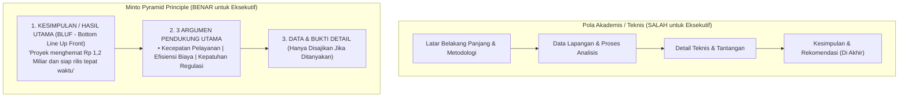
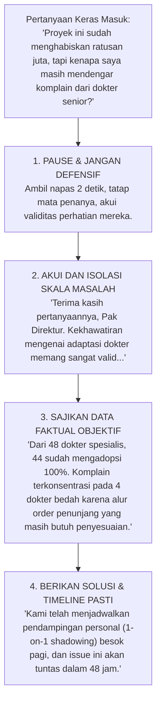
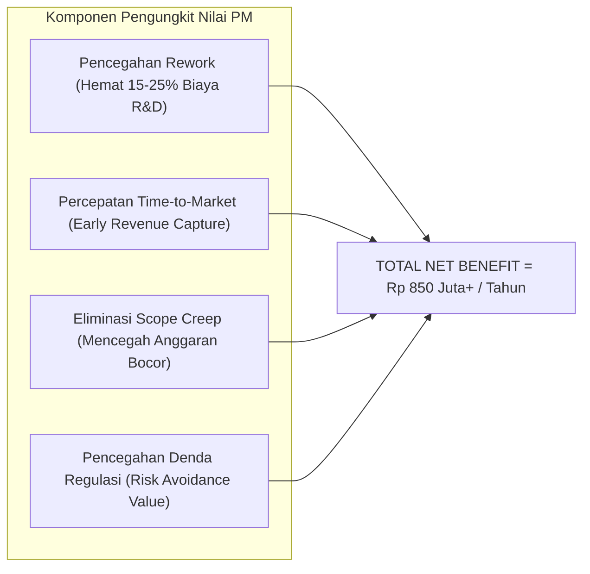

# Modul 43: Demonstrating PM Value to C-Suite (Membuktikan Nilai Strategis PM di Depan Eksekutif)

Bagi banyak eksekutif tingkat C (*Chief Executive Officer, Chief Financial Officer, Chief Medical Officer*), divisi manajemen proyek (*PMO*) sering kali dicurigai hanya sebagai pusat biaya administratif (*cost center*) atau lapisan birokrasi tambahan yang memperlambat laju inovasi.

Jika Anda melaporkan kemajuan proyek kepada Dewan Direksi dengan bahasa teknis seperti *"Kami telah memodifikasi 14 controller Java, menyelesaikan 32 story points, dan mengatur konfigurasi Docker swarm"*, Anda telah gagal total. Eksekutif tidak membeli proses teknis; mereka membeli **dampak bisnis (*business outcomes*)**, perlindungan terhadap risiko kepatuhan (*regulatory compliance*), dan penghematan biaya finansial (*financial ROI*).

Kemampuan mengartikulasikan nilai proyek dalam bahasa Dewan Direksi adalah pembeda utama antara manajer proyek teknis tingkat junior dan pemimpin portofolio strategis.

---

## 1. Minto Pyramid Principle: Struktur Komunikasi Khusus Eksekutif

Diciptakan oleh Barbara Minto (McKinsey & Co.), *Pyramid Principle* menyatakan bahwa komunikasi eksekutif harus dibalik 180 derajat dibandingkan dengan penulisan akademis tradisional.



### Kamus Penerjemahan Bahasa Teknis ke Bahasa C-Suite:

| Apa yang Diucapkan PM Junior (Teknis) | Bagaimana PM Strategis Mengatakannya ke Eksekutif (Bisnis) |
| :--- | :--- |
| *"Kami telah mengoptimalkan indeks query database SQL dari 4 detik menjadi 200 ms."* | *"Kami memotong waktu tunggu antrean kasir sebesar 45%, menghindarkan 150 pasien/hari dari kelelahan mengantre, dan menaikkan kepuasan pasien (CSAT) ke 94%."* |
| *"Sistem bridging SatuSehat FHIR telah selesai lolos uji sandbox Kemenkes."* | *"Rumah sakit kita 100% aman dari risiko sanksi administratif pencabutan akreditasi faskes oleh Kementerian Kesehatan."* |
| *"Velocity tim sprint minggu ini naik dari 28 menjadi 40 story points."* | *"Efisiensi throughput rilis fitur naik 42% tanpa ada penambahan biaya anggaran programmer baru."* |
| *"Terjadi bug pada form resep obat yang menyebabkan error saat load data."* | *"Kami mendeteksi dan menghentikan potensi insiden keselamatan pemberian obat (medication error) sebelum sistem menyentuh pasien hidup."* |

---

## 2. Format 1-Slide Executive Dashboard

Dewan Direksi rata-rata hanya memiliki rentang perhatian 3 hingga 5 menit untuk menyerap status proyek Anda. Format satu lembar (*One-Pager*) berikut dirancang untuk memberikan transparansi instan tanpa membebani memori mereka:

```
+-------------------------------------------------------------------------------------------------------+
| EKSEKUTIF BRIEFING: DIGITALISASI REKAM MEDIS & BRIDGING SATUSEHAT                                     |
| Sponsor: Direktur Utama | Lead PM: Dessy Rahmawati Chairullina | Status: 🟢 HIJAU (ON TRACK)          |
+-------------------------------------------------------------------------------------------------------+
| METRIK BISNIS UTAMA (HASIL):                                                                          |
| • Penghematan Biaya Kertas/Cetak : Rp 14.500.000 / Bulan (Turun 78%)                                  |
| • Kecepatan Pelayanan Farmasi    : Dari 24 Menit/Resep menjadi 7 Menit/Resep (Hemat 70% Waktu)         |
| • Kepatuhan Regulasi RME Kemkes  : 100% Resource Terpetakan (Encounter, Condition, Observation)       |
+---------------------------------------+---------------------------------------------------------------+
| STATUS REALISASI MILESTONE:           | ANGGARAN & FINANSIAL (YTD):                                   |
| [X] M1: Cetak Biru Alur Klinis (Selesai)| • Pagu Anggaran Disetujui : Rp 350.000.000                    |
| [X] M2: Pilot Project Rawat Jalan      | • Realisasi s.d. Hari Ini : Rp 280.000.000                    |
| [ ] M3: Peluncuran Rawat Inap (Target 30 Nov)| • Varian (Hemat)     : Rp 70.000.000 (Cost Under Budget)|
+---------------------------------------+---------------------------------------------------------------+
| RISIKO STRATEGIS & KEPUTUSAN YANG DIBUTUHKAN:                                                         |
| • Risiko: Tingkat kehadiran dokter spesialis pada pelatihan modul rawat inap baru 62%.                |
| • PERMINTAAN KEPADA DIREKTUR MEDIS: Mohon penerbitan Surat Edaran Wajib Pelatihan 30 menit bagi     |
|   seluruh Dokter Penanggung Jawab Pelayanan (DPJP) sebelum tanggal 24 November.                      |
+-------------------------------------------------------------------------------------------------------+
```

---

## 3. Menghadapi Pertanyaan Keras di Ruang Dewan (*Hostile Boardroom Dynamics*)

Saat mempresentasikan proyek di hadapan Direksi dan Dewan Komisaris, Anda pasti akan menghadapi pertanyaan tajam atau nada skeptis. Ketenangan emosional dan penguasaan data adalah kunci bertahan hidup:



### 3 Pantangan di Depan C-Suite:
1. **Dilarang Berargumen Emosional**: Jangan pernah berkata *"Bapak tidak tahu betapa susahnya tim kami kerja lembur tiap malam"*. Kerja keras tidak dinilai oleh eksekutif; hasil nyata yang dinilai.
2. **Dilarang Menebak Data Palsu**: Jika Anda tidak tahu angka pastinya, jangan mengarang. Katakan: *"Saya tidak ingin memberikan estimasi yang keliru kepada Dewan. Saya akan memverifikasi angka akuratnya dengan data warehouse dan mengirimkan jawabannya sebelum pukul 15.00 hari ini."*
3. **Dilarang Menyalahkan Pihak Lain**: Menyalahkan staf perawat atau vendor pihak ketiga di depan Direksi hanya akan membuat Anda terlihat tidak berdaya (*weak leader*). Ambil tanggung jawab kepemimpinan atas penyelesaiannya.

---

## 4. Menghitung PM Value Multiplier (Bagaimana PM Menghasilkan Uang)

Banyak organisasi tidak menyadari bahwa manajemen proyek yang solid secara matematis meningkatkan profitabilitas perusahaan:



### Rumus Sederhana PM Value Proposition:
$$\text{Net PM Value} = (\text{Biaya Pengerjaan Ulang yang Dicegah}) + (\text{Pendapatan dari Rilis Lebih Awal}) + (\text{Denda Regulasi yang Dihindari}) - (\text{Biaya Operasional PM})$$

---

## 5. Studi Kasus Riil: Presentasi Dewan Direksi untuk Menyetujui Anggaran Ekspansi SIMRS

### Konteks
- **Presenter**: Dessy Rahmawati Chairullina, S.Kom (Lead Project Manager / Business Analyst).
- **Audiens**: Direktur Utama, Direktur Keuangan, Direktur Medis, dan Dewan Pengawas RS Indriati.
- **Tujuan Pertemuan**: Mendapatkan persetujuan penambahan anggaran Rp 450.000.000 untuk pengadaan infrastruktur server redundan, modul rekam medis digital terpadu, dan pelatihan SDM.

### Skenario Penyampaian di Ruang Rapat Direksi:

> *"Selamat pagi Bapak dan Ibu Dewan Direksi.  
> Kehadiran kami hari ini bukan untuk meminta anggaran teknologi informasi demi membeli komputer baru, melainkan untuk **mengunci pertumbuhan pendapatan rawat jalan sebesar Rp 2,4 Miliar** dan **menghilangkan risiko pending klaim BPJS sebesar Rp 800 Juta per bulan** yang selama ini mengendap di piutang.
>
> Dalam 6 bulan terakhir, implementasi fase pertama modul antrean online dan verifikasi resep digital telah membuktikan 3 hal:
> 1. Waktu tunggu pasien terpangkas dari 115 menit menjadi 38 menit, meningkatkan kapasitas pelayanan poli sebesar 35%.
> 2. Akurasi koding diagnosis ICD-10 naik dari 71% menjadi 98,4%, mempercepat persetujuan klaim BPJS dari 45 hari menjadi 14 hari kerja.
> 3. Penghematan biaya fisik kertas dan sewa gudang arsip sebesar Rp 174 Juta per tahun.
>
> Usulan investasi fase kedua sebesar Rp 450 Juta ini memiliki Payback Period 4,2 bulan dengan Net Present Value (NPV) positif sebesar Rp 1,1 Miliar dalam 3 tahun. Kami telah menyiapkan dokumen analisis kelayakan finansial dan matriks risiko implementasi di lampiran meja Bapak/Ibu. Kami merekomendasikan Dewan menyetujui program ini hari ini agar integrasi tuntas sebelum audit akreditasi rumah sakit semester depan."*

### Respon Dewan:
Direktur Keuangan langsung menyetujui anggaran tanpa memotong nilai nominal karena proposal dibingkai bukan sebagai biaya (*expense*), melainkan sebagai **investasi percepatan arus kas (*cash flow accelerator*)**.

---

## 6. Checklist Kesiapan Sebelum Menghadap Direksi

```
[ ] 1. Pesan Utama (BLUF) dapat dipahami oleh anak usia 12 tahun dalam 30 detik.
[ ] 2. Semua singkatan teknis (API, CI/CD, FHIR, SQL, Latency) telah diganti menjadi istilah bisnis.
[ ] 3. Dashboard keuangan menyertakan angka varian biaya (Budget vs Actual) terkini.
[ ] 4. Telah disiapkan 1 slide 'Appendix' yang memuat data mentah jika ada Direktur skeptis yang ingin audit mendalam.
[ ] 5. Permintaan tindakan (*Call to Action*) jelas: Meminta tanda tangan SK, persetujuan anggaran, atau instruksi kebijakan lintas divisi.
```
