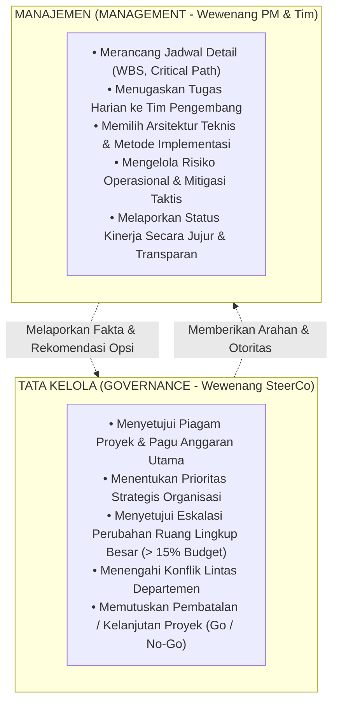
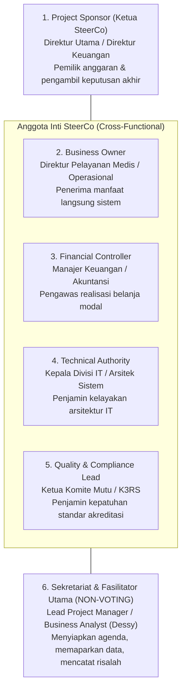
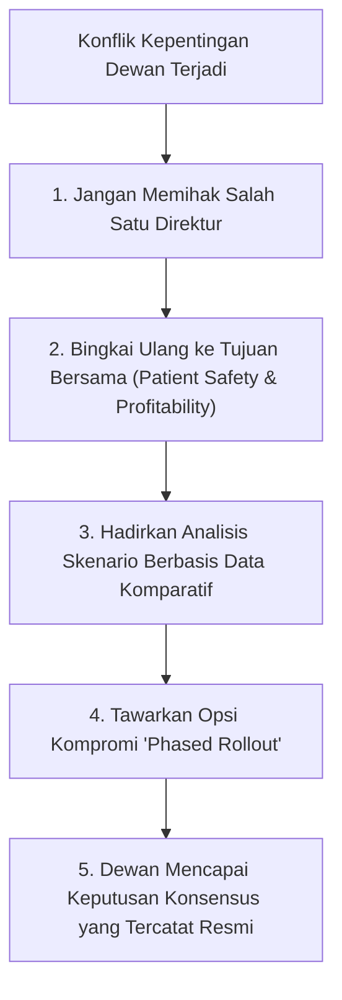

# Modul 44: Steering Committees and Board Governance (Tata Kelola Proyek & Komite Pengarah)

Pada proyek-proyek skala enterprise dengan anggaran ratusan juta hingga miliaran rupiah, Project Manager (PM) tidak bekerja sendirian di ruang hampa. Keberhasilan proyek bersandar pada struktur tata kelola (*project governance*) yang kokoh. 

Di puncak struktur tata kelola ini berdiri **Steering Committee (SteerCo)** atau Komite Pengarah: sekelompok pimpinan eksekutif lintas fungsi yang memiliki otoritas tertinggi untuk menyetujui anggaran, mengubah arah strategis (*strategic pivot*), memecahkan sengketa prioritas antar-departemen, dan memastikan bahwa proyek tetap selaras dengan visi jangka panjang institusi.

Namun, mengelola SteerCo adalah salah satu tantangan politik korporat terbesar bagi seorang PM. Jika tidak difasilitasi dengan baik, pertemuan SteerCo dapat bergeser menjadi ajang debat kusir politik antar-direktur atau tempat saling menyalahkan (*blame game*).

---

## 1. Governance vs Management: Menegakkan Garis Batas Otoritas

Banyak proyek hancur karena kekacauan batas wewenang: anggota SteerCo terlalu mencampuri urusan mikro teknis (*micromanagement*), atau sebaliknya, PM mengambil keputusan strategis di luar batas wewenangnya.



---

## 2. Struktur Ideal & Terms of Reference (ToR) SteerCo

Steering Committee yang efektif biasanya terdiri dari 4 hingga 7 pemangku kepentingan kunci:



### Mandat Dokumen ToR (Terms of Reference):
1. **Kuorum Pengambilan Keputusan**: Keputusan sah jika dihadiri oleh minimal Sponsor + 2 Anggota Inti.
2. **Frekuensi Pertemuan**: Sekali sebulan untuk fase pembangunan (*build phase*), atau sewaktu-waktu dalam waktu 48 jam jika status proyek berubah menjadi **MERAH (*Critical Alert*)**.
3. **Mekanisme Voting**: Diutamakan konsensus musyawarah; jika terjadi jalan buntu (*deadlock*), Project Sponsor memegang hak veto tunggal.

---

## 3. Anatomi Rapat SteerCo yang Efektif (60 Menit)

Rapat dewan tidak boleh melebihi 60 menit. Struktur pembagian waktu yang ideal:

| Waktu | Durasi | Agenda | Output yang Ditargetkan |
| :--- | :--- | :--- | :--- |
| **00 - 10** | 10 Mnt | **Executive Flash Summary (RAG Status & Nilai)** | Dewan memahami posisi proyek dalam 1 pandangan. |
| **10 - 25** | 15 Mnt | **Tinjauan Milestone & Realisasi Finansial** | Varian biaya dan jadwal diaudit secara transparan. |
| **25 - 50** | 25 Mnt | **Pembahasan Isu Kunci & Keputusan Strategis** | *Decision Item* utama dibahas dan divotasi solusinya. |
| **50 - 60** | 10 Mnt | **Pengesahan Risalah & Penugasan Aksi (RACI)** | Siapa mengerjakan apa dalam 30 hari ke depan disepakati. |

---

## 4. Resolusi Konflik Kepentingan Antara Anggota Dewan

Skenario umum di rumah sakit atau korporasi besar adalah pertentangan kepentingan antara divisi:
- **Direktur Pelayanan Medis**: *"Kami butuh integrasi modul riwayat alergi otomatis dan penambahan 20 komputer baru di poli agar pasien tertangani cepat."*
- **Direktur Keuangan (CFO)**: *"Arus kas rumah sakit sedang ketat, tidak ada penambahan belanja modal (CapEx) komputer tahun ini!"*
- **Kepala IT**: *"Server lama sudah kelebihan beban (overloaded), jika dipaksakan menambah modul tanpa upgrade RAM, server bisa ambruk."*



### Taktik Fasilitasi PM Saat Terjadi Perdebatan Panas:
1. **Visualisasikan Trade-Off**: Buka diagram *Triple Constraint* di layar: *"Jika kita menolak belanja RAM baru namun tetap meluncurkan modul alergi, risiko downtime sistem saat jam sibuk naik menjadi 35%. Apakah Dewan bersedia menerima risiko ini?"*
2. **Pisahkan Emosi dari Angka**: Hadirkan kalkulasi biaya kegagalan (*Cost of Inaction*). Menunjukkan bahwa biaya denda kelalaian alergi obat (Rp 500 Juta) jauh lebih mahal daripada membeli modul RAM seharga Rp 25 Juta seketika memecah kebuntuan argumen keuangan.

---

## 5. Protokol Risalah Rapat (Minutes of Meeting - MoM) yang Mengikat

Risalah rapat SteerCo bukan catatan curhat; ini adalah **dokumen hukum korporat** yang mengikat seluruh direktorat:

```
===================================================================================
                    STEERING COMMITTEE DECISION LOG & MINUTES (MoM)
Nama Proyek  : Transformasi Rekam Medis Elektronik (RME) Generasi II
Nomor Rapat  : STEERCO/RME/2026/XI-04
Tanggal/Waktu: 16 November 2026 | 09.00 - 10.05 WIB
Tempat       : Ruang Dewan Direksi / Boardroom Lt. 3
Pimpinan     : Direktur Utama RS Indriati
Notulis/PM   : Dessy Rahmawati Chairullina, S.Kom
===================================================================================

[1] DAFTAR KEPUTUSAN STRATEGIS YANG DISETUJUI (DECISIONS BINDING):
    * DEC-04.1: Menyetujui pengalihan sisa anggaran lisensi software (Rp 45 Juta) 
                untuk penambahan kapasitas server cloud staging SatuSehat.
                (Status: DISETUJUI SECARA AKLAMASI).
    * DEC-04.2: Menetapkan tanggal Go-Live modul rawat inap pada 15 Desember 2026.
                Segala permintaan perubahan fitur (CR) baru setelah tanggal 20 
                November resmi DITUTUP (Feature Freeze).

[2] MATRIKS TINDAK LANJUT EKSEKUTIF (ACTION ITEMS & RACI):
    +----------------------------------------------------+----------+-------------+
    | Deskripsi Tindakan                                 | PIC/DRI  | Tenggat     |
    +----------------------------------------------------+----------+-------------+
    | Penerbitan SK Direktur tentang SOP Input RME Wajib | DirMedis | 22 Nov 2026 |
    | Pencairan Termin II Pengadaan Hardware Scanner     | ManKeu   | 25 Nov 2026 |
    | Laporan Uji Beban Server 2.000 User Simultan       | Lead PM  | 30 Nov 2026 |
    +----------------------------------------------------+----------+-------------+

Tanda Tangan Pengesahan:
Ketua Komite Pengarah (Project Sponsor)          Lead Project Manager
( Direktur Utama )                               ( Dessy Rahmawati Chairullina )
===================================================================================
```

---

## 6. Studi Kasus Riil: Mengendalikan Krisis Proyek Berstatus Merah di Hadapan SteerCo

### Skenario Lapangan
- Proyek digitalisasi modul resep farmasi dan kasir mengalami status **MERAH 🔴**: Vendor penyedia modul bridging stok obat gagal menyerahkan API tepat waktu (molor 3 minggu), mengancam penundaan peluncuran seluruh rumah sakit.
- Rapat SteerCo Luar Biasa digelar dengan suasana tegang. Direktur Medis marah karena dokter-dokter sudah dijanjikan sistem baru bulan depan.

### Eksekusi Manajemen Krisis oleh PM (Dessy):
1. **Transparansi Tanpa Alibi**: PM membuka rapat dengan mengakui fakta tanpa menutup-nutupi: *"Bapak/Ibu Direksi, proyek ini saat ini berstatus MERAH karena keterlambatan vendor modul stok farmasi. Kami memohon maaf dan tidak akan membuang waktu untuk mencari alasan."*
2. **Penyajian 3 Opsi Strategis Lengkap dengan Matriks Risiko**:
   - **Opsi A (Menunda Seluruh Go-Live 1 Bulan)**: Menunggu vendor menyelesaikan modul. *Dampak*: Menjaga kesempurnaan modul tapi merusak jadwal akreditasi dan membengkakkan biaya overhead Rp 40 Juta.
   - **Opsi B (Membangun Modul Stok Mandiri Secara In-House)**: Menghentikan kerja sama vendor, tim internal mengkodekan sendiri algoritma stok minimum dalam 10 hari. *Dampak*: Tim internal lembur, namun anggaran vendor senilai Rp 85 Juta ditarik kembali (*cost recovery*) via klausa wanprestasi kontrak.
   - **Opsi C (Go-Live Parsial / Phased)**: Meluncurkan modul resep elektronik terlebih dahulu; pemotongan stok farmasi dijalankan melalui rekonsiliasi batch setiap pergantian shift.
3. **Rekomendasi Tegas PM**: PM merekomendasikan **Opsi B**, didukung fakta bahwa tim developer internal telah membedah arsitektur database dan mampu menyelesaikan modul tersebut.
4. **Hasil**: SteerCo menyetujui rekomendasi Opsi B, menerbitkan surat klaim wanprestasi ke vendor, dan tim in-house sukses merilis fitur tepat pada tanggal target awal. Kepercayaan Dewan terhadap kapabilitas PM melonjak tinggi.
