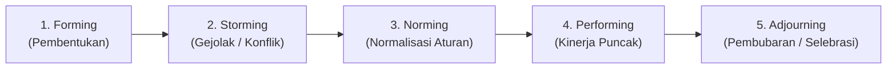
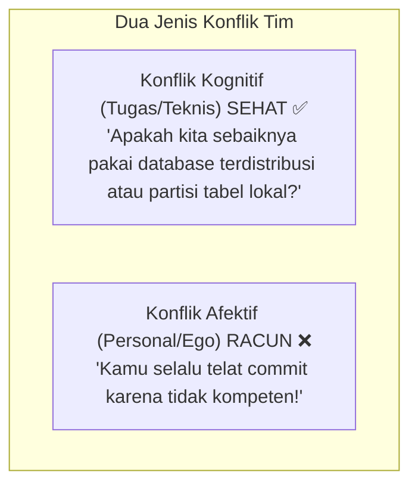
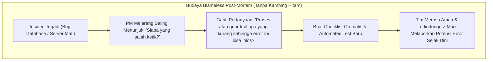
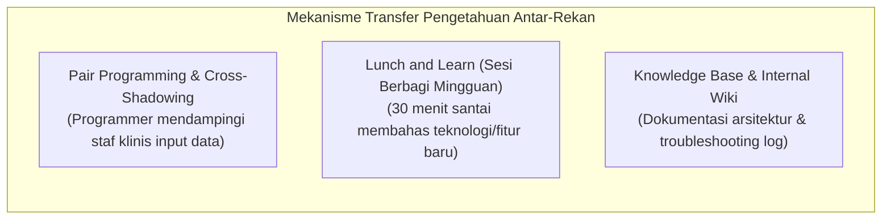
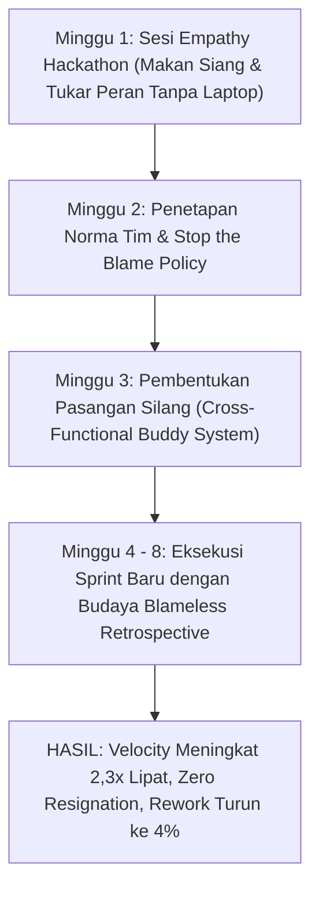

# Modul 45: Building High-Performing Teams and Peer Effectiveness (Membangun Tim Berkinerja Tinggi & Efektivitas Rekan Sejawat)

Proyek perangkat lunak atau inisiatif transformasi bisnis tidak diselesaikan oleh dokumen rencana yang rapi atau metodologi Scrum di atas kertas; proyek diselesaikan oleh **sekelompok manusia yang bekerja sama secara harmonis**.

Seorang Project Manager (PM) yang hebat bukan sekadar pencatat jadwal (*taskmaster*), melainkan arsitek budaya tim (*team culture architect*). Menyatukan kepribadian yang berbeda—pengembang perangkat lunak yang introvert dan sangat analitis, dokter spesialis yang terbiasa memberi instruksi hierarkis, analis bisnis yang metodis, serta akuntan yang sangat berhati-hati terhadap angka—memerlukan kepemimpinan emosional, empati, dan penguasaan dinamika kelompok.

---

## 1. Model Perkembangan Tim Bruce Tuckman

Setiap tim yang baru dibentuk pasti melewati 5 tahap evolusi psikologis. Mengenali di tahap mana tim Anda berada memungkinkan Anda menerapkan gaya kepemimpinan yang tepat:

| Tahap | Gejala Perilaku di Lapangan | Peran Kunci Project Manager | Gaya Kepemimpinan |
| :--- | :--- | :--- | :--- |
| **Forming** | Anggota tim saling bersikap sopan, berhati-hati, bingung peran masing-masing, pasif menunggu instruksi. | Tetapkan visi proyek yang jelas, definisikan peran (*RACI*), buat *Team Charter*. | **Directive (Mengarahkan)** |
| **Storming** | Gesekan ego, saling mempertanyakan kompetensi, komplain tentang beban kerja, resistensi terhadap proses baru. | Fasilitasi mediasi konflik, dorong komunikasi terbuka, tegakkan norma tim tanpa menghakimi. | **Coaching (Membimbing)** |
| **Norming** | Terbentuk konsensus, anggota mulai saling membantu, format dokumentasi disepakati, kepercayaan (*trust*) tumbuh. | Dorong otonomi tim, delegasikan keputusan teknis ke ahli di bidangnya, perkuat kolaborasi. | **Participative (Mendukung)** |
| **Performing** | Alur kerja otomatis dan cair, inovasi spontan, penyelesaian masalah mandiri, kecepatan (*velocity*) stabil dan tinggi. | Singkirkan hambatan eksternal (*blockers*), lindungi tim dari gangguan politik, rayakan pencapaian. | **Delegating (Mendelegasikan)** |
| **Adjourning** | Proyek selesai, transisi ke tim operasional pemeliharaan, ada rasa kehilangan dan kelegaan. | Lakukan retrospektif penutupan, dokumentasikan *Lessons Learned*, adakan selebrasi resmi apresiasi. | **Appreciative (Mengapresiasi)** |

---

## 2. Menavigasi Fase "Storming" Tanpa Membakar Hubungan

Banyak PM pemula panik ketika timnya memasuki fase *Storming*, mengira bahwa proyek mereka sedang gagal. Faktanya, **konflik adalah bukti bahwa anggota tim mulai peduli terhadap pekerjaan mereka**. Yang berbahaya bukanlah adanya konflik, melainkan **konflik destruktif personal (*affective conflict*)** yang tidak dikelola.

### Teknik PM Mengubah Konflik Menjadi Terobosan:
1. **Fokus pada Masalah, Bukan Orangnya**: Segera intervensi jika diskusi berubah menjadi serangan personal: *"Mari kita tahan penilaian pribadi. Fokus kita adalah memastikan transaksi data aman saat internet rumah sakit terputus. Apa opsi arsitektur terbaiknya?"*
2. **Pisahkan Pihak Bertikai untuk 1-on-1**: Jangan biarkan dua anggota tim beradu urat leher di depan seluruh peserta rapat. Ajak masing-masing berbicara berdua secara privat untuk mendengarkan akar kecemasan mereka.
3. **Penyelarasan Nilai Bersama (*Superordinate Goal*)**: Ingatkan mereka pada tujuan yang lebih besar: *"Kita semua berada di sini bukan untuk membuktikan siapa paling pintar, melainkan agar pasien tidak perlu menunggu 3 jam untuk mendapatkan obat."*

---

## 3. Menumbuhkan Rasa Aman Psikologis (*Psychological Safety*)

Berdasarkan riset monumental Google (*Project Aristotle*), faktor nomor 1 yang menentukan kinerja sebuah tim bukan IQ individu, bukan anggaran, melainkan **Keamanan Psikologis (*Psychological Safety*)**: keyakinan bahwa tidak ada anggota yang akan dipermalukan, ditolak, atau dihukum karena mengemukakan ide, bertanya hal bodoh, atau mengakui kesalahan.

### 3 Tindakan Konkret PM untuk Menciptakan Keamanan Psikologis:
1. **Modelkan Kerentanan (*Vulnerability*)**: Jangan takut mengakui ketidaktahuan Anda: *"Saya tidak memahami implikasi latency dari protokol HL7 ini, bisakah rekan arsitek menjelaskannya kepada saya?"*
2. **Rayakan Penemuan Bug Awal**: Jika seorang QA atau pengguna melaporkan celah keamanan besar, berikan pujian di hadapan tim alih-alih mengeluhkan jadwal rilis yang tertunda.
3. **Dorong Suara Minoritas**: Dalam rapat, tanyakan langsung pada anggota yang paling pendiam: *"Rudi, kamu biasanya memiliki perspektif yang jeli tentang stabilitas query, bagaimana pandanganmu tentang skema ini?"*

---

## 4. Pelatihan Rekan Sejawat (*Peer Coaching*) & Berbagi Pengetahuan

Tim berkinerja tinggi tidak bergantung pada satu pahlawan super (*single point of failure / hero syndrome*). Mereka aktif mendistribusikan pengetahuan melalui mekanisme terstruktur:

- **Cross-Shadowing**: Wajibkan setiap pengembang perangkat lunak untuk duduk mendampingi kasir atau perawat minimal 2 jam setiap kuartal. Melihat secara langsung kepanikan kasir saat aplikasi lag melahirkan empati rekayasa (*engineering empathy*) yang jauh lebih efektif daripada dokumen PRD 100 halaman.
- **Pair Code Review**: Tinjauan kode bukan ajang menghakimi, melainkan sarana transfer standar arsitektur bersih (*clean code*) kepada insinyur junior.

---

## 5. Merayakan Kemenangan & Motivasi Intrinsik

Hadiah finansial (bonus uang) memang penting, namun motivasi intrinsik—otonomi, penguasaan keahlian (*mastery*), dan tujuan hidup (*purpose*)—adalah bahan bakar yang menjaga tim tetap solid di masa-masa krisis proyek.

### Formula Apresiasi 3R:
1. **Real-Time**: Jangan menunggu acara tahunan kantor untuk memuji kontribusi. Kirimkan pesan apresiasi personal 10 menit setelah seseorang menyelesaikan tugas krusial.
2. **Relevant & Specific**: Hindari pujian klise seperti *"Kerja bagus semuanya"*. Katakan: *"Terima kasih Doni, ketelitianmu mengecek constraint foreign key kemarin malam telah menyelamatkan kita dari corrupt-nya 10.000 riwayat transaksi hari ini."*
3. **Public Recognition**: Berikan penghargaan dan sebutkan kontribusi tim teknis saat mempresentasikan hasil proyek di hadapan Direksi dan Komite Medis.

---

## 6. Studi Kasus Riil: Mentransformasi Tim SIMRS dari Saling Menyalahkan Menjadi Unit Performa Tinggi

### Latar Belakang & Gejala Masalah
- **Tim**: 4 Pengembang Java/Database, 2 Analis Sistem/QA, 3 Staf Perwakilan Rekam Medis & Keuangan RS Indriati.
- **Gejala Krisis (*Severe Storming*)**:
  - Hubungan kerja sangat dingin dan penuh kecurigaan. Staf rekam medis menganggap tim IT sombong dan tidak peduli keluhan lapangan: *"IT bikin aplikasi sembarangan, kalau error kita yang dimarahi pasien!"*
  - Tim IT menganggap staf rekam medis tidak mau belajar dan lambat beradaptasi: *"Mereka itu gaptek, disuruh baca manual book saja tidak mau!"*
  - Tingkat pengerjaan ulang (*rework*) mencapai 45%, moral tim sangat rendah, dan turnover karyawan meningkat.

### Intervensi Kepemimpinan oleh PM (Dessy Rahmawati Chairullina):

1. **Sesi "Empathy Hackathon" (Tanpa Laptop)**:
   - PM mengumpulkan seluruh anggota di luar kantor rumah sakit untuk sesi makan bersama.
   - Setiap orang diminta menceritakan 1 hal yang paling membuat mereka stres dalam pekerjaan sehari-hari. Programmer baru menyadari bahwa staf rekam medis sering dimaki langsung oleh keluarga pasien jika antrean obat tertunda 5 menit saja.
2. **Pemberlakuan "Stop the Blame Policy"**:
   - Jika terjadi bug di sistem, dilarang mencari siapa pembuat kodenya di chat grup publik.
   - Sebagai gantinya, analis klinis dan programmer duduk bersama dalam waktu 30 menit untuk memetakan akar masalah (*root cause*) dan merancang proteksi validasi otomatis.
3. **Sistem Buddy Silang (Cross-Functional Buddy)**:
   - Setiap programmer dipasangkan dengan satu perwakilan perawat/staf admisi. Mereka menjadi kontak pertama sebelum isu teknis dinaikkan ke sistem tiket formal.
4. **Hasil Transformasi**:
   - Dalam 2 bulan, tim bertransformasi dari fase *Storming* akut langsung menuju *Performing*.
   - Kecepatan rilis fitur meningkat 2,3 kali lipat (*cycle time* tiket turun dari 9 hari menjadi 3 hari).
   - Seluruh anggota tim menandatangani piagam apresiasi bersama saat proyek integrasi SatuSehat sukses lolos verifikasi nasional.
