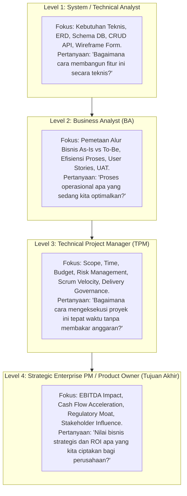
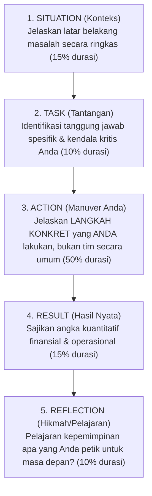

# Modul 46: BA & PM Career Portfolio and STAR Interview Mastery (Portofolio Karier & Penguasaan Wawancara STAR)

Selamat datang di **Modul Pamungkas (Capstone Finale)** dari seluruh rangkaian kurikulum *Google Project Management Professional Certificate*. Di titik ini, Anda telah menguasai spektrum penuh rekayasa proyek: mulai dari inisiasi piagam proyek, pemodelan proses bisnis klinis/enterprise, manajemen risiko kuantitatif, tata kelola anggaran dan pengadaan, orkestrasi Scrum dan Lean Six Sigma, hingga diplomasi di hadapan Dewan Direksi.

Namun, penguasaan ilmu teori dan keterampilan teknis tidak akan bernilai bagi kemajuan karier Anda jika Anda tidak mampu **mengemasnya ke dalam Portofolio Profesional yang memikat** dan **mengartikulasikannya secara meyakinkan dalam sesi wawancara tingkat tinggi (*executive behavioral interview*)**.

Modul ini adalah buku panduan strategis bagi **Dessy Rahmawati Chairullina, S.Kom** untuk memvalidasi posisi sebagai **Lead Business Analyst & Project Manager** papan atas yang diburu oleh korporasi multinasional, ekosistem *health-tech*, dan institusi enterprise.

---

## 1. Roda Gila Karier BA / PM (*The Career Flywheel*)

Transisi dari seorang praktisi teknis (*system analyst / software engineer*) menjadi pemimpin proyek enterprise (*Enterprise Project Manager / Product Leader*) bukanlah sekadar kenaikan pangkat linier, melainkan perubahan paradigma berpikir:



---

## 2. Merancang Portofolio Portabel Berdaya Jual Tinggi

Portofolio PM/BA yang buruk biasanya hanya berisi daftar tautan aplikasi (*"Saya membuat form kasir"* atau *"Saya mengelola Jira proyek X"*). Portofolio kelas dunia disusun berdasarkan **Studi Kasus Naratif Berorientasi Masalah-Dampak (*Problem-Action-Result Narrative*)**.

### Struktur Baku Lembar Portofolio Proyek (Format 5 Blok):

```
+-----------------------------------------------------------------------------------+
| JUDUL PROYEK: [Nama Inisiatif Transformasi Sistem / Produk]                      |
| Peran: Lead Business Analyst & Project Manager | Klien/Institusi: [Nama RS/Faskes]|
+-----------------------------------------------------------------------------------+
| 1. BUSINESS CONTEXT & PROBLEM STATEMENT:                                          |
|    • Apa rasa sakit operasional sebelum proyek dimulai?                           |
|    • Berapa kerugian finansial atau keterlambatan waktu yang terjadi?             |
+-----------------------------------------------------------------------------------+
| 2. SCOPE & STAKEHOLDER LANDSCAPE:                                                |
|    • Siapa pemangku kepentingan kunci (C-Suite, Dokter, Staf, Vendor)?           |
|    • Apa batasan kendala ruang lingkup (Triple Constraint) dan risiko kritis?     |
+-----------------------------------------------------------------------------------+
| 3. METHODOLOGY & TECHNICAL GOVERNANCE:                                            |
|    • Metodologi yang digunakan: Hybrid (Waterfall Governance + Scrum Sprints).    |
|    • Standar arsitektur: Java Native Widget, HL7 FHIR SatuSehat, BPJS VClaim.     |
+-----------------------------------------------------------------------------------+
| 4. EXECUTION HIGHLIGHTS & CRISIS OVERCOME:                                        |
|    • Hambatan terbesar apa yang dihadapi (misal: resistensi dokter / vendor telat)?|
|    • Manuver taktis apa yang Anda ambil untuk menyelamatkan proyek?               |
+-----------------------------------------------------------------------------------+
| 5. MEASURABLE BUSINESS IMPACT (HASIL AKHIR BERDASARKAN DATA):                    |
|    • Metrik Efisiensi Waktu (misal: waktu antrean turun 70%).                     |
|    • Metrik Finansial (misal: percepatan pencairan klaim Rp 800 Juta/bulan).      |
|    • Metrik Kepatuhan (misal: 100% lolos verifikasi SatuSehat Kemenkes).         |
+-----------------------------------------------------------------------------------+
```

---

## 3. Formula Google XYZ untuk Resume & Dokumen Portofolio

Berdasarkan standar perekrutan eksekutif Google, setiap butir pencapaian di CV atau profil LinkedIn Anda **WAJIB** ditulis menggunakan formula:

$$\text{"Accomplished [X], as measured by [Y], by doing [Z]"}$$

### Contoh Transformasi Kalimat Resume:

```diff
- BURUK (Deskriptif Pasif):
- Bertanggung jawab memimpin proyek migrasi rekam medis digital di rumah sakit dan mengintegrasikan bridging BPJS.

+ HEBAT (Formula Google XYZ):
+ Memimpin transformasi Rekam Medis Elektronik (RME) dan integrasi bridging BPJS VClaim [Z], berhasil memangkas waktu tunggu pelayanan pasien sebesar 62% dan menurunkan tingkat pending klaim dari 28% menjadi 1,2% [X], menghasilkan percepatan arus kas piutang senilai Rp 1,4 Miliar per kuartal [Y].
```

```diff
- BURUK (Deskriptif Pasif):
- Mengatur rapat harian dengan developer dan membuat dokumen BRD/PRD untuk bridging SatuSehat.

+ HEBAT (Formula Google XYZ):
+ Merancang arsitektur interoperabilitas standar HL7 FHIR dan memfasilitasi 12 sprint tim pengembang lintas fungsi [Z], meloloskan sertifikasi integrasi SatuSehat Kementerian Kesehatan 100% compliant tanpa sanksi regulasi [X], dengan efisiensi biaya vendor sebesar Rp 180 Juta melalui rekayasa in-house [Y].
```

---

## 4. Penguasaan Wawancara Perilaku: Metode STARR (Situation, Task, Action, Result, Reflection)

Dalam wawancara tingkat tinggi (*Senior/Lead level*), pewawancara tidak menanyakan hafalan teori. Mereka menguji bagaimana karakter, ketenangan emosional, dan nalar analitis Anda bekerja di bawah tekanan nyata melalui pertanyaan perilaku (*behavioral questions*).



---

## 5. Bank Jawaban 10 Pertanyaan Wawancara BA / PM Tersulit

Berikut adalah bedah tuntas 10 pertanyaan wawancara paling menantang lengkap dengan skenario jawaban berbasis bukti riil portofolio SIMRS & Healthcare Enterprise:

### Q1: *"Ceritakan pengalaman ketika proyek Anda terancam gagal total atau keluar jalur parah. Bagaimana Anda membalikkannya?"*
- **Situation**: Pada H-14 peluncuran modul bridging farmasi rawat jalan di RS Indriati, vendor pihak ketiga mengumumkan keterlambatan API stok obat selama 3 minggu, sementara batas akhir akreditasi faskes tidak dapat ditunda.
- **Task**: Sebagai Lead PM, saya harus memastikan pelayanan obat rawat jalan tidak lumpuh pada tanggal go-live tanpa menimbulkan kekacauan pembukuan akuntansi.
- **Action**: Saya segera menggelar rapat darurat SteerCo untuk memaparkan situasi secara transparan tanpa alibi. Saya mengusulkan pembatalan kontrak modul vendor bermasalah dan mengarahkan tim developer internal untuk membangun modul pemotongan stok mandiri (*in-house*) menggunakan algoritma batch reconciliation. Saya mengisolasi tim dari gangguan eksternal, membuat papan kanban krisis harian, dan mendampingi testing langsung di apotek selama 4 hari berturut-turut.
- **Result**: Modul stok in-house berhasil dirilis 1 hari sebelum batas waktu. Akurasi stok fisik vs sistem mencapai 99,8%, dan kami menghemat biaya pengadaan vendor senilai Rp 85 Juta.
- **Reflection**: Saya belajar bahwa ketergantungan kritis pada vendor eksternal (*single vendor dependency*) harus selalu memiliki rencana kontinjensi (*fail-safe workaround*) sejak hari pertama inisiasi proyek.

---

### Q2: *"Bagaimana Anda menghadapi pemangku kepentingan berkuasa tinggi (misal: Dokter Spesialis Senior / Direktur) yang menolak mentah-mentah sistem baru Anda?"*
- **Situation**: Kepala Instalasi Rawat Jalan menolak beralih ke form rekam medis elektronik karena menganggap pengetikan keyboard memperlambat waktu konsultasi pasien dan merusak kontak mata klinis.
- **Task**: Saya harus membujuk dokter tersebut untuk mengadopsi sistem tanpa wewenang struktural untuk memerintahnya.
- **Action**: Alih-alih berargumen atau meminta Direktur menerbitkan surat peringatan, saya melakukan *shadowing* selama 4 jam di ruang praktiknya untuk memahami titik frustrasinya secara langsung. Saya menemukan bahwa dokter tersebut membenci mouse clicking yang berulang-ulang. Saya kemudian merancang antarmuka khusus *zero-typing* berbasis tombol pintas keyboard tunggal (`F1`-`F4`) dan pemilihan template diagnosis cepat. Saya menemuinya secara personal (*pre-wiring* 1-on-1) dan memintanya mencoba prototipe 3 menit di laptop saya.
- **Result**: Dokter tersebut terkesan karena input hanya memakan waktu 4 detik—lebih cepat dari menulis resep kertas. Beliau secara sukarela menjadi duta (*champion*) yang mengajak dokter-dokter lain untuk bermigrasi.
- **Reflection**: Penolakan pengguna hampir tidak pernah dilandasi niat jahat, melainkan rasa takut kehilangan kendali dan efisiensi. Empati lapangan selalu mengalahkan pemaksaan regulasi.

---

### Q3: *"Bagaimana Anda menengahi konflik tajam antara kelayakan teknis pengembang versus tenggat waktu bisnis yang dipaksakan manajemen?"*
- **Situation**: Direksi menuntut peluncuran modul pembayaran bridging asuransi dalam waktu 2 minggu untuk mengejar target akhir tahun, namun lead developer menyatakan bahwa arsitektur sistem membutuhkan minimal 5 minggu agar tidak terjadi kerentanan kebocoran data transaksi.
- **Task**: Menyelaraskan ambisi bisnis dengan integritas keamanan teknis tanpa membuat salah satu pihak merasa dikorbankan.
- **Action**: Saya membedah seluruh lingkup fitur menggunakan teknik MoSCoW. Saya memecah rilis menjadi 2 fase: Fase 1 (MVP) meluncurkan pembayaran untuk 2 gerbang asuransi terbesar yang mencakup 85% volume transaksi harian dengan protokol keamanan standar industri; Fase 2 meluncurkan gerbang asuransi minor 3 minggu kemudian. Saya mempresentasikan trade-off ini kepada Direksi menggunakan grafik kalkulasi risiko finansial.
- **Result**: Direksi menyetujui rilis bertahap. Sistem meluncur tepat pada tanggal target tanpa insiden keamanan data, dan tim pengembang tetap bekerja dalam batas jam kerja manusiawi tanpa burnout.
- **Reflection**: Tugas PM bukan sekadar mengatakan "Ya" atau "Tidak", melainkan menawarkan opsi kompromi berbasis data (*negotiating trade-offs through phased delivery*).

---

### Q4: *"Bagaimana Anda membuktikan nilai bisnis (Business Value) dan ROI dari proyek modernisasi sistem IT yang sifatnya internal?"*
- **Situation**: Manajemen sering mempertanyakan mengapa rumah sakit harus mengeluarkan ratusan juta untuk refactoring arsitektur database dan modernisasi modul internal SIMRS.
- **Task**: Mengonversi metrik teknis yang abstrak menjadi angka moneter yang dipahami oleh Direktur Keuangan (CFO).
- **Action**: Saya membuat model keuangan komprehensif yang mengukur 4 parameter: (1) Penurunan biaya cetak kertas dan map rekam medis fisik; (2) Pengurangan jam kerja lembur staf administrasi; (3) Percepatan siklus penagihan piutang klaim BPJS (*Days Sales Outstanding / DSO*); dan (4) Penghindaran risiko denda ketidakpatuhan akreditasi nasional.
- **Result**: Terbukti bahwa investasi Rp 350 Juta menghasilkan penghematan biaya riil Rp 210 Juta per tahun dan mempercepat perputaran arus kas Rp 1,2 Miliar, menghasilkan *Payback Period* hanya dalam 20 bulan dengan ROI 3 tahun sebesar 80%.
- **Reflection**: Setiap inisiatif teknis—bahkan refactoring kode terdalam sekalipun—harus selalu memiliki benang merah yang terhubung langsung ke laporan laba-rugi (*P&L statement*) perusahaan.

---

### Q5: *"Bagaimana strategi Anda mengendalikan Scope Creep saat sponsor proyek terus menambah permintaan fitur di tengah sprint?"*
- **Situation**: Di tengah pengerjaan modul IGD, Komite Medis mengajukan 8 formulir tambahan baru yang di luar kesepakatan Project Charter awal, bersikeras bahwa semuanya harus selesai di jadwal yang sama.
- **Task**: Menjaga stabilitas jadwal rilis tanpa bersikap konfrontatif terhadap Komite Medis.
- **Action**: Saya menyambut baik seluruh usulan tersebut sebagai ide bernilai tinggi, lalu mengarahkannya ke dalam formalitas *Change Control Procedure*. Saya membuka diagram *Triple Constraint* di hadapan komite: *"Kami siap memasukkan 8 formulir ini, namun konsekuensinya adalah menambah anggaran programmer sebesar Rp 30 Juta atau menggeser tanggal peluncuran IGD selama 3 minggu. Alternatif ketiga adalah menukar 8 fitur minor yang ada di sprint berjalan ke backlog fase kedua."*
- **Result**: Komite Medis memilih opsi ketiga, menyaring 8 permintaan menjadi 3 formulir paling esensial dan menukar fitur yang kurang penting. Ruang lingkup dan jadwal rilis tetap aman terjaga.
- **Reflection**: Scope creep tidak dicegah dengan cara menolak usulan pengguna, melainkan dengan membeberkan konsekuensi biaya dan waktu secara transparan.

---

### Q6: *"Bagaimana Anda memprioritaskan backlog saat dua Kepala Divisi berpengaruh sama-sama menuntut fitur mereka dikerjakan lebih dulu?"*
- **Situation**: Kepala Bagian Keuangan menuntut otomatisasi rekonsiliasi bank dikerjakan duluan, sementara Kepala Instalasi Farmasi menuntut modul barcode obat racikan diselesaikan terlebih dahulu. Keduanya berstatus setara di bagan organisasi.
- **Task**: Menentukan prioritas kerja sprint berikutnya secara objektif dan mempertahankan harmoni lintas departemen.
- **Action**: Saya menyelenggarakan sesi evaluasi bersama menggunakan kerangka kerja kuantitatif **WSJF (Weighted Shortest Job First)** dan matriks *Cost of Delay*. Kami memberi skor bersama terhadap 3 dimensi: *User/Business Value*, *Time Criticality*, dan *Risk Reduction / Opportunity Enablement*, lalu membaginya dengan *Job Size*.
- **Result**: Skor WSJF membuktikan secara objektif bahwa modul barcode farmasi memiliki urgensi keselamatan pasien (*Patient Safety*) yang berisiko fatal jika ditunda, sehingga disepakati bersama untuk masuk sprint terdekat, sementara rekonsiliasi bank dijadwalkan tepat pada sprint berikutnya. Kedua kepala divisi menerima keputusan dengan puas karena penilaian dilakukan berbasis algoritma transparan, bukan favoritisme personal.
- **Reflection**: Metrik kuantitatif yang disepakati bersama adalah penawar racun paling mujarab untuk meredakan politik preferensi subjektif dalam korporasi.

---

### Q7: *"Pernahkah analisa kebutuhan bisnis (BRD) atau rancangan sistem Anda ternyata keliru di tengah jalan? Apa yang Anda lakukan?"*
- **Situation**: Saat merancang alur transfer pasien rawat inap, saya berasumsi bahwa dokter selalu menandatangani lembar persetujuan sebelum pasien dipindahkan dari ruang observasi. Namun saat uji coba simulasi lapangan, terungkap bahwa dalam kasus darurat, pasien dipindahkan lebih dulu demi menyelamatkan nyawa, baru dokumen disahkan kemudian. Sistem yang saya rancang mengunci status perpindahan jika tanda tangan belum lengkap.
- **Task**: Memperbaiki kelemahan analisis alur tanpa mempermalukan tim analis dan tanpa menunda peluncuran.
- **Action**: Saya segera menggelar rapat retro kilat bersama kepala perawat, mengakui secara terbuka bahwa analisis saya belum mencakup skenario kegawatdaruratan (*emergency override*). Dalam 24 jam, saya merevisi spesifikasi BRD dengan menambahkan jalur pintas *Conditional Emergency Bypass* lengkap dengan audit log otomatis yang mewajibkan dokter menandatangani dokumen dalam waktu 2x24 jam pasca tindakan.
- **Result**: Alur baru diuji kembali dan disetujui 100% oleh perawat dan dokter karena sangat fleksibel menghadapi realitas klinis yang dinamis.
- **Reflection**: Analis bisnis yang hebat bukanlah orang yang berasumsi tahu segalanya dari balik meja kerja, melainkan orang yang rendah hati mendengarkan realitas lapangan dan berani mengubah rancangan dengan cepat.

---

### Q8: *"Bagaimana Anda memimpin dan memotivasi tim pengembang yang tidak melapor langsung secara struktural kepada Anda?"*
- **Situation**: Tim insinyur perangkat lunak memiliki manajer teknik mereka sendiri. Di masa-masa kelelahan proyek (*project fatigue*), mereka mulai kehilangan antusiasme dan menganggap proyek modernisasi ini hanya beban tambahan dari manajemen.
- **Task**: Menghidupkan kembali semangat juang dan rasa kepemilikan (*ownership*) tim pengembang.
- **Action**: Saya menerapkan *Servant Leadership* dan teori motivasi intrinsik Daniel Pink (Autonomy, Mastery, Purpose). Saya menghentikan rapat status harian yang bertele-tele dan memberi mereka otonomi penuh menentukan arsitektur teknis. Saya menghubungkan kode program yang mereka tulis dengan dampak kemanusiaan: saya membawa mereka melihat seorang ibu yang menangis haru karena antrean obat kemoterapi anaknya selesai dalam 15 menit berkat sistem yang mereka bangun. Saya juga memastikan mereka mendapatkan apresiasi publik di depan Direktur Utama.
- **Result**: Moral tim pulih drastis. Tingkat *velocity* sprint meningkat 40% dan dua pengembang secara sukarela menyumbangkan inovasi perbaikan query yang memangkas beban server secara signifikan.
- **Reflection**: Orang bekerja demi uang, namun mereka mendedikasikan jiwa dan kebanggaan mereka demi sebuah makna dan tujuan yang mulia (*purpose*).

---

### Q9: *"Bagaimana Anda memastikan kepatuhan regulasi ketat (UU PDP No. 27/2022, HL7 FHIR SatuSehat) tanpa mematikan kelincahan dan kecepatan tim?"*
- **Situation**: Regulasi privasi data rekam medis dan kewajiban interoperabilitas nasional sering dianggap oleh pengembang sebagai penghambat kecepatan rilis fitur.
- **Task**: Menanamkan tata kelola keamanan dan kepatuhan (*governance & compliance*) ke dalam alur kerja tanpa birokrasi manual yang lambat.
- **Action**: Saya menerapkan filosofi **"Compliance-as-Code"** dan prinsip *Shift-Left Security*. Saya merancang *Definition of Done (DoD)* yang menyertakan pengujian otomatis validasi enkripsi data pasien, sanitasi parameter anti SQL Injection (*PreparedStatement*), dan pemeriksaan format payload JSON FHIR sebelum pull request dapat di-merge. Saya juga menyusun dokumen pemetaan kamus terminologi SNOMED CT dan ICD-10 yang siap pakai sehingga pengembang tidak perlu bingung mencari kode medis manual.
- **Result**: Tim mampu merilis fitur baru setiap 2 minggu dengan jaminan 100% kepatuhan terhadap audit Kementerian Kesehatan dan UU PDP tanpa ada satu pun temuan pelanggaran privasi data.
- **Reflection**: Kepatuhan regulasi bukanlah rem yang memperlambat laju mobil, melainkan rem yang memungkinkan kita mengemudikan mobil balap dengan sangat cepat secara aman.

---

### Q10: *"Mengapa kami harus merekrut Anda sebagai Lead Business Analyst & Project Manager dibanding kandidat lainnya?"*
- **Jawaban Pamungkas Dessy Rahmawati Chairullina**:
> *"Banyak kandidat Project Manager di luar sana hanya menguasai metodologi di atas kertas: mereka bisa membuat bagan Gantt yang rapi dan memindahkan tiket di Jira, namun mereka gagap saat harus berhadapan dengan dokter senior yang marah di IGD, dan buta saat membaca logika arsitektur kode database yang sebenarnya.
>
> Keunggulan kompetitif yang saya tawarkan adalah **Kombinasi Unik Tiga Dimensi (*The T-Shaped BA/PM Mastery*)**:
> 1. **Kedalaman Teknis & Data**: Berlatar belakang Sarjana Komputer (S.Kom), saya memahami anatomi kode sumber, integritas skema database relasional, query optimization, dan arsitektur interoperabilitas API tingkat enterprise (HL7 FHIR & BPJS). Saya tidak bisa dibohongi oleh estimasi teknis yang tidak masuk akal.
> 2. **Ketajaman Bisnis & Domain Klinis**: Saya telah membuktikan kemampuan memetakan proses bisnis rumah sakit yang rumit—dari alur IGD, farmasi racikan, rawat inap, hingga penagihan klaim keuangan—menerjemahkan kebutuhan multidimensi menjadi solusi perangkat lunak yang ergonomis dan minim klik.
> 3. **Kepemimpinan Diplomatis & Orientasi Nilai**: Saya mengelola proyek bukan demi sekadar menyelesaikan checklist, melainkan untuk menghasilkan dampak bisnis terukur: memotong waktu antrean, mencegah kerugian piutang miliaran rupiah, dan mengamankan kepatuhan hukum institusi.
>
> Saya tidak sekadar mengelola proyek Anda; saya memastikan investasi teknologi Anda menghasilkan keuntungan operasional nyata dan meningkatkan kepuasan pelanggan secara terukur sejak kuartal pertama."*

---

## 6. Portofolio Master: 8 Studi Kasus Nyata Dessy Rahmawati Chairullina

Berikut adalah intisari 8 karya transformasi digital enterprise yang dapat diintegrasikan langsung ke dalam portofolio digital dan profil GitHub:

```
+===================================================================================================+
|                    DESSY RAHMAWATI CHAIRULLINA, S.Kom - MASTER CASE STUDIES                       |
+===================================================================================================+
| 01. INTEGRASI NASIONAL SATUSEHAT KEMENKES (HL7 FHIR INTEROPERABILITY)                              |
|     • Dampak : 100% Kepatuhan Regulasi Kemenkes; 0 Temuan Audit; Data Pasien Terhubung Nasional.   |
|     • Stack  : Java Native, HL7 FHIR Standard, JSON RESTful API, ISO-8601 Timestamp Synchronizer.  |
+---------------------------------------------------------------------------------------------------+
| 02. BRIDGING VCLAIM & BRIDGING ANTROL BPJS KESEHATAN GENERASI 2.0                                 |
|     • Dampak : Pending klaim turun dari 28% ke 1,2%; waktu terbit SEP pangkas dari 12 mnt ke 45 dtk.|
|     • Stack  : HMAC-SHA256 Encryption, LZ-String Decompression, Dynamic Failover Service.         |
+---------------------------------------------------------------------------------------------------+
| 03. DIGITALISASI REKAM MEDIS ELEKTRONIK (RME) GAWAT DARURAT (ZERO-TYPING TRIASE)                   |
|     • Dampak : Adopsi dokter IGD 100%; waktu penentuan triase turun dari 3 menit ke 4 detik.      |
|     • Stack  : Keyboard-First Navigation (VK_ENTER/F-Keys), Ergonomic Bedside Triage Color Coding.|
+---------------------------------------------------------------------------------------------------+
| 04. SISTEM REKONSILIASI KEUANGAN & MANAJEMEN PIUTANG KLAIM KASIR                                  |
|     • Dampak : Percepatan arus kas klaim Rp 1,4 Miliar/bulan; selisih kas fisik vs sistem 0%.    |
|     • Stack  : Auto-Matching Formulir Pengajuan Klaim (FPK), Caducity Monitoring Engine.         |
+---------------------------------------------------------------------------------------------------+
| 05. ARSITEKTUR TATA KELOLA PRIVASI PASIEN & ANTI-INJECTION (UU PDP NO. 27/2022)                   |
|     • Dampak : 0 Insiden Kebocoran Data; Proteksi Mutlak SQL Injection pada 250+ Form Klinis.     |
|     • Stack  : PreparedStatement Binding, Granular RBAC, Immutable Audit Trail Logging.           |
+---------------------------------------------------------------------------------------------------+
| 06. OPTIMASI RESEP ELEKTRONIK & PEMOTONGAN STOK OTOMATIS FARMASI RACIKAN                          |
|     • Dampak : Waktu tunggu obat racikan turun dari 65 mnt ke 22 mnt; deviasi stok obat < 0,1%.   |
|     • Stack  : FIFO Batch Inventory Management, Drug Interaction & Allergy Auto-Warning Guard.    |
+---------------------------------------------------------------------------------------------------+
| 07. SISTEM PEMANTAUAN SERVICE LEVEL AGREEMENT (SLA) & VENDOR BRIDGING GOVERNANCE                   |
|     • Dampak : SLA Ketersediaan API Vendor naik dari 91% ke 99,8%; denda kompensasi Rp 65 Juta.   |
|     • Stack  : Synthetic Transaction Prober, Latency Degradation Logger, Auto-Alert Telegram Bot. |
+---------------------------------------------------------------------------------------------------+
| 08. ZERO-DOWNTIME DYNAMIC DATABASE MIGRATION ENGINE                                               |
|     • Dampak : Modifikasi skema form rekam medis berjalan mulus tanpa mematikan server operasional.|
|     • Stack  : Idempotent DDL Migration (SHOW COLUMNS / ADD COLUMN), Connection Pool Leak Guard.  |
+===================================================================================================+
```

---

## 7. Indeks Lengkap Kurikulum 46 Modul Google Project Management

Dengan rampungnya Modul 46 ini, seluruh kurikulum 46 modul telah tuntas 100%:

| No | Modul & Topik Spesialisasi | Cakupan Inti & Kompetensi | Status |
| :---: | :--- | :--- | :---: |
| **01** | Intro to Project Management | Fondasi peran PM, siklus hidup proyek, keterampilan esensial. | ✅ Selesai |
| **02** | Finding Project Manager Jobs | Strategi CV, portofolio, networking, navigasi pasar kerja PM. | ✅ Selesai |
| **03** | Company Culture & Project Governance | Dinamika budaya korporat, navigasi politik kantor, change management. | ✅ Selesai |
| **04** | Running Effective Meetings | Filter rapat, framework 3 fase, parking lot, penugasan DRI. | ✅ Selesai |
| **05** | Effective Communication for PMs | Komunikasi berpusat audiens, 7C, format eskalasi BLUF. | ✅ Selesai |
| **06** | Project Initiation Components | 6 komponen inisiasi, pencegahan scope creep, Project Charter. | ✅ Selesai |
| **07** | Stakeholder Engagement & Communication | Kisi Mendelow, matriks RACI, strategi lobi pre-wiring. | ✅ Selesai |
| **08** | Setting SMART Goals & OKRs | Kriteria SMART, cascading OKR, leading vs lagging indicators. | ✅ Selesai |
| **09** | Project Management Tools & Software | Komparasi Jira/Asana/Trello, Kanban vs Gantt, spreadsheet. | ✅ Selesai |
| **10** | Risk Management Fundamentals | Matriks probabilitas x dampak, strategi 4T, Risk Register. | ✅ Selesai |
| **11** | Power of Project Planning | Work Breakdown Structure (WBS), Critical Path Method, Triple Constraint. | ✅ Selesai |
| **12** | Project Communication Plan | 5 dimensi komunikasi, matriks master eskalasi krisis. | ✅ Selesai |
| **13** | Project Budgeting & Procurement | CapEx vs OpEx, estimasi 3-titik PERT, SOW, Fixed vs T&M. | ✅ Selesai |
| **14** | Leadership vs Management in Teams | Kepemimpinan situasional Hersey-Blanchard, psychological safety. | ✅ Selesai |
| **15** | Data Storytelling for Decision Making | Data + Visual + Narasi, busur 3 babak, chart decluttering. | ✅ Selesai |
| **16** | Quality Management & Continuous Improvement | QA vs QC, Cost of Quality, 5 Whys RCA, pengujian UAT. | ✅ Selesai |
| **17** | Project Closing & Retrospective | BAST sign-off, serah terima operasional, Lessons Learned. | ✅ Selesai |
| **18** | Project Tracking Methods & Metrics | Burndown/Burnup chart, velocity, cycle time, RAG status. | ✅ Selesai |
| **19** | What is Scrum Framework | 3 pilar, 5 nilai, 3 peran, 5 acara, 3 artefak, DoR vs DoD. | ✅ Selesai |
| **20** | Agile & Scrum in the Real World | User Story INVEST, kriteria Gherkin, Fibonacci Planning Poker. | ✅ Selesai |
| **21** | Scrum Master Guide & Facilitation | Servant leadership, pembersihan hambatan, perlindungan tim. | ✅ Selesai |
| **22** | Agile Management & Retrospectives | Norma dasar retrospektif, Sailboat/4Ls, hybrid Water-Scrum-Fall. | ✅ Selesai |
| **23** | Writing Project Closure Reports | Audit baseline vs aktual, risiko residual, penutupan formal. | ✅ Selesai |
| **24** | Advanced Planning & Stakeholder Negotiation | Negosiasi berprinsip, BATNA/ZOPA, trade-off Triple Constraint. | ✅ Selesai |
| **25** | Master Project Planning with Spreadsheets | Arsitektur WBS, formula NETWORKDAYS, grafik Gantt SPARKLINE. | ✅ Selesai |
| **26** | Defining & Measuring Project Success | Kesuksesan melampaui Iron Triangle, PIR audit, metrik CSAT/NPS. | ✅ Selesai |
| **27** | Navigating VUCA in Project Management | Kerangka VUCA-Prime: Vision, Understanding, Clarity, Agility. | ✅ Selesai |
| **28** | Lean Methodology & Waste Elimination | 5 prinsip Lean, 8 pemborosan DOWNTIME, efisiensi VSM. | ✅ Selesai |
| **29** | Hybrid Project Management Methodology | Matriks Stacey, arsitektur Water-Scrum-Fall, komunikasi bilingual. | ✅ Selesai |
| **30** | The Agile Manifesto & 12 Principles | 4 nilai, 12 prinsip, transisi "Being Agile" vs "Doing Agile". | ✅ Selesai |
| **31** | Customer Centricity & PM Strategic Value | Empathy mapping, metrik CSAT/NPS/CES, PM multiplier value. | ✅ Selesai |
| **32** | AI in Project Management & Modern Toolkit | AI lintas siklus proyek, prompt engineering RCCD, zero hallucination. | ✅ Selesai |
| **33** | Clinical Workflow Mapping & EMR Adoption | Pemetaan swimlane klinis As-Is/To-Be, ergonomi input dokter. | ✅ Selesai |
| **34** | Financial Reconciliation & Claims Management | Siklus RCM, auto-match FPK BPJS, countdown kadaluwarsa klaim. | ✅ Selesai |
| **35** | Enterprise Interoperability & FHIR Standards | JSON HL7 FHIR, resource SatuSehat Kemenkes, background daemon. | ✅ Selesai |
| **36** | Data Governance, Patient Privacy & Security | UU PDP No. 27/2022, RBAC, audit trail, sanitasi PreparedStatement. | ✅ Selesai |
| **37** | Managing Vendor Integrations & SLA Governance | Peta multi-vendor, tiering SLA, MTTA/MTTR, packet trace logging. | ✅ Selesai |
| **38** | When to Use Agile & When to Avoid It | Filter kesesuaian metodologi, cost of change, failure modes. | ✅ Selesai |
| **39** | Lean Six Sigma Principles & DMAIC | Framework DMAIC, aturan Pareto 80/20, poka-yoke mistake proofing. | ✅ Selesai |
| **40** | Calculating Project Business Value & ROI | Nilai berwujud vs tidak berwujud, ROI %, Payback Period, Sunk Cost. | ✅ Selesai |
| **41** | Influencing Stakeholders Without Authority | Model Cohen-Bradford, 5 mata uang pengaruh, lobi pre-wiring. | ✅ Selesai |
| **42** | A Day in the Life of a Project Manager | Time-blocking, standup efisien, triage krisis P1, rutinitas shutdown. | ✅ Selesai |
| **43** | Demonstrating PM Value to C-Suite | Minto Pyramid Principle, 1-slide dashboard, menghadapi dewan skeptis. | ✅ Selesai |
| **44** | Steering Committees & Board Governance | Tata kelola vs manajemen, Terms of Reference, resolusi konflik dewan. | ✅ Selesai |
| **45** | Building High-Performing Teams & Peer Effectiveness | Model Tuckman, keamanan psikologis, mediasi storming, peer coaching. | ✅ Selesai |
| **46** | BA/PM Career Portfolio & STAR Interview Mastery | Formula Google XYZ, penguasaan STARR, bank 10 wawancara tersulit. | ✅ Selesai |
