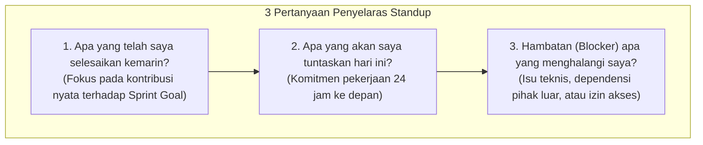
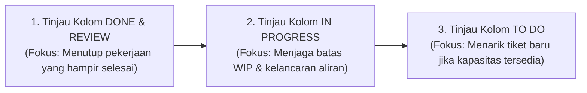
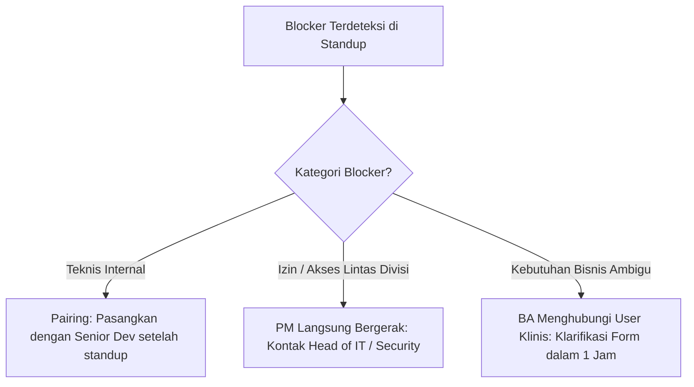

# Modul 01: Manfaat Daily Standup dan Ritme Tim (Benefits of Daily Standup & Team Rhythm)

Banyak organisasi atau tim pemula yang memandang **Daily Standup** (atau *Daily Scrum*) sebagai sekadar "absen kehadiran pagi" atau "sesi laporan status kepada bos". Akibatnya, standup berubah menjadi pertemuan yang kaku, memakan waktu 45 menit, membosankan, dan dihindari oleh tim pengembang.

Pada hakikatnya, Daily Standup adalah **pertemuan perencanaan taktis harian (*daily tactical planning*)** yang dirancang untuk menjaga tempo kerja tim, mendeteksi hambatan sebelum menjadi krisis, dan menumbuhkan rasa kepemilikan bersama (*collective accountability*).

---

## 1. Tiga Pertanyaan Inti & Pola Pikir Standup

Daily Standup dibatasi secara ketat maksimal **15 menit** dan secara fisik dilakukan sambil berdiri (*standing up*) untuk menjaga energi tetap ringkas dan fokus.



### Jebakan Umum Standup vs Pola Pikir yang Benar:

| Pola Pikir Salah (Status Meeting) | Pola Pikir Benar (Agile Sync) |
| :--- | :--- |
| Anggota tim berbicara menghadap ke Project Manager untuk melapor: *"Kemarin saya mengerjakan tiket 102."* | Anggota tim berbicara saling berhadapan satu sama lain sambil menatap papan Kanban: *"Kemarin saya menyelesaikan validasi query kasir, hari ini siap dites."* |
| Membahas perdebatan arsitektur teknis secara mendalam selama 20 menit di depan seluruh peserta. | Mengidentifikasi isu arsitektur dalam 30 detik, lalu memindahkannya ke **Parking Lot** untuk dibahas hanya oleh pihak terkait setelah standup bubar. |
| PM bertindak sebagai polisi absensi yang mencatat keterlambatan dan memarahi tim. | PM/Scrum Master bertindak sebagai fasilitator pelindung yang mencatat blocker untuk segera diselesaikan. |

---

## 2. Walk the Board: Membaca Papan dari Kanan ke Kiri

Salah satu teknik paling ampuh untuk menjaga efisiensi standup adalah teknik **Walk the Board**:



Dengan membaca papan dari kanan (*Done*) ke kiri (*To Do*), tim memprioritaskan penyelesaian pekerjaan yang sudah berjalan daripada terburu-buru memulai pekerjaan baru (*"Stop Starting, Start Finishing"*).

---

## 3. Menangani Blocker Secara Tanggap

Blocker bukanlah tanda kelemahan; blocker adalah data lapangan. Peran utama Project Manager saat standup adalah mendengarkan dengan jeli apa yang memperlambat laju tim:



---

## 4. Studi Kasus Riil: Menyelamatkan Sprint SIMRS Melalui Standup yang Disiplin

### Latar Belakang Kasus
- **Proyek**: Integrasi Bridging Surat Eligibilitas Peserta (SEP) BPJS Kesehatan RS Indriati.
- **Masalah**: Pada minggu pertama sprint, tim pengembang merasa mandek. Standup harian berlangsung 40 menit karena dua programmer selalu berdebat mengenai struktur JSON, sementara staf rekam medis yang hadir merasa bosan dan tidak mengerti.

### Intervensi oleh PM (Dessy Rahmawati Chairullina):
1. **Pemberlakuan Batasan Waktu 15 Menit Keras (*Hard Stop*)**:
   - Mengatur timer fisik di tengah meja. Setiap anggota hanya memiliki waktu berbicara maksimal 90 detik.
2. **Penerapan Aturan "Parking Lot"**:
   - Ketika perdebatan JSON terjadi, PM langsung menginterupsi sopan: *"Topik JSON ini sangat krusial, tapi mari kita parkir di Parking Lot. Doni dan Rian akan duduk bersama saya tepat pukul 09.00 setelah standup selesai."*
3. **Hasil**:
   - Durasi standup terpangkas dari 40 menit menjadi **11 menit**.
   - Blocker koneksi server sandbox terdeteksi pada hari ke-3 (bukan di akhir sprint), memungkinkan PM menghubungi tim IT BPJS cabang lebih awal.
   - Sprint selesai 100% tepat waktu dengan seluruh 24 tiket terdistribusi lancar.

---

## 5. Actionable Checklist Daily Standup Efektif

```
[ ] 1. Tepat Waktu: Standup dimulai pada jam yang sama setiap hari kerja tanpa menunggu anggota yang terlambat.
[ ] 2. Berdiri Fisik / Fokus Kamera: Seluruh peserta berdiri (atau menyalakan kamera) untuk menjaga energi dan fokus.
[ ] 3. Papan Terbuka: Papan Kanban (Jira/Trello/Physical Board) menjadi pusat perhatian visual utama.
[ ] 4. Disiplin Parking Lot: Segala diskusi teknis mendalam yang melibatkan < 3 orang langsung dipindahkan ke sesi lanjutan.
[ ] 5. Tindak Lanjut Blocker: PM memiliki daftar PIC dan batas waktu penyelesaian untuk setiap blocker yang muncul.
```
