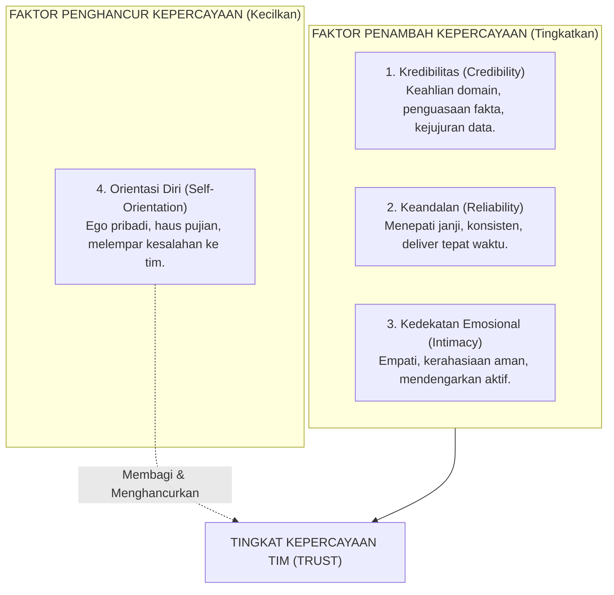
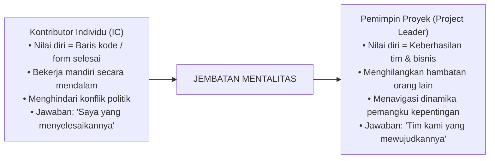

# Modul 02: Pelajari Cara Menjadi Pemimpin Proyek (Learning How to Lead Projects)

Banyak profesional mengawali kariernya sebagai kontributor individu yang sangat ahli di bidang teknis (*engineer, data analyst, desainer UI, atau staf klinis*). Namun, ketika mereka dipromosikan menjadi Project Manager (PM), keahlian teknis saja tidak lagi cukup. 

Menjadi manajer proyek menuntut pergeseran paradigma total: dari seseorang yang dinilai berdasarkan **apa yang ia hasilkan sendiri secara individual**, menjadi seorang pemimpin yang dinilai berdasarkan **bagaimana ia menginspirasi, memberdayakan, dan membimbing orang lain untuk berhasil bersama**.

---

## 1. Persamaan Kepercayaan (*The Trust Equation*)

Seorang pemimpin proyek tidak dapat memimpin tanpa kepercayaan dari tim dan pemangku kepentingan. Berdasarkan model David Maister, kepercayaan (*Trustworthiness*) dapat dirumuskan secara matematis:

$$\text{Kepercayaan (T)} = \frac{\text{Kredibilitas (C)} + \text{Keandalan (R)} + \text{Kedekatan Emosional (I)}}{\text{Orientasi Diri (S)}}$$



- **Jika Self-Orientation Anda tinggi** (misal: Anda selalu membanggakan diri sendiri di depan Direksi dan menyalahkan tim ketika ada bug), nilai kepercayaan tim kepada Anda akan jatuh mendekati nol, terlepas dari seberapa pintar Anda secara teknis.

---

## 2. Transisi Mental: Kontributor Individu ke Pemimpin



---

## 3. Empat Pilar Kepemimpinan Proyek Berkelanjutan

1. **Visionary Clarity (Kejelasan Visi)**:
   Mampu menjelaskan dengan bahasa sederhana mengapa proyek ini penting bagi masa depan organisasi dan kehidupan pengguna.
2. **Emotional Composure (Ketenangan di Bawah Tekanan)**:
   Ketika server down atau direksi marah, pemimpin adalah jangkar emosional tim. Jika pemimpin panik, seluruh tim akan lumpuh dalam ketakutan.
3. **Decisiveness (Keberanian Mengambil Keputusan)**:
   Tidak terjebak dalam *analysis paralysis*. Lebih baik mengambil keputusan 80% benar dengan cepat dan menyesuaikannya di lapangan, daripada menunda keputusan hingga peluang lewat.
4. **Radical Candor (Keterusterangan yang Peduli)**:
   Berani memberikan umpan balik korektif yang tajam secara privat karena benar-benar peduli pada perkembangan anggota tim, bukan untuk mempermalukan mereka.

---

## 4. Studi Kasus Riil: Kepemimpinan Krisis Saat Migrasi Database SIMRS

### Konteks Skenario
- **Pemimpin Proyek**: Dessy Rahmawati Chairullina, S.Kom.
- **Kondisi Krisis**: Pukul 02.30 WIB dini hari, saat proses migrasi database live rekam medis sedang berlangsung, terjadi kegagalan sinkronisasi tabel registrasi pasien rawat jalan. Waktu tinggal 3,5 jam sebelum loket pendaftaran pagi dibuka pukul 06.00 WIB.
- **Kondisi Tim**: Database administrator dan lead developer mulai panik, saling menyalahkan terkait skrip alter table yang belum teruji sempurna.

### Langkah Kepemimpinan yang Diambil:
1. **Mengambil Kendali Emosional Ruangan**:
   - PM berdiri, meminta semua orang berhenti mengetik selama 60 detik, dan mengambil napas bersama: *"Teman-teman, tenang. Masalah ini bisa kita selesaikan. Kita tidak sedang mencari siapa yang salah membuat skrip; fokus kita satu-satunya adalah memastikan jam 06.00 pasien bisa mendaftar."*
2. **Menerapkan Rencana Kontinjensi (*Rollback Decision*)**:
   - Menghitung waktu mundur (*Point of No Return*): Jika hingga pukul 04.00 perbaikan skrip belum stabil, PM secara tegas memutuskan eksekusi *rollback* ke snapshot database cadangan pukul 00.00.
3. **Melindungi Tim dari Interupsi Manajemen**:
   - Direktur Pelayanan menelepon dengan nada cemas. PM mengangkat telepon di luar ruangan, memberikan penjelasan terukur tanpa melibatkan tim teknis, sehingga tim dapat fokus 100% tanpa tekanan psikologis dari pejabat rumah sakit.
4. **Hasil**:
   - Pada pukul 03.45 WIB, skrip perbaikan berhasil disinkronisasi ulang dan seluruh tabel lolos verifikasi integritas data.
   - Pukul 06.00 WIB loket dibuka tepat waktu tanpa ada satu pun pasien yang menyadari ketegangan semalam.
   - Anggota tim menyatakan respek mendalam karena PM melindungi mereka dari kemarahan eksekutif dan tetap tenang di masa krisis.

---

## 5. Actionable Checklist Kepemimpinan Proyek

```
[ ] 1. Evaluasi Self-Orientation: Apakah dalam laporan status mingguan Anda lebih banyak menyebut kontribusi anggota tim dibanding nama Anda sendiri?
[ ] 2. Praktik Radical Candor: Apakah Anda berani menyampaikan kebenaran data yang pahit kepada atasan secara sopan namun tegas?
[ ] 3. Jangkar Ketenangan: Ketika krisis P1 terjadi, apakah reaksi pertama Anda adalah menenangkan ruangan dan mengisolasi masalah?
[ ] 4. Kepemilikan Penuh (Extreme Ownership): Apakah Anda siap memikul akuntabilitas penuh atas kegagalan proyek di depan manajemen, sekaligus membagikan kredit keberhasilan kepada tim?
[ ] 5. Pengembangan Rekan: Apakah Anda telah meluangkan waktu untuk melatih atau membimbing minimal satu anggota tim junior minggu ini?
```
