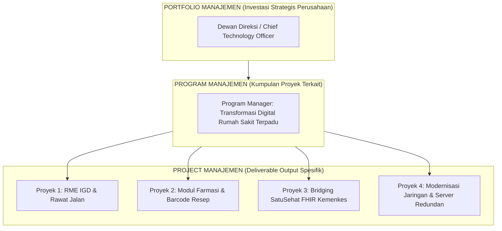
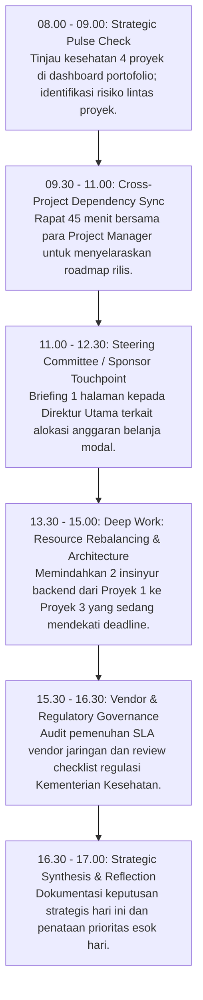
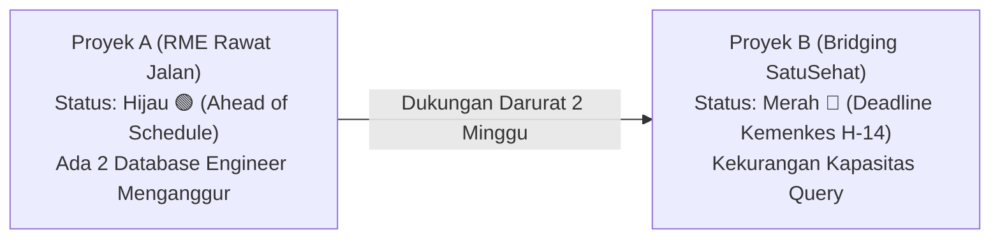

# Modul 03: Sehari dalam Kehidupan Seorang Manajer Program (A Day in the Life of a Program Manager)

Banyak profesional di industri teknologi dan korporasi sering bertanya-tanya: *"Apa perbedaan mendasar antara Project Manager (PM) dan Program Manager (PgM)?"*

Secara sederhana:
- **Project Manager (PM)** mengelola **satu proyek spesifik** dengan ruang lingkup, jadwal, dan anggaran yang telah ditentukan (*fokus pada output deliverable*).
- **Program Manager (PgM)** mengelola **sekumpulan proyek yang saling terkait (*a portfolio of related projects*)** untuk mencapai tujuan strategis bisnis jangka panjang yang tidak bisa diraih jika proyek-proyek tersebut dikerjakan secara terpisah (*fokus pada outcome & organizational transformation*).

Menjadi Program Manager menuntut kemampuan berpikir sistemik (*systems thinking*), navigasi politik tingkat tinggi, serta kemampuan mengorkestrasi ketergantungan lintas divisi.

---

## 1. Arsitektur Perbandingan: Project vs Program vs Portfolio



| Dimensi | Project Manager (PM) | Program Manager (PgM) |
| :--- | :--- | :--- |
| **Fokus Utama** | Menghasilkan produk / sistem yang berfungsi sesuai spesifikasi (*Deliverables*). | Mewujudkan manfaat bisnis strategis dan pertumbuhan pendapatan (*Business Outcomes & ROI*). |
| **Rentang Waktu** | Jangka pendek - menengah (3 hingga 9 bulan). | Jangka panjang - multi tahun (1 hingga 3 tahun). |
| **Metrik Keberhasilan** | Tepat waktu, sesuai anggaran, lingkup terpenuhi (Triple Constraint). | Adopsi budaya organisasi, kepatuhan regulasi nasional, efisiensi arus kas. |
| **Manajemen Dependensi**| Dependensi internal antar-tugas teknis dalam tim. | Dependensi antar-proyek (Jika Proyek 4 terlambat, Proyek 3 tidak bisa go-live). |

---

## 2. Ritme Kerja 24 Jam Seorang Program Manager

Berikut adalah gambaran nyata alur kerja sehari-hari seorang Program Manager yang mengorkestrasi transformasi enterprise:



---

## 3. Keterampilan Super: Systems Thinking & Resource Rebalancing

Tantangan terbesar Program Manager adalah **Alokasi Sumber Daya Dinamis (*Dynamic Resource Balancing*)**. Ketika salah satu proyek dalam program menghadapi krisis, PgM tidak bisa sekadar meminta anggaran tambahan ke direksi; PgM harus mampu memindahkan kapasitas dari proyek yang sedang longgar:



Dengan memindahkan sumber daya secara cair antar-proyek, Program Manager menyelamatkan reputasi seluruh organisasi tanpa membakar biaya anggaran baru.

---

## 4. Studi Kasus Riil: Mengorkestrasi Program Transformasi Digital RS Indriati

### Skenario Lapangan
- **Program Manager**: Dessy Rahmawati Chairullina, S.Kom.
- **Nama Program**: Transformasi Digital & Interoperabilitas Kesehatan Terpadu.
- **Cakupan Program**: Mengawasi 4 proyek simultan dengan 18 pemangku kepentingan kunci.
- **Krisis Dependensi**: Proyek Bridging SatuSehat (Proyek 3) terancam gagal rilis karena Proyek Modernisasi Server (Proyek 4) mengalami keterlambatan pengiriman perangkat keras switch network selama 2 minggu.

### Intervensi Strategis oleh Program Manager:
1. **Mengidentifikasi Efek Domino**:
   - Jika Proyek 4 dibiarkan terlambat secara pasif, Proyek 3 akan gagal memenuhi batas waktu audit Kementerian Kesehatan, yang berisiko menurunkan status akreditasi rumah sakit.
2. **Manuver Solusi Arsitektur Hibrida**:
   - PgM tidak menunggu switch fisik tiba. PgM berkoordinasi dengan lead engineer untuk menyewa server cloud privat sementara (*Virtual Private Cloud*) selama 30 hari untuk lingkungan *staging* dan pengujian sandbox SatuSehat.
   - Anggaran sewa cloud (Rp 8.000.000) diambil dari efisiensi sisa anggaran Proyek 1 yang berhasil menghemat biaya lisensi.
3. **Hasil Penyelarasan**:
   - Pengujian bridging SatuSehat berhasil diselesaikan 5 hari sebelum batas waktu kementerian.
   - Ketika switch network fisik tiba 2 minggu kemudian, infrastruktur lokal tinggal melakukan *switchover* mulus tanpa mengganggu jadwal akreditasi nasional.

---

## 5. Actionable Checklist Program Manager

```
[ ] 1. Peta Dependensi Lintas Proyek: Apakah Anda memiliki visualisasi peta yang menunjukkan dependensi kritis antara Proyek A, B, dan C?
[ ] 2. Alokasi Sumber Daya Fleksibel: Apakah Anda memiliki visibilitas atas beban kerja seluruh insinyur di bawah portofolio Anda untuk memindahkan bantuan saat krisis?
[ ] 3. Bahasa C-Suite: Apakah laporan kemajuan Anda berfokus pada hasil strategis organisasi (EBITDA, kepatuhan hukum, kepuasan pasien), bukan sekadar tiket fitur?
[ ] 4. Audit Tata Kelola Vendor: Apakah seluruh vendor pihak ketiga di bawah program Anda dipantau dengan matriks SLA yang terintegrasi?
[ ] 5. Penyelarasan Sponsor: Apakah Anda menjadwalkan touchpoint rutin 15 menit setiap 2 minggu dengan Project Sponsor utama?
```
