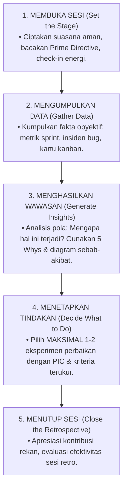
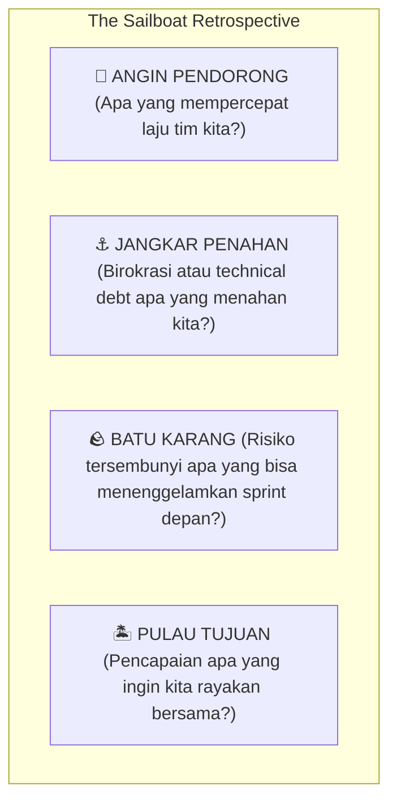

# Modul 04: Tips untuk Retrospektif yang Sukses (Tips for High-Impact Retrospectives)

Di akhir setiap sprint atau fase proyek, tim Agile berkumpul untuk melakukan **Sprint Retrospective**. Tujuan utamanya sederhana namun mendalam: mengevaluasi bagaimana cara tim bekerja, mengidentifikasi apa yang berhasil, dan menentukan apa yang perlu diperbaiki pada siklus berikutnya.

Namun di banyak organisasi, retrospektif sering kali mengalami degenerasi menjadi salah satu dari dua malapetaka:
1. **Sesi Keheningan Kaku (*The Silent Meeting*)**: Seluruh peserta diam menatap lantai, tidak ada yang berani berbicara jujur karena takut menyinggung rekan atau atasan.
2. **Sesi Curhat Tanpa Aksi (*The Whining Session*)**: Setiap orang mengeluh dan saling menyalahkan, namun tidak ada satu pun tindakan perbaikan konkret yang dieksekusi di sprint berikutnya.

Retrospektif yang sukses adalah **katalisator utama perbaikan berkelanjutan (*Continuous Improvement Engine*)**.

---

## 1. Lima Tahap Retrospektif Esther Derby & Diana Larsen

Retrospektif kelas dunia dirancang melalui 5 fase psikologis yang terstruktur:



---

## 2. Pilihan Format Kreatif: Mencegah Kebosanan Tim

Jangan menggunakan format yang sama setiap dua minggu. Variasikan instrumen retrospektif agar otak tim tetap segar dan terstimulasi:



### Alternatif Format Populer:
- **Mad - Sad - Glad**: Sangat cocok saat tim baru saja melewati sprint yang emosional atau krisis berat (*Mad* = yang membuat marah, *Sad* = yang mengecewakan, *Glad* = yang membanggakan).
- **4Ls (Liked, Learned, Lacked, Longed For)**: Sangat cocok untuk mengidentifikasi kebutuhan pelatihan tim dan kekurangan alat bantu kerja.

---

## 3. Hukum Emas: Batasi Maksimal 2 Action Items

Kesalahan paling fatal dari fasilitator retrospektif adalah menghasilkan daftar 15 perbaikan sekaligus. Pada akhirnya, tidak ada satu pun dari 15 perbaikan itu yang dikerjakan karena tim kewalahan dengan beban kerja sprint baru.

```
+-----------------------------------------------------------------------------------+
|               PRINSIP SMART ACTION ITEM DALAM RETROSPEKTIF                        |
+-----------------------------------------------------------------------------------+
| 1. BATAS KERAS: Maksimal 1 hingga 2 komitmen perbaikan per sprint.                |
| 2. JADIKAN TIKET RESMI DI SPRINT BOARD: Action Item retrospektif WAJIB dimasukkan |
|    sebagai kartu tugas resmi di Jira/Kanban sprint berikutnya, bukan dibiarkan    |
|    tersimpan di catatan notulensi yang terlupakan.                                |
| 3. ASSIGN PIC TUNGGAL: Setiap action item harus memiliki satu nama penanggung     |
|    jawab (Directly Responsible Individual - DRI).                                 |
+-----------------------------------------------------------------------------------+
```

---

## 4. Studi Kasus Riil: Mengubah Retrospektif Pasif Menjadi Terobosan Kecepatan Rilis

### Latar Belakang Kasus
- **Tim**: 5 Pengembang Java/DB, 1 Analis Klinis, 1 QA Tester RS Indriati.
- **Masalah**: Pada 3 sprint awal, proses testing manual form rawat jalan selalu molor, memicu lembur di malam sebelum rilis. Pada rapat retro, anggota tim hanya diam dan berkata: *"Semuanya aman kok, Bu."*

### Intervensi Fasilitasi oleh PM (Dessy Rahmawati Chairullina):
1. **Membangun Anonimitas Awal**:
   - PM menggunakan papan digital (atau sticky notes fisik tanpa nama) di mana anggota menuliskan keluhan secara anonim selama 5 menit.
2. **Fakta Terungkap**:
   - Ditemukan keluhan: *"Setiap kali mau testing, kami harus menginput ulang 20 data master pasien secara manual di database lokal karena tidak ada data dummy otomatis. Ini membuang waktu 3 jam per orang."*
3. **Penyusunan Action Item Tunggal**:
   - **Tindakan**: Membuat skrip SQL seeder otomatis (*Database Fixture*) yang mengisi 100 data pasien sampel dalam 5 detik.
   - **PIC**: Lead Database Developer.
   - **Deadline**: Hari ke-3 sprint berikutnya.
4. **Hasil**:
   - Waktu penyiapan pengujian terpangkas dari **3 jam menjadi 5 detik**.
   - Kecepatan penyelesaian pengujian QA meningkat 60%, dan tim tidak pernah lagi lembur di malam sebelum rilis.

---

## 5. Actionable Checklist Retrospektif Berdampak Tinggi

```
[ ] 1. Bacakan Prime Directive: Apakah Anda selalu menegaskan di awal bahwa sesi ini bertujuan memperbaiki sistem, bukan menghakimi orang?
[ ] 2. Variasikan Format: Apakah format retro berbeda dari format 2 minggu yang lalu?
[ ] 3. Suara Merata: Apakah anggota tim yang paling pendiam sudah diberikan kesempatan berbicara tanpa diinterupsi oleh anggota yang dominan?
[ ] 4. Maksimal 2 Action Items: Apakah hasil retrospektif disaring menjadi maksimal 2 poin perbaikan yang realistis?
[ ] 5. Review Retro Sebelumnya: Apakah Anda memulai retro hari ini dengan memeriksa status eksekusi action item dari retro sprint lalu?
```
