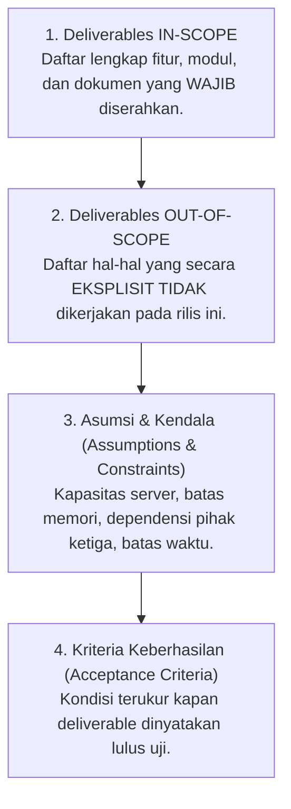
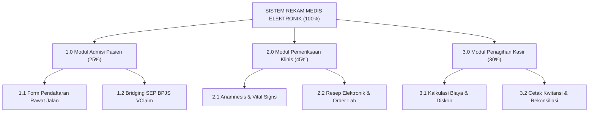

# Modul 05: Pentingnya Lingkup Kerja yang Terdefinisi (The Critical Importance of Well-Defined Scope)

Dalam dunia manajemen proyek, ada pepatah klasik: *"Jika Anda tidak tahu pasti apa yang sedang Anda bangun, Anda tidak akan pernah tahu kapan Anda selesai, berapa biayanya, atau apakah yang Anda buat itu benar."*

Ambiguitas ruang lingkup (*Scope Ambiguity*) adalah pembunuh nomor satu dari keberhasilan proyek. Banyak proyek dimulai dengan kalimat-kalimat umum yang terlihat mulia seperti: *"Kita akan membangun sistem pendaftaran rumah sakit modern kelas dunia."* Namun kalimat tersebut tidak memberikan definisi teknis operasional apa pun. 

Bagi dokter, "modern" berarti form selesai dalam 1 detik; bagi akuntan, berarti laporan keuangan otomatis; bagi pasien, berarti aplikasi mobile; dan bagi pengembang, berarti arsitektur backend terbaru. Tanpa batas lingkup yang tegas, proyek dijamin akan tenggelam dalam perselisihan tanpa akhir.

---

## 1. Anatomi Dokumen Batasan Lingkup (*Scope Statement*)

Dokumen definisi lingkup kerja yang kuat harus memiliki 4 pilar yang tidak dapat dinegosiasikan:



### Kekuatan Magis "Out-of-Scope":
Mendefinisikan apa yang **TIDAK** Anda kerjakan sering kali jauh lebih penting daripada mendefinisikan apa yang Anda kerjakan. Bagian *Out-of-Scope* adalah perisai pelindung utama Anda dari tuntutan liar pemangku kepentingan di tengah jalan.

| Contoh In-Scope (Dikerjakan) | Contoh Out-of-Scope (TIDAK Dikerjakan) |
| :--- | :--- |
| Form input pemeriksaan fisik dokter rawat jalan di laptop workstation poli. | Aplikasi mobile mandiri berbasis Android/iOS untuk pasien umum. |
| Integrasi bridging pencarian nomor kartu BPJS secara online. | Integrasi mesin pembayaran kartu kredit otomatis pihak ketiga (EDC). |
| Migrasi data rekam medis aktif 12 bulan terakhir. | Migrasi arsip dokumen fisik pasien 10 tahun lalu yang belum terdigitalisasi. |

---

## 2. Work Breakdown Structure (WBS) & Aturan 100% (*100% Rule*)

WBS adalah proses dekonstruksi hierarkis dari tujuan proyek besar menjadi paket-paket pekerjaan (*work packages*) yang dapat dikelola dan diestimasi dengan akurat:



### Aturan 100% (*The 100% Rule*):
WBS harus mencakup **tepat 100% dari seluruh pekerjaan yang disepakati** dalam piagam proyek—tidak kurang dan tidak lebih. Anak cabang dari setiap elemen harus berjumlah 100% dari induknya. Jika sesuatu tidak ada di dalam WBS, maka hal tersebut secara resmi berada di luar cakupan proyek (*Out-of-Scope*).

---

## 3. Tingkat Granularitas Paket Kerja: Aturan 8/80

Kapan sebuah tugas dianggap sudah cukup dipecah di WBS?
- **Batas Bawah (8 Jam)**: Jangan memecah tugas menjadi detail konyol di bawah 8 jam (misal: *"Mengetik tombol simpan 15 menit"*). Hal ini memicu *micromanagement*.
- **Batas Atas (80 Jam)**: Tidak boleh ada satu paket kerja yang berdurasi lebih dari 80 jam (sekitar 2 minggu kerja untuk 1 orang) tanpa dipecah lebih lanjut. Jika paket kerja terlalu besar, Anda tidak akan bisa mendeteksi keterlambatan hingga sudah terlambat 2 minggu.

---

## 4. Studi Kasus Riil: Menghentikan Scope Creep Rp 200 Juta pada Proyek IGD

### Skenario Lapangan
- **Inisiatif**: Digitalisasi Formulir Asesmen Triase IGD RS Indriati.
- **Tenggat Waktu**: 6 Minggu. Pagu Anggaran: Rp 75.000.000.
- **Tekanan Lapangan**: Di minggu ke-3, Kepala Instalasi Laboratorium mendatangi tim developer dan menuntut agar modul IGD langsung terhubung ke mesin analisis darah otomatis di laboratorium sentral, mengklaim bahwa *"IGD tidak ada gunanya kalau hasil lab darah tidak muncul otomatis di layar dokter!"*

### Intervensi oleh Lead BA / PM (Dessy Rahmawati Chairullina):
1. **Memeriksa Piagam Lingkup yang Telah Ditandatangani**:
   - PM membuka dokumen Scope Baseline resmi yang ditandatangani Direktur Medis di awal proyek.
   - Pada poin 2.3 tertera jelas: *"Otomatisasi antarmuka mesin laboratorium sentral (LIS) berstatus OUT-OF-SCOPE pada Fase 1 dan dijadwalkan pada Roadmap Transformasi Fase 2 tahun depan."*
2. **Kalkulasi Biaya & Waktu Bila Diakomodasi Sekarang**:
   - Menghubungkan mesin LIS membutuhkan pembelian lisensi middleware vendor senilai Rp 200 Juta dan waktu pengerjaan 8 minggu tambahan.
3. **Penyampaian Diplomatis Berbasis Fakta**:
   - PM menemui Kepala Laboratorium bersama Direktur Medis: *"Dokter, integrasi LIS adalah inovasi yang sangat luar biasa. Namun, jika kita masukkan sekarang, peluncuran IGD yang sudah ditunggu pasien minggu depan harus ditunda 2 bulan dan membutuhkan anggaran baru Rp 200 Juta. Kami telah merancang modul IGD ini dengan tombol input hasil lab manual yang sangat cepat (hanya 5 detik), dan integrasi otomatis mesin LIS akan menjadi agenda utama kita di kuartal berikutnya."*
4. **Hasil**:
   - Kepala Laboratorium memahami batasan tersebut dan menyetujui rilis bertahap.
   - Modul IGD meluncur sukses tepat pada minggu ke-6 tanpa pembengkakan anggaran satu rupiah pun.

---

## 5. Actionable Checklist Pengendalian Ruang Lingkup

```
[ ] 1. Dokumen Scope Disahkan: Apakah Project Scope Statement telah disahkan oleh Sponsor dan Business Owner sebelum pengerjaan kode dimulai?
[ ] 2. Daftar Out-of-Scope Eksplisit: Apakah dokumen Anda secara gamblang menyebutkan minimal 5 fitur yang TIDAK akan dibangun pada rilis ini?
[ ] 3. WBS Mematuhi Aturan 100%: Apakah dekonstruksi WBS sudah mencakup seluruh deliverable tanpa ada yang tersembunyi?
[ ] 4. Granularitas 8/80 Terpenuhi: Apakah setiap paket kerja berada dalam rentang estimasi 8 hingga 80 jam kerja?
[ ] 5. Batasan Perubahan Disepakati: Apakah seluruh pemangku kepentingan memahami bahwa setiap permintaan baru di tengah jalan wajib melalui proses Change Control resmi?
```
